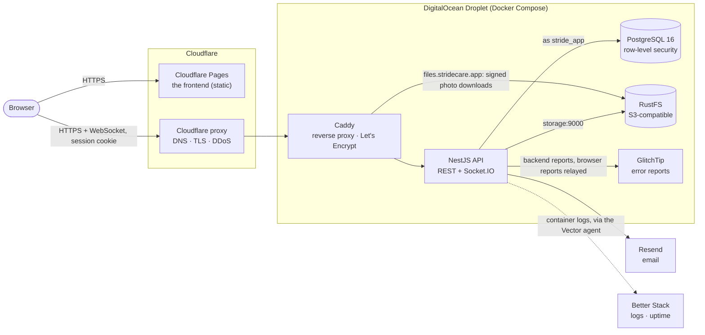
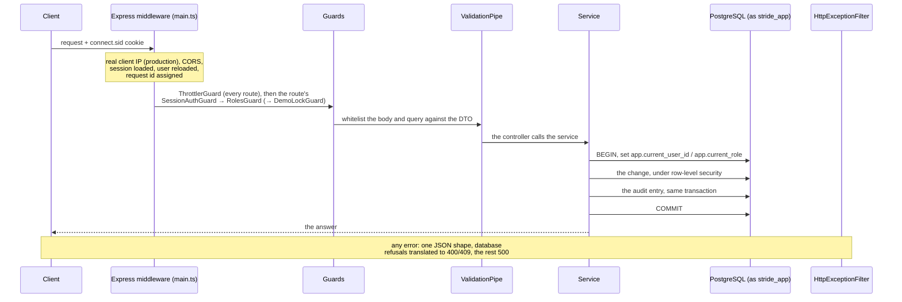

## docs/api/01-authentication.md

````markdown
# Authentication & Sessions

Source of truth:
[`src/auth/`](../../src/auth/) (sign-in, sign-out, role switch, password
reset), [`src/mfa/`](../../src/mfa/) (two-factor sign-in, re-confirmation),
[`src/password-change/`](../../src/password-change/),
[`src/email-change/`](../../src/email-change/),
[`src/invitations/`](../../src/invitations/),
[`src/common/guards/`](../../src/common/guards/),
[`src/auth/strategies/session.serializer.ts`](../../src/auth/strategies/session.serializer.ts),
[`src/main.ts`](../../src/main.ts). Tests:
[`test/auth.e2e-spec.ts`](../../test/auth.e2e-spec.ts),
[`test/auth-recovery.e2e-spec.ts`](../../test/auth-recovery.e2e-spec.ts),
[`test/mfa.e2e-spec.ts`](../../test/mfa.e2e-spec.ts),
[`test/step-up-failures.e2e-spec.ts`](../../test/step-up-failures.e2e-spec.ts),
[`test/invitations.e2e-spec.ts`](../../test/invitations.e2e-spec.ts),
[`test/password-change.e2e-spec.ts`](../../test/password-change.e2e-spec.ts),
[`test/email-change.e2e-spec.ts`](../../test/email-change.e2e-spec.ts).

## This is cookie auth, not token auth

There is no `Authorization` header, no JWT and no bearer token anywhere in
this API. Authentication is one `httpOnly` session cookie, `connect.sid`,
issued by [`express-session`](https://www.npmjs.com/package/express-session).
The sessions themselves live in Postgres (a `session` table managed by
`connect-pg-simple`, on a connection pool of its own).

For a frontend, that means:

- **Send every request with credentials**: `fetch(url, { credentials:
  'include' })`, or `withCredentials: true` with axios. Without it the
  browser neither stores nor sends the cookie, and every request looks like
  a signed-out visitor's.
- **CORS trusts an explicit list of origins, never a wildcard.** The API
  answers with credentials only to the origins in `FRONTEND_URLS`
  (comma-separated; [`src/config/allowed-origins.ts`](../../src/config/allowed-origins.ts)).
  The CORS rules forbid pairing credentials with `*`, so the frontend's
  exact origin (scheme, host and port) must be in the list.
- **There is nothing to store.** No response carries a token, so there's
  nothing to keep in `localStorage` (where any script on the page could read
  it). JavaScript never sees the cookie.
- **Cookie attributes** ([`src/main.ts`](../../src/main.ts)): `httpOnly`
  always. In production, `secure: true` and `sameSite: 'none'`; in
  development, `secure: false` and `sameSite: 'lax'`, so plain
  `http://localhost` works.
- **A session lasts 7 days from sign-in**, and isn't extended by activity
  (no `rolling` option). After that, the person signs in again.
- **A session stops working at once** when its account is deactivated or
  loses the session's active role. Every request reloads the account
  (`SessionSerializer.deserializeUser`) and treats such a session as signed
  out.

## A Nest default worth knowing: `POST` answers `201`

A `POST` route without `@HttpCode` answers `201 Created`, even when it
creates nothing: `login`, `mfa/verify` and `switch-role` all answer `201`.
A client that checks `status === 200` to detect a successful sign-in will
read every success as a failure. Check `response.ok`, or the exact status
in the [endpoint index](./06-endpoints.md).

## Accounts are invited, not registered

There is **no public sign-up**. `POST /auth/register` was removed with
invitations: a self-registered patient belonged to no clinic, so no one
could see or treat them. An account is created by someone already in Stride:

- an **admin** creates practitioners, patients and other admins;
- a **practitioner** creates patients, and joins their care team.

That's `POST /users`. The new account has **no password**: it gets an
invitation email, and the person chooses their password from its link.

### The very first account: `POST /auth/register-clinic`

Creates the first clinic and its founding admin in one transaction, then
signs the admin in (`201`, with the admin and the new `clinicId`). It's
**one-time**: once any admin exists, it answers `403` for good. Later
clinics are created with `POST /clinics`, and later accounts with
`POST /users`.

`GET /auth/setup-status` (public) tells the sign-in page which case it's
in:

```json
{ "setupComplete": true, "demo": null }
```

`demo` is `null` except on the reviewers' demo deployment (`DEMO_MODE`).
There it holds the shared demo accounts, their password, the two-factor
account's key, and the reset schedule, for the sign-in page's "For
reviewers" card. Those values are public on purpose.

### Accepting an invitation

The invitation link carries a random 256-bit token. Only its SHA-256 hash
is stored, so a leaked database can't be used to accept anyone's
invitation. The token always travels in the **body**, never in a URL the
server would log.

1. `POST /invitations/lookup` `{ token }`: `200` with what the accept page
   shows (`email`, `firstName`, `lastName`, `clinicNames`, `expiresAt`). An unknown token answers
   `404`. One that can't be used any more answers `410`, with `reason`
   `accepted`, `revoked` or `expired`.
2. `POST /invitations/accept` `{ token, password }`: `204`. The password is
   set, and the person then signs in normally.

An invitation is valid for **7 days**, and accepting it is single-use (one
conditional `UPDATE`: two tabs accepting at once can't both succeed). An
admin, or a practitioner on the patient's care team, can send a new one
(`POST /users/:id/invitations`, which closes the open one) or revoke it
(`POST /users/:id/invitations/revoke`). `GET /users/:id/invitations` shows
its state.

Until the invitation is accepted, the account can't sign in (it fails like
a wrong password) and can't ask for a password reset (that would be a way
around the invitation).

## Login: single-role vs. multi-role accounts

`POST /auth/login` `{ email, password, role? }`. The email is matched
without regard to case. The rules are in `AuthService.validateUser`:

| Case | Answer |
|---|---|
| No account with this email, a wrong password, or an account whose invitation isn't accepted yet | `401 Invalid email or password`: the same status and words for all three, so the answer doesn't reveal which. A failed attempt against a real account is audited (`LOGIN_FAILURE`). |
| The right password for a **deactivated** account | `401 This account has been deactivated`. Checked *after* the password, so someone without the password can't learn the account's state. |
| One role, no `role` sent | Signed in, in that role. |
| Several roles, no `role` sent | `400`, with `roles` listing them: `{ "message": ["This account has multiple roles. Specify which one to log in as."], "roles": ["practitioner", "patient"], … }`. Ask the person, then send the same request with `role`. |
| `role` sent, but the account doesn't hold it | `403 This account does not have the "<role>" role` |
| Two-factor sign-in is on | `201 { "mfaRequired": true }`. The session is **not** signed in yet: see below. |
| Otherwise | `201` with the signed-in user (the same shape as [`GET /auth/me`](#get-authme-who-am-i)) |

**The same answer, in the same time.** The three failures in the first
row also take as long as each other. An unknown email, or an account with
no password yet, is still checked against a dummy bcrypt hash of the same
cost ([`src/common/password-hashing.ts`](../../src/common/password-hashing.ts)),
so every refusal pays one bcrypt comparison (about 70 ms here). Until
2026-11-03 an unknown email answered at once: 6 ms against 75 ms for a
wrong password, measured on a local server. Timing a few attempts could
then tell whether an address has an account. Measured after the fix: 70 ms
against 72 ms. The remaining couple of milliseconds is the audit entry
written for a failed attempt against a real account, well inside ordinary
network jitter.

## Two-factor sign-in

If the account has two-factor sign-in on, a correct password doesn't sign
the session in. `POST /auth/login` stores a *pending* marker in the session
(`mfaPending`), separate from the one Passport checks, and answers
`{ mfaRequired: true }`. Until the second step succeeds, every guarded
route still answers `401`.

**`POST /auth/mfa/verify`** `{ code }` (no guard: the session isn't
signed in yet; the pending marker is the check):

- `code` is either the **6-digit code** from the authenticator app (TOTP,
  RFC 6238) or one of the account's **recovery codes** (`xxxxx-xxxxx`).
  Spaces around it are trimmed.
- Success: `201` with the signed-in user, in the role chosen at the
  password step.
- A wrong or already-used code: `401`, with words saying which. **No code
  works twice**: each app code is accepted once, and a recovery code is
  spent when used. The pending marker stays, so the person can type the
  next code without re-entering the password.
- No pending sign-in in this session: `400`.

Signing in with a recovery code is audited (`MFA_RECOVERY_CODE_USED`), and
the account's owner gets an email about it.

### Turning two-factor on, and off

| Step | Route | Body | Answer |
|---|---|---|---|
| 1. Start | `POST /auth/mfa/setup` | `currentPassword` | `201` with the new secret and its QR code, shown **once** |
| 2. Confirm | `POST /auth/mfa/enable` | `code`: a 6-digit code from the app, proving it holds the secret | `200` with **10 recovery codes**, shown once (only their keyed hashes are stored). Every *other* session of the account is signed out. |
| Codes left | `GET /auth/mfa/recovery-codes` | — | `200 { "remaining": 7 }` |
| New codes | `POST /auth/mfa/recovery-codes` | `currentPassword`, `code` | `201` with 10 new codes; the old ones stop working |
| Turn off | `POST /auth/mfa/disable` | `currentPassword`, `code` | `204` |

An admin can turn off someone else's two-factor sign-in, for a person who
lost their phone and their codes: `POST /users/:id/mfa/reset`. The admin
re-confirms with *their own* password, plus their own code if their
account has two-factor on. The person's sessions are signed out.

The secret is stored encrypted (AES-256-GCM, with a key held in the
server's environment, not in the database).

## Re-confirming before sensitive changes ("step-up")

A signed-in session proves someone signed in at some point, not that the
account's owner is at the keyboard now. So the changes that could hand the
account to someone else ask again:

- **the current password**, always;
- **and a second factor** (an app code or a recovery code) when the account
  has two-factor on. The field is `code` on the two-factor routes and
  `mfaCode` on the others.

The routes that ask: changing the email, changing the password, new
recovery codes, turning two-factor off, and an admin's two-factor reset.
Starting set-up asks the password alone, since two-factor is still off at
that point.

- A wrong password: `400 Your current password is not correct`. A missing,
  wrong or used second factor is also a `400`, with words saying which.
- **Five failures in a row sign the session out.** The fifth answers `401`,
  with words explaining why. The rate limit slows guessing from one
  address, but a stolen session could otherwise keep trying for hours from
  several. Each failure is audited (`STEP_UP_FAILED`). A success resets the
  count.
- A code that passed is spent even if the change then fails, so it can't be
  replayed: RFC 6238 says a validated code must not be accepted again.

## Switching roles on a multi-role account

`POST /auth/switch-role` `{ role }`: `201` with the user in the new role.
It changes the active role **of this session only**, without signing out:

- The account must hold the role (`403` otherwise).
- The switch is audited (`ROLE_SWITCHED`), because the role decides what
  data the session can read.
- The session gets a **new id** (Passport regenerates it, against session
  fixation). Its open WebSocket connections are closed, since each keeps
  the role it connected with. The client reconnects and gets a socket for
  the new role ([WebSocket API](./02-websocket-api.md#connecting)).

## Logout

`POST /auth/logout`: `204`. It destroys the session, clears the cookie,
closes the session's sockets, and audits `LOGOUT`. It has no guard: a
signed-out caller gets the same `204`.

## Passwords

### Forgot / reset

| Route | Body | Answer |
|---|---|---|
| `POST /auth/forgot-password` | `email` | **Always `204`**, whether an account matched or not. Only an **active** account that has a password gets an email. One still waiting for its invitation doesn't, and neither does a deactivated one: reactivating the account is the way back. The email is sent *after* answering, so the answer doesn't wait for the mail server (that wait used to reveal a real account: journal entry 28). |
| `POST /auth/reset-password/check` | `token` | `200 { email, expiresAt }` if the link is still usable, otherwise the reset's own `400`. The reset page asks first, so a dead link is reported before anyone types a password. |
| `POST /auth/reset-password` | `token`, `newPassword` (8–128 characters) | `204`. **Every session of the account is signed out**, since someone else may have had access. |

The reset token is random (256 bits), stored as a SHA-256 hash, valid for
**1 hour**, and single-use. A newer request replaces it. If the account is
deactivated in the meantime, the link stops working, with the same "invalid
or has expired" words as any dead link.

### Change (signed in)

`POST /auth/password` `{ currentPassword, newPassword, mfaCode? }`: `204`.
It's a step-up route (above). Every other session of the account is signed
out; this one stays signed in.

## Changing the email address

The new address must be proven before it replaces the old one, and the old
address hears about it:

| Route | Who | Answer |
|---|---|---|
| `POST /auth/email-change` `{ newEmail, currentPassword, mfaCode? }` | signed in (step-up) | `201 { pending }`. **The same answer whether the address is free or already taken**, so the route can't be used to discover accounts. The new address gets a confirmation link (or, if it's taken, an email saying so). The old address gets a notice with a cancel link. |
| `GET /auth/email-change` | signed in | `200 { pending }`: the open request, or `null` |
| `DELETE /auth/email-change` | signed in | `204`: cancels the open request |
| `POST /auth/email-change/confirm` `{ token }` | public (the link from the new inbox) | `200 { email }`. The address changes, and the account's other sessions are signed out. |
| `POST /auth/email-change/cancel` `{ token }` | public (the link from the old inbox) | `204` |

A request is valid for **24 hours**. A new request replaces the open one.

## `GET /auth/me`: who am I?

`200` with the signed-in user. It's built by the same function as every
user in every response (`UsersService.toPublic`), plus the settings only
the owner may read (`toSelf`):

- the account's own fields (`id`, `email`, names, `phone`, address fields,
  `isActive`, `mfaEnabled`…);
- `roles` (every role held) and `activeRole` (this session's);
- a profile per role: `practitionerProfile` (`licenseNumber`,
  `specialties`, `bio`), `patientProfile` (`dateOfBirth`), `adminProfile`
  (`position`);
- `avatarUrl`: a **presigned URL** the browser can load directly, valid
  for a limited time, or `null`;
- `readableFont`: the owner's "easier-to-read font" setting, sent only to
  the owner.

**Never in any response:**

- `passwordHash`;
- the two-factor secret, and the time the last code was used;
- the step-up failure count;
- the reset token's hash and expiry;
- the photo's storage key. `avatarPath` is replaced by `avatarUrl`: where a
  file lives in storage is an internal detail.

One function strips these for every route, rather than one copy per route.
Two copies of a security rule drift apart; this happened once, when login
had its own copy and leaked the reset-token fields.

## When a session is signed out by the server

| Event | Which sessions end |
|---|---|
| Logout | this one |
| Password reset (forgot-password link) | **all** of the account's |
| Password change, two-factor turned on, email change confirmed | all **but** the one making the change |
| An admin's two-factor reset, a deactivation, a patient merge | the target account's |
| Five failed step-ups in a row | the one that failed them |
| A role switch | none, but this session gets a new id and its sockets are closed |

Each time, the ended sessions' WebSocket connections are closed too.

## `401` vs `403` vs `404`

- **`401 Unauthorized`**: no signed-in session (or one that just ended). The
  frontend's answer is to go to sign-in. `SessionAuthGuard` says `You must
  be logged in to access this resource`.
- **`403 Forbidden`**: signed in, but not allowed. That's either the wrong
  *active role* for the route (`RolesGuard`: `You do not have permission to
  access this resource`), or a service rule (for example, writing to a
  conversation whose care-team link has ended).
- **`404 Not Found`**, often *instead of* `403`. Row-Level Security makes
  rows the caller has no relationship with **invisible**, not forbidden. A
  practitioner asking for a patient outside their care team gets the same
  `404` as for an id that doesn't exist. That's deliberate: a `403` would
  confirm that the record exists. [Roles & Authorization](./04-authorization.md)
  explains where each applies.

````

## docs/api/02-websocket-api.md

````markdown
# WebSocket API — `MessagingGateway`

Source of truth:
[`src/messaging/messaging.gateway.ts`](../../src/messaging/messaging.gateway.ts),
[`src/messaging/messaging-events.ts`](../../src/messaging/messaging-events.ts),
[`src/messaging/ws-exception.filter.ts`](../../src/messaging/ws-exception.filter.ts),
[`src/messaging/session-io.adapter.ts`](../../src/messaging/session-io.adapter.ts),
[`src/messaging/messaging.service.ts`](../../src/messaging/messaging.service.ts).
Every behaviour below has a test in
[`test/messaging-gateway.e2e-spec.ts`](../../test/messaging-gateway.e2e-spec.ts),
which drives real Socket.IO connections against a running app.

Swagger documents HTTP routes only, so none of this appears at `/api-docs`.

**Transport:** [Socket.IO](https://socket.io/) 4 (`socket.io@^4.8.3`,
`@nestjs/platform-socket.io@^11`), on the API's own address. It uses the
default namespace (`/`) and path (`/socket.io`). The gateway's CORS uses the
same allow-list as the REST API (`FRONTEND_URLS`), with credentials.

## What the socket is for

The socket is the **live** half of messaging. Every action also exists as a
REST route (`/conversations…`), and REST is the way to load things: the
conversation list, a thread's history, marking as read, archiving. The
socket adds two things:

1. **The server pushes events** to everyone concerned the moment something
   happens: a new message, a deletion, a "seen", an archive. That holds
   **whichever door the change came through.** The service emits the event
   itself, after its transaction commits, so a message sent with
   `POST /conversations/:id/messages` is pushed exactly like one sent over
   the socket.
2. **Two actions can be sent over it**, `sendMessage` and `deleteMessage`.
   They call the same service methods as the REST routes, with the same
   rules, the same audit entries and the same answers.

## Connecting

There is no separate WebSocket login: the socket is authenticated by the
**same session cookie** as REST. Sign in over REST first (and complete the
two-factor step, if the account has one), then connect with credentials so
the handshake carries the cookie:

```ts
const socket = io('https://api.stridecare.app', { withCredentials: true })
```

Two pieces make the cookie work for a socket:

- **`SessionIoAdapter`** runs the app's own `express-session` middleware
  on every Socket.IO handshake. Socket.IO doesn't go through Express's
  middleware by default, so without this the handshake would have no
  session at all.
- **A Socket.IO middleware** (`server.use(...)` in the gateway's
  `afterInit`) checks that session. Being middleware, not a
  `handleConnection` hook, matters: Socket.IO waits for it to finish before
  the connection counts as open. So no event from the client can reach a
  handler before the user is known. (An earlier version used
  `handleConnection` and had exactly that race. The test "handles an event
  emitted immediately on connect" guards against it coming back.)

The middleware, on every handshake:

1. **No signed-in session**: refused, `Unauthorized`.
2. **The session's active role is `admin`**: refused, `Forbidden`.
   Messaging is between a practitioner and a patient; admins read no
   messages (decided 2026-10-20). The REST routes say the same, since all
   are `practitioner, patient` in the [endpoint index](./06-endpoints.md).
3. **The account no longer has that role** (removed since sign-in):
   refused, `Unauthorized`.
4. Otherwise the user is loaded (the same shape as `@CurrentUser()` over
   REST), and the connection joins its **two rooms**:
   - `user:<id>:<role>`: every tab and device of this person in this
     role. Every event for a conversation is sent to its two participants'
     rooms, so the conversation list, the unread badge and an open thread
     all hear about every conversation. The client joins nothing itself, so
     there is nothing to authorize per conversation. The role is part of
     the name: someone who is both a practitioner and a patient hears their
     patients' messages only while signed in as a practitioner.
   - `session:<sessionId>`: the connections of one sign-in session, so the
     server can close exactly those (below).

   Joining happens *inside* the middleware, before the client's `connect`
   fires, so no event can be missed between connecting and joining.

A refused handshake never fires `connect`, only `connect_error`, with the
reason as its message (`err.message` is `'Unauthorized'` or `'Forbidden'`).
Treat it as "this session can't open a socket": sign in again over REST.

**The server closes the socket when the session ends or changes.** A
socket is authenticated once, at its handshake, so the server disconnects
a session's sockets when:

- that session signs out or switches role;
- the account changes in a way that signs its other sessions out: a
  password, email or two-factor change, a deactivation or a merge.

After a role switch the client reconnects and gets a socket for the new
role. After a sign-out, the reconnection is refused.

**One server process.** Rooms live in the memory of the process holding the
connection. Running several backend instances would need Socket.IO's Redis
adapter; that's listed in the deferred improvements.

## Client → server events

Both events are validated like a REST body: the gateway has its own
`ValidationPipe`, with the same options as the global one ([unknown fields
refused, types converted](./03-conventions.md#requests)).

### Acknowledgements: how each event ends

Pass a callback as the last argument of `emit`. It receives one shape for
success and failure alike:

```ts
type WsAnswer<T> =
  | { ok: true; data: T }                                       // what REST would answer
  | { ok: false; status: number; message: string[]; requestId?: string }
```

- `status` and `message` are those the REST route would give for the same
  refusal (`404`, `409`…, and the same sentences). Database refusals are
  translated by the same function as over REST
  ([conventions](./03-conventions.md#database-refusals-become-the-same-answers)).
- An unexpected failure answers `status: 500`,
  `message: ["Internal server error"]` and a `requestId`. An event on an
  open socket is not an HTTP request, so it has no `X-Request-Id` header;
  this id plays that role and is the one in the server's log.
- **Use the acknowledgement.** Without one, a refusal arrives as a separate
  `exception` event (`{ status, message }`) that doesn't say which `emit`
  failed. A screen that sent two messages couldn't tell which one to mark
  "not sent". The `exception` event is kept only for clients that send no
  callback.

### `sendMessage`

```ts
socket.emit(
  'sendMessage',
  { conversationId: 12, messageBody: 'See you at 3pm' },
  (answer) => { /* { ok: true, data: PublicMessage } */ },
)
```

The same as `POST /conversations/:id/messages`:

- `conversationId` is a positive integer.
- `messageBody` is a string of up to 5,000 characters that isn't blank.
- The caller must be one of the conversation's two participants
  (`403 You are not a participant in this conversation`). A conversation
  the caller can't see at all answers `404`: Row-Level Security hides it
  before any participant check runs.
- The two must still share a care team. Otherwise the conversation is
  read-only (`403`). If the patient's account is deactivated, it's a `409`
  that says so; reactivating the account clears it.
- A new message brings the conversation back out of both participants'
  archives.

On success, `newMessage` is pushed to both participants, the sender's other
tabs included, and the acknowledgement carries the message. The sender's
own screen can use it to replace its "sending…" bubble.

### `deleteMessage`

```ts
socket.emit(
  'deleteMessage',
  { conversationId: 12, messageId: 501 },
  (answer) => { /* { ok: true, data: PublicMessage with messageBody: null } */ },
)
```

The same as `DELETE /conversations/:id/messages/:messageId`, a **soft**
delete: the row stays, its text is no longer shown. All of these must hold:

- the message is in that conversation (`404` otherwise);
- the caller sent it (`403 You can only delete your own messages`);
- it hasn't been read yet (`409`);
- it was sent less than **15 minutes** ago (`409`). The database's clock
  decides, and a trigger enforces the same rule if two requests race.

Deleting a message you already deleted (from another tab) succeeds again
without changing anything.

## Server → client events

The full list, with payloads, is the `ServerEvents` type in
[`messaging-events.ts`](../../src/messaging/messaging-events.ts). Every
event goes to both participants' `user:` rooms, except
`conversationArchived`.

### `newMessage`

A message was sent, through REST or the socket. The payload is a
`PublicMessage`:

```json
{
  "id": 501,
  "conversationId": 12,
  "senderId": 7,
  "messageBody": "How's the knee feeling today?",
  "sentAt": "2026-11-03T14:22:03.101Z",
  "readAt": null,
  "deletedAt": null
}
```

### `messageDeleted`

A message was deleted. The same `PublicMessage`, with
**`messageBody: null`** and `deletedAt` set. Every later read of the thread
shows it the same way.

### `conversationRead`

The reader marked the thread read (`PATCH /conversations/:id/read`). That
gives the sender's "Seen", and clears the reader's unread badge in their
other tabs.

```json
{ "conversationId": 12, "readerId": 9, "readAt": "2026-11-03T14:25:00.000Z", "messageIds": [501, 502] }
```

### `conversationArchived`

I archived or unarchived the conversation (`archivedAt: null` means
unarchived). It goes **to my own connections only**: archiving is per
participant, so the other person's view doesn't change.

```json
{ "conversationId": 12, "archivedAt": "2026-11-03T14:30:00.000Z" }
```

## End-to-end example

```ts
import { io } from 'socket.io-client'

const API = 'https://api.stridecare.app'

// 1. Sign in over REST: this sets the session cookie.
await fetch(`${API}/auth/login`, {
  method: 'POST',
  credentials: 'include',
  headers: { 'Content-Type': 'application/json' },
  body: JSON.stringify({ email: 'patient@example.com', password: '…' }),
})

// 2. Connect: the browser sends the same cookie with the handshake.
const socket = io(API, { withCredentials: true })
socket.on('connect_error', (err) => console.warn('refused:', err.message))

// 3. Listen. No room to join: every conversation's events arrive here.
socket.on('newMessage', (message) => console.log('new message', message))
socket.on('messageDeleted', (message) => console.log('deleted', message.id))
socket.on('conversationRead', (receipt) => console.log('seen', receipt.messageIds))

// 4. Send, and learn how it ended from the acknowledgement.
socket.emit('sendMessage', { conversationId: 12, messageBody: 'See you at 3pm' }, (answer) => {
  if (answer.ok) console.log('sent', answer.data.id)
  else console.warn(answer.status, answer.message.join(' '))
})
```

````

## docs/api/03-conventions.md

````markdown
# Response Conventions

The rules that hold across the whole REST API, written once here instead of
repeated for each route: how requests are validated, what every error looks
like, which lists are paged, how dates are written, how rate limiting
answers, and what gets recorded in the audit trail.

## Requests

Bodies are JSON, except the routes marked *multipart upload* in the
[endpoint index](./06-endpoints.md). Every body and query string goes
through one global `ValidationPipe`
([`src/main.ts`](../../src/main.ts)), with three settings that matter to a
client:

- `whitelist: true` and `forbidNonWhitelisted: true`: a field the route's
  DTO doesn't declare is an error (`400`, naming the field), not silently
  ignored. A typo in a field name fails loudly instead of being dropped.
- `transform: true`: query-string values (always strings on the wire) are
  converted to the DTO's types, so `?page=2` arrives as the number `2`. A
  value that can't be converted (`?page=two`) is a `400`.

## Error responses

Source of truth:
[`src/common/filters/http-exception.filter.ts`](../../src/common/filters/http-exception.filter.ts),
registered globally in [`src/app.module.ts`](../../src/app.module.ts) via
`APP_FILTER`. It's an `@Catch()` with no argument, so it catches everything
thrown anywhere: deliberate `HttpException`s (`NotFoundException`, a
validation failure…) and unexpected errors alike.

Every error, whatever its status, has this shape:

```json
{
  "statusCode": 404,
  "message": ["Exercise 501 not found"],
  "error": "NotFoundException",
  "timestamp": "2026-11-03T14:22:03.101Z",
  "path": "/exercises/501",
  "requestId": "3f2c7e9a-1b4d-4c6e-9a8f-0d2e5b7c1a44"
}
```

- **`message` is always an array of strings.** Most errors have exactly one
  entry: a sentence written for a person, safe to show as it is. The
  frontend does show it, so the backend's messages are part of its
  contract. A validation failure can have several entries, one per failed
  rule.
- **`requestId`** is also sent as the `X-Request-Id` header on every
  response, error or not. The same id is in the server's log line and in
  the error report sent to GlitchTip, so a person quoting it from an error
  screen leads straight to what happened. The server makes the id itself;
  an `X-Request-Id` sent by the client is ignored.
- **A `500` says nothing more than `["Internal server error"]`**, with
  `error: "InternalServerError"`. The real error (which could carry a stack
  trace or raw Postgres text naming tables and columns) goes only to the
  server log and to GlitchTip.

### Errors that carry more fields

A few refusals add fields next to `message`, so a screen can react without
parsing the sentence:

| Status | Where | Extra fields |
|---|---|---|
| `400` | `POST /auth/login`, for an account with several roles and no `role` in the body | `roles`: the roles to choose from (see [multi-role login](./01-authentication.md#login-single-role-vs-multi-role-accounts)) |
| `409` | Creating a patient who may already exist (same name and date of birth) | `reason: "possible_duplicate"`, plus what the caller may see of the existing patient. Send `allowPossibleDuplicate: true` to create anyway. |
| `410` | An invitation that can't be used any more | `reason`: `accepted`, `revoked` or `expired` |
| `410` | A records-export link that can't be used any more | `reason`: `used`, `replaced`, `locked` or `expired` |
| `400` | A records-export download with the wrong date of birth | `attemptsLeft`: how many tries remain before the link locks |

### Database refusals become the same answers

Some rules are enforced twice: by the service, and by the database itself
(CHECK constraints and triggers). Examples are "a closed program can't
change" and "one finished session a day". The database's copy catches the
rare request that races past the service's check, such as an edit that
lands while the program is being cancelled. When that happens, the filter
translates the database's refusal into the **same status and the same
words** the service would have given (`translateDatabaseRefusal`), never a
`500`. The WebSocket gateway's filter uses the same translation.

## Dates and times

Two kinds of value, never mixed:

- **A calendar date**, a day: `"2026-11-03"`, exactly `YYYY-MM-DD`. Used
  for program dates, schedules and a session's day. It has no time zone,
  because a day means the same day for everyone. Impossible dates
  (`2026-02-30`) are refused.
- **An instant**, a moment: ISO 8601 with its offset, as written by
  `toISOString()`, for example `"2026-11-03T13:22:03.101Z"`. Used for
  timestamps. Where the client sends one (the audit log's `from` and
  `before`), **the offset is required**. Without one, "midnight" would mean
  midnight in whatever zone the server or Postgres happens to use. The
  browser knows the person's time zone; the server doesn't. So the client
  sends the moments that bound the person's day, and the server compares
  instants.

Two routes also take an IANA time-zone name (`"Europe/Paris"`), for the
dates printed in a PDF: the records export and the legal-disclosure copy.

## Pagination

Source of truth:
[`src/common/dto/pagination-query.dto.ts`](../../src/common/dto/pagination-query.dto.ts).

**Pagination is not universal.** Three routes are paged:

| Route | Page size by default | Filters |
|---|---|---|
| `GET /exercises` | 20 | `search` (name), `mine` |
| `GET /admin/users` | 25 | `search`, `role`, `clinic` (an id, or `none`), `status` (`active` by default, `deactivated`, `all`), `attention` |
| `GET /audit-logs` | 20 | `action`, `entityType`, `performedBy`, `targetUserId`, `kind` (`change`, `view`, `sign_in`), `from`, `before` |

They take `page` (≥ 1, default `1`) and `limit` (1–100, a hard ceiling),
and answer:

```json
{
  "data": [ /* up to `limit` rows */ ],
  "meta": { "total": 143, "page": 2, "limit": 20, "totalPages": 8 }
}
```

`meta.total` counts every matching row, whatever the page.
`totalPages = Math.ceil(total / limit)`. A page past the last answers
`data: []` with the real `totalPages`, so a screen can offer the way back.

**Every other list answers a plain JSON array**, with no `data`/`meta`
wrapper. That includes `GET /users`, the programs, sessions, conversations
and messages.

## Rate limiting

Source of truth: [`src/config/rate-limits.ts`](../../src/config/rate-limits.ts),
applied to every route by a global `ThrottlerGuard` (`@nestjs/throttler`
6).

- **The default:** 60 requests a minute, per route and per client IP
  address.
- **Tighter limits** sit on the routes worth guessing at: sign-in,
  two-factor codes, passwords, invitations, records-export downloads
  (mostly 5 a minute). The [endpoint index](./06-endpoints.md) lists every
  route's own limit, generated from its `@Throttle` decorator. `GET /health`
  has none, so monitors can poll it freely.
- **The client's IP behind Cloudflare.** In production the server takes
  the visitor's address from Cloudflare's `CF-Connecting-IP` header
  ([`src/main.ts`](../../src/main.ts)). Otherwise every visitor would share
  the limit of the Cloudflare server in front of them.

Every response carries `X-RateLimit-Limit`, `X-RateLimit-Remaining` and
`X-RateLimit-Reset` (seconds until the window resets, not a timestamp).
Over the limit, the answer is a `429` with a `Retry-After` header and a
sentence giving the same wait:

```json
{
  "statusCode": 429,
  "message": ["Too many attempts in a short time. Try again in 42 seconds."],
  "error": "ThrottlerException",
  "timestamp": "2026-11-03T14:22:03.101Z",
  "path": "/auth/login",
  "requestId": "…"
}
```

CORS exposes `Retry-After`, `Content-Disposition` and `X-Request-Id` to the
browser, so a frontend on another origin can read them.

`RATE_LIMITS=off` switches the limits off for the end-to-end test suites,
which send far more requests than a person would. The server refuses to
start with it when `NODE_ENV=production`.

## Audit trail

Every route that can change data writes **one complete audit entry**, in
the same database transaction as the change: if the change rolls back, so
does its entry. The service writes it, because only the service knows what
the record was before and after. The route only *declares* it, with
`@AuditedByService()`.

A unit test, [`src/audit/audit-tags.spec.ts`](../../src/audit/audit-tags.spec.ts),
fails the build for any route that can change data and carries neither
`@AuditedByService()` nor `@NotAudited(reason)`. Only three routes are
`@NotAudited`, each a `POST` that only reads (marked *changes nothing* in
the endpoint index).

Entries are of three kinds (`kind` on `GET /audit-logs`):

- **`change`**: a record was created, changed, archived or deactivated.
- **`view`**: someone **read clinical data**: a program, a session, a
  medical file, range-of-motion results, messages, alerts, a records
  export. HIPAA asks for this, because who looked at a health record
  matters as much as who changed it.
- **`sign_in`**: sign-ins (successful, failed, blocked), sign-outs, role
  switches, recovery codes used, failed re-confirmations.

The log can't be edited. The `audit_logs` table's Row-Level Security has
policies for `SELECT` and `INSERT` only, so the app's database role is
refused any `UPDATE` or `DELETE` there, whatever the code asks
([`0002_audit_logs_rls.sql`](../../src/database/migrations/0002_audit_logs_rls.sql)).
Who may read it is in
[Roles & Authorization](./04-authorization.md).

````

## docs/api/04-authorization.md

```markdown
# Roles & Authorization

Who may do what, and how the API decides. The **gate** of each route (public,
any signed-in user, or a list of roles) is in the generated
[endpoint index](./06-endpoints.md). This document explains everything
behind the gate: the relationships that grant access, the three layers of
checks, and the rules of each resource.

Every rule below is read from the code (the services, and the Row-Level
Security policies in [`src/database/migrations/`](../../src/database/migrations/)).
Each comes with the end-to-end test file that pins it; the tests' names
state the rules almost word for word.

## The three roles, and the active one

- **`admin`** runs the practice: clinics, accounts, invitations, the audit
  log, merges, and the formal record releases (complaint reviews, legal
  disclosures). An admin has **no standing access to clinical data**
  ([below](#admins-and-clinical-data)).
- **`practitioner`** treats patients: exercises and templates in the shared
  library, and, for the patients on their care team, programs, the medical
  file, range-of-motion assessments, session reviews and messages.
- **`patient`** reads their own record, does their sessions, and messages
  their care team. A patient never edits a prescription, even their own.

An account can hold several roles (`user_roles`); someone can be both
`admin` and `practitioner`, say. **Every check is made against the
session's active role**, chosen at sign-in or with `POST /auth/switch-role`,
never against the full set. The database applies the same rule: each
transaction runs with the session's user id and active role set
(`app.current_user_id`, `app.current_role`), and the policies read those.
An admin + practitioner account signed in **as admin** sees no clinical data
at all, even for patients on its own care team.

## The two relationships that grant access

**Clinic membership** (`user_clinics`) says where someone works or is
treated. Admins manage it (`/clinics/:id/members`). On its own, membership
grants **no** clinical access. A same-clinic practitioner who isn't on a
patient's care team is refused every clinical route
([`care-team.e2e-spec.ts`](../../test/care-team.e2e-spec.ts), "before anyone
joins: same clinic is NOT enough"). What membership does give a
practitioner is the clinic **directory** (`GET /directory/patients`): names
and directory fields, nothing clinical.

**The care team** (`care_team_members`) is the clinical relationship. A
practitioner is on a patient's care team when a link between them is
**current** (started, and not ended) **and** they share a clinic. Both
halves are checked in one SQL function, `rls_care_team_member()`, used by
the policies of every clinical table. The services check the same thing
in TypeScript (`isPatientManagedBy`). A test asserts that the two answer
the same in every situation.

How a link is made:

- **Creating a patient** (`POST /users`, as a practitioner) puts the creator
  on the new patient's care team.
- **"Add to my patients"** (`POST /users/:id/care-team`): a practitioner who
  shares a clinic with the patient joins **with no approval**. This is
  deliberate: it's the practice's emergency access ("break-glass"), and it
  stays accountable. It's audited (`CARE_TEAM_JOINED`), visible to the
  patient on their team page, and every other current member gets an item to
  review. A practitioner of another clinic is refused (`403`).
- **Adding a colleague** (same route, with the colleague and an optional
  planned end, as planned cover): by a practitioner who shares a clinic
  with the patient, or an admin. The colleague must work at one of the
  patient's clinics too (`400` otherwise).
- `GET /users/:id/care-team/candidates` lists who could be added: the
  practitioners of the *patient's* clinics.

How a link ends: `POST /users/:id/care-team/:practitionerId/end`, by the
practitioner on the link (for themselves only) or an admin. A link is
**never deleted** and can only be ended, now. A database trigger refuses
any other change, for an admin too. The history therefore keeps every past
member, and the patient sees them. Leaving a clinic, or being deactivated,
ends a practitioner's links there.

## The three layers, and why many refusals are `404`

1. **The guard** (`SessionAuthGuard`, `RolesGuard` reading `@Roles`): is
   this session signed in, in a role this route accepts? It fails with `401`
   or `403 You do not have permission to access this resource`. The
   [endpoint index](./06-endpoints.md) lists the gate of every route, and its
   test checks the guards are wired so this holds.
2. **The service**: may *this* caller act on *this* record? For example:
   is the patient on my care team, did I write this template, is this my
   session? These refusals are `403`s with words naming the rule, or `409`
   when it's the record's state that refuses (a closed program, a
   deactivated patient).
3. **Row-Level Security**: the same rules again, enforced by PostgreSQL on
   every query, for the restricted `stride_app` role the API connects as.
   Even a query the code got wrong can't read or write outside them.

The third layer changes some answers. A policy doesn't refuse a row; it
makes the row **invisible**. So when a service first loads the record and
only then checks the caller, a caller with no relationship to it gets `404
<Resource> <id> not found`: the same answer as an id that doesn't exist.
That's on purpose. A `403` would confirm that the record exists, which for
a patient's file is itself information. The pattern across the API:

- **one record you have no relationship with**: `404` (a program, a
  session, a file entry, an assessment, a conversation);
- **a list, or a route about a patient you named**: often `403`, because
  the service checks the relationship before reading anything (`GET
  /medical-files?patientId=` off the care team, `GET
  /assigned-programs?patientId=`);
- **a list that's simply scoped**: an empty answer, not an error (for
  example, the alerts of a practitioner on no care team).

Each resource below says which applies.

Some tables are readable by everyone on purpose, because the login path
itself reads them before any user is known. That's `users`, `user_roles`,
the profile tables, `clinics` and `user_clinics`: `SELECT USING (true)`,
proven necessary in the RLS passes (journal entries 29–34). The *services*
then decide which users a caller is shown. "Covered by RLS" and
"restrictive" are different claims, and here only the first is true for
those tables.

## Admins and clinical data

**An admin can't read or change clinical data**: programs, sessions,
medical files, range-of-motion assessments, alerts or messages. That was
decided in two steps: messages and medical files from the start, programs
and sessions in Phase 6 (decisions §16). An admin runs clinics and
accounts; clinical access comes with the practitioner role and a place on
the care team. The rule holds in all three layers:

- every clinical route's gate leaves `admin` out (`403` from the guard);
- the policies have no admin branch, so an admin's query returns **0 rows**
  (tested as the database role, not only through the API);
- in the audit log, an admin sees **that** clinical data was read or
  changed, by whom and when, but not the details, which hold clinical
  content (a prescription before and after, a session's scores). The
  details stay stored.

There are two ways an admin can see a record, both **narrow, time-boxed or
one-off, and recorded** (decisions §25):

- **A complaint review** (`/users/:id/complaint-reviews`): for a complaint
  about care. The admin opens it on one patient, with a required reason
  and an optional case reference. It lasts 7 days and can be ended early.
  It gives no clinical route. What the admin gets is the records PDF,
  stamped "Review copy", each copy audited with the ids of what went in
  (only the opener may make copies). The care team is told.
- **A legal disclosure** (`/users/:id/legal-disclosures`): for a court
  order, a subpoena or a legal requirement. The recipient, the legal basis,
  and the parts and period released are recorded, with a PDF of exactly
  those parts. Messages are released **only** this way. Each disclosure is
  listed in the patient's own accounting of disclosures (`GET
  /legal-disclosures`, and their export), unless held back until a date set
  by the order.

## Resource by resource

### Users — [`users.e2e-spec.ts`](../../test/users.e2e-spec.ts), [`admin-users-list.e2e-spec.ts`](../../test/admin-users-list.e2e-spec.ts)

- **Create** (`POST /users`): an admin creates any role, in any clinic. A
  practitioner creates **patients only**, in a clinic they belong to
  (`clinicId` required) and joins their care team. The account is invited;
  a `password` in the body is refused.
- **List** (`GET /users`): a practitioner gets their **care-team
  patients**, and an admin everyone. The admin's paged, filtered list is
  `GET /admin/users` ([conventions](./03-conventions.md#pagination)).
- **Read one** (`GET /users/:id`): yourself, a practitioner on the
  patient's care team, or an admin. Others get `403`.
- **Update** (`PATCH /users/:id`): yourself, a managing practitioner for
  their patient, or an admin.
  - Which profile fields apply follows the **target's** roles.
  - A practitioner can't change their own license number (`403`); only an
    admin can.
  - An email can't be changed here at all: that's the
    [verified email change](./01-authentication.md#changing-the-email-address).
- **Deactivate** (`DELETE /users/:id`, a soft delete) and **reactivate**
  (`POST /users/:id/reactivate`, admin only):
  - A patient may deactivate their own account, and so may a managing
    practitioner or an admin.
  - A practitioner's account may be deactivated only by an admin or by the
    practitioner themselves. Their care-team links end, in their name.
  - The account's sessions end.
- **Grant a role** (`POST /users/:id/roles`): admin only.
- **Avatar**: your own, or anyone's for an admin.
- **Merge duplicate patients** (`POST /users/:id/merge`, `GET
  /patient-merges`): admin only, and only for two patient accounts. An
  account that is also staff can't be merged away; a merged account can't
  be reactivated; the survivor must be active. The merge runs as one
  database function that only the app's role may execute
  ([`patient-merges.e2e-spec.ts`](../../test/patient-merges.e2e-spec.ts)).
- **Reset someone's two-factor sign-in** (`POST /users/:id/mfa/reset`):
  admin only, with the admin's own re-confirmation.

### Invitations — [`invitations.e2e-spec.ts`](../../test/invitations.e2e-spec.ts)

Seeing, re-sending and revoking an account's invitation: an admin, or a
practitioner on the (patient's) care team. A same-clinic practitioner off
the care team can't see it, and their revoke changes nothing. Looking up and
accepting are public and use only the token, which sees **only its own
invitation**: a policy branch matches the token's hash, set for that one
transaction. Invitations are never deleted, and one account has at most one
open invitation.

### Care team — [`care-team.e2e-spec.ts`](../../test/care-team.e2e-spec.ts)

- **Seeing a patient's team** (`GET /users/:id/care-team`): the patient
  (directory fields only, with no contact details, license or reason), an
  admin, and a practitioner sharing a clinic with the patient. A
  practitioner of another clinic gets `403`. An id that isn't a patient
  gets `404`.
- Joining, adding and ending are [above](#the-two-relationships-that-grant-access).
  Ending someone else's link is `403`, except for an admin.

### Clinics — [`clinics.e2e-spec.ts`](../../test/clinics.e2e-spec.ts)

Reading clinics (`GET /clinics`, `/clinics/:id`) is open to every
signed-in user: names, contact details and logos are display data, not
patient data. Everything else is admin only: creating, editing,
deactivating and reactivating clinics, their logos, and their members. A
clinic is **branding and directory data, not a security boundary**, since
Stride is single-tenant. What the clinic does decide is the care-team rule
above (a link needs a shared clinic).

### Exercise library — [`exercises.e2e-spec.ts`](../../test/exercises.e2e-spec.ts)

- **Read**: every signed-in user. It's a shared library (RLS `SELECT USING
  (true)`) with no patient data.
- **Create**: practitioners. A new exercise is `source: "custom"`, owned by
  its author.
- **Edit, archive, photos**: the author of a custom exercise, or an admin.
  An admin may also correct the imported library. Anyone else gets `403`
  ("You can only modify custom exercises you created, unless you are an
  administrator").

### Program templates — [`programs.e2e-spec.ts`](../../test/programs.e2e-spec.ts), [`workouts.e2e-spec.ts`](../../test/workouts.e2e-spec.ts)

- **Read**: every signed-in user, the same shared library as exercises.
- **Create and duplicate**: practitioners only (an admin gets `403`).
- **Edit, archive, workouts, exercises**: the template's author, or an
  admin. A different practitioner gets `403`.

### Assigned programs — [`assigned-programs.e2e-spec.ts`](../../test/assigned-programs.e2e-spec.ts), [`program-lifecycle.e2e-spec.ts`](../../test/program-lifecycle.e2e-spec.ts), [`deactivated-patient.e2e-spec.ts`](../../test/deactivated-patient.e2e-spec.ts)

- **Read**: the patient (their own), and the patient's care team. Anyone
  else, an admin included, gets nothing.
  - `GET /assigned-programs` is scoped by role: a patient's own, a
    practitioner's patients'. An admin gets `403`.
  - `?patientId=` off the care team is a `403`, not an empty list.
  - One program off the care team is a `404`.
- **Change** (create, edit, workouts, exercises, schedules, cancel,
  complete, delete): the care team. **The patient can never change their
  own program** (`403`), and neither can an admin.
  - A closed (cancelled or completed) program is read-only (`409`); only
    archiving remains.
  - A program with sessions can't be deleted.
  - A deactivated patient's open programs can't change, and no new one can
    be assigned (`409`) until the account is reactivated.

### Sessions — [`sessions.e2e-spec.ts`](../../test/sessions.e2e-spec.ts)

- **Start, update, skip, complete, stop**: **the patient only**, on their
  own program's sessions. Starting a session of someone else's program is
  refused. A practitioner or an admin can't drive a session at all.
- **Read** (`GET /sessions/:id`): the patient, and their care team.
- **Review** (`POST /sessions/:id/review`): a care-team practitioner. A
  managing practitioner can **view** a session and review it, but never
  write to it.
- Some rules are enforced by the database too, against races: one finished
  session a day, no change to a finished session.

### Medical file — [`medical-files.e2e-spec.ts`](../../test/medical-files.e2e-spec.ts)

- **Read**: the patient (their own file), and their care team. Off the care
  team: `403` for the list, `404` for one entry. An admin is refused on
  every route, and the policy returns 0 rows to an admin too.
- **Write** (`POST /medical-files`): a care-team practitioner, decided by
  the policy itself. Entries are **append-only**: no edit, no delete. A
  correction is a new entry *amending* an earlier one, which forms a chain;
  two simultaneous amendments can't both win.
- The same account acting in another role sees nothing.

### Range of motion — [`range-of-motion.e2e-spec.ts`](../../test/range-of-motion.e2e-spec.ts)

The medical file's rules, for measured assessments: the patient reads their
own; the care team reads and records (`403` for the list off the team,
`404` for one); an admin gets nothing. Assessments are append-only with
amendment chains. The author and the moment are set by the server and
can't be sent.

### Alerts ("For review") — [`alerts.e2e-spec.ts`](../../test/alerts.e2e-spec.ts)

Practitioners only (a patient or an admin gets the guard's `403`). Each
practitioner sees the alerts of **their** care-team patients:

- a same-clinic practitioner on no care team gets an empty list;
- reviewing one off the team is a `404`;
- a review is written in **your own name** only, never in a colleague's.

### Messaging — [`messaging.e2e-spec.ts`](../../test/messaging.e2e-spec.ts), [`messaging-gateway.e2e-spec.ts`](../../test/messaging-gateway.e2e-spec.ts)

Practitioners and patients only; admins read no messages (the socket
refuses them too).

- A conversation is between one practitioner and one patient who share a
  care team. Each participant sees only their own conversations; one they
  aren't in is a `404`.
- Sending needs a **current** care-team link, decided by the policy.
  Without one the conversation becomes read-only (`403`). If the patient is
  deactivated, it's a `409` until reactivation. The history stays readable.
- Deleting is your own message only, unread, within 15 minutes.
- Archiving is per participant.
- Details: [WebSocket API](./02-websocket-api.md).

### Records export — [`records-export.e2e-spec.ts`](../../test/records-export.e2e-spec.ts), [`records-export-links.e2e-spec.ts`](../../test/records-export-links.e2e-spec.ts)

- **`GET /records-export`**: the patient's own whole record, as a PDF.
  Patients only, with each export audited. HIPAA's right of access is
  self-service.
- **Export links**: for a patient who can't sign in, an admin sends a
  single-use link (`/users/:id/records-export-links`, admin only).
  - The download (`POST /records-export/download`, public) needs the token
    **and** the patient's date of birth.
  - Wrong dates are counted, and the link locks after too many.
  - Links expire after 72 hours. A newer link replaces the older one.

### Audit log — [`audit-log-viewer.e2e-spec.ts`](../../test/audit-log-viewer.e2e-spec.ts)

Admins only, for the log and the list of actions. Clinical areas' details
are withheld from the admin ([above](#admins-and-clinical-data)). The log is
insert-only for the app's role
([conventions](./03-conventions.md#audit-trail)).

### Admin home — [`admin-metrics.e2e-spec.ts`](../../test/admin-metrics.e2e-spec.ts)

`GET /admin/metrics`: admins only. Counts and attention lists (for example,
patients without a care team, or invitations to send again); no clinical
data.

### Public routes

The rest of the public routes are listed in the [endpoint
index](./06-endpoints.md). Signing in, the password reset, the email-change
links, invitations and the export download each rely on a secret: a
password, or a random 256-bit token kept only as a hash. The two others:

- `GET /health` answers whether the database is up.
- `POST /monitoring` passes browser error reports to GlitchTip. It accepts
  only the app's own project and a Sentry envelope of up to 256 KB, so it
  can't be used as an open relay
  ([`monitoring.e2e-spec.ts`](../../test/monitoring.e2e-spec.ts)).

## Deactivated accounts

A deactivated account can't sign in (`401`, checked after the password).
Its sessions end, it gets no password reset
([details](./01-authentication.md#forgot--reset)), and its existing sessions
stop working on the next request. A deactivated **patient's** record stays
readable by their care team, but **nothing clinical can be added or
changed** until reactivation: no new program, no change to an open one, no
message (`409`, in all three layers)
([`deactivated-patient.e2e-spec.ts`](../../test/deactivated-patient.e2e-spec.ts),
[`practitioner-deactivation.e2e-spec.ts`](../../test/practitioner-deactivation.e2e-spec.ts)).

## The demo deployment's locks

On the reviewers' demo (`DEMO_MODE`), the shared demo accounts can't have
their password, email or two-factor sign-in changed, and can't be
deactivated or merged (`403`, with words explaining why). One reviewer can't
lock the others out. The routes are marked *demo lock* in the
[endpoint index](./06-endpoints.md)
([`demo-mode.e2e-spec.ts`](../../test/demo-mode.e2e-spec.ts)).

```

## docs/api/05-getting-started.md

````markdown
# Getting Started — A Real Walkthrough

From an empty database to a patient seeing the program their practitioner
assigned, in eight steps, with `curl`. Every request and every answer below
comes from **one real run** against a local backend (3 November 2026). The
answers are trimmed to the fields that matter here, with `jq`, the same way
the run printed them.

What it shows, in order: setting up Stride, inviting people (there is no
sign-up), signing in with a session cookie, the practitioner–patient link
that every later permission hangs on, and the shape of an assigned program.

## Before you start

- A backend running locally against a **fresh database**: migrated, with
  the restricted app role created, and **not seeded**. The seed creates
  accounts, after which step 1 is closed. The setup is in
  [`DEPLOYMENT.md`](../DEPLOYMENT.md), part 1. To explore with ready-made
  accounts instead, seed the database and use those in
  [`dev-test-accounts.md`](../dev-test-accounts.md).
- **Mailpit** running (it's in `docker-compose.yml`), with
  `EMAIL_TRANSPORT=smtp`, as in `.env.example`. The invitations of steps 3
  and 8 are real emails. Mailpit catches them: its inbox is at
  http://localhost:8025, and the walkthrough reads it through Mailpit's API.
- `curl` and `jq`.

Cookies: each person gets a cookie file (`-c` writes it at sign-in, `-b`
sends it), the way a browser keeps one cookie jar per site.

```bash
API=http://localhost:3000
MAIL=http://localhost:8025
J='Content-Type: application/json'
```

## 0. Is Stride set up?

```bash
curl -s $API/auth/setup-status
```

```json
{"setupComplete":false,"demo":null}
```

`false`: no admin exists yet, so the one-time setup route is open.

## 1. Register the clinic and its founding admin

```bash
curl -s -c admin.txt -X POST $API/auth/register-clinic -H "$J" -d '{
  "clinicName": "Riverside Physiotherapy",
  "clinicEmail": "hello@riverside.example",
  "email": "admin@riverside.example",
  "password": "correct-horse-battery",
  "firstName": "Ada",
  "lastName": "Admin"
}'
```

```json
{
  "id": 1,
  "email": "admin@riverside.example",
  "roles": ["admin"],
  "activeRole": "admin",
  "clinicId": 1
}
```

`201`, and Ada is **signed in**: the answer set the session cookie, now in
`admin.txt`. Keep `clinicId`; the next steps need it. From now on this
route answers `403`, and `setupComplete` is `true`.

## 2. Create a practitioner (as the admin)

```bash
curl -s -b admin.txt -X POST $API/users -H "$J" -d '{
  "email": "alex@riverside.example",
  "role": "practitioner",
  "firstName": "Alex",
  "lastName": "Moreau",
  "licenseNumber": "PT-48213",
  "clinicId": 1
}'
```

```json
{
  "id": 2,
  "email": "alex@riverside.example",
  "roles": ["practitioner"],
  "invitation": {
    "id": 1,
    "status": "pending",
    "expiresAt": "2026-11-10T09:22:23.986Z",
    "emailSent": true
  }
}
```

There's **no `password` field**; sending one is a `400` (unknown fields
are refused). Alex's account exists, but without a password. Alex chooses
it from the invitation email, valid for 7 days. `emailSent: false` would
mean the account exists but the email failed; `POST
/users/:id/invitations` sends a new one.

## 3. Accept the invitation

The email holds a link to the frontend's accept page,
`…/accept-invitation?token=…`. Here the token is read from Mailpit:

```bash
id=$(curl -s "$MAIL/api/v1/search?query=to:alex@riverside.example" | jq -r '.messages[0].ID')
TOKEN=$(curl -s "$MAIL/api/v1/message/$id" | jq -r '.Text' | grep -oE 'token=[A-Za-z0-9_-]+' | head -1 | cut -d= -f2)
```

What the accept page shows first:

```bash
curl -s -X POST $API/invitations/lookup -H "$J" -d "{\"token\":\"$TOKEN\"}"
```

```json
{
  "email": "alex@riverside.example",
  "firstName": "Alex",
  "lastName": "Moreau",
  "clinicNames": ["Riverside Physiotherapy"],
  "expiresAt": "2026-11-10T09:22:23.986Z"
}
```

Then Alex chooses a password:

```bash
curl -s -o /dev/null -w '%{http_code}\n' -X POST $API/invitations/accept -H "$J" \
  -d "{\"token\":\"$TOKEN\",\"password\":\"practitioner-pass-1\"}"
```

```
204
```

The token goes in the **body**, never in an API URL, because URLs end up
in logs. The invitation is now used up: a second `accept` answers `410`
with `reason: "accepted"`.

## 4. Sign in as the practitioner

```bash
curl -s -c alex.txt -X POST $API/auth/login -H "$J" \
  -d '{"email":"alex@riverside.example","password":"practitioner-pass-1"}'
```

```json
{
  "id": 2,
  "roles": ["practitioner"],
  "activeRole": "practitioner",
  "practitionerProfile": { "licenseNumber": "PT-48213", "specialties": [], "bio": null }
}
```

`201`, not `200`: a `POST` without `@HttpCode`
([why](./01-authentication.md#a-nest-default-worth-knowing-post-answers-201)).
One role, so no `role` field was needed. An account with two-factor
sign-in on would get `{ "mfaRequired": true }` here, then send its code to
`POST /auth/mfa/verify`.

## 5. Create a patient (as the practitioner)

```bash
curl -s -b alex.txt -X POST $API/users -H "$J" -d '{
  "email": "pat@riverside.example",
  "role": "patient",
  "firstName": "Pat",
  "lastName": "Lee",
  "dateOfBirth": "1988-04-12",
  "clinicId": 1
}'
```

```json
{
  "id": 3,
  "email": "pat@riverside.example",
  "roles": ["patient"],
  "patientProfile": { "dateOfBirth": "1988-04-12" },
  "invitation": { "id": 2, "status": "pending", "expiresAt": "2026-11-10T09:22:24.347Z", "emailSent": true }
}
```

This one step does more than it shows:

- **Alex joins Pat's care team.** That link (with the shared clinic) is
  what lets Alex see Pat at all, in the service checks and in the
  database's Row-Level Security. Another practitioner asking for Pat gets a
  `404`, as if Pat didn't exist.
- A practitioner may create **patients only**, and only in a clinic they
  belong to. `clinicId` is required; without it the answer is `400 Choose
  the clinic this patient belongs to`.
- If a patient with the same name and date of birth already exists, the
  answer is a `409` with `reason: "possible_duplicate"`. Send
  `allowPossibleDuplicate: true` to create anyway.

## 6. Create an exercise (as the practitioner)

```bash
curl -s -b alex.txt -X POST $API/exercises -H "$J" -d '{
  "name": "Seated knee extension",
  "primaryMuscles": ["quadriceps"],
  "equipment": ["chair"],
  "instructions": [
    "Sit tall on a chair, feet flat on the floor.",
    "Straighten one knee until the leg is level, hold for two seconds.",
    "Lower slowly. Repeat, then switch legs."
  ]
}'
```

```json
{ "id": 1, "name": "Seated knee extension", "source": "custom", "createdBy": 2 }
```

`source: "custom"` marks an exercise written in Stride, as opposed to the
imported library the seed loads (`npm run seed:exercises`). Photos are
added afterwards: `POST /exercises/:id/images`, multipart.

## 7. Assign a program to the patient (as the practitioner)

```bash
curl -s -b alex.txt -X POST $API/assigned-programs -H "$J" -d '{
  "patientId": 3,
  "title": "Knee strength, weeks 1-4",
  "startDate": "2026-11-03",
  "exercises": [
    { "exerciseId": 1, "sets": 3, "reps": 12, "sortOrder": 0 }
  ],
  "schedule": {
    "type": "weekdays",
    "days": [
      { "weekday": 1, "workoutIndex": 0 },
      { "weekday": 3, "workoutIndex": 0 },
      { "weekday": 5, "workoutIndex": 0 }
    ]
  }
}'
```

```json
{
  "id": 1,
  "title": "Knee strength, weeks 1-4",
  "status": "active",
  "startDate": "2026-11-03",
  "workouts": [{ "id": 1, "sortOrder": 0 }],
  "exercises": [
    { "id": 1, "workoutId": 1, "exerciseId": 1, "name": "Seated knee extension", "sets": 3, "reps": 12 }
  ],
  "schedules": [
    {
      "type": "weekdays",
      "effectiveFrom": "2026-11-03",
      "days": [
        { "weekday": 1, "workoutId": 1 },
        { "weekday": 3, "workoutId": 1 },
        { "weekday": 5, "workoutId": 1 }
      ]
    }
  ]
}
```

What the shape says:

- **A program is made of workouts.** Exercises sent at creation go into
  one workout. Further workouts (A, B, …) are added with
  `POST /assigned-programs/:id/workouts`, and exercises are placed in them.
- **The exercise is copied, not referenced.** The program's exercise row
  (`id: 1`) has its own `name`, `sets` and `reps`, copied from the library
  exercise (`exerciseId: 1`). Editing the library later doesn't change what
  Pat was prescribed. A health record must not change after the fact.
- **The schedule is versioned.** `schedules` is a list of versions, each
  with the date it takes effect (`effectiveFrom`). A change of plan adds a
  version (`POST /assigned-programs/:id/schedules`) instead of rewriting
  the past, so the sessions Pat already did keep the schedule they were
  done under. `weekday` is ISO: 1 = Monday … 7 = Sunday. The other kind
  at creation is `times_per_week` (with `timesPerWeek`, 1–7). A later
  version can also be `paused`.
- **Dates are calendar dates** (`YYYY-MM-DD`), with no time zone
  ([conventions](./03-conventions.md#dates-and-times)).

To start from a saved template instead, send `basedOnTemplateId` (from
`/programs`), or `basedOnProgramId` to copy one of the patient's earlier
programs.

## 8. The patient accepts, signs in, and sees the program

```bash
# Pat's invitation token, read from Mailpit as in step 3, then:
curl -s -o /dev/null -w '%{http_code}\n' -X POST $API/invitations/accept -H "$J" \
  -d "{\"token\":\"$TOKEN\",\"password\":\"patient-pass-1\"}"
curl -s -c pat.txt -X POST $API/auth/login -H "$J" \
  -d '{"email":"pat@riverside.example","password":"patient-pass-1"}'
curl -s -b pat.txt $API/assigned-programs
```

```
204
{ "id": 3, "activeRole": "patient" }
[ { "id": 1, "title": "Knee strength, weeks 1-4", "status": "active" } ]
```

The same route answers each role differently. For Pat, `GET
/assigned-programs` is *Pat's* programs. For Alex, it's the programs of
Alex's patients (`?patientId=3` narrows to one). For a patient outside
Alex's care team, it's nothing.

## Where to go from here

- **Sessions**: Pat starts a session from a program (`POST /sessions`),
  ticks off exercises, and finishes it. One finished session a day.
- **Messaging**: `POST /conversations` between Alex and Pat, then live
  over the [WebSocket](./02-websocket-api.md).
- **Every route**, with who may call it: the [endpoint index](./06-endpoints.md).
  Request bodies: Swagger at `/api-docs`.
- **Who may do what, and why**: [Roles & Authorization](./04-authorization.md).

````

## docs/api/06-endpoints.md

```markdown
# Endpoint Index

Every REST route in the API, on one page: its method and path, who may call
it, what it answers on success, and anything special about it. The WebSocket
events aren't routes, so they're in [the WebSocket reference](./02-websocket-api.md)
instead.

**This table is generated from the code, not written by hand.** The command
`npm run docs:endpoints` ([`scripts/docs-endpoints.ts`](../../scripts/docs-endpoints.ts))
reads the metadata that each controller's decorators store (`@Controller`,
`@Get`/`@Post`/…, `@UseGuards`, `@Roles`, `@HttpCode`, `@Throttle`,
`@DemoLocked`…). That's the same metadata Nest reads to build its router,
so the table shows what the server does, not what a comment says. A unit
test ([`scripts/docs/endpoints.spec.ts`](../../scripts/docs/endpoints.spec.ts))
fails as soon as a route changes and the table doesn't. The same test checks
that every role check has a sign-in check in front of it, since the
**Who** column depends on that.

## Reading the table

- **Who** is the *guard-level* gate: the first check a request meets.
  - `public`: no sign-in needed.
  - `signed in`: any signed-in user, whatever their role.
  - A role list (for example `practitioner, admin`): the session's
    **active** role must be one of them (see
    [switching roles](./01-authentication.md#switching-roles-on-a-multi-role-account)).

  It is *not* the whole rule. Most routes then check the specific record in
  their service ("is this patient one of yours?"), and the database checks
  again with Row-Level Security. A `signed in` route is therefore usually
  narrower than it looks. [Roles & Authorization](./04-authorization.md)
  explains those rules resource by resource.
- **Success** is the status of a successful answer. Nest answers `201` to a
  `POST` and `200` to everything else unless the route says otherwise
  (`@HttpCode`). That's why some `POST` routes that create nothing (such as a
  review or a lookup) answer `200`.
  Errors follow one shape everywhere ([Response Conventions](./03-conventions.md#error-responses)).
- **Notes**:
  - *limit*: the route's own rate limit, tighter than the default stated
    above the table.
  - *demo lock*: on the public demo deployment, the change is refused (`403`)
    for the shared reviewer accounts, so one reviewer can't lock the others
    out.
  - *multipart upload*: the body is `multipart/form-data`, not JSON.
  - *returns application/pdf*: the body is a file, not JSON.
  - *Cache-Control*: a header the route sets itself.
  - *changes nothing (not audited)*: a `POST` that only reads. Every other
    route that changes data writes an audit entry (see the
    [conventions](./03-conventions.md#audit-trail)).

For request and response **bodies** (fields, types, validation limits), use
the Swagger UI the server publishes at `/api-docs`. It's generated from the
DTOs, the same way this table is generated from the decorators.

## The routes

<!-- BEGIN GENERATED: npm run docs:endpoints — do not edit by hand -->

149 routes. Rate limit when the Notes don't say otherwise: 60 / min per route and IP address.

### Admin

[`admin-metrics.controller.ts`](../../src/admin-metrics/admin-metrics.controller.ts), [`admin-users.controller.ts`](../../src/users/admin-users.controller.ts)

| Method | Path | Who | Success | Notes |
|---|---|---|---|---|
| GET | `/admin/metrics` | admin | 200 |  |
| GET | `/admin/users` | admin | 200 |  |

### Alerts

[`alerts.controller.ts`](../../src/alerts/alerts.controller.ts)

| Method | Path | Who | Success | Notes |
|---|---|---|---|---|
| GET | `/alerts` | practitioner | 200 |  |
| POST | `/alerts/care-team-joins/:linkId/review` | practitioner | 200 |  |
| POST | `/alerts/complaint-reviews/:reviewId/review` | practitioner | 200 |  |
| POST | `/alerts/legal-disclosures/:disclosureId/review` | practitioner | 200 |  |
| POST | `/alerts/patient-merges/:mergeId/review` | practitioner | 200 |  |
| POST | `/alerts/programs/:programId/review` | practitioner | 200 |  |

### Assigned Programs

[`assigned-programs.controller.ts`](../../src/assigned-programs/assigned-programs.controller.ts)

| Method | Path | Who | Success | Notes |
|---|---|---|---|---|
| GET | `/assigned-programs` | practitioner, patient | 200 |  |
| POST | `/assigned-programs` | practitioner | 201 |  |
| GET | `/assigned-programs/:id` | practitioner, patient | 200 |  |
| PATCH | `/assigned-programs/:id` | practitioner | 200 |  |
| DELETE | `/assigned-programs/:id` | practitioner | 200 |  |
| POST | `/assigned-programs/:id/cancel` | practitioner | 200 |  |
| GET | `/assigned-programs/:id/closing` | practitioner, patient | 200 |  |
| POST | `/assigned-programs/:id/complete` | practitioner | 200 |  |
| POST | `/assigned-programs/:id/exercises` | practitioner | 201 |  |
| PATCH | `/assigned-programs/:id/exercises` | practitioner | 200 |  |
| PATCH | `/assigned-programs/:id/exercises/:exerciseRowId` | practitioner | 200 |  |
| DELETE | `/assigned-programs/:id/exercises/:exerciseRowId` | practitioner | 200 |  |
| POST | `/assigned-programs/:id/exercises/:exerciseRowId/images` | practitioner | 201 | multipart upload |
| PATCH | `/assigned-programs/:id/exercises/:exerciseRowId/images` | practitioner | 200 |  |
| DELETE | `/assigned-programs/:id/exercises/:exerciseRowId/images` | practitioner | 200 |  |
| POST | `/assigned-programs/:id/exercises/:exerciseRowId/images/from-library` | practitioner | 201 |  |
| GET | `/assigned-programs/:id/exercises/:exerciseRowId/removal` | practitioner, patient | 200 |  |
| POST | `/assigned-programs/:id/exercises/copy` | practitioner | 201 |  |
| POST | `/assigned-programs/:id/schedules` | practitioner | 201 |  |
| GET | `/assigned-programs/:id/sessions` | practitioner, patient | 200 |  |
| GET | `/assigned-programs/:id/summary` | practitioner, patient | 200 |  |
| POST | `/assigned-programs/:id/workouts` | practitioner | 201 |  |
| PATCH | `/assigned-programs/:id/workouts` | practitioner | 200 |  |
| PATCH | `/assigned-programs/:id/workouts/:workoutId` | practitioner | 200 |  |
| DELETE | `/assigned-programs/:id/workouts/:workoutId` | practitioner | 200 |  |

### Audit

[`audit.controller.ts`](../../src/audit/audit.controller.ts)

| Method | Path | Who | Success | Notes |
|---|---|---|---|---|
| GET | `/audit-logs` | admin | 200 |  |
| GET | `/audit-logs/actions` | admin | 200 |  |

### Auth

[`email-change.controller.ts`](../../src/email-change/email-change.controller.ts), [`auth.controller.ts`](../../src/auth/auth.controller.ts), [`mfa.controller.ts`](../../src/mfa/mfa.controller.ts), [`password-change.controller.ts`](../../src/password-change/password-change.controller.ts)

| Method | Path | Who | Success | Notes |
|---|---|---|---|---|
| GET | `/auth/email-change` | signed in | 200 |  |
| POST | `/auth/email-change` | signed in | 201 | limit 5 / min; demo lock: no email change when signed in as a shared demo account |
| DELETE | `/auth/email-change` | signed in | 204 |  |
| POST | `/auth/email-change/cancel` | public | 204 | limit 5 / min |
| POST | `/auth/email-change/confirm` | public | 200 | limit 5 / min |
| POST | `/auth/forgot-password` | public | 204 | limit 5 / min |
| POST | `/auth/login` | public | 201 | limit 5 / min |
| POST | `/auth/logout` | public | 204 |  |
| GET | `/auth/me` | signed in | 200 |  |
| POST | `/auth/mfa/disable` | signed in | 204 | limit 5 / min; demo lock: no two-factor change when signed in as a shared demo account |
| POST | `/auth/mfa/enable` | signed in | 200 | limit 5 / min; demo lock: no two-factor change when signed in as a shared demo account |
| GET | `/auth/mfa/recovery-codes` | signed in | 200 |  |
| POST | `/auth/mfa/recovery-codes` | signed in | 201 | limit 5 / min; demo lock: no two-factor change when signed in as a shared demo account |
| POST | `/auth/mfa/setup` | signed in | 201 | limit 5 / min; demo lock: no two-factor change when signed in as a shared demo account |
| POST | `/auth/mfa/verify` | public | 201 | limit 5 / min |
| POST | `/auth/password` | signed in | 204 | limit 5 / min; demo lock: no password change when signed in as a shared demo account |
| POST | `/auth/register-clinic` | public | 201 | limit 5 / min |
| POST | `/auth/reset-password` | public | 204 | limit 5 / min |
| POST | `/auth/reset-password/check` | public | 200 | limit 5 / min; changes nothing (not audited) |
| GET | `/auth/setup-status` | public | 200 |  |
| POST | `/auth/switch-role` | signed in | 201 |  |

### Care team

[`directory.controller.ts`](../../src/care-team/directory.controller.ts), [`care-team.controller.ts`](../../src/care-team/care-team.controller.ts)

| Method | Path | Who | Success | Notes |
|---|---|---|---|---|
| GET | `/directory/patients` | practitioner | 200 |  |
| GET | `/users/:id/care-team` | signed in | 200 |  |
| POST | `/users/:id/care-team` | practitioner, admin | 201 |  |
| POST | `/users/:id/care-team/:practitionerId/end` | practitioner, admin | 201 |  |
| GET | `/users/:id/care-team/candidates` | signed in | 200 |  |

### Clinics

[`clinics.controller.ts`](../../src/clinics/clinics.controller.ts)

| Method | Path | Who | Success | Notes |
|---|---|---|---|---|
| GET | `/clinics` | signed in | 200 |  |
| POST | `/clinics` | admin | 201 |  |
| GET | `/clinics/:id` | signed in | 200 |  |
| PATCH | `/clinics/:id` | admin | 200 |  |
| DELETE | `/clinics/:id` | admin | 200 |  |
| POST | `/clinics/:id/logo` | admin | 201 | multipart upload |
| DELETE | `/clinics/:id/logo` | admin | 200 |  |
| GET | `/clinics/:id/members` | admin | 200 |  |
| POST | `/clinics/:id/members` | admin | 201 |  |
| DELETE | `/clinics/:id/members/:userId` | admin | 200 |  |
| POST | `/clinics/:id/reactivate` | admin | 201 |  |

### Complaint reviews

[`complaint-reviews.controller.ts`](../../src/complaint-reviews/complaint-reviews.controller.ts)

| Method | Path | Who | Success | Notes |
|---|---|---|---|---|
| GET | `/users/:id/complaint-reviews` | admin | 200 |  |
| POST | `/users/:id/complaint-reviews` | admin | 201 |  |
| GET | `/users/:id/complaint-reviews/:reviewId/copy` | admin | 200 | limit 5 / min; returns application/pdf; `Cache-Control: no-store` |
| POST | `/users/:id/complaint-reviews/:reviewId/end` | admin | 200 |  |

### Exercises

[`exercises.controller.ts`](../../src/exercises/exercises.controller.ts)

| Method | Path | Who | Success | Notes |
|---|---|---|---|---|
| GET | `/exercises` | signed in | 200 |  |
| POST | `/exercises` | practitioner | 201 |  |
| GET | `/exercises/:id` | signed in | 200 |  |
| PATCH | `/exercises/:id` | practitioner, admin | 200 |  |
| DELETE | `/exercises/:id` | practitioner, admin | 200 |  |
| POST | `/exercises/:id/images` | practitioner, admin | 201 | multipart upload |
| PATCH | `/exercises/:id/images` | practitioner, admin | 200 |  |
| DELETE | `/exercises/:id/images` | practitioner, admin | 200 |  |

### Health

[`health.controller.ts`](../../src/health/health.controller.ts)

| Method | Path | Who | Success | Notes |
|---|---|---|---|---|
| GET | `/health` | public | 200 | no rate limit; `Cache-Control: no-cache, no-store, must-revalidate` |

### Invitations

[`public-invitations.controller.ts`](../../src/invitations/public-invitations.controller.ts), [`invitations.controller.ts`](../../src/invitations/invitations.controller.ts)

| Method | Path | Who | Success | Notes |
|---|---|---|---|---|
| POST | `/invitations/accept` | public | 204 | limit 5 / min |
| POST | `/invitations/lookup` | public | 200 | limit 10 / min; changes nothing (not audited) |
| GET | `/users/:id/invitations` | practitioner, admin | 200 |  |
| POST | `/users/:id/invitations` | practitioner, admin | 201 |  |
| POST | `/users/:id/invitations/revoke` | practitioner, admin | 200 |  |

### Legal disclosures

[`own-legal-disclosures.controller.ts`](../../src/legal-disclosures/own-legal-disclosures.controller.ts), [`legal-disclosures.controller.ts`](../../src/legal-disclosures/legal-disclosures.controller.ts)

| Method | Path | Who | Success | Notes |
|---|---|---|---|---|
| GET | `/legal-disclosures` | patient | 200 |  |
| GET | `/users/:id/legal-disclosures` | admin | 200 |  |
| POST | `/users/:id/legal-disclosures` | admin | 201 | limit 5 / min; returns application/pdf; `Cache-Control: no-store` |

### Medical Files

[`medical-files.controller.ts`](../../src/medical-files/medical-files.controller.ts)

| Method | Path | Who | Success | Notes |
|---|---|---|---|---|
| GET | `/medical-files` | practitioner, patient | 200 |  |
| POST | `/medical-files` | practitioner | 201 |  |
| GET | `/medical-files/:id` | practitioner, patient | 200 |  |

### Messaging

[`messaging.controller.ts`](../../src/messaging/messaging.controller.ts)

| Method | Path | Who | Success | Notes |
|---|---|---|---|---|
| GET | `/conversations` | practitioner, patient | 200 |  |
| POST | `/conversations` | practitioner, patient | 201 |  |
| GET | `/conversations/:id` | practitioner, patient | 200 |  |
| PATCH | `/conversations/:id/archive` | practitioner, patient | 200 |  |
| GET | `/conversations/:id/messages` | practitioner, patient | 200 |  |
| POST | `/conversations/:id/messages` | practitioner, patient | 201 |  |
| DELETE | `/conversations/:id/messages/:messageId` | practitioner, patient | 200 |  |
| PATCH | `/conversations/:id/read` | practitioner, patient | 200 |  |
| PATCH | `/conversations/:id/unarchive` | practitioner, patient | 200 |  |

### Monitoring

[`monitoring.controller.ts`](../../src/observability/monitoring.controller.ts)

| Method | Path | Who | Success | Notes |
|---|---|---|---|---|
| POST | `/monitoring` | public | 200 | limit 30 / min; changes nothing (not audited) |

### Programs

[`programs.controller.ts`](../../src/programs/programs.controller.ts)

| Method | Path | Who | Success | Notes |
|---|---|---|---|---|
| GET | `/programs` | signed in | 200 |  |
| POST | `/programs` | practitioner | 201 |  |
| GET | `/programs/:id` | signed in | 200 |  |
| PATCH | `/programs/:id` | practitioner, admin | 200 |  |
| DELETE | `/programs/:id` | practitioner, admin | 200 |  |
| POST | `/programs/:id/duplicate` | practitioner | 201 |  |
| POST | `/programs/:id/exercises` | practitioner, admin | 201 |  |
| PATCH | `/programs/:id/exercises` | practitioner, admin | 200 |  |
| PATCH | `/programs/:id/exercises/:templateExerciseId` | practitioner, admin | 200 |  |
| DELETE | `/programs/:id/exercises/:templateExerciseId` | practitioner, admin | 200 |  |
| POST | `/programs/:id/exercises/copy` | practitioner, admin | 201 |  |
| POST | `/programs/:id/workouts` | practitioner, admin | 201 |  |
| PATCH | `/programs/:id/workouts` | practitioner, admin | 200 |  |
| PATCH | `/programs/:id/workouts/:workoutId` | practitioner, admin | 200 |  |
| DELETE | `/programs/:id/workouts/:workoutId` | practitioner, admin | 200 |  |

### Range of Motion

[`range-of-motion.controller.ts`](../../src/range-of-motion/range-of-motion.controller.ts)

| Method | Path | Who | Success | Notes |
|---|---|---|---|---|
| GET | `/range-of-motion` | practitioner, patient | 200 |  |
| POST | `/range-of-motion` | practitioner | 201 |  |
| GET | `/range-of-motion/:id` | practitioner, patient | 200 |  |
| GET | `/range-of-motion/movements` | practitioner, patient | 200 |  |

### Records export

[`records-export.controller.ts`](../../src/records-export/records-export.controller.ts), [`public-records-export.controller.ts`](../../src/records-export/public-records-export.controller.ts), [`records-export-links.controller.ts`](../../src/records-export/records-export-links.controller.ts)

| Method | Path | Who | Success | Notes |
|---|---|---|---|---|
| GET | `/records-export` | patient | 200 | limit 5 / min; returns application/pdf; `Cache-Control: no-store` |
| POST | `/records-export/download` | public | 200 | limit 5 / min; returns application/pdf; `Cache-Control: no-store` |
| GET | `/users/:id/records-export-links` | admin | 200 |  |
| POST | `/users/:id/records-export-links` | admin | 201 |  |

### Sessions

[`sessions.controller.ts`](../../src/sessions/sessions.controller.ts)

| Method | Path | Who | Success | Notes |
|---|---|---|---|---|
| POST | `/sessions` | patient | 201 |  |
| GET | `/sessions/:id` | practitioner, patient | 200 |  |
| PATCH | `/sessions/:id` | patient | 200 |  |
| POST | `/sessions/:id/complete` | patient | 200 |  |
| PATCH | `/sessions/:id/exercises/:exerciseRowId` | patient | 200 |  |
| POST | `/sessions/:id/review` | practitioner | 200 |  |
| POST | `/sessions/:id/stop` | patient | 200 |  |
| POST | `/sessions/skip` | patient | 201 |  |

### Users

[`patient-merges.controller.ts`](../../src/patient-merges/patient-merges.controller.ts), [`users.controller.ts`](../../src/users/users.controller.ts), [`mfa-admin.controller.ts`](../../src/mfa/mfa-admin.controller.ts)

| Method | Path | Who | Success | Notes |
|---|---|---|---|---|
| GET | `/patient-merges` | admin | 200 |  |
| GET | `/users` | practitioner, admin | 200 |  |
| POST | `/users` | practitioner, admin | 201 |  |
| GET | `/users/:id` | signed in | 200 |  |
| PATCH | `/users/:id` | signed in | 200 |  |
| DELETE | `/users/:id` | signed in | 200 | demo lock: no deactivation when the target is a shared demo account |
| POST | `/users/:id/avatar` | signed in | 201 | multipart upload |
| DELETE | `/users/:id/avatar` | signed in | 200 |  |
| POST | `/users/:id/merge` | admin | 200 | limit 5 / min; demo lock: no merge when the target is a shared demo account |
| POST | `/users/:id/mfa/reset` | admin | 204 | limit 5 / min; demo lock: no two-factor change when the target is a shared demo account |
| POST | `/users/:id/reactivate` | admin | 201 |  |
| POST | `/users/:id/roles` | admin | 201 |  |

<!-- END GENERATED -->

```

## docs/api/README.md

```markdown
# Stride API — Integration Reference

The integration reference for the Stride backend (NestJS, Drizzle,
PostgreSQL), written for whoever builds a client against it. The project's
own frontend is one such client. It covers what the Swagger UI (generated
from the DTOs, served at `/api-docs`) can't show: how sign-in and sessions
work, the WebSocket API, the conventions every route follows, who may do
what, and a walkthrough you can run.

**For a route's exact request and response body** (fields, types,
validation limits), use `/api-docs`. It's generated from the code, so it
can't drift. **For the list of routes**, use the
[endpoint index](./06-endpoints.md), generated from the code the same way
and checked by a unit test.

## Contents

1. **[Authentication & Sessions](./01-authentication.md)**: the session
   cookie; invitations instead of sign-up; single- and multi-role sign-in;
   two-factor sign-in and recovery codes; re-confirmation before sensitive
   changes; password and email changes; when the server signs a session
   out; `401` vs `403` vs `404`.
2. **[WebSocket API](./02-websocket-api.md)**: connecting with the same
   cookie; the per-person rooms; `sendMessage` and `deleteMessage` with
   their acknowledgements; the four events the server pushes; when the
   server closes a socket.
3. **[Response Conventions](./03-conventions.md)**: validation, the one
   error shape (and the errors with extra fields), request ids, dates and
   instants, the three paged lists, rate limits, and the audit trail.
4. **[Roles & Authorization](./04-authorization.md)**: the three roles, the
   three layers of checks (guards, services, Row-Level Security), and who
   may do what, resource by resource.
5. **[Getting Started](./05-getting-started.md)**: from an empty database
   to a patient seeing their program, in eight `curl` steps, every answer
   from a real run.
6. **[Endpoint Index](./06-endpoints.md)**: all routes, with who may call
   each, its success status, and what's special about it. Generated.

## The one-paragraph version

The API authenticates with an `httpOnly` session cookie (`connect.sid`), not
a bearer token: there is no `Authorization` header anywhere. Every request,
REST or WebSocket, must be sent with credentials (`fetch(…, { credentials:
'include' })`, axios's `withCredentials: true`, or `io(url, {
withCredentials: true })`). CORS answers only the exact origins listed in
`FRONTEND_URLS`, because credentials can never be combined with a wildcard
origin. Accounts are created by invitation; there is no sign-up. Errors
always have the same shape, with `message` an array of sentences written to
be shown to a person. Rows a caller has no relationship with answer `404`,
not `403`, because the database's Row-Level Security makes them invisible.

## How this reference is kept true

- **Read from the code, checked against tests.** Each document names its
  source files and the test files that pin the behaviour it describes.
  Nothing here describes planned behaviour; where something isn't built,
  the document says so.
- **Generated where it can be.** The endpoint index is produced from the
  controllers' decorators (`npm run docs:endpoints`), and a unit test fails
  when it falls behind.
- **Run where it can be.** The getting-started walkthrough was run end to
  end against a fresh local backend, and its answers are copied from that
  run.
- **Measured where it matters.** The claim that sign-in takes the same
  time whether or not an email has an account is backed by before-and-after
  timings, in
  [Authentication](./01-authentication.md#login-single-role-vs-multi-role-accounts).

```

## docs/ARCHITECTURE.md

````markdown
# Stride backend: architecture

This document describes the backend **as it stands**: what the parts are, how
they fit together, and what each one guarantees. It's a living document,
edited in place whenever the system changes. It keeps no history: the
history is in the [journal](journal/README.md), which is a frozen record of
each phase as it happened.

| For | Read |
|---|---|
| Building a client: routes, sign-in, errors, who may call what | [The API reference](api/README.md) |
| Why a decision was made, what was tried first | [The journal](journal/README.md) and [`PROJECT.md`](PROJECT.md) |
| Running it on a server | [`DEPLOYMENT.md`](DEPLOYMENT.md) |
| The seeded accounts | [`dev-test-accounts.md`](dev-test-accounts.md) |

Where this document and the code disagree, the code is right and this
document has a bug. Each section names its source files so it can be
checked.

---

## 1. What Stride is, and its parts

Stride runs a physiotherapy practice. **Admins** run its clinics and
accounts. **Practitioners** keep an exercise library, build program templates,
assign programs to their patients, write the medical file and measure range
of motion. **Patients** follow their programs session by session, report
pain and difficulty, and message their practitioners. One account can hold
several roles; a session acts in one of them at a time.

The backend is one NestJS process (REST plus a Socket.IO gateway) in front of
PostgreSQL and an S3-compatible object store. The frontend is a separate
single-page app in its own repository, served as static files.



The addresses chosen for the deployment are `https://stridecare.app` (the
frontend, on Cloudflare Pages) and `https://api.stridecare.app` (the API,
proxied by Cloudflare to the Droplet). Being one site lets the session cookie
be `SameSite=Lax`; see [§12](#12-open-items-before-the-deployment).

| Layer | Choice |
|---|---|
| Language, framework | TypeScript, NestJS 11 on Express |
| Database | PostgreSQL 16, Drizzle ORM and drizzle-kit migrations (80 so far) |
| Sign-in | `express-session` + Passport, sessions stored in Postgres (`connect-pg-simple`); TOTP two-factor with `otplib` |
| Real time | Socket.IO, authenticated by the same session cookie |
| Files | RustFS through `@aws-sdk/client-s3`; PDFs drawn with `pdfkit` |
| Email | Resend in production, SMTP to Mailpit locally (`nodemailer`) |
| Observability | `nestjs-pino` (JSON logs) shipped to Better Stack; `@sentry/nestjs` reporting to a self-hosted GlitchTip |
| Hosting | Docker Compose on one Droplet; Caddy; Cloudflare in front |

---

## 2. Inside the API process

### Modules

[`src/app.module.ts`](../src/app.module.ts) imports one module per area. Each
owns its controller(s), its service and its DTOs. 31 controllers serve 149
HTTP routes, listed in the generated [endpoint index](api/06-endpoints.md);
one gateway handles the socket's events.

| Area | Modules (`src/…`) |
|---|---|
| Accounts and sign-in | `auth`, `mfa`, `invitations`, `password-change`, `email-change`, `users`, `clinics`, `care-team`, `patient-merges` |
| Exercise programs | `exercises` (the library), `programs` (templates), `assigned-programs` (a patient's programs and their schedules), `sessions` |
| Clinical record | `medical-files`, `range-of-motion`, `alerts` (the practitioner's to-do and notices) |
| Messaging | `messaging` (REST controller, gateway, events, the new-message emails) |
| Record access and compliance | `records-export`, `complaint-reviews`, `legal-disclosures`, `audit`, `admin-metrics` |
| Platform | `database`, `storage`, `email`, `observability`, `health`, `demo`, `config`, `common` |

Services hold the rules; controllers translate HTTP into service calls and
back. Rules that are pure (no database, no clock) live in their own files
beside the service, so they are unit-tested with plain values: the schedule
module (`assigned-programs/schedule/`), the alert thresholds
(`alerts/alert-rules.ts`), the message rules (`messaging/message-rules.ts`),
the records export's content (`records-export/record-content.ts`).

### One request, start to finish



- **Middleware** ([`src/main.ts`](../src/main.ts)): in production, the
  visitor's IP from `CF-Connecting-IP` is copied into `X-Forwarded-For` before
  anything reads `req.ip`, and `trust proxy` is set to `TRUST_PROXY_HOPS` (2
  there: Cloudflare, then Caddy). Then CORS (an explicit list of origins,
  credentials allowed), the session, and Passport. Passport's
  `deserializeUser` reloads the account on **every** request, so a
  deactivation or a removed role takes effect on the next request.
- **Guards** run in a fixed order: the global `ThrottlerGuard`, then the
  route's `SessionAuthGuard` (`401`) and `RolesGuard` (`403`), plus, on a few
  routes, the demo deployment's `DemoLockGuard` (§10). A unit test reads every
  controller's metadata and fails if a route has `@Roles` without the guards
  that enforce it.
- **Validation**: one global `ValidationPipe` with `whitelist`,
  `forbidNonWhitelisted` and `transform`. An unknown field is a `400`, never
  silently dropped.
- **The service** does its work in a transaction that carries the caller's
  identity (§4). Every write writes its audit entry in that same transaction
  (§5).
- **Errors** go through [`HttpExceptionFilter`](../src/common/filters/http-exception.filter.ts):
  one body shape (`message` always an array of sentences, plus the request
  id), described in [the conventions](api/03-conventions.md#error-responses).
  A database refusal that the services' own checks would have given (a closed
  program, a race with a Finish, a blank title) is translated to the same
  `400` or `409`, in the same words. Any other error is a `500` with no
  internal detail; the full error goes to the log and to GlitchTip.

### Work outside requests

There is one timer in the process: the **new-message emails**
([`message-notices.service.ts`](../src/messaging/message-notices.service.ts)).
Every minute it claims the conversations with a message unread for 15
minutes and emails each recipient once, without the message's text. `main.ts`
starts it after `listen()`, so the e2e suites, the seed and the scripts,
which build the same modules, never send email on a timer. The claim is a
database function using `SKIP LOCKED`, so two instances would never send the
same notice.

Everything else that runs on a schedule runs **outside** the process, on the
Droplet: the nightly backup (cron) and the demo deployment's nightly reset (a
systemd timer). See §11.

---

## 3. The data model

42 tables, defined in Drizzle under
[`src/database/schema/`](../src/database/schema/) and re-exported from its
`index.ts`. Migrations are in
[`src/database/migrations/`](../src/database/migrations/): generated by
drizzle-kit for schema changes, written by hand (`--custom`) for row-level
security, triggers and functions. A 43rd table, `session`, is created by
`connect-pg-simple` itself, outside the schema, and is only reached through
the session store's own connection pool.

| Area | Tables |
|---|---|
| Identity and clinics (7) | `users`, `user_roles`, `user_clinics`, `clinics`, `admin_profiles`, `practitioner_profiles`, `patient_profiles` |
| Care team (1) | `care_team_members` |
| Account security (3) | `invitations`, `email_change_requests`, `mfa_recovery_codes` |
| Library and templates (4) | `exercises`, `program_templates`, `template_workouts`, `template_exercises` |
| Assigned programs (6) | `assigned_programs`, `program_workouts`, `assigned_program_exercises`, `program_schedules`, `program_schedule_days`, `program_schedule_rotation` |
| Sessions (2) | `sessions`, `session_exercises` |
| Clinical record (3) | `medical_files`, `rom_assessments`, `rom_measurements` |
| Practitioner reviews (3) | `session_reviews`, `program_alert_reviews`, `care_team_join_reviews` |
| Messaging (2) | `conversations`, `messages` |
| Record access (8) | `records_export_links`, `complaint_reviews`, `complaint_review_reasons`, `complaint_review_notice_reviews`, `legal_disclosures`, `legal_disclosure_details`, `legal_disclosure_orders`, `legal_disclosure_notice_reviews` |
| Patient merges (2) | `patient_merges`, `patient_merge_notice_reviews` |
| Audit (1) | `audit_logs` |

### Patterns that hold across the schema

- **One identity, profiles per role.** `users` holds what every account has
  (email, password hash, encrypted two-factor secret, names); each role's own
  data is a 1:1 profile table keyed by `user_id`. `user_roles` lists the roles
  an account holds.
- **Two relationships, two meanings.** `user_clinics` says where someone
  works or is treated. It grants directory access only. `care_team_members`
  is the clinical relationship: a link with a start, an optional end, who
  made it and why. An `EXCLUDE` constraint forbids two overlapping periods
  for the same patient and practitioner, so two simultaneous "join" clicks
  can't both succeed.
- **Copy, not reference, for what a patient was told.** Assigning a template
  copies its workouts and exercises into the patient's program; editing the
  template later changes nobody's program. A session copies its checklist's
  prescription and description when it starts, so editing a program later
  doesn't rewrite last month's sessions.
- **History is corrected, not edited.** Medical file entries and
  range-of-motion assessments are append-only: a mistake is fixed by an
  **amendment**, a new complete row pointing at the one it replaces, with a
  reason. Schedules are **versions** with an "applies from" date; a change is
  a new version, and versions that have started can't be removed. Care-team
  links can only be **ended**, never deleted or reopened.
- **Retire, archive or deactivate rather than delete.** A program exercise a
  session used is retired (`retired_at`), not deleted. Templates, library
  exercises and assigned programs are archived (`is_archived`). Accounts and
  clinics are deactivated (`is_active`); `users` has no delete policy at all.
  A message's delete is a soft delete (`deleted_at`) that empties its text.
- **`ON DELETE` is chosen per relationship.** 45 foreign keys are `RESTRICT`:
  anything with evidentiary value. 16 are `CASCADE`, for pure composition
  (a template's exercises, a schedule's days, an account's recovery codes).
  2 are `SET NULL`, where only provenance is optional (who created a library
  exercise).
- **Typed columns, with JSONB in one place.** Everything a query filters or a
  constraint checks is a typed column, with CHECKs for lengths, ranges and
  "not blank" (`~ '\S'`, the same test as the DTOs). The one JSONB column is
  `audit_logs.details`, whose shape differs by action.
- **The database's clock decides time-based rules.** Expiries, "reviewed at"
  and "ended at" are `now()` in SQL (often forced by a trigger), and lifetimes
  are counted in hours (`interval '72 hours'`), never in days, so daylight
  saving can't stretch them.

---

## 4. Who may do what, and how it's enforced

The rules themselves (the roles, the care team, why many refusals are `404`,
what an admin may and may not see) are in
[Roles & Authorization](api/04-authorization.md), resource by resource. This
section is about the machinery.

### Three layers

1. **Guards** check the session and its active role
   ([`src/common/guards/`](../src/common/guards/)).
2. **Services** check the relationship to the record: is this patient on my
   care team (`CareTeamService.isOnCareTeam`, used through
   `UsersService.isPatientManagedBy`), did I write this template, is this my
   session, and is the record in a state that allows the change.
3. **Row-level security** applies the same relationships again, in
   PostgreSQL, on every query the API makes.

The third layer is independent of the other two. A query the code got wrong
still can't read or write outside the policies.

### How row-level security is wired

- **The restricted role.** The API's queries connect as `stride_app`
  ([`drizzle.provider.ts`](../src/database/drizzle.provider.ts)), created by
  [`scripts/create-app-role.ts`](../scripts/create-app-role.ts). It's not a
  superuser and owns no table: either would bypass every policy. It has
  `SELECT`/`INSERT`/`UPDATE`/`DELETE` on the tables, `EXECUTE` on the two
  definer functions below, and nothing else (no DDL).
  Migrations, the session store, the seed and the maintenance scripts use the
  owner's connection.
- **All 42 tables** have row-level security enabled **and forced**.
- **The caller's identity reaches the policies** through two
  transaction-local settings, `app.current_user_id` and `app.current_role`,
  set by `withRlsContext(db, currentUser, fn)`
  ([`rls-context.ts`](../src/database/rls-context.ts)). They are set with
  `set_config(…, true)`, so they disappear at the transaction's end and can't
  leak to the next request on the same pooled connection.
- **Visitors without a session** (accepting an invitation, confirming an
  email change, downloading a records export from an emailed link) act
  through the **hash of the token** they hold: a transaction-local setting
  that lets the transaction see exactly one row of that table, and nothing
  else. Once the row says whose it is, the transaction may switch to acting
  as that account (`applyUserContext`).
- **One definition of the care team.** The SQL function
  `rls_care_team_member()` (a current link and a shared clinic) is used by
  every clinical policy, through `rls_practitioner_manages_patient()`. Its
  TypeScript twin is `CareTeamService.isOnCareTeam()`, and
  [`care-team.e2e-spec.ts`](../test/care-team.e2e-spec.ts) runs the same
  scenarios through both and requires the same answers.
- **Covered is not the same as restrictive.** Some tables have a
  `SELECT USING (true)` policy on purpose: `users`, `user_roles`,
  `user_clinics`, `clinics` and the three profile tables are read by sign-in
  before anyone is known, and the library (`exercises`, `program_templates`,
  `template_workouts`, `template_exercises`) is shared by design. The
  services decide what a caller is shown from those tables. Every **write**
  policy is restrictive, and so is every read policy on clinical data,
  messages, record access and the audit log (admins only).
- **Two `SECURITY DEFINER` functions**, each one narrow door for work no
  signed-in user's policies allow:
  - `merge_patients()` moves an account's rows into its duplicate, including
    clinical rows the admin who merges may not read;
  - `claim_message_notices()` finds the unread messages to email about, with
    no user signed in. It returns only names and addresses, never a message's
    text, and refuses to run inside a request's context.

  Both have a pinned `search_path`, run with `row_security = off` (so a
  misconfigured owner fails loudly instead of silently seeing nothing), and
  are executable by `stride_app` only.

### The database's half of the rules

Many rules are enforced twice: by the service, with a clear message, and by
the database, so a direct query or a race can't break them. Besides CHECK,
UNIQUE and EXCLUDE constraints, **29 triggers** guard what policies can't
express (which columns may change, and how). For example:

- a closed program (completed, cancelled or archived) refuses changes to its
  exercises, workouts and schedule, and new sessions;
- a session can be finished only on its own day, and only one completed
  session per program per day;
- a message's text never changes, and it can be deleted only while unread and
  within 15 minutes;
- a care-team link may only be ended, now;
- a review's "reviewed at" is always the database's `now()`.

Most triggers let the tables' owner through, so the seed, the test set-up and
the merge function can still write; the ones that only stamp the database's
clock, or check that an assessment has measurements, apply to everyone. When a
trigger refuses, it raises a named
constraint, and `HttpExceptionFilter` turns that into the service's own `409`
or `400` ([`pg-errors.ts`](../src/database/pg-errors.ts) lists them).

---

## 5. The audit trail

Every change to data writes **one complete audit entry, in the change's own
transaction**: who acted, the specific action (`ASSIGNED_PROGRAM_SCHEDULE_SET`,
not `POST /…`), the patient it concerns (`target_user_id`), the entity, and
`details` holding what changed (before and after for an edit, the whole record
for a creation, the removed rows for a removal). The change and its entry
commit or roll back together. A failed audit insert fails the request, which
for clinical data is the point: better refused than unrecorded.

- **Every mutating route is tagged.** `@AuditedByService()` says its service
  writes the entry; `@NotAudited(reason)` marks a POST that changes nothing
  (checking a reset link, relaying an error report). A unit test,
  [`audit-tags.spec.ts`](../src/audit/audit-tags.spec.ts), fails for a route
  with neither. There is no global interceptor any more.
- **Others' reads of clinical data are recorded** (programs, sessions,
  alerts, messages, the medical file, range of motion): one entry per patient
  shown, written before the answer is sent. A patient reading their own data
  is not recorded, except in the medical file, where every read is, the
  patient's included.
- **Sign-in events** (`LOGIN_SUCCESS`, `LOGIN_FAILURE`, `STEP_UP_FAILED`…) are
  written on their own connection, awaited before the answer.
- **The vocabulary is closed.** Every action and entity type is listed in
  [`audit-vocabulary.ts`](../src/audit/audit-vocabulary.ts); an unlisted
  action doesn't compile.
- **Append-only for the app.** `audit_logs` has an insert policy and an
  admin-only select policy, and no update or delete policy.
- **Admins see that clinical data was read or changed**, by whom and when,
  but not the details, which hold clinical content (they stay stored).
- **Retention** is decided (6 years) but no purge job exists yet, since
  nothing is that old.

---

## 6. Accounts, sign-in and sessions

The client-facing behaviour is in
[Authentication & Sessions](api/01-authentication.md). The design in brief:

- **A server-side session, not a token.** The cookie `connect.sid` is
  `httpOnly`, lasts 7 days from sign-in, and is not extended by activity. The
  session row stores `{ id, activeRole }` only. Ending a session server-side
  (sign-out, a password reset, deactivation) is immediate, and the same
  cookie authenticates the WebSocket.
- **Accounts are invited.** There is no sign-up: an admin or practitioner
  creates the account, and an emailed link (7 days) lets the person set a
  password. The very first admin is created once, by
  `POST /auth/register-clinic`, which closes for good once an admin exists.
- **Secrets at rest.** Passwords are hashed with bcrypt (cost 10, one
  constant in [`password-hashing.ts`](../src/common/password-hashing.ts)). An
  unknown email is still compared against a dummy hash, so sign-in takes the
  same time either way. Reset, invitation, email-change and export tokens are
  256 random bits, stored as SHA-256 hashes. TOTP secrets are encrypted with
  AES-256-GCM (`MFA_ENCRYPTION_KEY`). Recovery codes are stored as a keyed
  HMAC-SHA256 under a key derived from that same key, so a copy of the
  database alone can't test a guess.
- **Two-factor sign-in** is optional per account. A code can't be used twice
  (the last accepted time step is stored). Ten single-use recovery codes are
  shown once.
- **Step-up.** Changing a password, an email address or two-factor settings
  asks for the current password, plus a code when two-factor is on. Five
  failed step-ups in a row sign that session out.
- **Rate limits.** 60 requests a minute per route and IP for everything, and
  tighter limits on the password, code and token routes (5 a minute for
  sign-in), in [`rate-limits.ts`](../src/config/rate-limits.ts). A `429`
  says how long to wait, in words and in `Retry-After`. The counters are in
  memory, which is correct for one instance.

---

## 7. Real-time messaging

The client-facing protocol is in [the WebSocket API](api/02-websocket-api.md).

- **Same cookie, same session.** `SessionIoAdapter` runs the Express session
  middleware on every Socket.IO handshake, and the gateway's connection
  middleware (`server.use()`) authenticates the socket before any event can
  reach a handler. Admins are refused at the handshake: they read no messages.
- **Rooms per person and role, and per session.** Each socket joins
  `user:<id>:<role>`, so every tab and device of that person in that role hears
  about all their conversations without joining anything, and
  `session:<sessionId>`, so signing out or switching role closes exactly that
  session's sockets.
- **One way to write.** Sending and deleting go through `MessagingService`,
  whichever door is used (REST or socket). The service then emits through
  `MessagingEvents`, a small provider the gateway hands its server to, so a
  message sent over REST reaches open browsers too, and no module depends on
  the gateway.
- **Same errors.** `WsHttpExceptionFilter` translates the same exceptions,
  and the same database refusals, into the socket's acknowledgement.
- **Email instead of presence.** Someone who doesn't read a message within
  15 minutes gets one email per conversation (§2).

---

## 8. Files: uploads, photos and generated PDFs

### Object storage

RustFS, self-hosted and S3-compatible, reached only through
[`StorageService`](../src/storage/storage.service.ts) with the standard AWS
SDK (`forcePathStyle: true`, which any self-hosted S3 needs). One private
bucket, `stride`. The database stores object keys, never file contents, and
the API never hands out a key: every image URL it returns is **presigned**,
so the browser downloads the file from storage directly, for a limited time.

- **Two addresses for one storage server**
  ([`storage-urls.ts`](../src/config/storage-urls.ts)). The backend's own calls
  (upload, copy, delete, list) go to the internal address, `storage:9000` in
  production. Presigned URLs are signed for the **public** address browsers
  use, `STORAGE_PUBLIC_URL` (`https://files.stridecare.app`, a Caddy site
  forwarding to `storage:9000`). A signature covers the URL's method, path and
  host, so a URL can't be pointed at another host after signing; that's why
  `StorageService` has a second S3 client used only to sign (signing is
  computed locally; that client never connects). Locally the setting is left
  unset and both addresses are `http://localhost:9000`. In production it's
  required, and must be `https://`.
- **Lifetimes.** 15 minutes by default; 24 hours for avatars and clinic logos
  (an open tab keeps its own user for a day). The library list's cover photos
  are signed with the time rounded down to the hour and asked to be cached
  for an hour (`private`), so the same photo has the same URL all hour and
  the browser downloads it once ([`cacheable-url.ts`](../src/storage/cacheable-url.ts)).
- **Keys are built from server values only** (`avatars/<id>/<timestamp>.<ext>`,
  `patients/<id>/exercise-photos/…`), never the uploaded file's name, and
  nothing ever overwrites a key, so a URL's content never changes.
- **Limits.** One Multer configuration for the image routes: memory storage,
  5 MB a file, JPEG, PNG or WebP. `StorageService.upload()` has its own 10 MB
  ceiling, whoever calls it. Every storage call has a timeout.
- **Storage isn't in the transaction.** An upload that's followed by a failed
  database write deletes what it stored (a compensating action,
  [`compensation.ts`](../src/storage/compensation.ts)). A file is deleted only
  after the row stops pointing at it, so a failure leaves an orphan, never a
  broken image. `npm run storage:sweep` lists the orphans (and deletes them
  with `--delete`), ignoring anything younger than 24 hours.
- **Program photos are copies.** A program exercise can have its own photos,
  copied inside storage (S3 `CopyObject`) from the library or from an earlier
  program, so no file is shared between rows.

### The records export

A patient's whole record (medical file, range of motion, programs, sessions)
as one PDF ([`src/records-export/`](../src/records-export/)), for the
patient's right of access. It's built on request and **never stored**:

- The record is read in one `REPEATABLE READ` transaction **acting as the
  patient**, so the patient's own policies decide what goes in, and every
  query sees the same moment.
- What the document says is decided by pure functions (`record-content.ts`,
  and `record-scope.ts` for a legal disclosure's narrower scope); how it looks
  by `record-pdf.ts` (pdfkit, US Letter, bundled Noto Sans with a Noto Emoji
  fallback).
- The same pipeline makes the patient's copy, the copy behind an emailed link
  (72 hours, opened with the date of birth, a limited number of tries), an
  admin's review copy under a complaint review, and a legal disclosure's
  copy. Each copy is audited with the ids of what went into it.

---

## 9. Email

[`EmailService`](../src/email/email.service.ts) decides what each email says;
a **transport** sends it. `EMAIL_TRANSPORT` picks one, and is required:
`resend` (production), `smtp` (Mailpit locally, or any SMTP server) or `log`
(prints to the console, refused in production). The e2e tests swap in an
in-memory outbox through Nest's provider override, so no setting can ever
route real mail into an array.

- **Branded, and safe.** One layout ([`email-layout.ts`](../src/email/email-layout.ts))
  with an HTML and a plain-text body. Every value a person typed is escaped by
  the `markup` tagged template ([`safe-html.ts`](../src/email/safe-html.ts)).
- **No clinical content.** A new-message email names who wrote, never what.
  Address changes are announced to the old address with the new one masked.
- **Failures reject, and the caller decides.** A failed send no longer
  disappears inside the service. Where the email is part of a flow (an
  invitation, an export link), the request still succeeds, and the record
  says whether its email went out so the screen can offer to send again.
  Where answering differently would reveal whether an account exists (forgot
  password), the failure is logged and the answer is the same `204`.
- Addresses on reserved domains (`.test`, `example.com`, …) are never handed
  to the provider, so the seeded accounts can't bounce real mail.

---

## 10. Configuration, logging and demo mode

### Settings, checked at start-up

`validateEnv()` ([`validate-env.ts`](../src/config/validate-env.ts)) runs
before Nest builds a single module. A missing or placeholder secret, or a
malformed switch, stops the app with a message naming the setting. The rules
for each switch live in one function, called both there and by the module
that uses it, because the e2e suites build the app without `main.ts`.

| Setting | Default | Notes |
|---|---|---|
| `SESSION_SECRET`, `MFA_ENCRYPTION_KEY`, `POSTGRES_APP_USER` / `_PASSWORD` | required | The secrets refuse `.env.example`'s placeholders; the MFA key must be 64 hex characters. |
| `EMAIL_TRANSPORT` | required | `resend` / `smtp` / `log`; `log` refused in production. |
| `RATE_LIMITS` | `on` | `off` exists for the e2e suites and is refused in production. |
| `DEMO_MODE` | `off` | `on` turns a production deployment into the reviewers' demo (below). |
| `SENTRY_DSN`, `SENTRY_BROWSER_DSN` | unset (off) | Error reporting, for the backend and for the browser reports it relays. |
| `FRONTEND_URLS` | — | The origins CORS and the socket accept. `FRONTEND_URL` builds the links in emails. |
| `STORAGE_PUBLIC_URL` | unset = the internal address | Where browsers reach storage; photo URLs are signed for it (§8). Required in production, `https://`, an origin only. |
| `TRUST_PROXY_HOPS` | `1` | `2` in production (Cloudflare, Caddy). |
| `DATABASE_POOL_MAX`, `SESSION_POOL_MAX`, `DATABASE_POOL_CONNECTION_TIMEOUT_MS` | 10, 5, 5 s | Two pools, sized apart; a waiting query fails after 5 s instead of hanging. |

Both pools survive Postgres closing an idle connection (a restart, say): the
error is logged, and the next query opens a new connection.

### Logs, request ids and error reports

The logs and the error reports leave the server (Better Stack, GlitchTip), so
one rule governs both: **nothing in them names or locates a patient**
([`src/observability/`](../src/observability/)).

- **Logs** are JSON in production. A request line holds its id, method and
  path only: no headers, no IP, no query string. Text is scrubbed of email
  addresses and of the values a failed query was given.
- **Every request gets a random id** (a UUID made by the server; a client's
  `X-Request-Id` is ignored), sent back in `X-Request-Id` and in every error
  body. Error screens show its first 8 characters as a "Reference", which
  finds the report in GlitchTip and every log line of that request.
- **Error reports** are rebuilt from an allow-list of fields, never "the SDK's
  event minus a few keys", so an SDK upgrade can't widen them. The browser's
  reports come through `POST /monitoring`, which accepts only the frontend's
  own project, re-applies the same rule, and adds the session's user id
  rather than one the page claims. GlitchTip itself is never on the internet.
- `GET /health` (Terminus, plus a `SELECT 1`) is public and not rate-limited;
  the Docker healthcheck and the uptime monitor call it.

### Demo mode

The reviewers' deployment is an ordinary production deployment with
`DEMO_MODE=on` ([`src/demo/`](../src/demo/)). The switch does three things:

- `GET /auth/setup-status` includes the four shared accounts, their password
  and the two-factor key, for the sign-in page's "For reviewers" card. With
  the switch off, it doesn't even say a demo mode exists.
- `@DemoLocked(…)` routes refuse to change what the others need to sign in
  (a shared account's password, email or two-factor; deactivating or merging
  one). This is checked before any step-up, so a refusal never counts as a
  failed attempt.
- A nightly reset recreates the seed's data (§11).

---

## 11. Deployment topology

The procedure is in [`DEPLOYMENT.md`](DEPLOYMENT.md). What runs where, from
[`docker-compose.prod.yml`](../docker-compose.prod.yml):

| Service | What it is | Reachable from |
|---|---|---|
| `caddy` | Reverse proxy ([`Caddyfile`](../Caddyfile)) for two sites: `api.stridecare.app` → `app:3000`, and `files.stridecare.app` → `storage:9000`, which passes only `GET`s inside the `stride` bucket (signed photo downloads) and marks answers without a cache rule `private` so Cloudflare doesn't keep them. Automatic Let's Encrypt certificates, HTTP→HTTPS, its own JSON access log | The internet: the only service with public ports (80, 443) |
| `app` | The API (`node:24-slim`, non-root, `HEALTHCHECK` on `/health`) | Caddy, at `app:3000` on the Compose network |
| `db` | PostgreSQL 16 | The Compose network only (no published port) |
| `storage` | RustFS | The app and Caddy on the Compose network; `127.0.0.1:9000` (API) and `:9001` (console) from the Droplet itself |
| `glitchtip`, `glitchtip-db` | Error tracking, its own Postgres 18 | `127.0.0.1:8000`, read over an SSH tunnel |
| `migrate`, `create-app-role`, `seed`, `demo-reset` | One-off jobs, built from the image's `builder` stage | Run by hand (`profiles: ["tools"]`), never by `up` |

- **The network boundary.** Cloudflare's proxy runs in Full (strict) TLS mode
  in front of Caddy's own certificate. The Droplet's DigitalOcean firewall
  admits only Cloudflare's published IP ranges on 80/443, so the origin can't
  be reached around Cloudflare.
- **Secrets are required twice.** Compose refuses to start `db`, `storage` or
  `glitchtip` without their passwords (`${VAR:?…}`), and the app refuses to
  start without its own (§10).
- **The image** is built in two stages: `npm ci` and `nest build` in
  `builder`, then a fresh `node:24-slim` with production dependencies and
  `dist/` only. The one-off jobs use `builder`, which has drizzle-kit and
  ts-node.
- **Logs.** Every long-running container writes `json-file` logs capped at
  3 × 10 MB. Better Stack's Vector agent, installed on the Droplet rather than
  in Compose, ships them, and Better Stack's uptime monitor watches
  `/health`. Caddy's own JSON log is the only record of a request that never
  reached the app (a `502` while it restarts).
- **Backups.** [`scripts/backup-database.sh`](../scripts/backup-database.sh),
  run by cron, dumps Postgres, compresses it and uploads it to RustFS. A
  restore into a scratch database was checked by row counts. Storage lives on
  the same Droplet, so this protects against mistakes, not against losing
  the Droplet.
- **The demo's nightly reset** is a systemd timer
  ([`scripts/ops/`](../scripts/ops/)) at 04:00 America/Toronto. A timer
  rather than cron, because it follows the zone's clock changes. It stops the
  app (closing every socket), reseeds, sweeps storage and starts the app
  again whatever happened.
- **CI** (GitHub Actions: lint, type-check, unit and e2e suites, and the
  frontend's browser suite against this backend) is written and rehearsed,
  and switched on once the repositories are public. Its shared scripts are in
  [`scripts/ci/`](../scripts/ci/).

---

## 12. Open items before the deployment

The deployment above hasn't been run end to end with the frontend yet. These
are known before it is:

- **The `files.stridecare.app` DNS record.** Storage's public address (§8)
  needs a Cloudflare record for the Droplet, proxied like the API's, before
  photos load in production.
- **The cookie's `SameSite`.** Production still sets `SameSite=None`
  ([`main.ts`](../src/main.ts)). With the frontend and the API on one site,
  it becomes `Lax`.
- **Image versions.** RustFS and Mailpit are pinned by tag and digest;
  `glitchtip/glitchtip:6`, `postgres:16`, `postgres:18` and `caddy:2` still
  float.

## 13. Deliberate limits

- **One practice per deployment.** Clinics are the practice's locations, not
  separate tenants: admins are practice-wide, and clinic membership shapes
  the directory and the care team rather than isolating data.
- **One API instance.** Rate-limit counters and Socket.IO rooms live in the
  process's memory. Several instances would need Redis for both, and sticky
  sessions for Socket.IO's fallback transport. (The new-message sweep is
  already safe with several.)
- **Keys in the environment.** `MFA_ENCRYPTION_KEY` and `SESSION_SECRET` sit
  in the server's `.env`, not a key management service. The encryption
  protects a copy of the database, not a compromised server.
- **Backups on the same machine** (§11).
- **No purge yet** for audit entries older than the retention period (§5).

---

## 14. Security, in one table

A summary of the engineering safeguards as they stand (framed by HIPAA's
technical safeguards, 45 CFR §164.312). It's not a compliance claim: there is
no signed business associate agreement, no formal risk assessment, and no
real patient data.

| Safeguard | Mechanism | Covers | Doesn't cover |
|---|---|---|---|
| Transport | Cloudflare Full (strict), Caddy's certificate | Encryption to the origin, with its certificate checked | — |
| Network | Firewall limited to Cloudflare's ranges; database unpublished; storage's S3 API on loopback, with only signed `GET`s in its bucket let through by Caddy | Reaching the origin directly; reaching the database, or any other storage operation, from outside | A compromised Droplet |
| Sign-in | bcrypt, constant-time unknown-email path, `httpOnly` cookie, optional TOTP, recovery codes, step-up, rate limits | Password guessing, session theft by script, a stolen password alone (with two-factor) | A compromised device |
| Authorization in the app | Guards, care-team checks in services, tested wiring | Every route | A bug in a check, which the next row is for |
| Authorization in the database | RLS forced on 42/42 tables for `stride_app`; 29 guard triggers; two narrow definer functions | A query the code got wrong; races between requests | The deliberately readable directory tables (§4) |
| Data at rest | AES-256-GCM (TOTP secrets), keyed HMAC (recovery codes), SHA-256 (tokens), bcrypt (passwords) | A copy of the database | A compromised app server, which holds the keys |
| Audit | One entry per change in its transaction; others' clinical reads; append-only | Who did or saw what, and when | Sign-in attempts naming no account (`performed_by` is required) |
| Data leaving the server | The "names or locates a patient" rule for logs and reports; emails without clinical text; exports never stored | Third parties holding patient data | — |
| Input | Global whitelisting `ValidationPipe`, length caps in DTOs and CHECKs | Malformed or oversized payloads | — |

---

## Where to go for "why"

The journal's entries 1–35 cover the backend up to the deployment and the
row-level security passes. The work since (the frontend era) is described in
this document; its journal entries are on their way.

| Section | Journal entries |
|---|---|
| Stack, overall shape | [01](journal/01-backend-architecture-decisions.md), [04](journal/04-exercise-seeding-and-storage-migration.md), [16](journal/16-docker-deployment-foundations.md) |
| Data model | [02](journal/02-database-schema-design.md), [08](journal/08-core-clinical-domain.md), [11](journal/11-medical-files-module.md) |
| Authorization and RLS | [05](journal/05-multi-role-authorization-and-clinics.md), [20](journal/20-two-bug-hunts.md), [23](journal/23-row-level-security-step-zero.md), [24](journal/24-row-level-security-rollout.md), [29](journal/29-row-level-security-user-roles.md), [30](journal/30-write-only-profile-fields.md), [32](journal/32-row-level-security-profile-tables.md), [33](journal/33-row-level-security-user-clinics.md), [34](journal/34-row-level-security-clinics.md) |
| Audit trail | [10](journal/10-audit-logging-system.md) (the first design, since replaced) |
| Sign-in and sessions | [03](journal/03-application-layer-and-authentication.md), [12](journal/12-password-reset-and-mfa.md), [17](journal/17-real-email-and-mfa-encryption.md), [28](journal/28-resend-flake-timing-side-channel-and-a-false-claim.md) |
| Messaging | [09](journal/09-messaging-system.md), [27](journal/27-message-normalization-and-api-docs-rls-review.md) |
| Files | [07](journal/07-file-upload-system.md), [15](journal/15-closing-the-review-five-improvements.md) |
| Deployment | [18](journal/18-deployment-provisioning-through-backups.md), [19](journal/19-deployment-verification-and-observability.md), [25](journal/25-closing-the-log-rotation-gap.md), [26](journal/26-redeploying-for-real.md), [35](journal/35-backup-bucket-and-credential-parsing.md) |
| The frontend era: care team, invitations, record access, demo mode, observability | TODO-LINK |

````

## docs/demo-deployment.md

````markdown
# The reviewers' demo deployment

How the deployed demo differs from a real clinic's deployment, and how to run
it (decisions §46). Everything here hangs on ONE setting, `DEMO_MODE=on`. A
real clinic leaves it unset: no card, no locks, and the seed refuses to run.

## What demo mode does

- **The sign-in page shows a "For reviewers" card**: four shared accounts
  (`admin@`, `alex@`, `pat@`, `casey@stride.test`), their password, Casey's
  two-factor key, when the data is reset, and a link to
  [`dev-test-accounts.md`](dev-test-accounts.md).
- **Those four accounts are locked** against the changes that would lock other
  reviewers out: their password, email address and two-factor sign-in can't be
  changed, and they can't be deactivated or merged away (403, with a sentence
  saying why). Everything else works — reviewers who want to try those
  features invite themselves as a new user.
- **The data is reset every night** (and after each deploy) — every account and
  everything they did; the exercise library is kept.

## `.env` (on the droplet)

```dotenv
NODE_ENV=production
DEMO_MODE=on
DEMO_RESET_TIME=04:00
DEMO_RESET_TIME_ZONE=America/Toronto
DEMO_GUIDE_URL=https://github.com/<owner>/stride-backend/blob/main/docs/dev-test-accounts.md
EMAIL_TRANSPORT=resend
RESEND_API_KEY=re_…
EMAIL_FROM=Stride <noreply@your-verified-domain>
```

`DEMO_RESET_TIME` / `DEMO_RESET_TIME_ZONE` tell the card when the reset runs —
it shows that moment in each reviewer's own time ("every night at 1:00 AM your
time"). They must match the timer below (`OnCalendar=… 04:00:00
America/Toronto`): the card only reports, the timer decides. `DEMO_GUIDE_URL` must start with `https://` (the app refuses to
start otherwise); leave it out until the repositories are public.

## Email: a verified domain on Resend

Resend's sandbox sender (`onboarding@resend.dev`) delivers only to the Resend
account's own address, so "invite yourself" needs a domain of your own:
Resend → Domains → Add domain, then add the DNS records it lists (SPF and
DKIM; DMARC recommended) at your domain's registrar, wait for "Verified", and
set `EMAIL_FROM` to an address on that domain.

**Addresses that can never exist are never sent to.** The seeded accounts are
all `@stride.test`, and reviewers may type `@example.com`: those domains are
reserved (RFC 2606) and would only come back as bounces, which lower the
domain's reputation. The app's Resend transport refuses them before asking
Resend (`src/email/reserved-domains.ts`): an invitation to such an address
shows "couldn't be sent"; a notice to a seeded account is skipped (logged).
The reset itself sends nothing.

## First install

After the usual steps (`migrate`, `create-app-role`, `seed` for the exercise
library), create the demo data once:

```sh
sh scripts/ops/demo-reset.sh
```

## The nightly reset

(Run it as `sh scripts/ops/demo-reset.sh` — through `sh`, so it needs no
executable bit, which a commit from Windows can't carry. `.gitattributes`
keeps it, and the systemd units, in LF line endings: with CRLF, Linux's
shell refuses the script.)

`scripts/ops/demo-reset.sh` checks `.env` says `DEMO_MODE=on`, **stops the
app**, runs the `demo-reset` compose job, and **starts the app again — always,
even if the reset failed**. The job:

1. `seed-dev.ts --reset` — deletes every row except the exercise library, in
   ONE transaction (if anything fails, nothing is deleted and the app comes
   back on yesterday's data), then creates the demo world again. Every signed-in
   reviewer is signed out (their sessions are rows too).
2. `storage-sweep.ts --delete` — deletes the stored files no row uses any more
   (avatars and photos of the deleted accounts). Files younger than 24 hours
   are left, so a day's files go the night after.

Why the app is stopped rather than reset under it: a browser's live messaging
connection was authenticated once, when it opened — it would stay open on an
account that no longer exists; and the app's new-message sweep (every minute)
could meet the reset halfway. Stopped, neither can happen. The site answers
an error for the minute or so it takes.

**Install the timer** (once; change `/opt/stride` in the `.service` file to
where the repository is):

```sh
sudo cp scripts/ops/stride-demo-reset.service scripts/ops/stride-demo-reset.timer /etc/systemd/system/
sudo systemctl daemon-reload
sudo systemctl enable --now stride-demo-reset.timer
systemctl list-timers stride-demo-reset.timer     # the next run
journalctl -u stride-demo-reset.service           # what the last runs printed
```

A systemd timer, not a crontab line: the droplet's clock is UTC, and Ubuntu's
cron has no time zone per line — "04:00 Eastern" would move by an hour twice a
year. `OnCalendar=*-*-* 04:00:00 America/Toronto` follows Eastern time's clock
changes; `Persistent=true` runs a missed night once the droplet is back.

**Why 04:00 Eastern:** the reviewers are in North America, and the reset signs
everyone out and deletes what they did. 4 a.m. Eastern is the quietest hour
across the continent — 1–2 a.m. in Vancouver, 5:30 a.m. in St. John's (10:00
in Paris).

**Accounts reviewers create are deleted too.** The reset keeps only the
exercise library: an account a reviewer invited themselves to is gone the next
morning (they invite themselves again). On purpose — those addresses are real
people's, and the demo keeps them less than a day; and their data is woven into
the seeded accounts' (Pat's care team, Alex's messages), so keeping some
accounts while recreating the others would leave broken links. The card says
so.

## After each deploy

```sh
docker compose -f docker-compose.prod.yml run --rm migrate
sh scripts/ops/demo-reset.sh
```

A deploy can change what the seed creates; resetting right after it means the
demo always shows the data of the version that is running.

## Known limits

- **Casey's recovery codes are single-use.** Reviewers who sign in with them use
  them up until the next reset; the key on the card (added to an authenticator
  app) always works.
- **A two-factor code works once.** Two reviewers signing in as Casey within the
  same 30 seconds: the second waits for the next code.
- **Reviewers see each other's data.** The card says not to enter real personal
  information; the nightly reset removes whatever was typed.

````

## docs/DEPLOYMENT.md

````markdown
# Stride — Installation & Deployment Guide

## Part 1 — Local development setup

**Prerequisites**: Node.js 24.x, Docker + Docker Compose, `npm`.

Local dev deliberately does **not** containerize the app itself — only `db`
and `storage` run in Docker; the app runs directly on the host. This is why
`docker-compose.yml` has no `app`/`migrate`/`create-app-role` services at
all, unlike the production compose file.

### 1. Clone and install

```bash
git clone <repo-url> stride-backend
cd stride-backend
npm ci
```

### 2. Start the database and object storage

```bash
docker compose up -d
```

This brings up `db` (Postgres 16, published on `localhost:5432`) and
`storage` (RustFS, published on `localhost:9000`/`9001`) with default
credentials suitable for local dev only.

### 3. Configure environment variables

```bash
cp .env.example .env
nano .env
```

(Any editor works — `code .env` if you have VS Code's CLI set up, or
whatever you're used to. `nano` is just the one guaranteed to exist with
no setup, the same reason it's used throughout this guide.) Everything
with a `# Generate: openssl rand -hex N` comment needs a real generated
value — `validateEnv()` refuses to boot on a missing or placeholder value
for `SESSION_SECRET`, `MFA_ENCRYPTION_KEY`, and `POSTGRES_APP_PASSWORD`
specifically:

```bash
openssl rand -hex 32   # SESSION_SECRET
openssl rand -hex 32   # MFA_ENCRYPTION_KEY — must be exactly 64 hex chars
openssl rand -hex 24   # POSTGRES_APP_PASSWORD
```

`RESEND_API_KEY` can stay as the placeholder locally — `EmailService`
degrades to logging reset links to the console rather than sending real
email (see doc 12/17), which is fine for local testing.

### 4. Create the restricted application database role

```bash
npm run db:create-app-role
```

This has to succeed **before the app can connect to Postgres at all** —
`drizzle.provider.ts` connects as `stride_app`, not the Postgres superuser,
and that role doesn't exist until this script creates it. Idempotent and
safe to re-run any time (syncs the password if the role already exists).
*(rationale: doc 23)*

### 5. Run migrations

```bash
npx drizzle-kit migrate
```

Runs on the *owner* connection (real DDL rights), not `stride_app` —
migrations and the app's runtime queries deliberately use different roles.

### 6. (Optional) Seed the exercise library

```bash
npm run seed:exercises
```

Idempotent — safe to re-run; skips any exercise whose `external_id` already
exists.

### 7. Start the app

```bash
npm run start:dev
```

Watches for changes. The API listens on `:3000` by default; `GET /health`
and `/api-docs` (Swagger) are good first checks that everything's actually
up.

### 8. Run the test suite

```bash
npm run test              # unit tests
npm run test:e2e:fresh    # e2e tests, against a dedicated stride_test database
```

**Always use `test:e2e:fresh`, never plain `test:e2e`**, unless
`POSTGRES_DB` is already pointed at `stride_test` some other way — the e2e
suite truncates its own tables on every run, and running it against your
real dev database will destroy real dev data. Every e2e spec also verifies
`current_database()` itself before truncating anything, as a second,
structural safeguard against exactly this mistake. *(rationale: doc 06, 13)*

`stride_test` needs to exist and be migrated once, separately from the main
dev database:

```bash
docker compose exec db psql -U postgres -c "CREATE DATABASE stride_test;"
POSTGRES_DB=stride_test npx drizzle-kit migrate
POSTGRES_DB=stride_test npm run db:create-app-role
```

On Windows/WSL2, a known cause of intermittent, otherwise-inexplicable
failures in timing-sensitive e2e tests (e.g. an assertion comparing a
database timestamp against `Date.now()`) is the Docker Desktop WSL2 VM
clock drifting several seconds ahead of the host — `wsl --shutdown`
resyncs it.

---

## Part 2 — Production deployment (fresh host, start to finish)

This assumes a fresh DigitalOcean Droplet and mirrors the actual sequence
used to deploy Stride, in the order that avoids known chicken-and-egg
problems (documented as they come up below). Each phase ends with a
concrete way to verify it actually worked before moving to the next one.

### Phase 0 — Before you start

You need: a DigitalOcean account, a domain registered through (or
transferable to) Cloudflare, and SSH access set up locally.

**If you're recreating an existing deployment rather than deploying for
the first time**, note first what does *not* need to be redone — it lives
independently of the Droplet:
- The domain and its Cloudflare DNS/SSL configuration — only the `A`
  record's IP needs updating once the new Droplet exists (Phase 2/8).
- Any external observability account (Better Stack's uptime monitor and
  log source) — only the Vector *agent* running on the Droplet itself
  needs reinstalling (Phase 10).

```bash
ssh-keygen -t ed25519 -C "stride-droplet"   # skip if reusing an existing key
cat ~/.ssh/id_ed25519.pub
```

Copy the full output of that second command — one line, starting with
`ssh-ed25519 AAAA...`, ending with the comment you gave it. That's what
gets pasted into DigitalOcean, either under Settings → Security → SSH Keys
ahead of time, or directly in the "Add SSH Key" step during Droplet
creation (Phase 1). **Never paste the contents of `id_ed25519`** (no
`.pub` extension) anywhere — that's the private key, and it should never
leave your machine.

### Phase 1 — Provision and harden the Droplet

1. Create a Droplet — Ubuntu 24.04 LTS (confirm this is still the current
   image DigitalOcean offers when you do this — check the dashboard
   directly, don't assume; see doc 18 for why this specific check matters),
   Basic/Regular, 2GB/1vCPU, SSH-key auth only (never set a root password),
   IPv6 enabled, monitoring left on.
2. Note the new IPv4 address. If it was previously assigned to a Droplet
   you've connected to before, clear the stale host key first:
   ```bash
   ssh-keygen -R <droplet-ip>
   ```
3. Connect as root, create a non-root sudo user, and copy your key over:
   ```bash
   ssh root@<droplet-ip>
   adduser stride
   usermod -aG sudo stride
   rsync --archive --chown=stride:stride ~/.ssh /home/stride
   ```
4. Disable root and password SSH login entirely:
   ```bash
   sudo nano /etc/ssh/sshd_config
   #   PermitRootLogin no
   #   PasswordAuthentication no
   sudo systemctl restart ssh
   ```
   **In a new terminal**, confirm `ssh stride@<droplet-ip>` works before
   closing the original root session — losing access here means starting
   over from a fresh Droplet.
5. Create a DigitalOcean Cloud Firewall with two inbound rules —
   DigitalOcean's own named presets, not just raw port numbers: **HTTP**
   (port `80`) and **HTTPS** (port `443`), both left open to all
   IPv4/IPv6 **for now** — restricting them to Cloudflare's IP ranges
   happens later, in Phase 8, only after Caddy is confirmed working. Doing
   it now would risk locking out the very first Let's Encrypt certificate
   request.
6. Add swap — a 1vCPU Droplet benefits from it, and this project has
   already hit single-vCPU resource limits once (Better Stack's eBPF
   collector, doc 19):
   ```bash
   sudo fallocate -l 2G /swapfile
   sudo chmod 600 /swapfile
   sudo mkswap /swapfile
   sudo swapon /swapfile
   echo '/swapfile none swap sw 0 0' | sudo tee -a /etc/fstab
   echo 'vm.swappiness=10' | sudo tee -a /etc/sysctl.conf
   sudo sysctl -p
   ```
7. Install Docker + the Compose plugin (Ubuntu 24.04's official method —
   there's no shortcut here worth taking):
   ```bash
   sudo apt-get update
   sudo apt-get install -y ca-certificates curl
   sudo install -m 0755 -d /etc/apt/keyrings
   sudo curl -fsSL https://download.docker.com/linux/ubuntu/gpg -o /etc/apt/keyrings/docker.asc
   sudo chmod a+r /etc/apt/keyrings/docker.asc
   echo \
     "deb [arch=$(dpkg --print-architecture) signed-by=/etc/apt/keyrings/docker.asc] https://download.docker.com/linux/ubuntu \
     $(. /etc/os-release && echo "$VERSION_CODENAME") stable" | \
     sudo tee /etc/apt/sources.list.d/docker.list > /dev/null
   sudo apt-get update
   sudo apt-get install -y docker-ce docker-ce-cli containerd.io docker-buildx-plugin docker-compose-plugin
   sudo usermod -aG docker stride
   ```
   **Log out and back in** before continuing — group membership needs a
   fresh login to take effect:
   ```bash
   exit
   ssh stride@<droplet-ip>
   ```
8. Install the AWS CLI — needed for the backup script, and Ubuntu 24.04
   dropped the `awscli` apt package, so use the official installer:
   ```bash
   sudo apt install -y curl unzip
   curl "https://awscli.amazonaws.com/awscli-exe-linux-x86_64.zip" -o "awscliv2.zip"
   unzip awscliv2.zip
   sudo ./aws/install
   rm -rf awscliv2.zip aws/
   ```
9. Avoid the cross-platform file-mode conflict doc 18 hit directly (a
   commit's executable bit disagreeing across OSes):
   ```bash
   git config --global core.fileMode false
   ```

**Verify**, with real commands, not just a description of what should be
true:
```bash
ssh stride@<droplet-ip>          # should succeed
ssh root@<droplet-ip>            # should be refused
docker ps                        # should run with no error, no sudo needed
aws --version                    # should print a real version string
```

### Phase 2 — Domain and Cloudflare

1. If the domain isn't already on Cloudflare, add it there — registering
   directly through Cloudflare (rather than a separate registrar) skips a
   nameserver handoff step entirely.
2. Add an `A` record for your API subdomain (e.g. `api.yourdomain.com`)
   pointing at the Droplet's IP, **proxied** (orange cloud on) — this is
   what makes Cloudflare terminate TLS at the edge and hide the origin IP.
3. Set SSL/TLS mode to **Full (strict)** specifically, not plain "Full" —
   this is what makes Cloudflare actually verify the origin's certificate
   rather than accept anything. It won't fully work until Caddy has a real
   certificate (Phase 6), which is expected at this point.

### Phase 3 — Get the code and configure secrets onto the Droplet

Clone via a **read-only deploy key**, not a personal credential sitting on
the Droplet:

```bash
ssh stride@your-droplet-ip
ssh-keygen -t ed25519 -C "stride-droplet-deploy-key" -f ~/.ssh/stride_deploy_key
chmod 600 ~/.ssh/stride_deploy_key
cat ~/.ssh/stride_deploy_key.pub
# add this as a read-only Deploy key on the repo: Settings → Deploy keys
```
Then:
```bash
git -c core.sshCommand="ssh -i ~/.ssh/stride_deploy_key" clone git@github.com:<you>/Stride-backend.git
cd Stride-backend
git config core.sshCommand "ssh -i ~/.ssh/stride_deploy_key"
```
The `git config` line matters and is easy to skip: `-c` on the `clone`
command only applies to that one invocation, not to the repo going
forward. Without persisting it, the next plain `git pull` here falls back
to SSH's default key discovery, finds nothing, and fails with `Permission
denied (publickey)` — worth confirming right after cloning
(`git pull` should succeed with no error) rather than assuming it carried
over.
```bash
cp .env.example .env
nano .env
```

Edit for production values (`nano` since you're already in an SSH
session — no GUI editor is going to be available here):

- **`POSTGRES_HOST=db` and `STORAGE_ENDPOINT=storage`, not `localhost`** —
  the single easiest mistake to make here. Local dev uses `localhost`
  because the app runs on the host; in production the app itself is a
  container reaching `db`/`storage` by their Compose service names.
- Generate fresh, real secrets — **do not reuse local-dev values**, and
  generate each one separately (running `openssl rand -hex N` twice
  produces two *different* values — don't copy one output into multiple
  fields):
  ```bash
  openssl rand -hex 32   # SESSION_SECRET
  openssl rand -hex 32   # MFA_ENCRYPTION_KEY — exactly 64 hex chars
  openssl rand -hex 24   # POSTGRES_PASSWORD
  openssl rand -hex 24   # RUSTFS_SECRET_KEY
  openssl rand -hex 24   # POSTGRES_APP_PASSWORD
  openssl rand -hex 8    # RUSTFS_ACCESS_KEY — see note below
  ```
  **`RUSTFS_ACCESS_KEY` needs a shorter value than the other secrets.**
  `.env.example`'s own comment currently suggests `openssl rand -hex 16`
  (32 hex characters) — this has been observed to cause RustFS console
  login failures. `openssl rand -hex 8` (16 characters) has worked in
  practice. *(I couldn't independently confirm RustFS's exact accepted
  key-length range in their official docs — treating this as your own
  verified finding from actually hitting the failure, not something I
  verified myself. Worth fixing `.env.example`'s own comment to match,
  since as written it currently points anyone following it toward the
  same failure.)*
- `NODE_ENV=production` — required exactly as that string; it's what flips
  session cookies to `secure: true`/`sameSite: 'none'` and pino to raw JSON.
- `TRUST_PROXY_HOPS=2` — Cloudflare, then Caddy.
- `FRONTEND_URL`/`FRONTEND_URLS` — your real deployed frontend origin(s).
- `RESEND_API_KEY` — a real key if email delivery should actually work at
  this deploy; note Resend's sandbox mode only delivers to the account's
  own signup address until a sending domain is verified (see doc 17).
- `EMAIL_FROM` — confirm the real sending subdomain before deploying;
  double-check this against whatever you actually verified in Resend
  rather than an old value copied from a previous `.env`.

```bash
chmod 600 .env
```

`Caddyfile` came along with the clone — confirm it points at your real
domain.

### Phase 4 — Bring up the database and storage layer

```bash
docker compose -f docker-compose.prod.yml up -d db storage
```

**Verify**: `docker compose -f docker-compose.prod.yml ps` shows both
healthy; `docker compose -f docker-compose.prod.yml logs storage` shows
RustFS started cleanly.

### Phase 5 — Migrations and the restricted app role

```bash
docker compose -f docker-compose.prod.yml run --rm migrate
docker compose -f docker-compose.prod.yml run --rm create-app-role
```

**Run migrations before `create-app-role`, not after.** `create-app-role`
does two things: an explicit grant sweep over every table that exists *at
the moment it runs*, and an `ALTER DEFAULT PRIVILEGES` rule so any table a
*future* migration creates is automatically granted too. Running migrations
first means the explicit sweep immediately covers every real table, rather
than relying solely on the default-privilege mechanism for tables that
already existed.

**Verify**: no errors from either command; `create-app-role`'s output
confirms the role was created or its password synced.

### Phase 6 — Bring up the app and Caddy

```bash
docker compose -f docker-compose.prod.yml up -d --build app caddy
```

Caddy will attempt to request a Let's Encrypt certificate automatically the
moment it sees real traffic on your domain — this requires the DNS record
from Phase 2 to already be live and port 80 reachable (which it is, since
the firewall is still open at this point).

**If you also need to seed the exercise library**, a dedicated `seed`
service mirrors `migrate`'s shape (`profiles: ["tools"]`, only ever run
explicitly):

```bash
docker compose -f docker-compose.prod.yml build seed
docker compose -f docker-compose.prod.yml run --rm seed
```

Idempotent — safe to re-run; skips any exercise whose `external_id`
already exists. Always `build` before `run --rm` for any `profiles: ["tools"]`
service after a `git pull` — Compose only auto-builds an image the first
time it doesn't exist, and silently reuses a stale one otherwise (see
Part 3's redeploy note for the general version of this rule).

**Verify**:
```bash
curl -I https://api.yourdomain.com/health
```
should return a real, valid-certificate HTTPS response with `200`. Check
`docker compose -f docker-compose.prod.yml logs caddy` if not — a failed
ACME challenge is the most likely first-deploy issue here.

### Phase 7 — Verify end-to-end, not just that it's up

Don't stop at a green health check — this is the point where doc 19 found
its most important real bugs (an `X-Forwarded-For` chain that didn't behave
as documented, and firewall behavior that only a `tcpdump` capture could
confirm was actually correct). No frontend needed for any of this — every
route is exercised directly.

**Run the `curl` and WebSocket steps below from your own machine, not the
Droplet.** They're all testing the public domain as any external client
would — running them from your laptop is actually the *more* correct test,
since it exercises the real "outside the internet → Cloudflare → origin"
path a real user takes, rather than a Droplet-to-itself round trip. It also
means you don't need Node installed on the Droplet at all — production
deliberately has nothing but Docker on the host (Part 1's local setup is
the only place this project expects a bare Node install). Only the final
log-checking step genuinely needs to run **on** the Droplet, since Docker's
logs only exist there — that one's called out explicitly below.

Set your real domain once:

```bash
DOMAIN=<api.yourdomain.com>
```

- [ ] **Health check**
  ```bash
  curl -I https://$DOMAIN/health
  ```
  → `200`.

- [ ] **Register, and confirm the cookie itself, not just success** —
  `-c cookies.txt` saves the session cookie for every following step, and
  `-i` shows the raw response headers so you can see `Set-Cookie` directly
  rather than trust `curl` swallowed it silently:
  ```bash
  curl -i -c cookies.txt -X POST https://$DOMAIN/auth/register \
    -H "Content-Type: application/json" \
    -d '{
      "email": "verify-deploy@example.com",
      "password": "SomeStrongPassw0rd!",
      "firstName": "Deploy",
      "lastName": "Verify",
      "dateOfBirth": "1990-01-01"
    }'
  ```
  Check the `Set-Cookie` line in the output directly: it must include
  `Secure` and `SameSite=None` — if either is missing, `NODE_ENV` isn't
  actually resolving to `production` in the running container (§ Phase 3).
  Also check the response body includes a nested `"patientProfile":
  { "dateOfBirth": "1990-01-01" }`.

- [ ] **Confirm the session is real**, using the saved cookie:
  ```bash
  curl -i -b cookies.txt https://$DOMAIN/auth/me
  ```
  → `200` with your account's data, `passwordHash`/`mfaSecret`/reset-token
  fields genuinely absent from the body (doc 22), `patientProfile` present
  the same as the register response.

- [ ] **`404`, not `403`, for an out-of-scope RLS-protected resource** —
  confirms the RLS rollout's actual current behavior is live, not the
  pre-rollout assumption: `medical_files`, `assigned_programs`, `sessions`,
  and `conversations` all return `404` for a resource this account has no
  relationship to, since RLS filters the row out before the ownership
  check ever runs (doc 27). A genuinely nonexistent id is the simplest
  live check (a real, existing-but-not-yours id would need a second test
  account, already covered by the local e2e suite — this is a lighter
  smoke check, not a full re-verification):
  ```bash
  curl -i -b cookies.txt https://$DOMAIN/medical-files/999999
  ```
  → `404`, `"Medical file entry 999999 not found"` — not a `403`.

- [ ] **WebSocket, over the full real chain** (Cloudflare + Caddy +
  session auth) — extract the raw cookie value first, then run the
  existing test script:
  ```bash
  COOKIE=$(grep connect.sid cookies.txt | awk '{print $6"="$7}')
  node scripts/test-websocket-production.js "$COOKIE"
  ```

- [ ] **`CF-Connecting-IP` vs `X-Forwarded-For`, checked directly against
  real evidence** — this was doc 19's most important finding, and it's
  worth re-confirming on every fresh deployment, not assumed to still
  hold. **This is the one step that genuinely needs to run on the
  Droplet itself** (SSH in), since Docker's logs live only there — fire
  the request from anywhere (or reuse `cookies.txt` if you copy it over),
  then check what Caddy actually received and what the app actually
  resolved for the *same* request, matched by timestamp:
  ```bash
  curl -s -b cookies.txt https://$DOMAIN/auth/me >/dev/null   # can run from anywhere with the cookie
  # then, on the Droplet:
  docker compose -f docker-compose.prod.yml logs --since 30s caddy \
    | grep -o '"Cf-Connecting-Ip":\["[^"]*"\].*"X-Forwarded-For":\["[^"]*"\]'
  docker compose -f docker-compose.prod.yml logs --since 30s app | tail -20
  ```
  The IP in the app's own log line for that request should match
  `Cf-Connecting-Ip` above — and should be a real, non-Cloudflare address
  (not something in Cloudflare's own published ranges), confirming the
  `main.ts` middleware fix from doc 19 is genuinely active in *this*
  deployment, not just correct in theory.

- [ ] **A real authorization boundary, not just an authenticated
  request** — a freshly registered account has no clinic and no elevated
  role, so a practitioner-only action should be refused:
  ```bash
  curl -i -b cookies.txt -X POST https://$DOMAIN/exercises \
    -H "Content-Type: application/json" \
    -d '{"name": "Should be rejected", "primaryMuscles": ["abdominals"]}'
  ```
  → `403`. Production RBAC enforcement under real conditions is a
  different claim than the local test suite passing.

- [ ] **Don't try to clean up the verification account individually** —
  there's no real way to. The app has no hard-delete route for `users`,
  and the schema's own `RESTRICT` foreign keys correctly refuse a direct
  SQL delete once an audit log entry references the account (confirmed
  directly — this is the schema working as designed, not a bug to work
  around). Leave it as known, intentional test data for now; **Phase 11**
  is where it actually gets removed, as part of a full reset, once you're
  done verifying everything else.

### Phase 8 — Lock down the firewall

Only now, once Phase 6/7 have confirmed Caddy genuinely has a working
certificate: restrict the DigitalOcean Cloud Firewall's inbound 80/443
rules to Cloudflare's published IP ranges — **re-fetch the current list
from `https://www.cloudflare.com/ips/` rather than reuse an old copy**,
since it does change periodically — instead of "everyone."

**Verify properly, not just by re-testing through Cloudflare** (a VPN or
other network quirk can produce a false pass or false fail — see doc 19).
Run these from your own machine, not the Droplet — you're testing whether
the outside world can reach the Droplet's raw IP directly, which is a
question about the network path *into* the Droplet, not something the
Droplet can meaningfully test against itself:

```bash
DROPLET_IP=<your-droplet-s-real-IP>
curl -m 5 -I http://$DROPLET_IP/health
curl -m 5 -I -k https://$DROPLET_IP/health
```

Both should **fail to connect** (a timeout or connection-refused, not any
kind of HTTP response) — `-m 5` caps the wait at 5 seconds so a correctly
blocked request doesn't just hang. Compare that against the domain, which
should still work fine, since Cloudflare's own IPs remain allowed:

```bash
curl -I https://$DOMAIN/health   # should still succeed normally
```

If the direct-IP requests unexpectedly succeed, don't trust the dashboard's
claimed rule set — capture directly on the box instead, from an SSH session
on the Droplet itself:

```bash
sudo tcpdump -i eth0 port 80 or port 443
```

then repeat the `curl` commands above from your machine and watch what
actually arrives. Cloud Firewalls filter at the hypervisor level, so
blocked traffic never reaches a capture taken on the box at all — seeing
*nothing* in the capture while a request is in flight is itself
confirmation the block is working; seeing the request arrive means the
firewall rule isn't actually applied the way the dashboard claims.

### Phase 9 — Backups

The `backups` bucket is created automatically by the script itself on
first run — nothing to confirm ahead of time. Worth knowing the RustFS
console is also reachable via an SSH tunnel if you ever want to browse
buckets directly, now that `storage` is actually up:

```bash
ssh -L 9101:localhost:9001 stride@<droplet-ip>
# then browse to http://localhost:9101 locally
```

Run the backup script for real, **on the Droplet**:

```bash
chmod +x scripts/backup-database.sh
./scripts/backup-database.sh   # run once by hand first — confirm it works
```

Then schedule it. Run:

```bash
crontab -e
```

That opens an editor — add this line inside it (don't paste it into your
shell directly; it only means anything inside the crontab file):

```
0 3 * * * /home/stride/Stride-backend/scripts/backup-database.sh >> /home/stride/backup.log 2>&1
```

**Don't stop at "the script exited cleanly"** — actually pull the backup
it just produced back down and restore it, verifying real row counts. A
backup that's never been restored is an assumption, not a tested fact.
*(rationale: doc 18)* Still on the Droplet:

```bash
# Same credential-extraction the backup script itself uses (a shared
# env_var() helper stripping trailing inline comments — .env.example's
# own documented "KEY=value # Generate: ..." format broke a naive
# grep|cut extraction here and in the script both; see its own comments
# for why `source .env` is deliberately avoided instead of just fixing
# that a different way):
env_var() {
  grep -E "^$1=" .env | cut -d= -f2- | sed -E 's/[[:space:]]+#.*$//; s/[[:space:]]+$//'
}
RUSTFS_ACCESS_KEY=$(env_var RUSTFS_ACCESS_KEY)
RUSTFS_SECRET_KEY=$(env_var RUSTFS_SECRET_KEY)
STORAGE_PORT=$(env_var STORAGE_PORT)
export AWS_ACCESS_KEY_ID="$RUSTFS_ACCESS_KEY"
export AWS_SECRET_ACCESS_KEY="$RUSTFS_SECRET_KEY"

# Find the file the manual run above actually produced:
aws --endpoint-url "http://localhost:${STORAGE_PORT}" s3 ls s3://backups/
```

Pull the most recent one down and restore it into a genuinely separate,
throwaway database — never directly into `stride`, even to "just check":

```bash
BACKUP_FILE=<the filename from the ls output above>
aws --endpoint-url "http://localhost:${STORAGE_PORT}" s3 cp \
  "s3://backups/${BACKUP_FILE}" "/tmp/${BACKUP_FILE}"

docker compose -f docker-compose.prod.yml exec -T db \
  psql -U postgres -c "CREATE DATABASE restore_verify;"
gunzip -c "/tmp/${BACKUP_FILE}" | docker compose -f docker-compose.prod.yml \
  exec -T db psql -U postgres -d restore_verify

# The real check — an actual count, not "no errors occurred":
docker compose -f docker-compose.prod.yml exec -T db \
  psql -U postgres -d restore_verify -c "SELECT count(*) FROM exercises;"
docker compose -f docker-compose.prod.yml exec -T db \
  psql -U postgres -d restore_verify -c "SELECT count(*) FROM users;"
```

Compare those counts against what you actually expect (873 exercises if
seeded, plus however many real accounts exist) — a mismatch here is the
one thing a clean-looking backup run can't tell you on its own. Clean up
once confirmed:

```bash
rm "/tmp/${BACKUP_FILE}"
docker compose -f docker-compose.prod.yml exec -T db \
  psql -U postgres -c "DROP DATABASE restore_verify;"
```

### Phase 10 — Observability

**Uptime monitor**: point at `https://<your-domain>/health`, HTTP, expect
`200`. If this is a redeploy and the monitor already targets the domain
(not the Droplet's IP directly), it may not need touching at all.

**Log shipping**: install Better Stack's Docker-specific Vector agent (not
the full eBPF collector — it's failed outright on a 1vCPU Droplet before,
see doc 19):

```bash
curl -sSL https://telemetry.betterstack.com/setup-vector/docker/YOUR_SOURCE_TOKEN \
  -o /tmp/setup-vector.sh && bash /tmp/setup-vector.sh
```

Then fix the Docker socket permission immediately — Vector runs as a
restricted `vector` user by default and can't reach the socket without
this:

```bash
sudo usermod -aG docker vector
sudo systemctl restart vector
```

Verify log shipping is genuinely working (Live Tail actually showing
output from all four containers) before trusting it, and confirm graceful
shutdown works as expected:

```bash
time docker compose -f docker-compose.prod.yml stop app
```

Should complete in well under the default 10-second grace period — if it
takes the full 10 seconds and gets killed, `enableShutdownHooks()` isn't
actually taking effect.

**`stop` only stops the container — it does not come back on its own.**
Bring it back up before treating this check as done, or you'll leave the
app genuinely down:
```bash
docker compose -f docker-compose.prod.yml start app
```
(`start`, not `up -d` — nothing changed, so this just resumes the existing
container rather than re-evaluating whether to recreate it.)

**Live Tail can lag behind real time by a noticeable amount** — the
shutdown and restart log lines may not appear immediately. Don't read a
few seconds of apparent silence as log shipping having failed; give it a
moment and check again before assuming Vector needs troubleshooting.

### Phase 11 — Final clean reset, once everything's verified (optional)

Phase 7's verification steps leave real artifacts behind: at least one
test account, and its `REGISTER`/`LOGIN_SUCCESS` rows in `audit_logs`.
There's no clean way to remove just that — the app has no hard-delete
route for `users` at all, and the schema's own `RESTRICT` foreign keys
correctly refuse a direct SQL delete once an audit log entry references
the account (this is the schema working as designed, not a bug to work
around). Once Phases 4–10 have all been confirmed working, it's worth one
full reset to leave the deployment genuinely clean before treating it as
ready for real use, rather than carrying test data forward indefinitely:

```bash
docker compose -f docker-compose.prod.yml down -v
```

This is deliberately destructive — safe specifically because there's no
real data yet, the same reasoning behind this project's established
pre-launch reset pattern (doc 04). Know exactly what it does and doesn't
touch before running it:

**Destroyed** — the four named volumes, nothing else:
- `pgdata` — the entire database, **including the `stride_app` role
  itself** (Postgres roles live inside the data directory, not outside it)
- `rustfs_data` — every bucket, including `stride` (exercise images) and
  the `backups` bucket (self-created by the backup script on next run)
- `caddy_data`/`caddy_config` — the TLS certificate

**Untouched** — everything outside those volumes: the Droplet itself
(Phase 1), DNS/Cloudflare (Phase 2), the cloned repo and `.env` (Phase 3),
the firewall restriction (Phase 8), the cron entry (Phase 9 — crontab is
host state, not a volume), and Vector (a host-level systemd service,
Phase 10).

**To bring it back**: restart from **Phase 4 through Phase 6** — `db`/
`storage` up, `migrate`, `create-app-role`, `seed` if you need the
exercise library again, `app`/`caddy`. **Deliberately don't re-run Phase
7's verification steps** — registering a fresh test account would
immediately recreate the exact kind of artifact this reset just removed,
defeating the point. A single, non-mutating confirmation is enough to
know the redeploy actually worked:
```bash
curl -I https://<your-domain>/health
```
**Backups are worth re-verifying too, but only partially.** The cron entry
itself survived the reset — it's host state, already listed as untouched
above — so there's no need to touch `crontab -e` again. What's actually
worth redoing is a single manual run plus the restore-and-row-count check,
since that data really did live in the wiped volume:
```bash
./scripts/backup-database.sh
```
then the restore verification from earlier in Phase 9. The `backups`
bucket recreates itself automatically on that run — nothing manual needed
there either. **Phase 8 and Phase 10 don't need repeating**; nothing they
configured lived in a wiped volume.

---

## Part 3 — Common operations

**Redeploying after a code change:**
```bash
git pull   # requires core.sshCommand set once per Phase 3 — see there if this fails with "Permission denied (publickey)"
docker compose -f docker-compose.prod.yml build migrate   # or: run --build --rm migrate
docker compose -f docker-compose.prod.yml run --rm migrate   # if migrations changed
docker compose -f docker-compose.prod.yml up -d --build app
```
**Rebuild before you rely on it, every time, for every service whose
source actually changed — not just the one you're about to restart.**
`docker compose run`/`up` only auto-build an image the *first* time it
doesn't exist yet; once built, both silently reuse that image forever,
staleness included, unless `--build` is passed explicitly. `app`'s line
above already had `--build`; `migrate`'s didn't, and it should have —
this exact gap (a `stride-migrate` image built before a fix landed,
silently reused after) cost real debugging time during this project's own
redeploy. If in doubt, `docker compose -f docker-compose.prod.yml build`
with no service name rebuilds everything that has a `build:` block in one
pass.

Note: `logging:` config (§ below) only applies at container *creation* —
a plain `up -d --build` on a service that already exists won't retroactively
apply a **new** compose-level change like that; use `--force-recreate` if
you've changed something structural (env var additions requiring restart
aside, which `up -d` does pick up).

**Rotating a secret**: update `.env`, then recreate only the affected
service(s) — `docker compose -f docker-compose.prod.yml up -d
--force-recreate app` for most app-level secrets. `POSTGRES_APP_PASSWORD`
specifically needs `create-app-role` re-run first (it syncs the password
via `ALTER ROLE`) before the app is restarted with the new value, or the
app will fail to authenticate.

**Restoring from backup**: pull the relevant `.sql.gz` from the `backups`
bucket, `gunzip`, and `psql` it into a target database — always a
throwaway/test target first if you're validating the backup itself, never
directly into production without a reason to believe you need to.

**Full teardown and redeploy from scratch**: `docker compose -f
docker-compose.prod.yml down -v` destroys named volumes (`pgdata`,
`rustfs_data`, `caddy_data`, `caddy_config`) — this is genuinely
destructive and appropriate only for a true from-scratch test, not a normal
redeploy. See Phase 11 for exactly what survives this and what needs
redoing afterward — a genuine fresh Droplet needs the whole Part 2 runbook
from Phase 1; an existing Droplet after `down -v` only needs Phase 4 onward.

---

## Appendix: required environment variables

| Variable | Required? | Notes |
|---|---|---|
| `POSTGRES_HOST` | Yes | `localhost` locally; `db` (the Compose service name) in production — **not** `localhost` there |
| `POSTGRES_USER`/`PASSWORD`/`DB` | Yes | Owner/superuser connection — migrations, session store, `create-app-role` itself |
| `POSTGRES_APP_USER`/`APP_PASSWORD` | Yes | The app's own restricted runtime role — see Phase 5 |
| `STORAGE_ENDPOINT`/`PORT` | Yes | `localhost` locally; RustFS's service name in prod |
| `RUSTFS_ACCESS_KEY`/`SECRET_KEY` | Yes | |
| `SESSION_SECRET` | Yes — boot fails without it | `openssl rand -hex 32` |
| `MFA_ENCRYPTION_KEY` | Yes — boot fails without it | Exactly 64 hex chars |
| `FRONTEND_URL` | Yes | Singular — used to build password-reset links |
| `FRONTEND_URLS` | Yes | Plural, comma-separated — CORS allow-list |
| `TRUST_PROXY_HOPS` | Prod only | `2` behind Cloudflare + Caddy |
| `NODE_ENV` | Prod only | Must be exactly `production` |
| `RESEND_API_KEY` | Yes — boot fails without it | Placeholder OK locally |
| `EMAIL_FROM` | No | Defaults to a Resend sandbox address |
| `DATABASE_POOL_MAX` / `SESSION_POOL_MAX` / `DATABASE_POOL_CONNECTION_TIMEOUT_MS` | No | Safe defaults if omitted |

````

## docs/dev-test-accounts.md

```markdown
# Demo data: accounts and what to try

`npm run seed:dev` fills your **development** database with two clinics, an
account for every role, one account per invitation state, and some content to
look at. Everything below is created by that command; the data itself lives in
`scripts/seed/dataset.ts` (a test, `scripts/seed/dataset.spec.ts`, checks this
page still matches it).

These are demo accounts with a published password. They are for local
development and reviewing only — the seed refuses to run with
`NODE_ENV=production`.

## Running it

With the services up (`docker compose up -d`), migrations applied
(`npx drizzle-kit migrate`) and the app role created
(`npm run db:create-app-role`):

| Command | What it does |
| --- | --- |
| `npm run seed:exercises` | Imports the shared exercise library (downloads ~870 exercises and their photos — a few minutes; needs internet). Safe to re-run: existing exercises are skipped. |
| `npm run seed:dev` | Creates the accounts and content below. Refuses a database that already has users. |
| `npm run seed:dev -- --reset` | Deletes every user, clinic and everything that belongs to them first — **the exercise library is kept** — then seeds again. |
| `npm run seed` | Both: the library, then the accounts. Add `-- --reset` to reset the accounts. |

The seed never touches a database whose name ends in `_test` (the e2e tests'
own). Run the library import first if you want the templates complete: without
it, they're created with only Alex's own exercises (the seed says which ones it
skipped).

Invitation emails go through your configured transport. With
`EMAIL_TRANSPORT=smtp` and Mailpit running, open **<http://localhost:8025>** to
read them.

## Password

Every account that has a password uses: **`password123`**

## Clinics

- **Riverside Physio** — Alex, Sam, Morgan, and most patients.
- **Harbour Sports Clinic** — Blake; Robin and the admin belong to both.

## Accounts you can log in with

| Email | Role(s) | Clinic(s) | What it shows |
| --- | --- | --- | --- |
| `admin@stride.test` | admin | both | The founding admin: clinics, users, and each user's invitation status (Admin → Users → a user). The home shows the **metrics**, who **needs attention** and the **recent activity** — see **The admin home** below. |
| `morgan@stride.test` | practitioner + admin | Riverside | The role switcher in the account menu. Logging in asks which role to use. |
| `alex@stride.test` | practitioner | Riverside | A practitioner with patients: two custom exercises in the library, two templates, and a program assigned to Pat (Programs page: *Templates* and *Assigned* tabs). |
| `sam@stride.test` | practitioner | Riverside | Same clinic as Alex, but on the care team of Jo, Robin and Frank only — the directory-vs-clinical split: **Add patient** finds Pat in the clinic directory, but Pat's page says Sam isn't on the care team. (Frank is `former.patient@`, deactivated.) Sam also LEFT Dana's care team. |
| `blake@stride.test` | practitioner | Harbour | Another clinic: shares just Robin with Riverside. |
| `pat@stride.test` | patient | Riverside | Alex's patient, with an assigned program (the patient's own screens come in Phase 4). |
| `jo@stride.test` | patient | Riverside | A care team of two: Alex and Sam. |
| `robin@stride.test` | patient | both | In both clinics, with a care team in each: Sam and Blake. |
| `casey@stride.test` | patient | Riverside | Two-factor sign-in on: logging in asks for a code — see **Two-factor sign-in** below. |
| `dana@stride.test` | patient | Riverside | Created by Sam, who then **left her care team**: nobody treats her. On the admin home's **Needs attention**; her **Team** page shows Sam as a past member. |
| `taylor@stride.test` | practitioner | none | Created at Harbour, then **removed from it** by the admin: in no clinic, so on nobody's directory. On the admin home's **Needs attention**. |

## The admin home

Log in as `admin@stride.test`. Under the shortcuts:

- **Metrics** — active accounts by role (an account with two roles counts in
  each), clinics, and invitations still waiting; deactivated ones are counted
  apart.
- **Needs attention** — three groups, each name a link to the user page where
  the fix is:
  - **Patients without a care team:** Dana (Sam left). Fix it on her user
    page: **Care team → Add someone**.
  - **Practitioners without a clinic:** Taylor (removed from Harbour). Fix it
    on their user page: **Clinics → Add**.
  - **Invitations to send again:** Lena Late (her invitation expired) and Stu
    Waiting (its email couldn't be sent) — they can't join on their own. Fix it
    on their user page: **Invitation → Send a new invitation** / **Send
    again**. (A revoked invitation isn't listed: someone decided it.)
  The group's title and "and N more" lead to the users list filtered the same
  way (**Show:** at the top of Admin → Users).
- **The users list** (**Admin → Users**) has a **Search** (part of a name, or
  of an email), **Role**, **Clinic** (one, or **No clinic**), **Status**
  (active, deactivated, or all) and the **Show** groups above; they combine,
  live in the address (Back and a shared link keep them), and the list comes
  25 accounts a page. Try **Role: Practitioners**, then **Clinic: Harbour
  Sports Clinic**, then Back.
- **The numbers keep themselves current:** above **Metrics**, "Updated … ·
  refreshes every minute" and a **Refresh** button. Leave the home open and
  create a user in another tab — within a minute the numbers and Recent
  activity include it.
- **Recent activity** — the newest changes from the audit log, with **See all
  changes**.
- **Deactivating a practitioner ends their care-team links** — try it on
  **Admin → Users → Alex Chen → Deactivate user** (the dialog says so). Alex's
  six links end: each patient's care team shows Alex as a past member, and Pat,
  Casey and the invited patients join **Patients without a care team** (Jo
  still has Sam). Reactivating Alex brings none of them back. A deactivated
  **patient** keeps their care team: log in as `sam@stride.test` and open
  Frank (`former.patient@`) — the page says **Account deactivated**, still
  shows his record and his care team, and Sam can still leave it; nobody new
  can join until the account is reactivated (the admin sees the same on
  **Admin → Users → Frank Former**, with **End**). Sam finds Frank under
  **Patients → Show 1 deactivated patient**; his page offers no **Message**
  and no **Assign a program** — the notice says why — and any program of his
  can only be completed or cancelled. Run `npm run seed:dev -- --reset`
  afterwards.

## Two-factor sign-in

`casey@stride.test` has two-factor sign-in on. After the password, the sign-in
asks for a code — two ways to get one:

- **An authenticator app** (Google Authenticator, Microsoft Authenticator,
  1Password…): add an account **by hand** (not by scanning) with the key
  **`STRIDEDEMOTWOFACTORSTRIDEDEMOTWO`** — time-based, 6 digits, every 30 seconds (the apps' default).
  The app then shows Casey's current code.
- **A recovery code**: each works **once** (until the next `npm run seed:dev --
  --reset`): `strde-22222`, `strde-33333`, `strde-44444`, `strde-55555`, `strde-66666`, `strde-77777`, `strde-88888`, `strde-99999`, `strde-aaaaa`, `strde-bbbbb`.

Then try, as Casey: **Profile → Two-factor sign-in → Manage** (the codes left,
new codes, turning it off), or a password change, which asks a code too. As the
admin: **Admin → Users → Casey Moreau**, section **Two-factor sign-in** — the
reset, for someone who lost their phone and their codes.

Any other account can set it up from its own profile: **Profile → Two-factor
sign-in → Set up**.

## Accounts that show invitation states

These can't log in (no password yet, or deactivated). Look at them as the admin:
**Admin → Users →** the account, section **Invitation**. The deactivated one is
listed once you tick **Show deactivated users**.

| Email | State | What to try |
| --- | --- | --- |
| `new.patient@stride.test` | invitation pending, email sent | Its email is in Mailpit: open it, follow the link, choose a password, then log in. |
| `stuck.patient@stride.test` | invitation pending, email couldn't be sent | The amber warning. "Send again" emails a new link (to Mailpit). |
| `late.patient@stride.test` | invitation expired | "Send a new invitation". |
| `former.patient@stride.test` | deactivated | A former patient (password `password123`, but deactivated): logging in fails; the admin can reactivate the account. |

The seed prints one error while it runs — the failed email for
`stuck.patient@stride.test`. That failure is on purpose (it's how that state is
made, through the app's own code); the seed announces it just before.

## Content

- **Practitioner profiles** (what a patient sees on **Team**): Morgan, Alex
  and Sam each have specialties and a short bio; Blake has specialties but no
  bio — log in as `robin@stride.test`, **Team → Blake Martin** to see a
  profile without one. Each patient's team: **Pat** — Alex; **Jo** — Alex and
  Sam; **Robin** — Sam (Riverside) and Blake (Harbour), each profile naming
  the clinic they share.
- **Alex's exercises:** *Terminal Knee Extension (band)* and *Heel Slides*.
- **Alex's templates:** *Knee Rehab — Phase 1* and *Lower Back Mobility*,
  mixing Alex's exercises with library ones. The knee template has **two
  workouts** — *A · Mobility* and *B · Strength* — each exercise in one of
  them; the back template is a single workout, the shape every template had
  before workouts existed.
- **Copying exercises** (as `alex@stride.test`): on the knee template — or
  Pat's knee program — the copy icon on a workout's header opens **Copy
  exercises from A · Mobility**: every exercise ticked, the next workout
  chosen, or **A new workout** with an optional name. One request copies them
  all, appended in the workout's order, with one audit entry (*Copied
  exercises within a template / program*). On a program the copies are the
  patient's own rows (tailored description, prescription, own photos copied
  to new files). The back template has one workout: **Copy to a new
  workout…** beside **Add a workout** duplicates it. Run `npm run seed:dev --
  --reset` afterwards.
- **Assigned programs**, one of each schedule type, each with a history of
  completed sessions (on past days, so their summaries have something to
  show — today's session is left for you):
  - *Knee Rehab — Pat*, a copy of the knee template by Alex (both workouts
    copied with it), started **21 days before** the seed ran — three whole
    program weeks. Its schedule names a workout for each day: **Monday and
    Friday = A · Mobility, Wednesday = B · Strength**. Every scheduled day so
    far is done — each session with that day's workout — except:
    - week 1: the 2nd scheduled day, **made up** the next day (with the
      missed day's workout) — and on that day itself, a session **stopped
      for pain** (pain 7/10 after, one exercise of two ticked): it shows as
      a label on the day, not as done;
    - week 2: the 4th, **missed** — and **skipped for illness** that
      morning (a label on the missed day: still missed) — and the 5th,
      **done early** — on the free day before it, a session saying it
      counts for that day (`countsFor`);
    - week 3: a **swap** — the first two scheduled days doing different
      workouts exchange them, each session counting for the other day.
    The summary's totals count them: **1 skipped, 1 incomplete**.
    **Pain and mobility** (the program page's charts, the home's trend):
    pain before easing from 6 to 3, pain after lower at each session,
    mobility rising from 4 to 7; the session stopped for pain: 5 before, 7
    after; the session done early answered the check-in only (a gap in the
    "after" line). Its **last session** rated its second exercise **9 of
    10**, with a note ("Sharp pain at the end of the movement. Should I stop
    earlier?") — a session on **Alex's To-do**.
  - *Lower Back Mobility — Jo*, assigned by **Sam**, started **17 days
    before** the seed ran, **3 times a week** — so its program weeks start
    on the weekday it started, not on Monday. The template has a single
    workout, so every session is A. First program week: **2 of 3, missed**;
    second week: **1 of 3, missed** — two weeks in a row below target, an
    **attendance alert** on Alex's and Sam's To-do; third week: **1 so far,
    in progress** (the seed runs on its 4th day). Its second session skipped
    the pain check-in (a gap in the "before" line).
  - *Knee Rehab — Robin*, assigned by **Sam**, started **21 days before**
    the seed ran, **twice a week** (A, then B): two weeks done, then
    nothing — and **cancelled** on the day the seed ran. It had sessions, so
    it stays, read-only, ending the day before. *Knee Rehab — Robin, block
    2* **continues it** ("Assign again"): its workouts and exercises copied
    from the cancelled one, starting the day the seed ran. Its sessions all
    made the pain **worse** (3→5, 4→5, 3→4, 3→7) — the gap between "before"
    and "after" the charts exist to show; look at it as **Sam**. The last
    one (pain 7 after, up 4) is a session to review, **already reviewed by
    Sam**: it is on **Blake's** To-do only, and its page shows Blake
    "Reviewed by Sam Okafor".
  - No program is paused; to try a pause, open a program as its
    practitioner (`alex@stride.test`, Pat's knee program) and choose
    **Pause** in **Schedule & progress**. **Back on** is optional: with a
    day, the schedule in force before the pause comes back on that day —
    both written at once (`POST …/schedules { type: 'paused', effectiveFrom,
    resumeOn }`), one entry in the audit log; without one, the pause stays
    open until **Resume**.
  - Admins read **no program and no session** (`admin@stride.test` gets a
    403; the database hides them too). The audit log still shows who did
    what, to whom and when — without a program's or a session's clinical
    details ("Clinical details aren't shown to admins").
- **The practitioners' "For review" list** (the home page, under the
  shortcuts; `GET /alerts`): **Alex** — Jo's two missed weeks, and Pat's last
  session (a hard exercise, a note); **Sam** — Jo's two missed weeks (Robin's
  session is reviewed); **Blake** — Robin's last session (high pain, a rise
  of 4). Morgan has none (on no care team). A session leaves the list when
  that practitioner marks it reviewed (its page), or 14 days after it
  happened. A program's alert clears itself when the patient acts, or when
  that practitioner marks it reviewed on the program page's banner — then it
  stays off their list until something changes, or for 14 days.
  **Care-team joins** (since 2026-10-28): when someone joins a patient's care
  team, or is added to it, the practitioners already on it see it here — so
  **Alex** also sees *Sam Okafor joined the care team* (Jo) and **Sam** sees
  *Blake Martin joined the care team* (Robin). **Mark as reviewed** in the row
  takes it off that practitioner's list; it leaves by itself after 14 days.
  To see an admin's addition: as the admin, add Morgan to Pat's care team
  (**Admin → Users → Pat → Care team → Add someone**) — Alex then sees *Avery
  Admin added Morgan Reyes to the care team*.
  **Complaint reviews** (since 2026-10-28): the seed opens none — to see one,
  as the admin go to **Admin → Users → Pat → Complaint reviews → Open a
  review**, give a reason (and a case reference if you like). For 7 days
  **Download a review copy** saves Pat's record as a PDF stamped *Review copy*
  on every page; each copy is in the audit log. **Alex** (on Pat's care team)
  then sees *Avery Admin opened a complaint review of the record* in For
  review — who, when, until, never the reason. Another admin (Morgan, as
  admin) sees the review and can **End now**, but can't make copies with it.
  **Legal disclosures** (since 2026-10-28): the seed makes none — to try one,
  as the admin go to **Admin → Users → Pat → Legal disclosures → Record a
  disclosure**: the recipient, the legal basis, the day the request arrived,
  the parts of the record (messages leave the app only this way) and, if you
  like, a period. **Record and download** saves ONE PDF, stamped *Disclosed to
  … under … on …* on every page; there is no second copy. Pat then finds it on
  **Profile → My records → When your record was shared**, and at the end of
  their own PDF copy; **Alex** sees *Avery Admin disclosed the record to …* in
  For review — who, when, to whom, never the order. Tick **Hold it back from
  Pat** (a day after today, and the agency's statement): Pat's list and copy
  leave it out until that day, and Alex's row says when Pat will see it.
- **Messages** (`GET /conversations`; the screens come with Phase 5's
  frontend): a patient writes with the practitioners on their care team, and
  only while they are on it.
  - **Pat ↔ Alex**: an exchange over the last few days. Alex's last two
    messages are **unread** — Pat's list shows 2 unread.
  - **Jo ↔ Sam**: Jo's question about a lighter program waits for Sam —
    **1 unread** on Sam's side.
  - **Robin ↔ Blake**: an old exchange that **Robin archived** (it shows
    behind "archived" on Robin's side only; a new message from either side
    brings it back for both).
  - Admins have **no messaging** — no route, no conversation, no message
    (`admin@stride.test` gets a 403; the database hides them too).
  - **Opening a thread is recorded:** when a practitioner opens a patient's
    conversation, the audit log gets **Viewed messages** about that patient
    (`MESSAGES_VIEWED`, the ids of the messages shown, never their text — one
    entry per page, "load earlier" included). Log in as `alex@stride.test`,
    open **Messages → Pat Lee**, then as the admin look at **Audit log**,
    **Kind: Views**. A patient reading their own messages isn't recorded.
  - **"You have a new message" emails:** a message left unread for 15
    minutes (the sender's delete window) emails its recipient — who wrote,
    never the text — once per conversation until it's read. The running
    backend checks every minute, so right after `seed:dev` the seeded unread
    messages produce two emails in Mailpit within a minute or so: **Pat**
    (from Alex) and **Sam** (from Jo). Reading the thread lets the next new
    message email again. Each person turns them off in **Settings** (the gear)
    → **Email me about new messages**. (The e2e suites and the seed never send
    them: only the running server starts the check.)
  - To see a **read-only** conversation: as the admin, end Alex's place on
    Pat's care team (Admin → Users → Pat → Care team → End). Pat and Alex
    both still read their history; neither can write until Alex rejoins.
  - A message can be deleted by its sender while it is **unread and at most
    15 minutes old** — the seeded ones are all older; send a new one to try.
- **Medical files** (`GET /medical-files`; the screens come with Phase 6's
  frontend): each entry is a SOAP note — Subjective, Objective, Assessment,
  Plan — written by a practitioner on the patient's care team. Entries are
  never edited or deleted; a correction is an **amendment** (a new entry that
  points at the old one, with a reason), and the old one stays, marked as
  amended.
  - **Pat** (by Alex): an initial assessment the day the knee program
    started; a progress note 11 days ago that recorded the **wrong knee**,
    **amended** the same morning ("The wrong knee was recorded…"); and a short
    note from yesterday with only Subjective and Plan.
  - **Jo** (by Sam): an initial assessment when the back program started.
  - **Robin**: an initial assessment by Sam (Riverside), a **discharge
    summary** by Sam when the first block was cancelled, and a progress note
    by Blake (Harbour).
  - Admins read **no medical file** (`admin@stride.test` gets a 403; the
    database hides the rows too). Every read is in the audit log —
    `MEDICAL_FILE_VIEWED` (the list, with the entries shown) and
    `MEDICAL_FILE_ENTRY_VIEWED` (one entry) — including a patient reading
    their own.
- **Range of motion** (`GET /range-of-motion`; the screens come with its pass
  2): what a practitioner MEASURED, in degrees — a joint, a direction, a side,
  active or passive (`GET /range-of-motion/movements` lists the 33 movements
  with their typical values). Recorded as an **assessment** (one visit's
  measurements, optionally linked to that visit's note); never edited or
  deleted — a correction is an **amendment**, like a note's.
  - **Pat** (by Alex): the right knee's flexion over three visits — 110° at
    the first (linked to the initial assessment), 120° at the review (typed as
    **102°** first and **amended** the same morning), 126° four days ago
    (typed in the next day, no note). The left knee is measured too: the
    comparison.
  - **Jo** (by Sam): the trunk at the first visit — flexion and extension
    have no side; side bending has one.
  - Admins read none (403; the database hides the rows). Every read is in the
    audit log (`ROM_VIEWED`, `ROM_ASSESSMENT_VIEWED`), and the records copy's
    PDF has a **Range of motion** part.

## Possible duplicate patients

Creating a patient whose **date of birth and name** match an existing patient's
(ignoring case, accents, hyphens and spaces, or with first and last name
swapped) shows a warning instead of creating the account straight away. Two
real people can share both, so it is never a refusal.

- **As a practitioner, a match in your clinics:** log in as `sam@stride.test`,
  **Patients → Add patient → Invite a new patient**: **Pat Lee**, born
  **1988-04-12**, any new email. Pat is shown as a patient of your clinic with **Add to my patients**
  (the better answer, if it's the same person). "pat lee", "LEE / Pat" or
  "Pát Lee" match too.
- **As a practitioner, a match you can't see:** still as Sam, invite **Frank
  Former**, born **1958-08-08**. Frank is deactivated, so Sam only reads that
  an account exists that he can't see — check with an admin — then **Invite
  Frank Former anyway**.
- **As the admin:** `admin@stride.test`, **Admin → Users → Add a user**, a
  patient **Frank Former**, born 1958-08-08. Every match is listed — Frank,
  "· Deactivated", Riverside Physio — each opening in a new tab.
  **Create Frank Former anyway** goes through, and the audit log's entry says
  **Possible duplicate of (user ids)**. Granting the patient role to an
  existing account (**Admin → Users →** an account **→ Grant a role**) warns
  the same way.

Run `npm run seed:dev -- --reset` afterwards to remove the extra accounts.

## Merging duplicate patients

When one patient ends up with two accounts, an admin merges them: everything
of one account (programs, sessions, medical file, messages, care team) moves
to the other, and the emptied account is deactivated for good.

1. Make a second account for Pat: as `admin@stride.test`, **Admin → Users →
   Add user**, a patient **Pat Lee**, born **1988-04-12**, any new email, then
   **Create Pat Lee anyway**.
2. Open that new account's page and choose **Merge with another account…**
   (section **Duplicate account**). Pick Pat's account (`pat@stride.test`) in
   **The other account**: the two show side by side, with what differs said
   above them.
3. Choose **Keep Pat Lee (pat@stride.test)**, read what will happen, enter
   your password (`password123`), then **Merge the accounts**.
4. The merged account's page now says **Merged into Pat Lee** and offers
   nothing else; the users list (tick **Show deactivated users**) marks it
   **Merged**. Pat gets an email (Mailpit) saying the accounts were combined,
   and the audit log has **Merged two accounts of a patient**.
5. Log in as `alex@stride.test` (on Pat's care team): **For review** shows
   *Avery Admin merged a second account of this patient into this one*, with
   **Mark as reviewed** and **Open patient**.

A merged account can't be reactivated, and merging asks for the admin's
password every time (and a code, with two-factor sign-in on). Run
`npm run seed:dev -- --reset` afterwards.

## Health record copies

A patient's whole record — medical file, programs and sessions — as one PDF,
made on request and never stored. Two ways to get one:

- **The patient's own download:** log in as `pat@stride.test`, **Profile → My
  records → Download my records**. The file is named after today's date; its
  dates are written in your browser's time zone. Five copies a minute, then
  the page says how long to wait.
- **An emailed link, for a patient who can't sign in:** as `admin@stride.test`,
  **Admin → Users → Frank Former** (`former.patient@stride.test`, deactivated —
  list deactivated users with the filter at the top of the list), section
  **Health record copy → Email a download link**. Open the email in Mailpit
  and follow its link (signed in or not — it works either way). The page asks
  Frank's date of birth (it's on his user page) before the download. A link
  works **once**, for **72 hours**; **5 wrong dates** lock it; a new link
  replaces the open one. The user page lists every link and what became of
  it; the audit log shows *Emailed a health record download link*, *Entered a
  wrong date of birth on a download link* and *Downloaded a copy of a health
  record*.

```

## docs/journal/01-backend-architecture-decisions.md

```markdown
# Backend architecture & technology decisions

This document explains the reasoning behind each technology choice in the backend
stack. The goal throughout was not just to make something work, but to make
deliberate choices appropriate for a healthcare-adjacent application — one that
should be built with the discipline of the HIPAA Security Rule's technical
safeguards in mind, even though this project (with no real patient data) does not
carry the full legal obligations of a HIPAA-covered production system.

## Database layer: PostgreSQL + Drizzle

**PostgreSQL** was chosen over alternatives (MySQL/MariaDB) for two reasons specific
to this domain:

- **Row-Level Security (RLS)** lets access control be enforced *inside the
  database itself* — a patient can only ever `SELECT` their own records, even if
  a bug exists in the application layer. This is defense-in-depth: authorization
  isn't only an `if` statement in a controller, it's a guarantee the database
  makes regardless of what queries the application sends.
- **JSONB** support gives a clean way to store genuinely variable-shaped data
  (audit log details, parts of medical history) without forcing everything into
  either rigid columns or an unstructured blob.

**Drizzle** was chosen over Prisma as the ORM because its query syntax stays close
to actual SQL rather than abstracting further away from it — a deliberate choice
to keep the reasoning behind every query visible and explainable, rather than
hidden behind a heavier abstraction layer.

## Backend framework: NestJS on Node.js

NestJS was chosen over plain Express specifically because its architectural
patterns map cleanly onto this project's two most compliance-relevant
requirements:

- **Guards** provide declarative, centralized role-based access control
  (`@Roles('practitioner')`) rather than repeated `if (req.user.role !== ...)`
  checks scattered across route handlers.
- **Interceptors** implement the immutable audit log as a genuine cross-cutting
  concern — one interceptor writes to `audit_log` on every mutating request,
  rather than relying on a manual call being remembered in every controller
  method.

Express remains the more common default in the Node.js ecosystem and was
seriously considered; NestJS was chosen because its structure directly serves
the RBAC and audit-logging requirements this domain has, at the cost of a
steeper learning curve.

## Authentication: Passport.js, session-based

Passport.js (`passport-local` strategy) was chosen over a managed auth service
(e.g. Supabase Auth) to demonstrate direct implementation of HIPAA's
Person/Entity Authentication safeguard: password hashing via bcrypt, rate-limited
login endpoints, and every authentication event (success and failure) written to
the audit log.

**Session cookies were chosen over JWTs.** This is a single first-party web
client (one frontend, one backend, same origin) — the classic case where
`httpOnly` session cookies are both simpler and more secure than hand-rolled
JWTs, since the cookie is inaccessible to JavaScript (closing off a common XSS
attack vector) and sessions can be revoked instantly by deleting a row, rather
than waiting out a token's expiry. JWTs earn their complexity when multiple
independent clients (e.g. a future native mobile app) need to verify identity
without a shared session store — that isn't the case here yet, but the
migration path is intentionally documented rather than pre-built.

## Real-time messaging: NestJS WebSocket Gateway

Practitioner–patient chat uses a NestJS `@WebSocketGateway()` (Socket.IO)
instead of Supabase Realtime's write-ahead-log-based approach. For a two-party
chat feature, explicitly emitting an event right after saving a message is
simpler to reason about than relying on database replication-stream detection,
and it reuses the same session-cookie authentication already established for
REST routes, rather than introducing a second trust mechanism.

## File storage: MinIO (self-hosted, S3-compatible)

Practitioner/patient photos and clinic logos are stored as object storage via
MinIO, an open-source, S3-API-compatible server — the database stores a path,
never binary image data.

MinIO runs self-hosted in this project's Docker Compose stack because there is
no real PHI involved in a bootcamp demo, so the added privacy/compliance
question doesn't yet apply. For a genuine production deployment with real
patient data, storage would migrate to a provider that can sign a Business
Associate Agreement (e.g. Backblaze B2 or AWS S3) — because compliance is
established by a signed BAA with the party handling the data, not merely by
self-hosting on infrastructure you happen to control. Because MinIO speaks the
same S3 API, this migration is a configuration change (endpoint + credentials),
not a rewrite.

## Infrastructure: Docker Compose + Caddy

Each service (`db`, `api`, `storage`, `proxy`) runs as its own container,
mirroring how production container orchestration (Kubernetes, ECS) separates
responsibilities — one process, one container. Named volumes persist Postgres
and MinIO data independently of container lifecycle.

**Caddy** was chosen as the reverse proxy / TLS-termination layer over nginx for
its automatic HTTPS certificate issuance and renewal via Let's Encrypt, removing
an entire category of manual-certificate-management failure that's common in
small deployments. nginx remains the more widely recognized name in the
industry, but Caddy is a production-grade, actively used choice, and its
reduced operational risk was judged more valuable for a solo-maintained project.

## Deliberately excluded

- **Full self-hosted Supabase stack** — its Auth and auto-generated REST API
  (PostgREST) services would sit unused given the choice of Passport.js and a
  hand-built NestJS API layer. Only Storage and Realtime would have added real
  value, and both are covered more simply (and more consistently with the rest
  of the stack) by MinIO and a NestJS WebSocket gateway respectively.
- **Appwrite** — its default database is MariaDB/MySQL, which conflicts with the
  project's PostgreSQL + Drizzle foundation.
- **Fastify** — its main advantage (raw throughput) is not a constraint at this
  project's scale, and its Passport.js integration is a community plugin rather
  than a first-class one.

## A note on HIPAA framing

This project is built to follow the *technical safeguards* described in the
HIPAA Security Rule (45 CFR §164.312) — access control, audit controls,
integrity controls, authentication, and transmission security — as a
demonstration of understanding how healthcare software should be architected.
It does not claim full HIPAA compliance, which is a legal/organizational status
requiring signed Business Associate Agreements with every vendor handling real
PHI, a documented risk assessment, and organizational policies — obligations
outside the scope of a solo academic project with no real patient data.

```

## docs/journal/02-database-schema-design.md

```markdown
# Database schema: design decisions & rationale

This document explains the reasoning behind the PostgreSQL schema's structure —
not just what tables exist, but the patterns and judgment calls that shaped them.
Column-by-column DDL lives in the Drizzle schema files; this is the "why" behind it.

## Entity overview

| Table | Purpose |
|---|---|
| `clinics` | Tenant/branding info (name, contact, logo) — no access-control power of its own |
| `user_clinics` | Many-to-many link between users and clinics |
| `users` | Central identity table for everyone who logs in (auth fields + role) |
| `practitioner_profiles` / `patient_profiles` / `admin_profiles` | Role-specific fields, one row per user, split from `users` |
| `medical_files` | Patient clinical chart entries (append-only history, not a single mutable record) |
| `conversations` / `messages` | Practitioner–patient direct messaging |
| `exercises` | Exercise library — combines a seeded open dataset with practitioner-authored custom entries |
| `program_templates` / `template_exercises` | Practitioner-authored presets, reusable across patients |
| `assigned_programs` / `assigned_program_exercises` | A concrete plan given to a specific patient — an independent copy, not a live reference to a template |
| `sessions` / `session_exercises` | Each scheduled occurrence of "patient does their exercises," with per-exercise outcomes (completion, timing, difficulty, feedback) |
| `audit_logs` | Immutable, insert-only ledger of who did what to which record and when |

## Key design patterns

### 1. Users: one identity table, split profiles

Rather than four unrelated user tables (admin/practitioner/patient/clinic), `users`
holds shared identity and auth fields (`email`, `password_hash`, `role`), and each
role's specific fields live in its own 1:1 profile table
(`practitioner_profiles`, `patient_profiles`, `admin_profiles`), keyed directly by
`user_id` as primary key rather than a separate surrogate ID. Everything else in
the schema (messages, audit logs, sessions) references `users.id` — a single,
consistent identity to join against, regardless of role.

### 2. Copy, not reference, for assigned programs

`program_templates` and `assigned_programs` are deliberately separate concepts,
with `assigned_program_exercises` holding an independent **copy** of the relevant
`template_exercises` row at the moment of assignment, rather than a live foreign
key back to the template. If a practitioner edits or removes a preset later,
patients already assigned that preset are unaffected — what a patient was
actually told to do on a given date is preserved, which matters for a clinical
record. This is also why `assigned_programs.based_on_template_id` uses
`ON DELETE SET NULL`: the link back to the source template is provenance only,
never something the assigned program's content depends on.

### 3. Audit log: one table, insert-only

All application activity — logins, record access, plan modifications — writes to
a single `audit_logs` table rather than being split per entity or per user role.
One table makes cross-cutting questions ("everything that happened to patient X,"
"everything practitioner Y did last week") a single indexed query instead of a
union across an unknown number of tables. The table is treated as insert-only at
the application permission level: no `UPDATE` or `DELETE` is ever issued against
it, so the history it records cannot be silently altered.

### 4. Soft delete, never hard delete, for anything with history

`users.is_active`, `exercises.is_archived`, `program_templates.is_archived`, and
`assigned_programs.is_archived` all follow the same rule: removal from the UI
does not mean removal from the database. This is enforced structurally, not just
by convention — nearly every foreign key pointing at `users` uses
`ON DELETE RESTRICT`, so the database itself refuses a hard delete that would
orphan clinical history, forcing a soft-delete flag to be used instead.

### 5. `ON DELETE` chosen per relationship, not defaulted

Every foreign key's delete behavior was chosen deliberately based on one
question: *if the parent row disappeared, would this child row still mean
anything on its own?*

- **`RESTRICT`** (most references to `users`, and any clinically meaningful
  record — `medical_files`, `assigned_programs`, `sessions`): the child is an
  independent record with real evidentiary value; the database refuses the
  delete and forces a deliberate soft-delete instead.
- **`CASCADE`** (e.g. `template_exercises` → `program_templates`,
  `session_exercises` → `sessions`): the child is pure composition with no
  meaning apart from its parent.
- **`SET NULL`** (`exercises.created_by`, `assigned_programs.based_on_template_id`):
  the child is independent and still useful on its own — only the provenance
  link is optional.

### 6. JSONB used selectively, not as a default

JSONB columns (`clinical_data`, `audit_logs.details`) are reserved for genuinely
variable-shaped data that won't be filtered, sorted, or constrained at the
database level. Anything that needs validation, uniqueness, or fast filtering —
`date_of_birth`, `license_number`, exercise `duration_in_seconds`,
`difficulty_rating` — is a typed column instead, including a `CHECK` constraint
on `difficulty_rating` to enforce a valid 1–10 range at the database layer
rather than trusting application code alone.

### 7. Explicit `NOT NULL` throughout, not left implicit

Every column has a deliberate nullability decision rather than relying on
Postgres's default-nullable behavior unreviewed. In particular:

- Booleans are always `NOT NULL` with an explicit `DEFAULT` — a nullable boolean
  creates an ambiguous three-state value that's rarely actually wanted.
- Arrays (`equipment`, `specialties`, `media_urls`) default to an empty array
  (`'{}'::text[]`) rather than `NULL`, so application code only ever handles one
  shape (a possibly-empty list) instead of two.
- Nullable timestamps are used deliberately as an implicit status signal —
  `messages.read_at`, `sessions.started_at`/`completed_at` — where `NULL` means
  "hasn't happened yet," which is more information-preserving than a boolean flag.

## Relationship to the HIPAA Security Rule technical safeguards

This schema's structure directly supports the technical safeguards described in
45 CFR §164.312, as outlined in the accompanying architecture writeup:

- **Audit controls** — the insert-only `audit_logs` table.
- **Integrity controls** — the copy-not-reference pattern for assigned programs,
  `RESTRICT`-by-default foreign keys preventing silent data loss, and `CHECK`
  constraints enforcing valid data at the database layer.
- **Access control** — the `users.role` field combined with (planned) PostgreSQL
  Row-Level Security policies, enforcing per-patient and per-practitioner data
  isolation at the database layer, not solely in application code.

```

## docs/journal/03-application-layer-and-authentication.md

````markdown
# Application layer & authentication

This document picks up after `backend-architecture-decisions.md` and
`database-schema-design.md`, covering what was actually built on top of that
foundation: the NestJS application layer, the first full feature module, and —
the centerpiece of this phase — the authentication system.

## Project naming

The application is named **Stride** — settled on after brainstorming several
directions (clinical/professional names like *Physiq*, connection-themed names
like *CarePath*) and landing on something that evokes forward progress through
a rehab program, which is thematically what the app tracks session by session.

## Dependency injection: wiring Drizzle into NestJS

PostgreSQL access is exposed to the rest of the app through a **factory
provider** (`drizzle.provider.ts`) rather than a hand-written service class.
The provider builds a `pg` connection **pool** (not a single connection —
a running server handles concurrent requests, and a pool lets multiple
requests borrow and return connections rather than queuing behind one),
wraps it with Drizzle's schema-aware query builder, and registers the result
under a `Symbol` injection token (`DRIZZLE`), since the value being injected
is a factory's return value, not a class Nest can instantiate on its own.

`DrizzleModule` is marked `@Global()` — imported once, in `AppModule`, and
then injectable from any feature module without each one repeating the
import. This is a deliberate, narrow exception to normal explicit-import
discipline, justified because effectively every feature module in this app
needs database access.

## The module template: `UsersModule`

`UsersModule` established the five-piece pattern every subsequent feature
module follows: **DTO(s)** for validated input, a **service** holding all
real logic behind the `DRIZZLE` token, a thin **controller** translating HTTP
into service calls, a **module** tying them together, and a line in
`AppModule`'s `imports`.

A few decisions worth carrying forward into every future module:

- **Passwords are hashed with bcrypt** before ever reaching the database —
  one-way, deliberately slow to compute, so a leaked database never exposes
  usable credentials.
- **Creating a user is wrapped in a database transaction** when it involves
  more than one table (a `users` row plus a role-specific profile row) — if
  either insert failed partway, a transaction guarantees neither one
  persists, rather than leaving an orphaned user with no profile.
- **`passwordHash` is stripped from every response** via a single shared
  helper, rather than trusting each future method to remember to omit it.
- **Soft delete only.** `is_active` is set to `false` through a dedicated
  method; there is no code path that issues a real `DELETE` against `users`,
  consistent with the `RESTRICT`-by-default foreign key strategy from the
  schema design.

## Authentication system

### Why session-based, not JWT (recap)

Decided early in the stack-selection phase: this is a single first-party web
client (one frontend, one backend), the case where `httpOnly` session
cookies are simpler and more secure than hand-rolled JWTs — the cookie is
inaccessible to JavaScript (closing off a common XSS vector), and a session
can be revoked instantly server-side rather than waiting out a token's
expiry.

### How it actually works, end to end

Four pieces work together:

1. **A session store.** Sessions are persisted in PostgreSQL via
   `connect-pg-simple`, using a *separate* connection pool from Drizzle's own
   (it manages its own `session` table with raw SQL, entirely outside the
   Drizzle schema/migration system). This was a deliberate choice over the
   default in-memory store, which would lose every logged-in session on
   every server restart and can't work at all across more than one running
   instance.
2. **A Passport strategy** (`passport-local`) — runs once, only at login,
   comparing the submitted password against the stored bcrypt hash via
   `AuthService.validateUser()`.
3. **A session serializer** — decides what's actually stored in the session
   (just the user's `id`, never the full object, keeping stored sessions
   small) and reloads the full user fresh from the database on every
   subsequent request. This means a role change or deactivation takes effect
   immediately, not just at the user's next login.
4. **Guards**, which enforce what the above already established.

### The strategy/guard connection is name-based, not a direct reference

Worth documenting because it's the least obvious mechanism in the whole
system: `LocalAuthGuard` and `LocalStrategy` never reference each other in
code. `passport-local`'s `Strategy` class self-registers into Passport's
internal registry under the fixed string `'local'` the moment NestJS
constructs it (which is *why* `LocalStrategy` must be listed in
`AuthModule`'s `providers` — that's what triggers construction).
`AuthGuard('local')` independently looks up that same string at request
time. The two connect only because both reference the same string constant,
not because either file imports the other.

### Two guards, two different questions

`SessionAuthGuard` (**authentication** — "is there a valid logged-in session
at all?") and `RolesGuard` (**authorization** — "is this specific,
already-authenticated user allowed to do this particular thing?") are
deliberately separate, and used together in that order:

```typescript
@UseGuards(SessionAuthGuard, RolesGuard)
@Roles('practitioner')
@Post()
create(@CurrentUser() user: PublicUser, @Body() dto: CreateSomethingDto) { ... }
```

This ordering means an anonymous request gets a clean `401`, while an
authenticated user outside the required role gets a `403` — a meaningfully
different signal, not the same generic rejection either way.

`@CurrentUser()`, a small custom parameter decorator, is what makes
`user.id` available as a real, server-verified value inside a service —
closing a real security gap: without it, a service would have no choice but
to trust a client-supplied ID (e.g. a `?patientId=` query param), which is a
textbook IDOR (Insecure Direct Object Reference) vulnerability.

### CORS

Since the frontend will run on a different origin during development (and
potentially a different subdomain in production), `credentials: true` CORS
support was added explicitly — without it, the browser silently drops the
session cookie on cross-origin requests even if the request itself
otherwise succeeds. `origin` is set to an explicit URL (`FRONTEND_URL`), not
a wildcard, since credentialed cross-origin requests require one.

### Logout destroys the session, not just the request-local reference

`req.logout()` alone only unlinks the currently authenticated user from the
in-memory request object — it doesn't necessarily remove the underlying
session row from Postgres. Logout was implemented to additionally call
`req.session.destroy()`, so the stored row is actually deleted rather than
lingering until natural expiry, and the cookie is explicitly cleared on the
response.

### Rate limiting

`@nestjs/throttler` is applied globally (`ThrottlerGuard` as an `APP_GUARD`
provider) with a generous baseline (60 requests/minute/IP) across the whole
API, and a much stricter override specifically on `POST /auth/login` (5
attempts/minute) — the one route where a high volume of fast requests
specifically indicates password brute-forcing rather than normal usage.

**`trust proxy` is set explicitly** (`app.set('trust proxy', 1)`), in
anticipation of the Caddy reverse proxy this app will sit behind in
production. Once Caddy is in front, every request technically originates
from Caddy's own container IP; without this setting, every visitor to the
deployed app would appear to be the same IP address, and per-IP rate
limiting would be meaningless — either uselessly loose (nobody meaningfully
limited) or, worse, one abusive client exhausting a shared limit for every
real user at once. This is safe specifically *because* Caddy is a known,
fixed, single hop directly in front of the app — trusting a forwarded-IP
header is only sound when the proxy in that position is infrastructure you
control, not an arbitrary intermediary a client could spoof.

### A scoping decision worth naming explicitly: in-memory throttler storage

Rate-limit counters are currently stored in memory, inside the one running
Node process. This is correct, not a shortcut, **specifically because this
deployment runs exactly one instance** of the API on one VPS — in-memory and
Redis-backed storage behave identically from the outside when there's only
one instance to keep count. The distinction would only matter for a
horizontally-scaled deployment (multiple API instances behind a load
balancer), where separate in-memory counters per instance would let the
*real* combined limit silently exceed the intended one. A genuine clinic
deployment serving real patient traffic, needing to scale beyond a single
instance, would need to swap in Redis-backed throttler storage at that
point — a small, well-supported change, not a redesign.

## Known, deliberate gaps (not yet built)

- **Guards are not yet applied to `UsersController`'s routes** — it remains
  open, pending `RolesGuard` being wired in as each future module is built
  and access rules for each endpoint are decided route by route.
- **Audit logging is not yet wired into login/logout** — `AuditModule`
  (writing `LOGIN_SUCCESS`/`LOGIN_FAILURE` and other events to the immutable
  `audit_logs` table) is planned after the core domain modules
  (`exercises`, `programs`, `sessions`) are built.
- **Password reset and MFA are deferred.** Password reset requires a real
  infrastructure decision (an email provider) better made once the core
  product loop is demoable; MFA is a stretch goal, valuable to demonstrate
  auth sophistication but not central to the capstone's actual subject
  matter.

````

## docs/journal/04-exercise-seeding-and-storage-migration.md

```markdown
# Exercise data seeding & the storage backend migration

This document picks up after `application-layer-and-authentication.md`, covering
the exercise data pipeline and — the most consequential event of this phase — an
unplanned but instructive migration of the object storage backend.

## The `free-exercise-db` seed script

`scripts/seed-exercises.ts` imports the previously-selected open dataset into the
`exercises` table. A few decisions worth recording:

- **It lives outside `src/`, in a top-level `scripts/` folder**, not colocated
  with the `exercises` feature module. Everything under `src/` is compiled into
  the deployment artifact (`dist/`) by `nest build`; this script is never
  imported by `AppModule` and is meant to be run once, manually, from a
  terminal. Keeping it outside `src/` keeps the actual deployed application free
  of operational tooling that has no business shipping with it.
- **It boots the application via `NestFactory.createApplicationContext()`**
  rather than duplicating connection/upload logic — this starts Nest's full
  dependency-injection graph (every provider constructed, lifecycle hooks run)
  without starting an HTTP listener, giving the script real, DI-wired instances
  of `DRIZZLE` and `StorageService` to call directly.
- **It's idempotent.** Before inserting, it checks whether a row with the
  source's `external_id` already exists (relying on the partial unique index
  added to the schema for exactly this purpose), so interrupting and re-running
  the script never creates duplicates.
- **Images are downloaded from the source and re-uploaded into our own object
  storage**, never linked directly to GitHub's raw content URLs — consistent
  with the earlier decision to own a local copy of the dataset rather than
  depend on a third party's CDN availability at runtime.

### A schema refinement made during this pass: `instructions` as an array

The source dataset stores each exercise's instructions as an array of discrete
steps. The schema originally stored this as a single flattened `TEXT` column
(steps numbered and joined into one string at import time). This was changed to
`TEXT[]` before any real data existed, for two reasons: it avoids a lossy
round-trip (structured data → flattened text → re-parsed by the frontend just to
render a list), and it matches the pattern already used elsewhere on the same
table (`equipment`, `primaryMuscles`, `secondaryMuscles`, `mediaUrls` are all
arrays) rather than being an inconsistent exception. Numbering and formatting
are left entirely to the frontend, which is a presentation concern the stored
data shouldn't dictate.

## The storage backend migration: MinIO → RustFS

While setting up MinIO's console, a licensing question (AGPLv3 vs. this
project's Apache-2.0 license) led to research that surfaced a materially more
important fact: **MinIO's open-source Community Edition has been effectively
discontinued.** Its admin console was stripped down in mid-2025, prebuilt Docker
images stopped being published in October 2025, and the repository was placed
in maintenance mode and ultimately archived by early-to-mid 2026, with the
company steering users toward a paid commercial product.

### Why this mattered beyond the news itself

The Docker image already in use was a frozen snapshot receiving no further
security patches through official channels — a real, live risk for a project
built around HIPAA Security Rule technical safeguards, not a hypothetical one.
Continuing to build on an abandoned dependency, discovered mid-project, is
exactly the kind of licensing/vendor-risk judgment call this capstone set out to
demonstrate — so it was addressed immediately rather than deferred.

### Evaluating alternatives

Three actively-maintained, open-source, S3-compatible candidates were compared:

| | License | Architecture | Verdict |
|---|---|---|---|
| Garage | AGPLv3 | Designed for geo-distributed multi-node clusters (full redundancy wants 3 nodes across physical zones) | Solves a problem this single-VPS deployment doesn't have |
| SeaweedFS | Apache 2.0 | Most production-proven (~30K stars, since 2015); multi-component (master + volume server + filer) | More operational complexity than warranted at this scale |
| **RustFS** | **Apache 2.0** | Single binary/container, explicitly designed as a like-for-like MinIO replacement, ships its own web console | **Selected** |

RustFS was chosen for matching this project's existing "lean stack" pattern
(one container, no added architectural complexity over what MinIO already was),
its permissive license removing the licensing question entirely rather than
merely concluding AGPL didn't block the prior unmodified/network-separate usage,
and restoring the full admin console MinIO's community edition had removed. The
honest tradeoff, recorded rather than glossed over: RustFS is the newest and
least battle-tested of the three (~4K GitHub stars vs. SeaweedFS's ~30K) — an
acceptable risk for a capstone demo, and one that would be weighed differently
before a genuine production deployment handling real patient data.

### Replacing the client library, not just the container

The initial migration kept the existing `minio` npm package as the application's
S3 client, on the theory that RustFS was designed for compatibility with it.
On reflection, this was flagged as unprofessional patchwork — reusing a
vendor-branded client against a different vendor's server — and checked against
RustFS's own documentation, which confirmed it directly: RustFS ships no client
SDK of its own and explicitly directs developers to standard S3-protocol
tooling instead, stating that any AWS-S3-compatible tool works against it by
changing only the endpoint URL.

The application was switched to `@aws-sdk/client-s3` (with
`@aws-sdk/s3-request-presigner` for presigned URLs) — the genuinely
vendor-neutral standard, rather than a client incidentally compatible with the
current backend. `StorageService`'s public interface (`upload()`,
`getPresignedUrl()`) was unchanged; only its internal implementation moved from
MinIO's client-method style to the AWS SDK v3's command-object style
(`client.send(new PutObjectCommand({...}))`), and `scripts/seed-exercises.ts`
required no changes at all, since it only ever called `StorageService`'s public
methods through dependency injection.

### `forcePathStyle`: a portability lesson worth recording

`forcePathStyle: true` is required because self-hosted S3-compatible servers
lack the wildcard DNS that lets AWS route bucket-specific subdomains
(`bucket.s3.amazonaws.com`) — buckets are instead addressed via the URL path.
This setting is tied to *which storage backend is in use*, not to whether the
application is running locally or deployed. It stays `true` unchanged for both
local development and a demo VPS deployment, since both are self-hosted RustFS.
It would only need to become `false` if the application ever migrated to real
AWS S3 specifically — any bucket created there since September 2020 requires
virtual-hosted-style addressing exclusively. Backblaze B2 (the other
BAA-capable production storage option identified earlier) supports both styles,
so no change would be required there. This is the practical payoff of choosing
an S3-*compatible* API in the first place: swapping backends is a small,
localized configuration change, not an application rewrite.

## Operational notes from this phase

- **`TRUNCATE` checks for the existence of a referencing foreign key
  constraint, not whether any rows currently use it** — attempting to truncate
  `exercises` failed even though the tables referencing it
  (`template_exercises`, `assigned_program_exercises`) were still empty. `DELETE
  FROM exercises` was used instead, since it only blocks on actual referencing
  rows, and the constraint's `RESTRICT` behavior was working exactly as
  designed rather than indicating a problem.
- **`docker compose down -v` remains the correct reset tool while pre-launch**,
  used again here to cleanly regenerate all tables after the schema and storage
  backend changes. This is explicitly a pre-launch-only pattern — safe only
  because no real user data exists yet, a distinction worth remembering as the
  project approaches anything resembling real data.

```

## docs/journal/05-multi-role-authorization-and-clinics.md

```markdown
# Multi-role authorization & clinic bootstrap

This document picks up after `exercise-seeding-and-storage-migration.md`,
covering the `ExercisesModule` build, and — the larger piece of this phase — a
mid-project redesign of how user roles work, triggered by a real-world case a
strict single-role model couldn't represent.

## `ExercisesModule`

Built on the established DTO/service/controller template, with one addition:
`RolesGuard` alone can express "is this user a practitioner," but not
"does this practitioner own this specific exercise" — that check depends on
data (`exercises.createdBy`) that only exists once the row has already been
fetched, so it lives in the service (`assertCanModify`), not the guard.
Practitioners are restricted to editing their own custom exercises; admins can
correct anything, including the shared seeded library — curation of shared
reference data is administrative oversight, not the same clinical judgment
call as authoring new content, so `POST /exercises` (create) remains
practitioner-only even though `PATCH`/`DELETE` allow both roles.

A related fix applied to both `ExercisesController` and `UsersController`:
soft-delete routes now return the updated row with a plain `200`, not `204 No
Content`. `204` is correct for a true, irreversible delete — the resource is
gone, there's nothing left to describe. A soft-delete's resource still exists,
and its new state is worth handing back directly rather than making the
frontend re-fetch or assume it changed.

## The case that broke the single-role model

A clinic owner who is also a treating practitioner is common in real
practices, not an edge case. The schema already supported one user holding
rows in more than one profile table (`practitioner_profiles`,
`admin_profiles`, etc. are independently keyed by `user_id`), but the single
`users.role` column made it structurally impossible to express "this account
is both." Two rejected alternatives, and why:

- **Two separate accounts** — not impractical, and arguably still defensible
  on separation-of-duties grounds (an unambiguous "which hat was this action
  taken under" in the audit trail), but a worse day-to-day experience than
  necessary for a single real person.
- **An `is_practitioner` boolean flag** — rejected because it would allow
  someone to act clinically with no `license_number` on file (undermining the
  `NOT NULL` constraint deliberately placed there), and doesn't generalize
  (a patient who is also a practitioner elsewhere would need a different flag
  again).

## The redesign: `user_roles`, and a session-scoped active role

`users.role` was removed entirely and replaced with a `user_roles` join table
— one person, several rows, no risk of two columns disagreeing about what
role someone holds (avoiding the same "two sources of truth" failure mode
this project has hit and fixed several times in infrastructure config).
Separately, the **session** tracks which one role is *active* for that
specific login — the same pattern AWS IAM uses for role assumption. Concretely:

- `LoginDto` accepts an optional `role`. Required only when an account holds
  more than one; a single-role account still logs in exactly as before, no
  role field needed.
- `AuthService.validateUser()` decides the active role: auto-selects if there
  is exactly one, requires an explicit choice if there is more than one, and
  rejects a requested role the account doesn't actually hold.
- The session stores `{ id, activeRole }`, not a bare user id.
  `SessionSerializer.deserializeUser` re-validates on every request that the
  stored `activeRole` is still among the account's real roles — if an admin
  revokes a role mid-session, the next request fails deserialization
  immediately (`isAuthenticated()` becomes false), rather than the change only
  taking effect at the next login.
- `POST /auth/switch-role` changes the active role without a full
  logout/login, by calling `req.login()` again with an updated `activeRole` —
  which also, as a side effect, rotates the session ID (Passport's built-in
  protection against session fixation).
- `UsersService.grantRole()` adds an additional role to an existing account,
  creating the corresponding profile row if one doesn't already exist — this
  is the actual mechanism that resolves the practitioner-who-owns-the-clinic
  case: create the account once, grant the second role later.

Every place that previously read `user.role` — `RolesGuard`, the ownership
checks in `UsersController`, `ExercisesService.assertCanModify` — was updated
to read `user.activeRole` instead, since authorization now depends on which
role is active for *this* session, not merely which roles the account holds
in general.

## `ClinicsModule` and the registration bootstrap problem

Restricting `POST /users` to authenticated staff (a consequence of the access-
map work) created a real gap: nothing could create the very first account in a
fresh deployment. `POST /auth/register-clinic` resolves this — creating a
clinic and its founding admin together in one transaction — but is
deliberately gated to refuse running at all once any admin account already
exists anywhere in the system. This is intentional, not a limitation to relax
later: the schema's own design treats `clinics` as branding/display, not a
multi-tenant isolation boundary, so an ungated version of this endpoint would
let anyone spin up unlimited clinics in the same database — a materially
different, and much higher-stakes, product than the single-tenant one that
was actually designed.

`ClinicsService` deliberately does not inject `UsersService` (and vice versa)
— both independently query whatever tables they need via the shared, global
`DRIZZLE` token. Neither module needing the other's NestJS module imported
avoids a circular dependency that would otherwise appear the moment each
needed to reference the other's data.

### Who can see whom: clinic-scoped, not strictly assigned

`GET /users` for a practitioner returns patients who share a clinic with
them — the only relationship table available (no `AssignedProgramsModule` or
`MedicalFilesModule` yet to define a stricter "actually treating"
relationship). Whether clinic-wide visibility among colleagues is
appropriate was checked against HIPAA's actual text, not assumed: the
"minimum necessary" standard explicitly does not apply to provider-to-provider
disclosures for treatment purposes, so clinic-wide access among practitioners
at the same practice is legally defensible, not merely convenient — a
reasonable default for a PT clinic specifically, where patients commonly see
more than one provider at the same practice over time.

### Single-tenant, confirmed deliberately

Revisiting multi-tenant vs. single-tenant directly, rather than assuming: the
schema's own framing of `clinics` (display/branding, not an isolation
boundary) was treated as the deciding factor. True multi-tenancy would need
every query in the application to correctly filter by `clinic_id`, forever —
a categorically stricter security bar than what this project actually needs,
for a capability nothing in the original spec asked for. Staying single-
tenant keeps the design consistent with earlier scoped-down infrastructure
choices (Caddy over Traefik, in-memory throttling over Redis) — solving the
problem this project actually has, not a larger one it doesn't.

```

## docs/journal/06-testing-infrastructure-and-debugging.md

```markdown
# Testing infrastructure & a real debugging investigation

This document covers the testing setup built during this phase, and — worth
recording in detail, since it's a genuine demonstration of systematic
debugging rather than guesswork — the investigation that traced a subtle
session-persistence bug back to a well-known but undocumented gap in
`@nestjs/passport` itself.

## Unit testing: isolating logic via dependency injection

`AuthService.validateUser()` (the role-selection logic: auto-select for a
single-role account, require an explicit choice for several, reject an
unheld requested role) was chosen as the first unit test specifically because
it has real branching logic worth verifying, and depends only on
`UsersService`, not the database directly.

The mechanism is the same dependency-injection pattern used throughout this
project, applied to testing: `Test.createTestingModule({ providers: [...] })`
lets a fake `UsersService` (a plain object of `jest.fn()` stand-ins) be
substituted for the real one — `AuthService` itself never changes, since it
only ever declared "inject me a `UsersService`," never `new UsersService()`
directly. This is the concrete payoff of having built the whole application
around DI from the start.

## End-to-end testing: a real, running stack, and the friction that surfaced

`test/exercises.e2e-spec.ts` boots the entire app (`AppModule`, real guards,
real session middleware, a real Postgres connection) and exercises the actual
multi-role, ownership-based scenario debugged this phase: a practitioner can
create a custom exercise; a patient cannot; an admin can correct any exercise,
including one they didn't create; a *different* practitioner cannot edit
another's custom exercise. Getting this test running surfaced several real,
worth-recording lessons:

- **Every standalone entry point needs its own `dotenv` loading.** `main.ts`,
  `scripts/seed-exercises.ts`, and this test file each run outside of any
  single shared bootstrap — NestJS itself never auto-loads `.env`, so each
  independent process needs `import 'dotenv/config'` as its own first line.
  This was missing from `main.ts` for an unknown period (it likely worked by
  accident, from state inherited across terminal sessions) and was
  independently missing from this test file too — the same root cause,
  recurring because there is no single place that "always" handles it.
- **A dedicated test database, not the shared dev database.**
  `POST /auth/register-clinic`'s deliberate one-time bootstrap gate — correct
  behavior, confirmed working exactly as designed — meant the test could
  never pass against the real `stride` database once real admin accounts
  existed there. A second database (`stride_test`) inside the same Postgres
  container resolves this with no new infrastructure, using a property of
  `dotenv` (it never overrides an already-set environment variable) to target
  it via a `POSTGRES_DB=stride_test` prefix, requiring zero code changes.
- **A repeatable test cleans up its own starting state.** The first
  successful run left real data behind, which then broke the *second* run
  the same way real dev data had blocked the first. The test now truncates
  its own tables at the start of every run (`TRUNCATE ... RESTART IDENTITY
  CASCADE`) — safe specifically because `stride_test` is dedicated and
  disposable, never real data.
- **Hardcoded IDs are fragile even with a reset database.** The test
  initially assumed a freshly created clinic would have `id = 1`; this broke
  again the moment `TRUNCATE` ran a second time without `RESTART IDENTITY`
  resetting the sequence. The durable fix was to stop assuming an ID at all —
  `AuthService.registerClinic()` now returns the real `clinicId` in its
  response, and the test reads it back rather than guessing.
- **Manually created resources need explicit cleanup.** `Jest did not exit`
  warnings traced to two separate un-closed connections: a `pg.Pool` created
  directly in the test's `beforeAll` for session storage (fixed by closing it
  in `afterAll`), and — a deeper, genuinely valuable fix — Drizzle's own
  connection pool, which had no closable reference anywhere in the
  application at all. `drizzle.provider.ts` was restructured to expose the
  raw pool as its own provider, with a small `DrizzlePoolCloser` class
  implementing `OnModuleDestroy` to close it when Nest tears the module down.
  `main.ts` also gained `app.enableShutdownHooks()`, so this same cleanup now
  correctly runs on a real `SIGTERM` (what `docker stop` sends), not only in
  tests — a genuine production-correctness fix, not just a test-hygiene one.

## The investigation: why a session never persisted

A login request returned a fully correct user object, yet the session table
remained empty and no cookie was issued. Ruling this out took several
independently-verified steps, each confirmed with direct evidence rather than
assumption, in order: session-store table existence (present), raw response
headers (`Set-Cookie` genuinely absent), `AuthModule`'s configuration
(`PassportModule.register({ session: true })` correctly present). None of
these explained it.

The actual cause, confirmed against `@nestjs/passport`'s own issue tracker
(open since 2018) and current independent guidance: **`AuthGuard`'s default
`canActivate()` runs the strategy and attaches the user to the request, but
never calls Passport's own `logIn()`**, the step that actually establishes and
persists a session. This is a well-known but non-obvious gap in the library —
`PassportModule.register({ session: true })` and `app.use(passport.session())`
are both necessary but not sufficient. The fix, matching the pattern shown
across multiple independent sources: override `canActivate()` in
`LocalAuthGuard` to explicitly call `super.logIn(request)` after the inherited
guard succeeds.

## A second, unrelated bug found via the same rigor

Once the guard fix resolved login, a second issue surfaced: an admin could not
edit an exercise they hadn't created, despite `assertCanModify`'s logic being
verified correct. Systematic elimination (session store contents, cookie/session
ID cross-reference, a direct diagnostic log statement inside the failing
method) traced this to `exercises.controller.ts` passing `user.id` (a bare
number) into a service method that had been updated, in an earlier change, to
expect the full `{ id, activeRole }` object — a call site that was never
updated when the method's signature changed. TypeScript's structural typing
did not catch this at compile time, since a number was still a valid argument
positionally; the bug only manifested at runtime, when `.activeRole` was read
off a plain number and evaluated as `undefined`.

## The recurring lesson: a shared codebase-snapshot sync-check

Several of the issues above stemmed from local project files having quietly
drifted from what had been discussed and shared — not unique to any one
mistake, but a repeating pattern worth solving structurally. A workflow was
established using an external coding tool (configured to only export, never
modify, the codebase) to produce a single combined markdown file of the real
project source, which could then be diffed programmatically against the
tracked reference copy. This caught, in one pass: a stale schema field that
had only ever been wrong in the tracked reference (not the real project), and
a genuinely broken import (`import { table } from 'console'`) accidentally
introduced by editor auto-import — both far faster than manual file-by-file
comparison would have found them.

```

## docs/journal/07-file-upload-system.md

```markdown
# File upload system

This document covers the shared image-upload pattern built to close out three
previously deferred fields: `users.avatarPath`, `clinics.logoPath`, and
`exercises.mediaUrls`.

## One shared mechanism, not three separate ones

All three fields were deliberately left out of their respective create/update
DTOs early on, since a real file upload needs different HTTP handling than a
JSON body (`multipart/form-data`, parsed via Multer, exposed through NestJS's
`FileInterceptor`/`FilesInterceptor` and `@UploadedFile()`/`@UploadedFiles()`)
— and all three are the same underlying shape: accept a file, upload it via
`StorageService`, persist the resulting object key. A single shared Multer
configuration (`common/config/image-upload.config.ts`) is used by all three
routes, rather than three slightly-different copies that could drift apart:
memory storage (files are immediately re-uploaded to RustFS, so writing to
local disk first would be pure overhead), a 5MB size limit, and a `fileFilter`
restricting uploads to JPEG/PNG/WebP.

`common/config/`, not the plain `src/config/`, is the deliberate location —
this file is meaningless outside a running NestJS request pipeline (it only
makes sense passed to `@UseInterceptors`), unlike `database-url.ts`, which is
plain infrastructure glue also used by standalone scripts with no NestJS
involved at all. The same "does this need Nest running at all" question
decided the earlier `local-auth.guard.ts` placement (`auth/guards/` vs.
`common/guards/`).

Each of the three modules now imports `StorageModule` directly (a real,
one-directional dependency — `UsersModule`/`ClinicsModule`/`ExercisesModule`
each need `StorageService`, and `StorageModule` needs nothing back from any
of them, so no circularity risk).

## Authorization reuses existing rules, rather than inventing new ones

- **Avatar** (`POST /users/:id/avatar`) — self or admin, the same rule
  already governing `PATCH /users/:id`.
- **Logo** (`POST /clinics/:id/logo`) — admin only, matching
  `PATCH /clinics/:id`.
- **Exercise images** (`POST /exercises/:id/images`) — reuses
  `assertCanModify` verbatim. Adding an image to an exercise is the same
  "are you allowed to touch this" question as editing its text fields, not a
  separate rule to design.

## Exercise images: add, remove, and reorder — deliberately not a rigid schema

The source dataset gives most exercises two genuinely distinct images (a
movement's start and end position), with no field indicating which is which
— purely an inferred convention from array order, not real structured data.
Building a rigid two-slot schema (`startImage`/`endImage`) around that
convention would over-fit to one dataset's authoring habit, and would break
down entirely for practitioner-authored custom exercises, which have no
guaranteed start/end pair at all.

The resolution: `mediaUrls` stays a plain ordered array, with three
operations, each independently authorized via `assertCanModify`:

- `addImages` — appends, rather than replacing. A full replace would
  silently delete a seeded exercise's existing, still-useful images the
  moment someone uploaded one new photo.
- `removeImage` — validates the target object key is genuinely one of this
  exercise's own images *before* deleting anything, closing an IDOR-shaped
  gap: without that check, any client-supplied key could be deleted from the
  bucket, not just ones actually belonging to the exercise in question. Also
  calls `StorageService.delete()` (a new method, added specifically for
  this) — removing a database reference without freeing the underlying
  object would hide the storage waste rather than eliminate it.
- `reorderImages` — accepts a full replacement ordering and validates it is
  an exact permutation of the current images (same set of keys, different
  order), rejecting anything that would sneak an add or remove past
  `assertCanModify` disguised as a reorder.

**"Cover image" was deliberately not built as its own field.** An initial
plan to add a separate `coverImageUrl` column was reconsidered before
implementation: it would need to stay in sync with `mediaUrls` indefinitely,
and would silently point at nothing the moment its referenced image was
removed — the same "two sources of truth" failure mode this project has
repeatedly hit and corrected in its infrastructure configuration. Instead,
the cover image is defined as simply `mediaUrls[0]` — the first image in the
array. This makes "reorder" and "set as cover" the same operation: moving an
image to the front of the array *is* setting it as the cover, with nothing
new to build, and nothing that can ever drift out of sync, since it's derived
from the one array that already is the single source of truth.

```

## docs/journal/08-core-clinical-domain.md

```markdown
# Completing the core clinical domain

This document covers `ProgramsModule`, `AssignedProgramsModule`, and
`SessionsModule` — the three modules that complete the entire practitioner-
prescribes → patient-completes loop described in the original project spec.

## `ProgramsModule`: presets, and a nested owned sub-resource

`program_templates` follows the established DTO/service/controller template,
visible to any authenticated user (a preset library is more useful shared
across a practice than hidden per-practitioner) but editable only by its
creator or an admin — the same visibility/ownership split already used for
the exercise library.

`template_exercises` introduced a new structural shape: a **nested resource**
that only ever makes sense inside a specific parent, and whose every mutation
needs two checks, not one — an ownership check on the *parent* template
(`assertCanModify`, fetched first), and a second check that the specific
child row id in the URL actually belongs to the template in the URL. Without
the second check, a valid `template_exercises` id belonging to a *different*
template (which its actual owner has every right to edit, on its own URL)
could be edited through the wrong template's route instead. Reordering reuses
the same permutation-validation pattern built for exercise image reordering,
adapted from array position to an explicit `sortOrder` column update, run
inside a transaction so a partial reorder can't be left half-applied.

## `AssignedProgramsModule`: where copy-not-reference is finally built

This is the module the schema was designed around from the start. Two
creation paths — from a template (server copies the template's current
exercises) or ad-hoc (practitioner supplies the list directly) — both
resolve into the same atomic transaction, and from the moment it commits,
`assigned_program_exercises` rows are completely independent of
`template_exercises`. Editing or deleting the source template afterward never
touches an already-assigned patient's program — verified directly by testing
it: assign from a template, edit the template's title, re-fetch the assigned
program, confirm nothing changed.

One implementation detail worth recording: the full "program with its
exercises" read cannot be nested inside the creation transaction itself. A
read using the pooled connection (`this.db`) issued *inside* an uncommitted
transaction block would not reliably see rows the transaction has inserted
but not yet committed (different connections, read-committed isolation) — so
the detailed read happens as a separate step immediately after the
transaction resolves, not nested inside it.

Authorization introduced a new DTO validation shape:
`ValidateNested({ each: true })` paired with `@Type()` from
`class-transformer`, for an array of *objects* (each exercise entry in an
ad-hoc assignment), as opposed to `@IsString({ each: true })` for an array of
plain values. `@Type()` tells class-transformer which class to actually
instantiate each array element as; `ValidateNested` is what makes
class-validator recurse into each of those instances.

Visibility and management both route through `UsersService.isPatientManagedBy`
— injected directly (a one-directional module dependency, since `UsersModule`
needs nothing back), rather than duplicating clinic-scoping logic a third
time. A patient can view their own program; a managing practitioner or admin
can view and edit; the patient themselves cannot edit their own prescription.

## `SessionsModule`: patient-only writes, broader read access

`session_exercises` differs structurally from every other "exercises" table
in this schema: it doesn't copy exercise details, it genuinely **references**
`assignedProgramExerciseId`. This is deliberate — the *prescription*
(target sets/reps) lives on the assigned program; a session only tracks
*actual performance* against that same prescribed slot, which is a live
reference relationship, not a snapshot.

Starting a session auto-generates its checklist: the service copies the
program's *current* list of prescribed exercises into fresh, all-incomplete
`session_exercises` rows. This is a separate concept from the copy-not-
reference pattern in `AssignedProgramsModule` — each row still points back
at its `assignedProgramExerciseId` rather than duplicating sets/reps: it's
pre-populating "here's today's list," not creating a permanent independent
snapshot.

The state machine (`pending → in_progress → completed/skipped`) runs through
one generic `PATCH` endpoint rather than several single-purpose ones — the
service sets `startedAt`/`completedAt` itself based on the requested status
transition, never trusting a client-supplied timestamp for either, matching
the same server-authoritative-timestamp rule applied to `created_at`/`sent_at`
everywhere else in this schema.

Authorization here is the most restrictive split in the app: every mutating
route is patient-and-self only, full stop — there is no practitioner or admin
branch in the ownership check at all. Practitioners and admins get read
access through the same three-tier visibility pattern used elsewhere, but
literally no write path into session data, matching the original spec's
explicit framing of checking off, timing, and rating exercises as patient
actions.

## A recurring bug worth naming as a pattern, not three separate incidents

Across this phase, several `no overload matches` / type errors traced back to
the same root cause: a Drizzle column's actual expected JS type not matching
what a DTO validator produces. `@IsDateString()` keeps a value as a string;
`timestamp()` columns (default mode) expect a real `Date` object;
`date()` columns (default mode) expect a string. There is no single rule that
holds across the whole schema — it depends on which column type is on the
receiving end of a given insert/update, and needs checking per case rather
than assumed from a previous, superficially similar field.

```

## docs/journal/09-messaging-system.md

```markdown
# Messaging: real-time infrastructure and two design decisions

This document covers `MessagingModule` — the last module from the original
spec — and two product-design questions worth recording in detail, since both
diverge from the app's usual default pattern for good, specific reasons.

## Reusing session authentication for WebSocket connections

WebSocket connections in NestJS do not automatically pass through Express's
middleware chain — meaning `app.use(session(...))` never runs for a socket
handshake unless something explicitly makes it. A custom `SessionIoAdapter`
resolves this: it wraps Socket.IO's own server creation and runs the *same*
session middleware instance (extracted into its own named variable in
`main.ts`, rather than passed inline, specifically so it could be reused for
both transports) against every socket handshake. This is the standard,
documented pattern for this integration — passing a non-functional
placeholder in place of Express's real `Response` object, since one
genuinely isn't available at this point in the connection lifecycle, and
isn't needed for a read-only session lookup. TypeScript requires this
placeholder be explicitly cast (`{} as Response`), rather than left
structurally untyped, along with using Express's own `NextFunction` type
directly instead of a narrower hand-written callback signature — a hand-
rolled type is an easy way to miss cases (like Express's string-based
internal `next()` calls) that aren't obvious until the type checker flags
the mismatch.

`MessagingGateway.handleConnection` then performs the WebSocket equivalent of
`SessionSerializer.deserializeUser` manually — reading `activeRole` off the
session, reloading the user, and re-validating the role is still held —
rather than trying to make Passport's own (Express-specific) deserialization
machinery run inside the WebSocket context, which would need wrapping
`passport.initialize()`/`passport.session()` too, real added complexity for
one connection event.

`MessagingService.sendMessage()` is called identically by both the REST
`POST` route and the WebSocket `sendMessage` event — there is exactly one
place a message is ever created. Only the gateway path broadcasts live (via
Socket.IO rooms, one room per conversation); the REST route is a fallback for
non-socket clients, consistent with how this was scoped from the start.

## Per-participant conversation archiving, not a shared flag

A conversation always has exactly two participants, and "archived" is a
property of each person's own relationship to it, not a shared fact about the
row — unlike every other soft-delete flag in this schema (`users.isActive`,
`exercises.isArchived`), a single boolean would incorrectly hide the
conversation from *both* people the moment either one archived it. The fix
was two independent nullable timestamp columns
(`practitionerArchivedAt`/`patientArchivedAt`), not a separate join table —
a conversation's participant count is fixed at exactly two by the schema's
own `UNIQUE(practitionerId, patientId)` constraint, so two columns is the
right amount of structure, not an under-built shortcut. Two explicit actions
(`archive`/`unarchive`) were chosen over one ambiguous toggle endpoint, each
touching only the calling user's own column. An admin's oversight view
deliberately ignores archive state entirely — it's a personal inbox action,
not something that should hide a conversation from administrative review.

## Message deletion: narrower than a typical chat app, deliberately

A naive "delete within N minutes" design (common in consumer messaging apps)
was rejected in favor of two conditions that both must hold: the recipient
must not have read the message yet, **and** it must be within a 15-minute
window of sending. Read status is the more meaningful boundary of the two —
once the other party has seen a message, retracting it is closer to rewriting
history than correcting a typo. This decision follows directly from the
schema's governing principle established from the very first design pass:
clinical communication history — reported symptoms, guidance given — should
never quietly disappear once acted upon or seen, the same reasoning behind
`audit_logs` being insert-only and `assigned_program_exercises` being a
permanent copy rather than a live reference.

Deletion is a soft delete (`messages.deletedAt`), matching the schema's
established discipline: the row is never removed. What changes is the served
representation — `MessagingService.toPublicMessage()` replaces the real
`messageBody` with a tombstone (`"[message deleted]"`) for anyone reading it,
sender included, rather than the message silently vanishing from the thread
with no trace. A dedicated `deleteMessage` WebSocket event mirrors
`sendMessage`'s live-broadcast pattern, so a deletion updates the other
party's open thread immediately rather than only on their next fetch.

## A process note: catching a self-inflicted regression immediately

While adding `deleteMessage`, a `str_replace` edit intended to insert new
methods before `findConversationOrThrow` instead replaced that method's
entire body, leaving a syntactically broken file. This was caught by
re-reading the complete file immediately after the edit, rather than trusting
the diff output alone, and fixed in the same turn before being presented —
the same "verify before presenting" discipline this project has applied
consistently since the earlier `validateUser()` and `database-url.ts`
incidents, worth naming again here as a repeated, deliberate practice rather
than a one-off catch.

```

## docs/journal/10-audit-logging-system.md

```markdown
# Audit logging: a hybrid design, and a real schema constraint

This document covers `AuditModule` — the piece deferred all the way back when
`AuthModule` was first built, and the last module needed to close out the
technical safeguards this backend has been built around from the start.

## A hybrid design: one global interceptor, plus explicit calls where nuance matters

Most mutations share a simple, generic shape: an authenticated user did
something to a resource. A single global `AuditLogInterceptor`
(`APP_INTERCEPTOR`, the same registration pattern already used for
`ThrottlerGuard`) handles this case for every `POST`/`PATCH`/`PUT`/`DELETE`
request across the app, deriving `entityType` from the URL's first path
segment and `entityId` from the response body's `id` field — a heuristic
that works cleanly specifically *because* of an earlier decision: every
mutating route in this app already returns the full affected row (the
204→200 change made for soft-delete routes a while back), so there's
reliably an `id` to read.

Authentication events don't fit that generic shape, for a concrete reason:
a login attempt has no `req.user` yet — establishing who's logged in is
exactly what's being attempted — and distinguishing "wrong password" from
"no such account" requires context only `AuthService` itself has. Rather
than stretch the generic interceptor to handle this, `/auth/*` routes are
explicitly excluded from it, and `AuthService` calls `AuditService.log()`
directly for `REGISTER`, `REGISTER_CLINIC`, `LOGIN_SUCCESS`, `LOGIN_FAILURE`,
and `LOGOUT` — each with far more precise detail than a generic request
observer could ever infer.

## A real, unresolved-by-design constraint: `performedBy` is `NOT NULL`

This surfaced a genuine tension worth recording rather than quietly
resolving: a failed login attempt against an email that matches **no real
account** cannot be logged at all under the current schema — `performedBy`
references `users.id` and is `NOT NULL`, and there is no valid id to
attribute a wholly anonymous attempt to. The resolution: only failed logins
against a real, matched account are logged (`LOGIN_FAILURE`, attributed to
that account) — which still captures the most security-relevant case
(repeated failed attempts against one known target, the same signal the
login rate limiter partially defends against from a different angle) without
requiring a schema change. Attempts against nonexistent accounts are simply
not represented in the audit trail. This is a deliberate, documented scope
limitation, not an oversight — worth stating plainly rather than leaving
implicit, since it's exactly the kind of tradeoff a real security review
would ask about directly.

## Fire-and-forget writes, and why that's an accepted tradeoff here

The interceptor's audit write is not awaited as part of the request/response
cycle — it's dispatched, with a caught-and-logged failure path, but the
actual HTTP response returns without waiting for it to complete. This is a
deliberate choice: awaiting it would add latency to every single mutating
request in the app for the sake of a secondary concern, and a rare failure
to write an audit row should never become a user-facing error on an
otherwise-successful action. The real tradeoff being accepted is eventual
consistency for the audit trail rather than strict transactional coupling to
the action it describes — reasonable for this application's stakes, and
worth being explicit is a real choice rather than an accidental gap.

## A TypeScript inference issue worth recognizing as a pattern

`AuthService.registerClinic()`'s transaction return value was, after
`await`, still typed as `Promise<{...}>` rather than the resolved object —
despite the `await` being genuinely present and correct at runtime. This
traces to a known category of TypeScript limitation: a generic method's
return type, inferred from a callback whose return value is built through
object spread, can occasionally fail to fully resolve through the generic
inference chain. The fix was not to restructure the code until inference
"worked" by accident, but to remove the ambiguity entirely — an explicit
named interface for the transaction's result shape, annotated on both the
callback's return type and the receiving variable. When a generic function's
inferred type does something surprising, an explicit type annotation is
generally more robust than continuing to fight inference.

```

## docs/journal/11-medical-files-module.md

```markdown
# Medical files: append-only records, and view-access auditing

This document covers `MedicalFilesModule` — the last entity from the
original schema design without its own module — and a small but genuinely
important audit-consistency fix that followed from building it.

## Append-only by design: no update, no delete

Every other module in this app has update and/or archive routes.
`MedicalFilesModule` deliberately has neither. This follows directly from a
decision made back during schema design: `medical_files` has no unique
constraint per patient — each row is a discrete clinical entry over time (a
visit note, an intake record), not a single row meant to be repeatedly
overwritten. A real clinical record shouldn't be silently rewritten after
the fact; a correction belongs as a new entry (an addendum, the way real EHR
systems handle corrections), not an edit to history. `create()` and read
access are the only operations this module exposes, and that's a complete
design, not a partially-built one.

## The first real use of `targetUserId`, and an intentional exception to "GETs aren't audited"

`audit_logs.targetUserId` — "the patient profile being looked at or
changed," per its own original schema comment — had never actually been set
by anything until this module, since nothing else in the app has a natural
"target patient" concept for a *read*. The global `AuditLogInterceptor`
deliberately skips all `GET` requests everywhere else, to avoid flooding the
table with routine reads (`GET /exercises`, etc.) that carry little signal.
Medical file access is the one deliberate exception: HIPAA's real concern
with clinical records is as much about **who viewed them** as who changed
them, so `findOne()` and `findAll()` both make explicit `AuditService.log()`
calls — `ACCESS_MEDICAL_FILE` / `ACCESS_MEDICAL_FILE_LIST` — logged for
every viewer, including a patient viewing their own record.

## A real duplicate-logging bug, caught before it shipped

`create()` was initially left to the generic interceptor, since `POST
/medical-files` fits its normal shape (an authenticated mutation with a
response body containing an `id`) — genuinely audited, just under a raw
`"POST /medical-files"` action string rather than a semantic name. When this
was revisited for naming consistency with the two explicit `ACCESS_*` calls,
adding a dedicated `CREATE_MEDICAL_FILE` call *without* also changing the
interceptor would have produced **two rows for one real event** — the
generic interceptor still firing alongside the new explicit call. The fix
extended the interceptor's existing `/auth/*` exclusion to also cover
`/medical-files`, the same mechanism already in place for the same reason:
routes whose own service calls `AuditService` directly should never also be
picked up generically.

This is worth naming as a pattern for any future module that wants
semantically-named audit actions instead of the generic default: **excluding
a route from the interceptor and adding an explicit call must happen
together, in the same change** — doing only the second half silently
duplicates the audit trail rather than improving it. A blanket exclusion
also means every future mutating route added to an already-excluded module
needs its own explicit call from that point forward; there's no partial
fallback once a route prefix opts out of the generic path.

```

## docs/journal/12-password-reset-and-mfa.md

```markdown
# Password reset, MFA, and a library that changed underneath the build

This document covers the two remaining deferred security features from
`AuthModule`'s original build — and an architectural decision MFA forced,
plus a real, live encounter with a breaking third-party API change.

## Password reset

Standard token-based flow, with each design choice made deliberately rather
than defaulted:

- **A cryptographically random 256-bit token** (`crypto.randomBytes`), hashed
  with SHA-256 before storage — not bcrypt. Bcrypt's deliberate slowness
  defends against brute-forcing a low-entropy, human-chosen value; a random
  token already has 2²⁵⁶ possibilities, infeasible regardless of hash speed.
  Using bcrypt here would cost real CPU for no additional security.
- **No user enumeration** — `forgotPassword()` returns identically whether
  the email matches a real account or not, and only generates a token/sends
  an email on a genuine match.
- **Single-use, overwritable** — stored directly on `users`
  (`passwordResetTokenHash`/`Expires At`), not a separate table. Only one
  active reset token per account ever makes sense; a new request invalidates
  any previous one, and a successful reset clears both columns entirely.
- **Every existing session is destroyed on a successful reset** — via raw
  SQL against the `session` table (`connect-pg-simple`'s own table, entirely
  outside Drizzle's schema and migrations, reached through `db.execute(sql\`...\`)`
  rather than the typed query builder). This matters concretely: if an
  account needed resetting because someone else had access to it, leaving
  their session alive afterward would defeat the point of resetting it.

**A deliberate infrastructure decision, stated rather than silently made**:
actual email delivery is a small `EmailService` abstraction whose only
current implementation logs the reset link to the console. Real provider
integration (Resend, SendGrid, SES) needs a verified sending domain and a
live frontend to redirect to — neither exists yet, so integrating one now
wouldn't be genuinely testable. This mirrors the same "swap the provider,
not the code" principle behind the S3-compatible storage design; `EmailService`
is the one place a real implementation would need to replace.

## MFA, and the architectural decision it forced

TOTP (Google Authenticator-compatible), via `otplib` and QR codes via
`qrcode`. The design decision worth recording in detail: **`LocalStrategy`
and `LocalAuthGuard` were retired entirely**, replaced with `login()` as an
explicit controller method calling `AuthService.validateUser()` directly.

The reason: Passport's strategy model is single-shot — succeed, and
`LocalAuthGuard`'s overridden `canActivate()` immediately calls `logIn()`.
MFA needs a genuine intermediate state (password correct, session
deliberately *not* yet authenticated, pending a second code), which that
model has no clean way to express. Rather than force an awkward workaround
onto a pattern that didn't fit, the pattern was replaced — recognizing that
a design choice correct at the time (and specifically debugged into working
correctly, in the session-persistence investigation a while back) no longer
fit a new requirement, the same reasoning behind the earlier multi-role
redesign. Nothing about Passport's *session* machinery
(`req.login()`/`req.isAuthenticated()`/`SessionSerializer`) changed —
`register()`, `registerClinic()`, and `switchRole()` were already calling
`req.login()` manually, proving the pattern worked without any strategy at
all, before MFA ever needed it.

The pending state itself lives in a **separate session key**
(`req.session.mfaPending`), deliberately distinct from
`req.session.passport` (the only key Passport's own `req.isAuthenticated()`
actually checks) — a session can prove "password was correct" without
Passport considering it authenticated at all. The same cookie carries
through to the follow-up `/auth/mfa/verify` call, exactly like every other
two-request flow tested with curl's `-b`/`-c` cookie jar throughout this
project.

**A genuine positive side effect**: `login()`'s `role` field, previously
read directly off `req.body` inside `LocalStrategy` (bypassing
`ValidationPipe` entirely, since guards run before pipes), now goes through
normal `@Body()` binding and gets properly validated like every other field
— a real correctness improvement that fell out of the refactor, not
something deliberately targeted.

**A known, stated scope limitation**: the TOTP secret is stored in plain
text, not encrypted at rest. Unlike `passwordHash` (one-way, useless even
with full database read access), a TOTP secret must remain genuinely
readable to verify codes — anyone with raw database access could compute
valid codes for any MFA-enabled account. Production would need
application-level encryption of that column with a key held separately from
the database itself (e.g. a KMS).

## `otplib`'s API rewrite, encountered live

While integrating `otplib`, its singleton `authenticator` export (the API
used in earlier planning) turned out not to exist at all in the version
actually installed — the package had undergone a major, very recent rewrite,
replacing the singleton with an instantiated `OTP` class, and converting
several previously-synchronous methods (`generate`, `verify`) to `async`,
with `verify()` now returning a `{ valid, ... }` result object instead of a
plain boolean. Every call site (`setupMfa`, `enableMfa`, `disableMfa`,
`verifyMfaCode`) needed updating to match.

This is the same category of lesson as MinIO's discontinuation from earlier
in the project, at smaller scale: a chosen dependency's public API is not
guaranteed stable between when it's planned and when it's actually
installed, especially for a library under active development. Worth a
standing habit noted directly, not just observed once: pinning exact
dependency versions (rather than a loose semver range that npm will happily
satisfy with a later major release) is a real, non-hypothetical safeguard
for fast-moving libraries, not excess caution.

```

## docs/journal/13-tsconfig-types-and-test-generation.md

```markdown
# The `types` array saga, and generating a full test suite with an agentic tool

This document covers a recurring TypeScript configuration investigation, and
the delegation of full unit/e2e test coverage to Claude Code — including the
real infrastructure bugs it found doing so.

## The `tsconfig.json` `types` array: solving the visible symptom first, then the actual problem

A `Cannot find name 'describe'` error (despite `@types/jest` being genuinely
installed) was resolved by adding an explicit `"types": ["jest", "node"]` to
`tsconfig.json`. This introduced a real regression, caught only once
`ts-node` performed a genuine full compile: `req.session` (from
`@types/express-session`'s global augmentation of Express's `Request`) and,
by the same mechanism, `req.user`/`req.login()` (from `@types/passport`) and
`Express.Multer.File` (from `@types/multer`) all stopped resolving.

The root cause of the regression, worth stating precisely: specifying
`types` explicitly doesn't narrow the default behavior, it **replaces** it
entirely — TypeScript's normal "auto-include every `@types/*` package found"
default only applies when the field is absent at all. The first fix solved
the one symptom in front of it (`jest`) without accounting for everything
else the implicit default had been silently providing.

The durable fix: rather than curating a hand-picked subset (an easy way to
repeat the same mistake a third time, guessing which packages need global
inclusion versus which are just normally imported), the array was built from
the complete, authoritative list at `node_modules/@types` — all 39 entries,
reproducible any time with `ls node_modules/@types`. The distinction that
actually matters, learned from this: the `types` array only affects what's
available *without* an explicit import (global ambient values like `describe`,
global interface augmentation like `Request.session`) — normal package
imports (`import * as bcrypt from 'bcrypt'`) resolve their own types via
ordinary module resolution regardless of what's in this array. A `tsconfig.build.json`
existing alongside the root config was investigated as a possible factor and
ruled out directly: it governs `nest build`'s production output only, and is
never consulted by the editor's live type-checking or by `ts-node`, both of
which resolve the nearest plain `tsconfig.json` instead.

## Generating the full test suite via Claude Code

Rather than hand-write unit and e2e tests for every remaining module, a
self-contained prompt was handed to Claude Code (which has direct filesystem
access to the real project, unlike this conversation's own sandboxed
reference copies) — explicitly pointing it at `auth.service.spec.ts` and
`exercises.e2e-spec.ts` as the actual, working reference pattern to match,
rather than describing conventions abstractly and risking a differently-styled
result. The prompt named specific scenarios worth explicit coverage per
module (the copy-not-reference guarantee for assigned programs called out
directly as the single most important test in the suite), and stated hard
rules learned the hard way earlier in this project: every e2e file needs its
own `import 'dotenv/config'`, must target `stride_test` never the real dev
database, must self-clean via `TRUNCATE ... RESTART IDENTITY CASCADE`, and
must never hardcode an assumed id.

Result: 125 unit tests and 73 e2e tests, covering every module's
authorization boundaries (both the allowed and rejected branch of every
`assert*` check) and the key domain guarantees established throughout this
project.

### Real infrastructure bugs surfaced by running the full suite for the first time

- **A genuine parallel-worker race condition**: Jest runs separate test
  *files* concurrently by default. With ten e2e files each running its own
  `TRUNCATE` against the same shared `stride_test` database in `beforeAll`,
  one file's setup could wipe another's in-progress data mid-test — a real,
  non-theoretical failure mode, not a hypothetical one. Fixed with
  `"maxWorkers": 1` in `test/jest-e2e.json` directly (confirmed present
  there, not only as a `--runInBand` CLI flag on the npm scripts) — the
  config-file version holds regardless of how Jest is ever invoked.
- **`otplib`'s transitive ESM dependencies weren't transformed by Jest** —
  its underlying crypto packages (`@noble/*`, `@scure/*`) ship ESM-only,
  which Jest's default transform doesn't touch, causing any file importing
  `AuthService` to fail to load at all. Fixed with `transformIgnorePatterns`
  in both Jest configs.
- **`db.execute(sql\`...\`)` returns a raw `pg.QueryResult` (with a `.rows`
  array), not something directly destructurable** — this was in the
  `current_database()` safety check added to `exercises.e2e-spec.ts`
  earlier in this same session, genuinely never having been run even once
  before Claude Code's first full suite execution exercised it. Worth being
  precise that this was newly-written, never-before-executed code being
  caught on its first real run, not a long-standing bug finally discovered.
  Fixed identically across every e2e file using the same pattern.
- **`stride_test` shares the same Postgres volume as the real dev database**
  — meaning every previous "nuclear reset" (`docker compose down -v`) had
  been silently wiping it too, with no step in the established reset
  sequence to recreate and re-migrate it. This was a genuine gap in this
  project's own operational habits, not something either the human or the
  assistant had been tracking; the reset sequence was corrected to include
  `CREATE DATABASE stride_test` and its own `drizzle-kit migrate` pass going
  forward.

## The `current_database()` safety check: a structural safeguard, not a warning

Rather than relying on remembering to always invoke the correct npm script
(`test:e2e:fresh`, never the unmodified default `test:e2e`), every e2e test
file's `beforeAll` now queries `SELECT current_database()` and throws an
explicit, named error if the result isn't `stride_test`, before any
`TRUNCATE` runs. This converts what would otherwise be a silent,
catastrophic failure mode — a mistyped or copy-pasted command destroying
every real account, clinic, and exercise ever created through genuine
testing — into a loud, immediate, harmless one. Worth the standing
practice: for any test with genuinely destructive setup logic, verify the
assumption a human could get wrong, rather than trusting the assumption to
always hold.

```

## docs/journal/14-codebase-review-nine-improvements.md

```markdown
# A systematic codebase review: nine improvements, three priority tiers

With every module from the original spec built, tested, and audited, this
phase stepped back from feature work to review the codebase as a whole —
producing a prioritized list of nine improvements, each with a stated reason
and expected benefit, rather than a generic best-practices checklist applied
without justification.

## Critical tier — fixed before anything else

**`SESSION_SECRET` silently fell back to a hardcoded value.**
`process.env.SESSION_SECRET ?? 'dev-secret-change-me'` meant a real
deployment missing this variable would run — insecurely, signing every
session cookie with a string sitting in the repo's own history — with zero
indication anything was wrong. The fix extends an already-established
pattern (`getDatabaseUrl()`'s own fail-loudly validation) rather than
introducing a new dependency: `validateEnv()` runs as the literal first line
of `bootstrap()`, before `NestFactory.create()` even executes, and refuses
to start at all if the secret is missing *or* still set to the
`.env.example` placeholder value — closing the case where someone copied the
example file but forgot to actually change it.

**No indexes existed on foreign key columns.** Worth the precise mechanism:
Postgres automatically indexes the *referenced* side of a foreign key (the
primary key) but never the referencing column itself. Every frequent query
in this app — `eq(assignedPrograms.patientId, ...)`,
`eq(sessionExercises.sessionId, ...)`, `eq(userClinics.userId, ...)` — filters
on exactly these un-indexed columns, invisible at the current tiny dataset
size but a real, predictable degradation into sequential table scans as the
data actually grows. Fourteen targeted indexes were added across six schema
files, matched specifically to columns genuinely filtered on in the services
already built (not a blanket "index everything"); the three profile tables
needed nothing added, since their `userId` column is already the primary
key and therefore already indexed automatically.

## High-value tier

**API documentation via `@nestjs/swagger`.** Rather than manually annotating
roughly 30 DTOs with `@ApiProperty()`, the CLI plugin
(`nest-cli.json`'s `compilerOptions.plugins`) infers Swagger metadata
directly from the `class-validator` decorators and TypeScript types already
present — a build-time static analysis step, not a runtime one, so it only
takes effect through `nest start`/`nest build`, never plain `ts-node`.
`@ApiTags()` was added to all 11 controllers via a small script; the first
version of that script had a real bug worth recording — it inserted the new
import line using naive "first newline after `import`" logic, which landed
*inside* multi-line `import { ... } from '@nestjs/common'` blocks rather
than after them, silently breaking six of the eleven files. This was caught
by explicitly checking every file's actual output before presenting any of
them, rather than trusting the script had worked uniformly — the same
"verify, don't assume" discipline applied throughout this project whenever
an automated or bulk edit touches multiple files at once.

**A health check endpoint**, via `@nestjs/terminus`. Terminus ships
indicators for TypeORM/Mongoose but nothing for Drizzle, so a small custom
`DrizzleHealthIndicator` (a `SELECT 1` query) was written — the same
"no official client, write a small correct one" situation already
encountered with RustFS. While implementing it, Terminus's `HealthCheckError`
turned out to be deprecated in favor of an injected `HealthIndicatorService`
with a fluent `.up()`/`.down()` builder — verified against a current source
rather than assumed, the same instinct applied to `otplib`'s earlier
rewrite. Functionally identical either way (a "down" result still produces
an overall `503`); only the mechanism for signaling it changed. The endpoint
itself is deliberately public (no `SessionAuthGuard`) and exempted from
global rate limiting (`@SkipThrottle()`), since monitoring systems need to
poll it without credentials or restriction.

**Pagination on list endpoints.** A real gotcha was identified *before*
writing any broken code: `ValidationPipe`'s `whitelist`/`forbidNonWhitelisted`
options validate the entire object handed to a single `@Query()` binding —
splitting pagination (`page`/`limit`) into one DTO while a route's existing
filters (`search`, or `AuditController`'s three separate filter params)
stayed as individual `@Query('x')` extractions would cause the DTO validator
to reject the whole request the moment any of those undeclared fields
appeared in the query string. The fix: one combined DTO per route, always
extending a shared `PaginationQueryDto` base, never splitting query params
across multiple `@Query()` decorators. Applied fully (with a real `COUNT`
query run in parallel via `Promise.all` alongside the page of rows, not
sequentially) to `exercises` (873 rows, previously unbounded) and
`audit-logs` (previously a silent, un-navigable hard cap of 200 rows — a
real bug in disguise, now real pagination instead) — establishing the exact
reusable pattern for extending to the remaining list endpoints later.

## Lower-urgency tier

**The exception filter**, built out from a placeholder that had sat unused
since the very first folder scaffold. Its real value is narrower than
"consistent error formatting" — it's the one place guaranteeing an
unexpected error (a dropped DB connection, a genuine bug) never leaks
internal detail (a stack trace, a raw Postgres error naming real
table/column names) to a client, while still logging the full detail
server-side. Deliberately registered via the same `APP_FILTER` global
pattern already used for `ThrottlerGuard` and `AuditLogInterceptor`.

**Structured logging** via `nestjs-pino`, replacing Nest's default console
logger globally — every `new Logger(X.name)` already scattered through the
app (`AuditLogInterceptor`, `MessagingGateway`, `StorageService`, the new
exception filter) automatically gained structured JSON output with no
changes to any of those files, since `nestjs-pino` swaps the underlying
implementation Nest's own `Logger` class delegates to. Redaction was
configured explicitly, not left to defaults — session cookies,
`Authorization` headers, and plaintext passwords in request bodies are all
stripped from every logged line, the same "never let a sensitive field
leak" discipline already applied to API responses (`passwordHash`/`mfaSecret`
stripping) extended to logs. Confirmed working directly in a real e2e run's
output (`"cookie": "[REDACTED]"`), not just assumed from configuration.

**WebSocket test coverage** — a real, named gap: the 198 tests generated
earlier cover every REST route thoroughly, but `supertest` has no concept of
a WebSocket upgrade at all, leaving `MessagingGateway`'s actual live
behavior (session-authenticated handshake, room joins, real-time broadcast)
entirely untested. A new file uses a genuine `socket.io-client` against a
truly listening server (`app.listen(0)`, letting the OS assign a free port —
unlike REST e2e tests, which can drive supertest against the app instance
without necessarily binding one). A deliberate implementation choice: HTTP
setup calls in this file use plain `fetch()` rather than `supertest`,
specifically to get direct, unambiguous access to the raw `Set-Cookie`
response header — the exact thing that has to be handed to
`socket.io-client` explicitly via `extraHeaders`, since it has no automatic
cookie-jar behavior linking it to a prior login call.

This file's first run failed with the same `db.execute()` row-shape issue
Claude Code had already found and fixed across the other ten e2e files —
because the safety-check pattern had been copied from an older, pre-fix
reference copy rather than the corrected version actually sitting in the
project. The fix was made twice: once functionally (using `.rows`), and
once again for styling, after the actual current file was shared directly
for comparison — matching Claude Code's cleaner convention (a generic type
argument on `db.execute<T>()`) rather than leaving a subtly different,
inconsistent style sitting in a sibling test file. Both corrections were
verified by comparing directly against the real, current file rather than
assumed, one more instance of the same discipline this project has returned
to repeatedly whenever a reference copy and the real project risked
diverging.

```

## docs/journal/15-closing-the-review-five-improvements.md

```markdown
# Closing out the review: five follow-up improvements

This document continues directly from `codebase-review-nine-improvements.md`
— a second sync-check against an updated codebase snapshot, followed by five
further improvements it and a fresh look surfaced.

## The second sync-check: one real finding

Comparing the updated snapshot against the tracked reference copy found one
genuine, if non-critical, gap: `validateEnv()` was correctly wired into
`bootstrap()` and functioning — a missing or placeholder `SESSION_SECRET`
would already crash the app before boot completed — but `main.ts` line 99
still read the *old* fallback (`?? 'dev-secret-change-me'`) instead of the
non-null assertion the fix was supposed to leave behind. Not a live security
hole (by the time that line executes, `validateEnv()` has already
guaranteed the value is set), but confusing, contradictory-looking dead
code misrepresenting what was actually guaranteed at that point — corrected
to `process.env.SESSION_SECRET!`. Every other targeted check (FK indexes,
pagination shape, the whitelist-safe combined query DTOs, the current
Terminus API, global filter/logger registration, and every previously-found
bug pattern) came back clean.

## CORS: supporting more than one origin

The original CORS config hardcoded exactly one `FRONTEND_URL` string. This
wasn't just inflexible — a CORS spec rule made it a structural limitation,
not a preference: **the moment `credentials: true` is set, a server is no
longer permitted to respond with a wildcard origin; it must echo back one
exact match.** A hardcoded single string meant there was no way to support
even the ordinary case of a staging deployment alongside production. The
fix — `getAllowedOrigins()`, parsing a new comma-separated `FRONTEND_URLS`
— had to be applied to *two* independent places, not one: Socket.IO's CORS
handling is entirely separate from Express/Nest's HTTP-level CORS, and
`MessagingGateway`'s own `@WebSocketGateway({ cors: ... })` config would
otherwise have silently continued rejecting a second origin's WebSocket
connections even after the HTTP side was fixed — a genuinely confusing
partial-failure bug to trace, since ordinary requests would have worked
fine. One shared helper, not two independent copies of the parsing logic,
closes off the two configs quietly drifting apart from each other later.

`FRONTEND_URL` (singular) was deliberately kept as its own, separate
variable — it serves a different purpose entirely (building the canonical
link inside password-reset emails), not origin matching, so collapsing it
into the new plural variable would have conflated two unrelated concerns.

## DTO length caps: a full sweep, not just the two original examples

Extended from the two representative DTOs built earlier to every DTO in the
app with an unbounded string or array — 24 files in total. Caps were
assigned by *category* (name/title, email, password, free-text
notes/feedback, phone, storage object keys, id-arrays) rather than picked
ad hoc per field, most matched directly to the corresponding schema
column's own `varchar` length where one existed. `CreateMedicalFileDto`'s
`clinicalData` needed a genuinely different technique — no single string to
measure on an intentionally unstructured JSON object — resolved with a
custom `class-validator` decorator (`MaxJsonSize`, via `registerDecorator`)
checking the value's *serialized byte size* rather than any string length,
the same underlying mechanism every built-in decorator is itself built
from. A final automated sweep (grep for `@IsString()`/`@IsEmail()` without
an accompanying `@MaxLength`) confirmed completeness, with one deliberate
false positive: `MfaCodeDto`'s `@Length(6, 6)` is stricter than a max-length
check would be, just expressed through a different decorator entirely.

## `avatarPath`: closing a real inconsistency the DTO sweep surfaced

While auditing `UpdateUserDto`, `avatarPath` turned out to still be a
plain, client-settable string — despite the dedicated, Multer-backed
`POST /users/:id/avatar` upload flow existing specifically to guarantee
that field only ever points at something genuinely uploaded.
`CreateClinicDto` had already correctly excluded the equivalent `logoPath`
field from the start; `UpdateUserDto` had simply been missed applying the
same principle. The fix removed the field entirely rather than merely
capping its length — a length cap doesn't address the real problem, which
is a client being able to set it to *any* string at all, including one
pointing at nothing ever actually uploaded, or used to probe for real
object keys in storage.

## `StorageService`: an independent size guard, not solely Multer's

The existing 5MB limit lived entirely in `image-upload.config.ts`'s Multer
options — meaning it only ever applied to callers routed through that
specific interceptor. `StorageService.upload()` itself had no size
enforcement of its own; a future caller bypassing that Multer config
(a new feature, a script) would have had zero protection. The fix adds a
generic ceiling directly inside the service, deliberately using a
*different* number (10MB) than the route-level 5MB limit — not a duplicate
of that specific business rule, but a different kind of check: not "is
this appropriate for a profile photo," but "is this an absurd upload no
matter what it's for." Verified with a standalone script calling
`StorageService.upload()` directly, bypassing HTTP and Multer entirely, to
confirm the guard genuinely travels with the service rather than depending
on which route happened to call it.

## Explicit, tunable Postgres connection pool configuration

Both `Pool` instances in the real app (Drizzle's main pool, and the
separate session-store pool `connect-pg-simple` uses) had been relying on
`pg`'s own implicit defaults. Two real issues, not one: `max` defaulting to
10 with no visibility into that number at all, and — more significant —
`connectionTimeoutMillis` defaulting to `0`, meaning a fully exhausted pool
would leave a request hanging indefinitely rather than failing fast with a
clear error. A shared `getPoolConfig()` helper makes both pools'
sizing independently tunable via environment variables, with defaults
chosen to match prior behavior exactly (no functional change today) while
adding an explicit 5-second connection timeout as a deliberate,
fail-fast replacement for the dangerous "wait forever" default. Test files'
own manually-created pools were deliberately left unconfigured — pool
*sizing* tunes for sustained concurrent load, which a single short-lived
test run never produces, so applying it there would be noise without
benefit.

```

## docs/journal/16-docker-deployment-foundations.md

```markdown
# Docker deployment foundations, and a sandbox reset survived cleanly

This document covers the first concrete deployment artifact — the
`Dockerfile` — the chain of real, non-obvious bugs building it surfaced, and
an infrastructure interruption on the assistant side that turned into a
genuine test of the project's own reference-integrity discipline.

## A mid-session reference reset, and the recovery it required

Partway through this phase, the assistant's own working environment reset
entirely, losing its whole tracked reference copy of the project built up
over the session. Rather than attempt a silent reconstruction from memory —
given how many times, even *with* a live reference copy, small drift had
already been caught and corrected earlier in the project — the deliberate
choice was to be explicit about the loss and re-establish a genuine
reference from a fresh codebase export, then re-run the full battery of
specific pattern checks accumulated across the whole project (not just
recent ones) rather than assume anything was still true. Every check came
back clean. This is worth recording as validation of the sync-check
practice itself: a tool built to catch small, incremental drift proved
equally capable of confirming full integrity after a much larger
disruption, with the same one mechanism.

## The `Dockerfile`: real decisions, not defaults

A multi-stage build — a `builder` stage installing every dependency
(including `devDependencies`, needed for `nest build`) and compiling
`dist/`, and a separate, clean `runtime` stage installing only production
dependencies (`npm ci --omit=dev`) and copying in just the compiled output.
This is what actually delivers the "exclude devDependencies from what
ships" intention flagged as a placeholder much earlier in the project — not
achievable with a single-stage build at all.

Base image chosen deliberately: `node:24-slim`, not `alpine`. `bcrypt` is a
genuine native addon (compiles C++ via `node-gyp`), and Alpine's `musl` libc
has real, documented friction with native Node modules — solvable with the
right build tooling, but a category of risk this project's consistent
preference for the reliable, well-understood choice (the same reasoning
behind Caddy over Traefik) argued against taking on for a modest size
tradeoff. The specific major version (`24`, not a vaguer tag) was chosen
from direct evidence already in the project — `@types/node@24.13.3`,
confirmed installed during an earlier `tsconfig` investigation — rather
than assumed, avoiding a "works locally, breaks in Docker" version gap.

A non-root `USER node` in the final image (Node's official images ship this
built in specifically for production use), and a `HEALTHCHECK` using the
real `/health` endpoint already built via Terminus — a small inline Node
script rather than installing `curl` just for this one purpose.
`.dockerignore` excludes more than just `node_modules`/`dist` — critically,
`.env` itself, since without it a locally-present `.env` file would be
copied straight into the build context and could end up baked into an
image. `*.txt`/`*.md` were added afterward for build-context hygiene
(cookie jars, the codebase-snapshot export, README) — worth being precise
that this was never actually closing a security gap given the multi-stage
build already means only `dist/` reaches the final image regardless; it was
purely about not sending irrelevant bytes to the Docker daemon on every
build. `.env.example` was deliberately left out of that exclusion list — it
contains no real secrets at all, and excluding it would have implied a risk
that doesn't exist.

## Three real, chained bugs surfaced by actually building it

**`dist/src/main.js` instead of `dist/main.js`.** TypeScript computes an
implicit `rootDir` as the common ancestor of every file it compiles; with
no explicit `rootDir` set, two files living outside `src/`
(`scripts/seed-exercises.ts`, and later `drizzle.config.ts`, discovered in a
second iteration once the first fix surfaced the next one) were both being
pulled into the same compilation via `tsconfig.build.json`'s default
`**/*` include pattern, widening that ancestor to the project root and
shifting the whole output structure to mirror it. Fixed with an explicit
`rootDir: "./src"` in `tsconfig.build.json` specifically — not the shared
root `tsconfig.json`, since that file is also used by `ts-node`
(`scripts/seed-exercises.ts`) and Jest (`test/*.e2e-spec.ts`), both of which
genuinely need to reference files outside `src/`, and would have broken
under a shared `rootDir` restriction.

**A stale `.tsbuildinfo` incremental-compile cache — found twice, in two
different invocation paths.** The first time, `nest build`'s cache masked
the `rootDir` fix from taking effect. The second time, after the fix was
confirmed working via a direct build, `npm run start:dev` (`nest start
--watch`) failed with the exact same symptom via a *separate* cache file
(`tsconfig.build.tsbuildinfo` at the project root) that hadn't been cleared
by the first fix — diagnosed precisely by noticing which folders *did* get
emitted (only the three areas most recently edited) versus which didn't
(everything else, including `main.js` itself), the exact signature of an
incremental compiler trusting a cache that predates the config change.
Both required a full `rm -rf dist` plus deleting the cache file, not a
partial fix — added to `.gitignore` afterward to prevent recurrence for
anyone else building the project fresh.

**`drizzle-orm` missing from `dependencies` entirely.** Invisible in local
development (which installs every dependency, dev and prod together),
surfacing only once `npm ci --omit=dev` respected that distinction for the
first time — a `MODULE_NOT_FOUND` for a real npm package, not a local file,
correctly pointing at a `package.json` classification issue rather than a
build problem. Resolved with a clean uninstall/reinstall using `--save`,
rather than attempting to manually patch whichever inconsistent state the
file was already in.

## Production-specific config, isolated from local dev by environment alone

`trust proxy` moved from a hardcoded `1` to `Number(process.env.TRUST_PROXY_HOPS ?? 1)`
— locally, no proxy sits in front of the app at all; in production, the
chain is Cloudflare then Caddy, genuinely two hops, not one. The session
cookie's `secure` and `sameSite` were fixed together, deliberately, as one
decision rather than two independent ones: hosting the frontend on
Cloudflare Pages (a separate domain from the API) makes every request
cross-site, and browsers block a cross-site cookie by default unless
`sameSite: 'none'` is set explicitly — which browsers in turn refuse to
honor unless `secure: true` is also set. Missing either half wouldn't
partially work; it would silently fail for the real deployed frontend while
looking completely fine in local curl testing, exactly the kind of gap that
survives until the worst possible moment to discover it. Both conditioned
on `NODE_ENV === 'production'`, so local dev's plain-HTTP behavior is
unaffected.

```

## docs/journal/17-real-email-and-mfa-encryption.md

```markdown
# From placeholders to real security features: email delivery and MFA encryption

This document covers upgrading two deliberately deferred scope decisions —
`EmailService`'s console-log stand-in, and `mfaSecret`'s plaintext
storage — into real implementations, prompted by revisiting both decisions
explicitly rather than letting "accepted as a demo limitation" go
unexamined once building toward a real deployment made them worth
reconsidering.

## Real email delivery via Resend

`EmailService`'s internal implementation changed; nothing about its public
interface did — every other file in the app still calls
`sendPasswordResetEmail()` exactly as before, the actual payoff of having
built it as a swappable abstraction in the first place. The SDK's current
shape was verified directly against Resend's own docs, GitHub, and npm
listing (all current within days) rather than assumed, given how many
library-API surprises this project has already hit.

One specific, non-obvious detail shaped the implementation: **Resend
returns send failures as a value (`{ error }`), never throws them.** This
mattered for a reason specific to this app's own design, not a generic
"handle your errors" concern — if a failed send were allowed to propagate
as a thrown exception, `forgotPassword()` would return a `500` on that
path, while a genuinely nonexistent email still correctly returns `204`.
That difference in status code would itself leak exactly the
account-existence signal the whole no-enumeration design exists to hide. A
send failure is logged, for operator visibility, but deliberately never
allowed to change the response the caller receives — a send failure and a
nonexistent email must remain indistinguishable from outside, the same as
they always were.

`RESEND_API_KEY` was added to `validateEnv()`'s boot-time checks, following
the same "fail loudly, immediately, at boot" principle already established
for `SESSION_SECRET` — a missing key would otherwise only surface the first
time someone actually requested a password reset, as a confusing runtime
failure deep inside a service, rather than a clear error before the app
ever starts serving traffic.

### A real, non-obvious testing constraint discovered afterward

Resend's unverified-sandbox mode restricts delivery to only the email
address the Resend account itself was signed up with — confirmed directly
rather than assumed, since guessing wrong here would have just produced
another confusing "nothing happened" result. This ruled out an initially
proposed e2e test addition: registering a test account with a random,
timestamped email address and asserting a real send occurred would only
ever work for whoever's personal Resend account happened to be configured
at the time — genuinely non-portable to a teammate, a future CI
environment, or even the same person using a different account later. The
decision was made explicitly *not* to commit that version, rather than
accept reduced portability for a small coverage gain — the real fix,
identified but deliberately deferred rather than implemented immediately,
is registering the test account with `delivered@resend.dev`, one of
Resend's own dedicated test addresses built for exactly this situation
(always succeeds, no account-specific restriction, documented in Resend's
own official examples).

## MFA secret encryption at rest

`mfaSecret` moved from plaintext to AES-256-GCM, encrypted and decrypted
via Node's built-in `crypto` module — no new dependency needed. Worth
stating the actual distinction from `passwordHash` precisely, since the two
can look similar without being equivalent: `passwordHash` is one-way
(bcrypt) — unrecoverable even with full database read access. A TOTP secret
cannot use one-way hashing at all, since it must remain genuinely readable
to compute and verify codes — the real risk this closes is that anyone
gaining database read access alone (a leaked backup, an over-permissioned
read replica, a narrow SQL-injection-class bug) could otherwise compute
valid codes for any MFA-enabled account indefinitely, quietly defeating the
entire point of a second factor at the exact moment a first-factor leak
makes it matter most.

Deliberately authenticated encryption (GCM, not a plain cipher mode) — a
tampered or corrupted ciphertext fails loudly on decryption (an exception)
rather than silently producing garbage that would fail TOTP verification in
a confusing, hard-to-diagnose way instead.

A real, explicitly named limitation, not a silently accepted one: this
protects against database-only compromise, not full server compromise,
since the decryption key lives in that same server's environment
(`MFA_ENCRYPTION_KEY`). A genuine production deployment handling real
patient data should hold that key in a real secrets manager or KMS (AWS
KMS, HashiCorp Vault) — separate infrastructure from both the database and
the application server — rather than a plain environment variable. Accepted
here deliberately, given this deployment's actual stakes (a demo, no real
patient data), with the path to the fully-correct answer stated explicitly
rather than left implicit.

### A mistake caught immediately, worth naming directly rather than glossing over

While wiring decryption into `verifyMfaCode()`, a `str_replace` edit
accidentally dropped the method's own `return` statement — the exact same
class of slip as the `validateUser()` incident much earlier in the
project. Caught by re-viewing the file immediately after the edit rather
than trusting it had landed correctly, and fixed in the same turn before
being presented. Worth recording again, this far into the project: the
"verify, don't assume" discipline isn't a one-time lesson from early
mistakes, it's a habit that still catches real slips this late, and is
worth applying with the same rigor regardless of how much of the project
has already been built correctly.

## Confirming test impact precisely, rather than assuming either direction

Both changes turned out to require zero test-file changes, for two
different, specific reasons worth distinguishing rather than lumping
together as "nothing broke." The `trust proxy` and session cookie changes
live entirely inside `main.ts`'s `bootstrap()` function, which e2e tests
never call at all (they construct `AppModule` and their own session
middleware directly) — not evidence the change was safe, but evidence that
code path was never actually exercised by e2e tests to begin with, a real
gap worth naming rather than a clean bill of health. The MFA encryption
change, by contrast, genuinely was exercised and genuinely didn't need
updating — `setupMfa()` was specifically designed so the value returned to
a caller stays plaintext (necessary, since that's what populates the QR
code), with only the stored copy encrypted, so a test that only ever
interacts with the public API surface (as `auth.e2e-spec.ts` does) observes
no difference at all.

Reviewing the actual `auth.e2e-spec.ts` file directly (rather than
reasoning about it hypothetically) also surfaced a real, pre-existing
coverage gap unrelated to either change: its `forgot-password` test used
two email addresses, neither of which was ever an actually-registered
account — meaning the test had never exercised the "real account, real
send attempted" path at all, before or after the Resend integration. A new
test was added specifically to close this — registering a genuine account,
triggering a real reset against it, and verifying success via a direct
database read of the resulting `PASSWORD_RESET_REQUESTED` audit entry,
deliberately not by checking actual email delivery (which would require
live network access and a real inbox from the test runner for no
additional verification value beyond what the audit log already confirms).

```

## docs/journal/18-deployment-provisioning-through-backups.md

```markdown
# Standing up the deployment: provisioning through backups

This document covers Phases 1 through 4 of the deployment roadmap — the
Droplet, the domain and Cloudflare architecture, Docker actually reaching
production for the first time, and a genuinely tested backup strategy.

## Provisioning, verified rather than assumed

Ubuntu 24.04 LTS was confirmed as the correct current choice specifically by
checking what DigitalOcean's own Droplet images actually offer — Ubuntu
26.04 LTS had already been released upstream by this point, but multiple
current sources confirmed DigitalOcean hadn't rolled it out to Droplet
images yet. A real, concrete example of why "newer exists" and "newer is
selectable in this specific dashboard" are different questions worth
checking separately.

Hardening followed DigitalOcean's own documented recommended pattern
(independently confirmed via search, not just assumed correct): SSH
key-only auth for a non-root sudo user, root login and password auth both
disabled at the `sshd_config` level, a Cloud Firewall restricting inbound
traffic. A genuine SSH host-key mismatch warning during first connection
was correctly diagnosed as IP address reuse (DigitalOcean recycling a
previously-assigned address) rather than a security concern — the key
judgment articulated explicitly: this kind of warning deserves real
suspicion when it appears for a server you've connected to many times
before with no reason for anything to have changed, not for a genuinely
fresh resource on an address you just watched get assigned.

## A deliberate provisioning strategy, given the actual free-credit situation

The DigitalOcean account predated this project, meaning the standard
$200/60-day credit (confirmed, via direct verification, to start counting
from account creation rather than first resource use) had already expired.
Combined with a separate, real finding — a *stopped* Droplet bills
identically to a running one, since DigitalOcean reserves the underlying
disk and IP regardless of power state — the resulting strategy was:
provision and fully validate the deployment now, while there's no deadline
pressure, then destroy the Droplet and recreate it later once the frontend
is actually ready. A dedicated recreation runbook was written specifically
to make that later recreation fast and low-risk, distilled from actually
walking through provisioning once rather than reconstructed from the more
general roadmap.

## The domain: a real requirement for the backend specifically, not a general one

A genuine misunderstanding surfaced and was corrected directly: Cloudflare
Pages needs no custom domain at all (a free `*.pages.dev` subdomain is
fully functional), but the Droplet side of this deployment genuinely does
— for two structural reasons, neither a preference. Public certificate
authorities like Let's Encrypt only issue certificates for domain names,
never raw IPs, and Cloudflare's proxy mechanism is fundamentally
DNS-based, requiring authoritative control over an actual domain to
function at all. `stridecare.app` was purchased directly through
Cloudflare (avoiding a separate nameserver handoff step entirely, since a
domain registered there is already using Cloudflare's nameservers from
the moment of purchase) — with the API on `api.stridecare.app` and the
apex domain deliberately reserved for the eventual frontend, mirroring the
same split real products like Stripe use between their marketing site and
API subdomain.

Cloudflare's SSL/TLS mode was set to Full (strict) specifically, with the
distinction from plain "Full" understood precisely: both encrypt the
Cloudflare-to-origin leg, but only "strict" verifies the origin's
certificate is genuinely valid rather than accepting anything — the
difference between defense against a compromised network path and merely
encrypting to whoever happens to answer.

## Docker reaching real production for the first time — one real, previously invisible bug surfaced immediately

The first live deployment attempt failed with a database error tracing
directly back to migrations never having been run against the fresh,
empty production database — expected, and resolved by running them the
first time via an ad hoc container built from the Dockerfile's `builder`
stage (the lean runtime image deliberately lacks `drizzle-kit` and the
migrations folder). That ad hoc approach was immediately recognized as a
real gap for anyone else deploying this project and replaced with a
proper, self-documenting solution: a dedicated `migrate` service inside
`docker-compose.prod.yml` itself, gated with Compose's `profiles` feature
so it never runs automatically with a plain `up`, discoverable by anyone
reading the one file everyone already looks at rather than requiring
separate, easy-to-lose instructions.

## The backup script: two real bugs found by actually running it, not by review

`source .env` — the initial approach for pulling RustFS credentials into
the backup script — broke immediately, and for a genuinely instructive
reason: a `.env` file is only guaranteed to be safe, simple key-value text
for tools with their own lightweight parser (Node's `dotenv`, Docker
Compose's `env_file:`). Bash's `source` genuinely *executes* the file as a
script, where unquoted spaces and characters like `<`/`>` carry real shell
meaning — and `EMAIL_FROM`'s value (`Stride Care <noreply@...>`) broke
exactly this way. The fix extracted only the specific values actually
needed via `grep`/`cut`, avoiding the whole class of problem rather than
trying to make `.env` "safe for bash" in a way that could behave
inconsistently across its other consumers. A second, related bug was
caught in the same pass: the extracted RustFS credentials were never
actually exported under the names the AWS CLI itself expects
(`AWS_ACCESS_KEY_ID`/`AWS_SECRET_ACCESS_KEY`), meaning every `aws s3` call
would have failed on authentication regardless of the first fix.

A separate, cross-platform friction point emerged getting the fix onto the
Droplet: git blocking a pull over a mode-only change (the executable bit,
set via `chmod +x` on the Droplet but never committed, conflicting with
incoming content from a Windows-based commit). Resolved properly rather
than patched per-occurrence — `git config core.fileMode false` stops git
from tracking that bit as a meaningful change at all, closing the whole
class of recurring conflict rather than repeatedly working around single
instances of it.

## A backup that's actually been restored, not just assumed to work

The real test deliberately mirrored a genuine disaster-recovery path —
pulling the backup back down from RustFS rather than reading a file still
conveniently sitting on local disk — restored into a throwaway database,
and verified with real row counts rather than merely "no errors occurred
during restore": `1` user, `873` exercises, matching the actual seeded
library exactly. The specific principle this was built around: a backup
that has never been restored is really just an assumption, and the
counted verification is what actually converts that assumption into
tested fact.

```

## docs/journal/19-deployment-verification-and-observability.md

```markdown
# Verifying it for real: production checks and observability

This document covers Phases 5 and 6 — proving the deployed system actually
behaves correctly under real conditions, rather than assuming configuration
correctness implies runtime correctness, plus the observability tooling
built on top of it.

## The Cloudflare IP-restriction firewall: a real diagnostic chain, not a single fix

Restricting the Droplet's firewall to Cloudflare's published IP ranges
(closing the direct-IP bypass deliberately deferred until Caddy existed)
appeared to fail — a direct request to the Droplet's raw IP still
succeeded, even after every dashboard-level check came back correct: exact
range list verified character-for-character, no leftover permissive
rules, no second firewall applied, correct Droplet. Rather than continue
guessing at configuration, the investigation moved to DigitalOcean's own
documented diagnostic technique — a `tcpdump` capture on the Droplet
itself, since Cloud Firewalls filter at the hypervisor level and blocked
traffic simply never appears in a capture taken on the box. The capture
showed only legitimate, already-proxied Cloudflare-range traffic — direct,
authoritative proof the firewall was correct all along. The actual
explanation for the misleading test result turned out to be local: NordVPN
altering how the test itself reached the network stack, confirmed by
disconnecting it and rerunning the exact same test with the expected
result. The greater value here was the diagnostic discipline itself —
testing each hypothesis against real evidence in sequence (DNS confusion,
leftover default rules, a second firewall, a typo, finally the VPN) rather
than accepting any single explanation without verifying it directly.

## The real finding of this phase: `X-Forwarded-For` doesn't behave as documented, in this specific chain

Verifying that rate limiting and audit logging see genuine visitor IPs
(rather than Cloudflare's own edge IP) started as a routine check and
surfaced a genuine, previously invisible bug. Generic documentation states
Cloudflare preserves the original client IP as the first entry in
`X-Forwarded-For`. Direct evidence from this project's own captured
production logs showed otherwise: `X-Forwarded-For` arriving at the origin
containing *only* a single Cloudflare edge IP, with the real visitor's
address entirely absent — while `CF-Connecting-IP`, Cloudflare's own
dedicated header, correctly carried it every time. Given this specific,
observed discrepancy in the app's own real chain, the `TRUST_PROXY_HOPS`
configuration alone was not actually resolving to real visitor IPs in
production, meaning rate limiting had been vulnerable to unrelated
visitors sharing the same bucket. The fix — middleware overwriting
`X-Forwarded-For` with `CF-Connecting-IP`'s value before anything
downstream reads `req.ip` — was verified the same way the bug was found:
direct evidence from a subsequent real request showing both headers now
matching exactly, not just trusting the fix should work.

## WebSocket and the full smoke test: real infrastructure, real authorization rules doing their job

A standalone `socket.io-client` script (curl cannot exercise a WebSocket
upgrade) confirmed real-time connections survive the complete chain —
Cloudflare, Caddy, and session-cookie authentication over the handshake —
using a genuine session cookie obtained through the real deployed login
flow. The subsequent full smoke test produced two `403` responses that
were initially worth investigating and turned out to be the *correct*,
intended result rather than bugs: an admin account attempting to create an
exercise (a role deliberately restricted to practitioners only, verified
directly against the controller's actual `@Roles` decorator rather than
assumed), and a practitioner attempting to message a patient with no
shared clinic relationship (the clinic-scoped access model working exactly
as designed once real setup data existed). Both were resolved by
completing the missing realistic setup step (adding both accounts to a
shared clinic) rather than by changing any actual authorization code — a
genuinely stronger smoke test outcome than everything succeeding on the
first attempt, since it directly proved production RBAC enforcement works
correctly under real conditions, not just in the local test suite.

## Observability: choosing and fitting tools to this project's actual constraints

UptimeRobot and Better Stack were compared directly rather than defaulting
to the more famous option — a real, current finding shifted the
recommendation: UptimeRobot's free tier has been restricted to
non-commercial, personal use only since December 2024, while Better Stack
carries no equivalent restriction and additionally bundles log management
alongside uptime monitoring, meaning one account could close two separate
Phase 6 gaps rather than standing up two disconnected tools.

Better Stack's full eBPF-based collector — offered as the default
onboarding path — failed outright on the Droplet's single vCPU, with
Docker refusing a CPU allocation the collector's own bundled config
requested. Rather than patch around the failure by shrinking a resource
limit in a downloaded config file, the mismatch was read as a genuine
signal that the tool itself was oversized for this project's deliberately
lean infrastructure choice, not a value to tune. The resolution switched
to a meaningfully lighter, purpose-built alternative — a standalone Vector
agent doing exactly one job, Docker log collection, with real, verified
documentation behind it, rather than the full multi-feature observability
platform. Once installed, it failed silently at its actual job (reading
zero container logs despite reporting a healthy running service) for a
reason directly traceable to a pattern already encountered earlier this
same evening: a dedicated, restricted system user (`vector`, sensible as a
security default) lacking permission to reach the Docker socket — the same
underlying shape of problem as RustFS's console access needing loopback
binding, recognized and fixed the same way, by adding the user to the
`docker` group.

Graceful shutdown was the final verification, deliberately sequenced after
log shipping was already confirmed working, so the same test served two
purposes at once: `docker stop` completing in a fraction of a second
(rather than the full 10-second grace period before a forced `SIGKILL`)
proved `enableShutdownHooks()` genuinely works, while the container's very
last log lines appearing correctly in Better Stack's Live Tail afterward
proved log shipping captures a service's output right up to the moment it
actually exits — a stronger combined check than either verification could
have been in isolation.

```

## docs/journal/20-two-bug-hunts.md

```markdown
# Two bug hunts: one accidental, one deliberate

This document covers the security and correctness bugs found across this
project's most recent stretch of work — starting with a documentation task
that surfaced real bugs unexpectedly, then a deliberate, methodology-driven
hunt for more.

## It started with API documentation, not a security review

Asked for professional API documentation, complementing (not duplicating)
the auto-generated Swagger reference already live at `/api-docs` — focused
specifically on what Swagger structurally can't express: the session-cookie
auth model, the WebSocket API, and a real getting-started path. Writing
accurate documentation forces a careful trace through actual behavior
rather than trusting a comment or a controller's apparent shape — and that
process surfaced three genuine, unrelated bugs along the way, entirely as
a side effect of the documentation task actually being done properly.

**`GET /users/:id` had no clinic-scoping at all** — its `PATCH`/`DELETE`
siblings on the same resource correctly verified a real managed
relationship (`isPatientManagedBy`); the `GET` route trusted the
practitioner *role* alone, letting any practitioner view any user's full
profile regardless of any actual connection to them.

**A code comment claimed something the code never enforced.**
`archiveConversation`/`unarchiveConversation` stated admins don't get an
archive action — a deliberate design choice — but nothing actually checked
for it; an admin calling either endpoint would silently fall into the
patient's own archive-state branch, corrupting a real participant's data on
a conversation the admin wasn't even part of.

**`joinConversation` had zero authorization check.** Any authenticated
WebSocket connection could join any conversation's room purely by knowing
its numeric id — receiving every real-time message broadcast to a clinical
conversation with no actual relationship to it at all.

## Fixing the third bug surfaced a fourth, more serious one

Writing a genuine test for the missing join check — rather than trusting
the fix once it compiled — exposed a real, previously invisible race
condition: `handleConnection` ran asynchronously without actually blocking
further events, meaning a client emitting an event immediately after
connecting could reach its handler before session data had finished
populating. Fixed by moving authentication into genuine Socket.IO
middleware (`server.use()`), which — unlike the lifecycle hook it replaced
— must fully resolve, `await`s included, before a connection is considered
established at all. The regression test written for this specifically
emits its event in the same tick as `connect`, with zero artificial delay
— the one test shape that actually re-triggers the original bug, since any
natural pause between connecting and emitting would never have caught it.

A closely related bug was fixed in the same pass: WebSocket errors were
collapsing into a generic "Internal server error" regardless of what was
actually thrown, since Nest's default WS exception handling only
recognizes `WsException` specifically — not the ordinary `HttpException`
subclasses this app's services throw everywhere else, deliberately, to
keep authorization logic identical whether reached via REST or a gateway.
A custom filter now converts a caught `HttpException` into its WS
equivalent before it reaches the client.

## The deliberate hunt: a five-check methodology, not a general review

Given how effective checking *stated intent against enforced behavior* had
just proven to be, a second pass applied the same technique deliberately
and systematically, rather than waiting for it to happen by accident again:
cross-checking sibling routes for inconsistent authorization, cross-checking
security-claiming comments against what's actually enforced, verifying
every WebSocket handler has a real check rather than an assumed one,
tracing what a client actually receives on error (not just what server
logic does), and checking for lifecycle-ordering assumptions that aren't
actually guaranteed by the framework.

This found one further real bug: **`POST /users` verified a submitted
`clinicId` existed, but never that the *requesting* practitioner actually
belonged to it** — meaning a practitioner in one clinic could plant a
patient record directly into an entirely different clinic's roster purely
by knowing its id. Fixed by reusing the same clinic-membership check
already established elsewhere, extracted into a shared helper along the
way (it had already been independently duplicated in two other methods).

## A smaller, separate correctness bug, found later during test-suite review

While reviewing test coverage for staleness, a third distinct bug was
found in `reorderExercises`'s permutation check — and turned out to be
copy-pasted across three separate implementations (program templates,
assigned programs, and exercise image galleries). The check compared only
*deduplicated* Set sizes, never the raw submitted array's actual length or
internal duplicates — meaning a client could pad an array with a
duplicated id, satisfying the size check while silently omitting a real
entry, corrupting the resulting sort order (or, for image reordering,
silently dropping a real image from the gallery entirely). Fixed
identically in all three places once the shared root cause was recognized,
rather than treating the originally-flagged instance as the whole story.

## A pattern worth naming directly

Twice in this arc, a bug initially reported in one specific location
turned out to be broader on inspection — the `reorderExercises` flaw across
three files, and separately, a cosmetic `@ApiTags` copy-paste bug that
turned out to affect seven controllers, not the three first spotted. Both
times, doing a full sweep for the same pattern rather than fixing only
what was explicitly named caught real, additional instances that would
otherwise have been missed indefinitely.

```

## docs/journal/21-type-safety-hardening.md

```markdown
# Systematic type-safety hardening: four passes, one recurring root cause

Following the bug hunts, a `tsc`/`eslint` pass surfaced roughly 200 lint
findings — the overwhelming majority tracing back to a single, recurring
root cause repeated across the codebase: `any`-typed values standing in
for data that genuinely had a real, well-defined shape. Rather than patch
individual call sites, each instance of this pattern was fixed at its
actual source, systematically, one root cause at a time.

## The foundational realization

`@CurrentUser()` — used in nearly every protected controller and the
WebSocket gateway — returned `any`. Every subsequent property access or
function argument built from that value was therefore correctly flagged
as unsafe by TypeScript's own tooling: not 150 separate problems, but one
missing type definition, echoing through every file that used it. Tracing
the real runtime shape (from session deserialization through to what the
decorator actually extracts) and defining a proper `CurrentUser` interface
once eliminated the vast majority of findings in a single pass — existing,
narrower local `CurrentUser`-shaped types already in a few services were
deliberately left untouched, since TypeScript's structural typing means a
fuller type automatically satisfies a narrower one with zero risk.

## The same pattern, twice more, at different boundaries

A second pass closed an identical gap for `express-session`'s own
`SessionData` interface, which had no knowledge of `mfaPending` — a real,
custom property this app adds during the two-step MFA flow — forcing
`as any` casts everywhere it was read. Fixed via TypeScript's declaration
merging, extending the library's own interface in a dedicated `.d.ts` file
rather than casting at each read site. A related but genuinely distinct
gap was found alongside it: Socket.IO's `socket.request` isn't typed as an
Express `Request` at all, even though `SessionIoAdapter` genuinely attaches
Express's session middleware to it at runtime — closed with a local type
rather than forcing the same fix to cover two different underlying
problems.

A third pass found the same shape of gap one boundary further out: several
`context.switchToHttp().getRequest()` calls (an audit interceptor, two
guards) were untyped for the same underlying reason `@CurrentUser()` once
was. Rather than type each locally, a shared `AuthenticatedRequest` type
was added once, colocated with `CurrentUser`, and reused everywhere.

One deliberate *non*-fix is worth recording precisely: applying a global
`Express.User` augmentation (matching how `@types/passport` itself expects
consuming apps to describe their user shape) was investigated and
explicitly rejected, because it would have been *wrong*, not just risky.
Tracing every `req.login()` call site found a genuine divergence — the
plain-password login path deliberately strips `mfaSecret` before it's ever
assigned to `req.user`, while every other path (registration, MFA
verification, subsequent-request deserialization) carries it. A blanket
global type would have silently asserted these two shapes were always the
same, which they provably aren't for a real security reason. Scoping the
new type narrowly avoided baking in a false guarantee to save a global
augmentation from being noted as merely "unapplied."

## The fourth pass: real type safety, not just cosmetic consistency

A separate but related preference — enum-typed fields being compared
against plain string literals in some places and actual enum members in
others — was deliberately not treated as pure style. `activeRole`
specifically had never actually been typed as the real `UserRole` enum
anywhere in the codebase (the session augmentation, `CurrentUser`, and
several service-local types all declared it as plain `string`) — meaning
comparing it against an enum member gained nothing at compile time; it
was cosmetically longer, not actually safer. The real fix widened
`activeRole`'s type everywhere first, *then* swept every comparison
against every enum in the project (not just `UserRole`) to use the actual
member — including `RolesGuard`'s `@Roles()` membership check, correctly
recognized as sharing the identical underlying gap despite being a
different kind of check than a direct equality comparison.

This pass also required exactly one deliberate, documented boundary cast:
Drizzle infers a `pgEnum` database column's type as a string-literal
union, a fundamentally different TypeScript construct from a nominal enum
— even though their runtime values agree exactly, the two type systems
were never actually unified. A single cast at the one point role data
crosses from the database into enum-typed application code, with a comment
explaining why, was the correct and complete fix — not a workaround, the
standard pattern for exactly this situation.

## What was deliberately left as noise, not silently ignored

After all four passes, roughly 55 lint findings remain, explicitly
recorded as accepted rather than treated as an open TODO — the
qualitative difference from everything fixed above is real: these are
overwhelmingly Jest's own mock-typing limitations (`jest.fn()` is
inherently loosely typed without significant additional effort, a known
situation in any TypeScript/Jest project) and a few third-party libraries'
own loosely-typed public APIs (`class-validator`'s `ValidationArguments
.constraints`, Express/Socket.IO's integration boundaries). Continuing to
chase these to zero would be real, ongoing effort against very little
actual correctness value — a deliberate stopping point, not an oversight.

```

## docs/journal/22-scoped-bug-hunt-and-verification-loop.md

```markdown
# A scoped bug hunt, and the verification loop behind it

By the time both prior bug hunts and the four-pass type-safety hardening
were done, `tsc` and `eslint` had nothing further to say — every remaining
lint finding was a genuinely accepted limitation (Jest's own mock typing,
a couple of third-party libraries' loosely-typed public APIs), not an open
gap. But both earlier hunts had already demonstrated that lint-clean and
bug-free are different claims: the `GET /users/:id` scoping gap, the
archive/unarchive comment-vs-code mismatch, the missing `joinConversation`
check, and the `reorderExercises` permutation flaw were all things a type
checker was structurally incapable of ever flagging. The next pass had to
look for exactly that category on purpose, rather than wait for it to
surface by accident again.

## Five categories, chosen from what had already worked

Rather than a generic "find bugs" request, the categories investigated
were picked directly from what the two prior hunts had actually found,
treated as a track record rather than a hunch: cross-tenant/clinic
boundary leaks (the shape of the patient-planting bug), TOCTOU races (the
shape of the WebSocket auth race), array/object mutation validation before
an overwrite (the shape of the `reorderExercises` flaw), comments claiming
a restriction the code doesn't actually enforce (the exact technique that
caught the archive/unarchive gap, applied again deliberately this time),
and copy-paste propagation of a bug found in one place into siblings
(the pattern the closing note of the first bug-hunt writeup names directly).
Investigation was also kept explicitly separate from fixing — a full
read-through reported findings, with a concrete reproduction scenario and
a confidence rating per finding, before any fix was written.

## Two confirmed bugs

The first: `UsersService.toPublic()` — the one method every user-returning
endpoint in the API funnels through — stripped `passwordHash` before a
user object left the server, but never `mfaSecret`, `passwordResetTokenHash`,
or `passwordResetTokenExpiresAt`. Because session deserialization builds
`req.user` through exactly this method, `GET /auth/me`, `POST
/auth/mfa/verify`, and `POST /auth/switch-role` all echoed these fields
straight back — directly contradicting an explicit comment elsewhere in
the codebase asserting the opposite was already guaranteed. Fixed at the
single funnel point. Applying the same "search for the same shape
elsewhere" discipline the earlier hunts had already validated turned up
two further real instances of the identical mistake, in `AuthService`'s
`validateUser()` and `registerClinic()` — the latter harmless today only
because a brand-new account's fields happen to be null, not because
anything actually prevented the leak.

The second is a direct continuation of the comment-vs-code technique from
the first bug hunt. `archiveConversation`/`unarchiveConversation` had
already been fixed to genuinely enforce the "admin gets no archive action"
comment, rather than merely claiming it — but `sendMessage` and
`markAsRead`, which read from the exact same unconditional admin bypass in
`assertParticipant`, never received the equivalent explicit block. An
admin could still write a message into, and mark-as-read on, a
conversation between a patient and practitioner they had no clinical
relationship with — and marking as read had a real secondary effect,
closing the real participants' 15-minute message-delete window without
their involvement. The fix was mechanical once found: apply the identical
block already proven correct on archive/unarchive to the two remaining
write paths. `getMessages` was deliberately left alone, since full
oversight read access for admin is the actual intended design, not a gap.

## Three follow-ups, investigated rather than assumed

The same pass surfaced three more things that looked suspicious without a
constructible failure scenario at the time. Rather than either dismissing
or fixing them on the spot, each was logged and later given a dedicated
investigation before deciding what, if anything, to do:

A missing existence check in `ClinicsService.removeMember` — confirmed
genuinely cosmetic after checking whether anything downstream relied on
the response as confirmation of an actual deletion (nothing did) — fixed
for consistency with every sibling method regardless, since the fix
carried no real risk either way.

The absence of a per-route rate limit on MFA enable/disable, unlike MFA
verification itself. Investigating this meant checking the actual TOTP
library configuration rather than assuming a textbook tolerance window —
it turned out this app runs with zero tolerance beyond the single current
code, a narrower exposure than the original flag assumed. Fixed anyway,
for consistency with the app's own stated rationale for requiring a fresh
code on sensitive MFA actions — cheap to add, no real cost to legitimate
users.

A read-then-write race in the reorder endpoints: current state read,
validated, and only then written inside a separate transaction, leaving a
window where a concurrent change could make the write silently no-op or
skip a row. Tracing the actual failure mode precisely — rather than
assuming the worst from the shape of the bug alone — resolved it to a
harmless sort-order inconsistency, never a boundary violation. The
specific gap (the read happening outside the transaction that later
writes) was closed by folding both into one transaction; a narrower
theoretical race remains under Postgres's default isolation level,
documented in code rather than chased further, since fully closing it
would be disproportionate effort against a risk with no privilege
implications.

## The verification loop

Worth naming explicitly, since by this point it had become the actual
process, not an afterthought: every finding above was investigated and
reported with no fixes attached, each with an explicit confidence rating
(confirmed / likely / worth a second look) rather than a flat list. Every
"confirmed" finding was then independently re-traced against the real
source before a fix was even planned — reading the actual file and line
directly, not trusting a summary of what it does. Fixes were requested
with the specific pattern to reuse already identified (reuse
archive/unarchive's block, don't invent a new mechanism), one fix per
commit, with instructions to flag rather than silently paper over anything
that touched an existing test's assumptions. And every fix's actual diff
was checked against real source again before being accepted as closed —
including, for the reorder regression test specifically, tracing the
duplicate-padded-array example by hand against both the old and the fixed
permutation logic to confirm the test would actually have caught the
original bug, not merely that it passed.

One correction from that same discipline, applied to this document itself
rather than the code: an earlier draft of this writeup flagged what looked
like a contradiction — a historical commit message claiming a
`WsHttpExceptionFilter` was added to convert generic WebSocket errors into
real ones, against an API reference document claiming no such filter
exists. Re-checking the actual gateway source directly resolved it: the
filter is real, applied via `@UseFilters(new WsHttpExceptionFilter())` on
`MessagingGateway`, and covered by its own test. The API reference
document's claim was simply stale and has been corrected — the earlier
"discrepancy" was a documentation gap, not an unresolved question about
the code.

## Current status

Every item described across all three parts of this document is resolved
and covered by a regression test. [`deferred-improvements.md`](../deferred-improvements.md)
tracks this and other work as a running, terse ledger for anyone who wants
the changelog version instead of the narrative one.

```

## docs/journal/23-row-level-security-step-zero.md

```markdown
# Row-Level Security, step zero: a restricted role for the app's own queries

This document covers the first step of an incremental Row-Level Security
rollout — not RLS itself yet, but the prerequisite that makes RLS capable
of doing anything at all in this app. Nothing in this step enables RLS on
any table; it exists entirely to fix a structural fact about how the app
connects to Postgres that would otherwise make every future policy inert.

## Why this had to happen before anything else

Revisiting the original architecture-decision writeup surfaced a real
overclaim: it described Row-Level Security as an active guarantee ("a
patient can only ever `SELECT` their own records, even if a bug exists in
the application layer"), when in fact RLS had never been implemented —
every authorization check in this app has always lived entirely in the
application layer (NestJS guards, plus service-level checks like
`isPatientManagedBy`/`assertCanModify`). That's a legitimate, common
design, but a materially weaker guarantee than RLS specifically provides,
and the gap is worth naming plainly rather than letting the overclaim
stand unaddressed.

The original writeup was deliberately left as it was written, rather than
edited after the fact: it was an accurate description of the plan at the
time, and quietly rewriting it once the plan changed would trade a real
record of how the design evolved for a cleaner-looking one. This document
is that correction — the place where the gap between the original plan
and what actually got built is made explicit, not a patch to the
original file itself.

Closing that gap for real means enabling genuine, database-enforced RLS —
but doing that immediately would have accomplished nothing, for one
specific, absolute reason: **Postgres superusers bypass Row-Level Security
unconditionally.** Not "unless a flag is set" — there is no setting that
makes RLS apply to a superuser connection, not even the strongest form
(`FORCE ROW LEVEL SECURITY`, which normally applies RLS even to a table's
own owner, explicitly carves out an exception for superusers too). Every
connection this app has ever made — migrations, the main query pool, the
session store — has gone through one function, `getDatabaseUrl()`, using
`POSTGRES_USER` from `.env`. In the official Postgres Docker image,
`POSTGRES_USER` is created as a superuser by default. So: writing
`CREATE POLICY` statements against the schema as it stood would have
produced SQL that looked like real security but silently did nothing —
arguably worse than no RLS at all, since it would misrepresent what's
actually protected the exact same way the original architecture-doc
overclaim did, just baked into the database itself instead of a markdown
file.

## What was actually built

### A second, deliberately powerless role

A new Postgres role, `stride_app`, was created with three properties that
all matter for the same reason: it is not a superuser, it owns no tables,
and its only grants are `SELECT, INSERT, UPDATE, DELETE` on every table
plus `USAGE, SELECT` on every sequence (needed for `RETURNING id` on
inserts against serial/identity primary keys) — no `CREATE`, `ALTER`, or
`DROP` rights of any kind. This is the role every one of the app's *normal*
queries now runs as. Two Postgres mechanisms had to work together for RLS
to eventually have real teeth against this role specifically: not being a
superuser (the absolute rule above), and not owning the tables either —
table owners also bypass RLS by default unless a policy is explicitly
forced, and even then only non-superusers are actually subject to that
force. `stride_app` fails both exemptions on purpose, so a future policy
enabled on a table this role queries will be the first role in this
project actually subject to one.

One easy-to-miss detail, included specifically to avoid a recurring
maintenance trap: `ALTER DEFAULT PRIVILEGES ... GRANT ... TO stride_app`
was set at the same time as the role itself, scoped to whichever role runs
migrations. Without it, every future migration that adds a table or
sequence would silently leave that new object ungranted to `stride_app` —
not a loud failure, just a query against a brand-new table quietly
returning a permissions error the first time the app actually tried to use
it, in production, discovered the hard way. With it, new tables inherit the
same grants automatically going forward.

### A standalone, idempotent setup script

`scripts/create-app-role.ts` creates the role if it doesn't exist, or syncs
its password via `ALTER ROLE` if it does — safe to re-run, matching the
same idempotent-by-design pattern this project already established for
`scripts/seed-exercises.ts`. It deliberately connects using the *existing*
owner connection (`getDatabaseUrl()`), not the role it's creating — issuing
`CREATE ROLE` and `GRANT` statements requires real administrative rights,
which is exactly the category of privilege `stride_app` is never meant to
have. It lives outside `src/`, is never imported by `AppModule`, and is run
manually, the same operational shape as every other one-off setup script in
this project (`seed-exercises.ts`, `backup-database.sh`).

This had to be a standalone script rather than a Drizzle migration file for
a specific reason: migrations are plain, versioned SQL checked into git,
and `CREATE ROLE ... PASSWORD '...'` needs a real secret — baking one into
a migration file would put it in git history permanently, the exact
mistake `SESSION_SECRET` and `MFA_ENCRYPTION_KEY` are deliberately kept out
of version control to avoid.

### The connection split

`getDatabaseUrl()` — the one function every connection in this app used to
go through — was left completely untouched, still returning the owner
connection. A new, separate function, `getAppDatabaseUrl()`, was added
alongside it, reading `POSTGRES_APP_USER`/`POSTGRES_APP_PASSWORD` instead.
Only one call site in the entire app was actually switched to it:
`drizzle.provider.ts`, the factory behind the `DRIZZLE` injection token
every service in the app uses for its real query traffic. Everything else
that genuinely needs owner-level rights — `drizzle-kit`'s own config (real
DDL rights required to run migrations at all), the session store's
connection pool, and the role-creation script itself — was deliberately
left on the original, unchanged `getDatabaseUrl()`.

This is a narrow, single-purpose split, not a general "the app now has two
identities" architecture change: exactly one thing (the app's own ORM
query layer) moved to the restricted role: nothing else needed to, and
widening the change further would have meant more blast radius for no
additional benefit toward the actual goal.

### Docker Compose

`docker-compose.prod.yml` gained a `create-app-role` service mirroring the
existing `migrate` service's shape exactly — same builder-stage/`env_file`
pattern, and critically, the same `profiles: ["tools"]` gate, so it never
runs automatically with a plain `docker compose up`. It has to be invoked
explicitly, the same operational discipline already established for
running migrations in production. Local dev's `docker-compose.yml`
deliberately did *not* get an equivalent service — the app runs directly on
the host in dev, not in a container, so the equivalent step there is just
running `npm run db:create-app-role` directly.

## Consequences for actually running or deploying the app

**Two new required environment variables**, `POSTGRES_APP_USER` and
`POSTGRES_APP_PASSWORD`, both enforced by `validateEnv()` at boot the same
fail-loudly way every other required secret already is — a deployment
missing either one will refuse to start at all, with an error message that
points directly at `npm run db:create-app-role` as the fix, rather than
surfacing as a confusing connection failure buried inside
`drizzle.provider.ts` sometime later.

**One new manual step before the app can boot for the first time** (or
after a fresh database reset): `npm run db:create-app-role` has to actually
run, successfully, before `npm run start:dev` (or the equivalent Compose
service in production) will be able to connect at all. This is a genuine
new step in the setup sequence — anyone following the existing installation
instructions from scratch needs this added between "run migrations" and
"start the app."

**No behavioral change to the running application today.** No table has
RLS enabled yet, so every query the app issues — now running as
`stride_app` instead of the superuser — returns exactly what it always has.
This was verified directly, not assumed: the full unit and e2e suite passed
unchanged against the app running on the new role, and a standalone check
confirmed the role can genuinely do everything the app's normal traffic
needs (`SELECT`/`INSERT`/`UPDATE`/`DELETE`, including sequence-backed
primary keys) while being unable to do anything the app was never supposed
to do in the first place (`CREATE TABLE`, `ALTER TABLE`, and `DROP TABLE`
were all attempted directly as this role and confirmed rejected).

**One real test-infrastructure consequence, not an application one**:
every e2e spec's own cleanup logic used to `TRUNCATE` tables between test
runs using the app's own connection — which worked fine under the old,
superuser-backed connection, but `TRUNCATE` is a DDL-adjacent privilege
`stride_app` correctly does not have. This isn't a gap in the new role; a
test harness needing to wipe an entire table between runs is a different,
more privileged operation than anything the running application itself
should ever need to do, so it was correctly *not* granted. Each spec's
cleanup was moved to use its already-existing, separately-instantiated
`sessionPool` (which still connects as the owner) instead — a test-only
fix, with no equivalent change needed anywhere in actual application code.

**One thing worth remembering, not yet a problem**: the role-creation
script interpolates `POSTGRES_APP_PASSWORD` directly into a SQL string,
since Postgres has no parameterized-identifier syntax for a `CREATE ROLE`
statement. This is safe as long as the password never contains a single
quote — true by construction if it's generated the way `.env.example`
recommends (`openssl rand -hex 24`, hex characters only), but worth
knowing if that value is ever hand-typed to something else instead.

## What this unlocks

Every future step is now small and independently reviewable, because the
hard, one-time part — making Postgres capable of enforcing anything against
this app's actual query traffic — is done. Adding real RLS to any single
table going forward is always the same three-part recipe: enable and force
RLS on that table, write a policy whose logic mirrors that table's already-
correct application-layer rule, and verify it two ways — the existing test
suite still passing, and a direct, adversarial query as `stride_app`
confirming a row it shouldn't be able to see genuinely doesn't come back.
`medical_files` — the single highest-stakes, already-audited-on-read table
in this schema — is the natural first candidate, but nothing about this
step commits to covering any particular set of tables, or all of them; each
one is now a deliberate, separate decision rather than a package deal.

```

## docs/journal/24-row-level-security-rollout.md

```markdown
# Row-Level Security: the six-table rollout

This document picks up directly from "Row-Level Security, step zero" —
the restricted `stride_app` role that made any of this possible at all —
and covers the six tables (eight, counting the child tables) that
actually got real, database-enforced policies: `medical_files`,
`audit_logs`, `assigned_programs`+`assigned_program_exercises`,
`sessions`+`session_exercises`, `conversations`+`messages`,
`exercises`+`program_templates`+`template_exercises`, and finally
`users`. Each pass is covered here for what was genuinely distinctive
about it, not as a repeat of the SQL itself — that lives in the
migration files, which are the actual source of truth.

## The pattern that held, and why it was worth extracting early

`medical_files` established the shape everything else reused: a shared
`withRlsContext(db, currentUser, fn)` helper — a transaction that sets
`app.current_user_id`/`app.current_role` via `set_config(..., true)`
before running the caller's queries — and a small set of reusable SQL
functions (`rls_is_admin()`, `rls_current_user_id()`,
`rls_practitioner_manages_patient()`) added once `assigned_programs`
needed the same clinic-membership condition a second time, rather than
inlining it repeatedly. Extracting both early, rather than waiting for
the pattern to prove itself further, meant every later pass was mostly
"apply the known template, then find out what's actually different this
time" instead of rebuilding the mechanism from scratch six times.

The template itself: thread `currentUser` through whatever private
helper method a table's controllers already shared (`findProgramOrThrow`,
`findSessionOrThrow`, `findConversationOrThrow`, and so on), wrap only
the queries that actually touch an RLS-protected table, and leave
business-rule logic (ownership messages, time windows, permutation
checks) entirely alone — RLS's job was always the structural boundary,
never a replacement for the specific, human-readable errors the app
already produced.

## Where the shape genuinely differed, table by table

**`medical_files`** set the first real precedent, and the one that
recurred most often afterward: once a table's `SELECT` policy filters
who can see a row, any method that fetches-then-authorizes collapses its
own `403` into a `404` for a caller RLS never let the row reach in the
first place. Decided once, deliberately, rather than engineered around:
not confirming a record's existence to someone unauthorized to see it is
the *more* conservative posture, not a regression. Every subsequent
table re-derived this same tradeoff on its own terms rather than
assuming it — and in `exercises`/`program_templates`, it turned out not
to apply at all (see below).

**`audit_logs`** introduced the first genuinely asymmetric table: read
restricted to admin, write (`WITH CHECK (true)`) deliberately
unrestricted, because there's no per-row write rule to encode when a
`LOGIN_FAILURE` entry is legitimately written by someone who is
specifically *not* authenticated as the account it's filed against. This
pass also surfaced two Postgres facts worth knowing going forward, not
just once: `RETURNING` after an `INSERT` is checked against the table's
`SELECT` policy too, not just `WITH CHECK` (irrelevant here, since
`audit_logs`' writer never calls `.returning()`, but real for
`medical_files`, where it only worked because that table's `INSERT` and
`SELECT` policies happen to encode the identical condition); and running
more than one query through the same `withRlsContext` transaction trades
away real parallelism, since a transaction is pinned to one physical
connection by definition — measured directly (two queries: ~530ms
pooled/parallel vs. ~1006ms transaction-bound/serial), not assumed.

**`assigned_programs` + `assigned_program_exercises`** was the first
table where the write rule was *narrower* than the read rule in a way
that mattered: a patient can view their own assigned program but can
never manage it, full stop, even their own — unlike `medical_files`,
where authorization mostly tracked one rule shape. This is also where
the "child inherits parent visibility" simplification first appeared for
`SELECT` — a child table with no independent authorization rule of its
own can just check whether the parent row is selectable at all, relying
on the parent's own `FORCE ROW LEVEL SECURITY` to do the real filtering,
rather than re-deriving the same clinic-membership condition a second
time. This pass also produced the first scope correction: `SessionsService`
turned out to query `assigned_programs`/`assigned_program_exercises`
directly, outside the one service the task was originally scoped to —
caught, flagged, and fixed in the same pass rather than shipped as a
silent gap.

**`sessions` + `session_exercises`** was the strictest rule in the whole
rollout: only the owning patient may ever write, with *no* admin or
practitioner branch at all, even though both can read. It also produced
the sharpest proof of a real regression: `SessionsService.create()` had
already been partially wired for RLS as a side effect of the
`assigned_programs` pass, but its final call —
`findSessionWithExercises()`, deliberately outside the insert transaction
since the transaction had already committed by then — was still running
on the plain, unscoped connection. Once `FORCE ROW LEVEL SECURITY` was
live, that call would have returned nothing. This wasn't caught by
reasoning about it; it was caught by deliberately reverting just that
one fix and re-running the e2e suite to watch `create()` actually fail
with a `500`, then restoring it — proof, not inference.

**`conversations` + `messages`** had visibility living directly on two
columns (`practitionerId`/`patientId`), no clinic join needed at all for
read — the first and only table where participation was that simple.
Creating a conversation, though, needed a genuinely new kind of check:
the existing `rls_practitioner_manages_patient()` function assumes the
*current session* is the practitioner, but a patient starting a
conversation needs the inverse direction of the identical clinic-overlap
question. Rather than force the existing function to cover a case it
wasn't built for, a second, role-agnostic function
(`rls_clinic_overlap(user_a, user_b)`) was added specifically for it.
This pass also caught a correctness risk *before* it shipped, not after:
`createConversation`'s idempotent "find existing or insert" flow needed
both queries genuinely inside the same RLS-scoped transaction, or a
second attempt to start an already-existing conversation would never
find it and would hit the unique constraint instead of gracefully
returning the existing row.

**`exercises` + `program_templates` + `template_exercises`** was the one
genuine exception to nearly everything above. Both parent tables are
visible to any authenticated user by design — a shared library, not
per-patient data — so their `SELECT` policies are a plain `USING (true)`,
and for the first time, entire categories of query (`findAll`, `findOne`,
the existence-check inside `addExercise`) needed no RLS wrapping at all,
since their policies never consult a session setting. This also meant
the usual "read becomes invisible, `403` becomes `404`" tradeoff simply
never applied here — every unauthorized-write test kept its original
`403`, because the row was never hidden from the fetch-then-check flow
to begin with, which was the correct, predicted outcome rather than a
surprise.

**`users`**, saved for last deliberately, turned out to be the hardest
table in the rollout, and not for the reason originally guessed. The
assumption going in was that it would need a join to `user_roles` to
know a target row's own role — it didn't, because
`isPatientManagedBy()`, and the SQL function mirroring it, never checked
the target's role either, only clinic overlap; the existing function
reused directly. The real difficulty was structural: `SELECT` cannot be
restricted at all, for a load-bearing reason no other table had — login
itself (`findByEmailWithHash`) runs before any session exists, so a
restrictive read policy would break authentication permanently, not just
narrow visibility. `INSERT` can't fully encode "a practitioner may only
create a patient," since a user's role lands in the sibling `user_roles`
table within the same transaction, invisible to a `WITH CHECK` on `users`
itself. And two genuinely unauthenticated flows — public self-registration
and the one-time founding-admin bootstrap — insert into `users` with no
session to set as context at all, requiring an explicit third policy
branch for "no context set," reasoned through carefully rather than
assumed to be safe (it isn't a new exposure — `POST /auth/register` was
already fully public before RLS existed).

This pass also caught two real problems that would have shipped
otherwise. First, a genuine Postgres subtlety, worked out independently
and confirmed rather than guessed at: a custom session setting's "off"
state is `NULL` only on a connection that has *never once* had it set;
the moment any other request on that same pooled connection sets real
context and its transaction commits, the setting reverts to an empty
string, not back to `NULL`. Under connection pooling, a genuinely virgin
connection is the exception, not the rule — a bare `IS NULL` check on
the bootstrap branch would have made it fire almost never, breaking
registration intermittently in a way that would have looked like flaky
infrastructure, not a policy bug. Fixed with `NULLIF(..., '') IS NULL`.
Second, `AuthService` turned out to have five direct writes to `users`
entirely outside `UsersService` — MFA setup/enable/disable, and the two
token-based password-reset methods. The three authenticated MFA methods
just needed the real session threaded through, same as everywhere else.
The two token-based flows had no session at all, and — rather than
loosen `UPDATE` with the same "no context" branch `INSERT` got, which
would have been a materially bigger hole (a stray unrestricted `INSERT`
can only ever create a new row; a stray unrestricted `UPDATE` could
target any existing one) — they use a synthetic self-context built from
the identity already proven out-of-band: an email match for
`forgotPassword`, a token-hash match for `resetPassword`. Not a
loosening of the policy, just an accurate description of what's already
true by the time the write happens.

## A real operational incident, not a design one

Midway through the rollout, migration `0005` (`conversations`/`messages`)
was applied by hand — `docker exec ... psql`, not `drizzle-kit migrate`
— during a session where the automated path wasn't reached for. This
went unnoticed until a direct question surfaced it: would a fresh
deployment actually pick up all of this? Investigating properly (rather
than trusting the "should be fine" instinct) found the real state: every
migration `0000` through `0004` had genuinely gone through real
`drizzle-kit migrate` runs — confirmed by matching stored hashes and
timestamps in `__drizzle_migrations`, not assumed — and `0005` alone was
missing its bookkeeping row, in both `stride` and `stride_test`
identically. Confirmed empirically, not just predicted, that this would
break a real deploy: running `drizzle-kit migrate` for real against a
disposable copy of the test database failed immediately with `function
"rls_clinic_overlap" already exists`. Fixed by inserting the one missing
row — the actual hash `drizzle-kit` computes for that file, not a
recomputed one — into both databases, `stride_test` first, each verified
independently by actually re-running `migrate` again and confirming a
clean exit with nothing pending, rather than trusting the row's mere
presence. Production was never at risk; it's never had any of this
applied yet, so its first real run goes through every migration in order
with nothing to reconcile. Worth recording as what it actually was: a
one-off deviation under time pressure, not a hidden pattern needing
retroactive justification, and a reminder that even a fully correct
migration file isn't equivalent to a properly applied one.

## The verification discipline, held constant across all six passes

The same loop that governed every fix in the earlier bug-hunt work
applied here without exception: every SQL claim checked against the real
schema before being trusted, every application-code diff read in full
rather than sampled, every predicted test change (or, in `exercises`'
and `users`' cases, predicted *lack* of change) confirmed against the
actual updated test file rather than taken on a summary's word. Adversarial
verification always ran in both directions, not just the rejection case
— a managing practitioner's or an owning patient's legitimate write
confirmed to actually succeed, not only an unrelated party's confirmed
to fail, since a policy that rejects everything indiscriminately would
pass a suite that only tested rejection. And where a scope gap turned up
mid-pass — `SessionsService` touching `assigned_programs`, `AuthService`
writing to `users` directly — it was investigated and fixed within the
same pass rather than deferred, with the reasoning recorded, not just
the diff.

## Current status

All six tables carry real, `FORCE`-enforced Row-Level Security, verified
adversarially at the SQL level and exercised by the full application
test suite with no mocks standing in for the database. Explicitly out of
scope for this rollout, and worth naming rather than leaving implicit:
`user_roles`, the three profile tables, `clinics`, and `user_clinics`
carry no RLS policies of their own. `user_clinics` in particular is a
deliberate, permanent exception — it's the trust-anchor every clinic-scoped
policy above depends on via its own `EXISTS` subqueries; giving it a
restrictive policy of its own would risk silently narrowing what every
other table's policies can see through it. The others were never in the
original six-table plan and remain open questions for a future pass, not
oversights in this one.

```

## docs/journal/25-closing-the-log-rotation-gap.md

````markdown
# Closing a documentation gap: Docker log rotation, actually implemented

This document covers a small, self-contained fix — but one that started as
a documentation-accuracy check, not a feature request, and is worth
recording for the same reason several earlier entries are: the process of
verifying a claim mattered as much as the fix itself.

## How the gap was found

While updating `PROJECT.md` to reflect the RLS rollout and recent bug
hunts, one existing claim — "log rotation configured on every long-running
container" — was checked directly against the real, current
`docker-compose.prod.yml` rather than trusted at face value, the same
discipline applied to every other claim in that pass. It didn't hold up:
no `logging:` key, no `x-logging` anchor, on any service.

That alone was ambiguous — stale documentation and a genuine regression
look identical from the file's current state. The distinguishing question
(was this ever there and removed, or never there at all?) needed git
history, not just the current file, to answer honestly. Claude Code — with
real filesystem and git access this conversation doesn't have — was asked
to check both the full working tree and the complete commit history of
`docker-compose.prod.yml` for any trace of logging configuration, at
either the per-service or Docker-daemon level, and to report exact
citations (file, line, commit hash) rather than an inference.

The answer was unambiguous: the file has exactly four commits total, every
diff was read directly, and none of them ever added a `logging:` block.
The only place this configuration had ever existed was a single sentence
in `PROJECT.md` itself, written as prose describing work that, on the
evidence, was never actually committed. Worth stating plainly, the same
way the RLS overclaim in doc 01 was named rather than quietly corrected:
this was aspirational documentation, not a regression — the distinction
mattered enough to verify rather than assume either way.

## The fix

A shared `x-logging: &default-logging` YAML anchor, defined once at the
top of `docker-compose.prod.yml`:

```yaml
x-logging: &default-logging
  driver: json-file
  options:
    max-size: "10m"
    max-file: "3"
```

Applied via `logging: *default-logging` to the four services that run
continuously — `db`, `storage`, `app`, `caddy` — and deliberately *not* to
`migrate` or `create-app-role`, both already gated behind `profiles:
["tools"]` and invoked only on demand. A short-lived, on-request container
doesn't accumulate the unbounded log growth this fix exists to bound in
the first place; applying it there would be noise, not protection. 10MB
per file, 3 files retained caps each of the four services at 30MB of log
history before Docker discards the oldest entries — generous enough to
stay useful for debugging, bounded enough to never silently fill the
Droplet's disk the way the default, unbounded `json-file` driver genuinely
could over time.

This addresses unbounded *growth* specifically, not log *persistence*
across a full container recreation — a distinction worth keeping separate,
matching the same accepted-limitation framing already applied to the
backup strategy (doc 18) and observability setup (doc 19). In practice,
the Vector agent shipping logs to Better Stack already covers persistence
independently, but that was never the reason this fix was made.

## Verification, not just a syntactically valid diff

`docker compose -f docker-compose.prod.yml config` was run to confirm the
anchor actually *resolves* — the output showed a fully expanded `logging:`
block under `db`, `storage`, `app`, and `caddy`, and confirmed its absence
under `migrate`/`create-app-role` (forced into the output via `--profile
tools` specifically so their config could be inspected at all, since
they're excluded from a plain `config` call otherwise). Real evidence that
the anchor reference behaves as intended, not just that the YAML parses.

## A real, unplanned finding from running the verification command itself

`docker compose config` fully resolves environment variables into its
output by design — normal, documented behavior, not a bug in the tool or
in this fix. But it meant the verification step itself printed real
secret values (`RESEND_API_KEY`, `SESSION_SECRET`, `MFA_ENCRYPTION_KEY`,
`POSTGRES_APP_PASSWORD`, the database password) directly into that
session's output. This was flagged immediately rather than treated as
incidental noise, and every exposed secret was rotated as a precaution —
treating "this appeared somewhere its exposure can't be fully accounted
for" as sufficient reason to rotate, rather than trying to first determine
whether it was actually seen by anyone.

`MFA_ENCRYPTION_KEY` was the one rotation that wasn't a simple swap: every
currently-encrypted `mfaSecret` value is encrypted under the *current* key
specifically, so rotating it without a migration step would break
verification for any already-enrolled account (loudly, by design — AES-GCM
fails decryption rather than silently producing garbage, exactly the
property doc 17 built this around in the first place). With no real
enrolled accounts yet at this stage of the project, the pragmatic choice
was accepting a forced MFA re-enrollment over writing a one-off
decrypt/re-encrypt migration script for zero real users — the kind of
scope judgment this project has made repeatedly (RLS's table-by-table
rollout, the deliberately-scoped bug hunts) rather than defaulting to the
more thorough option regardless of what it actually buys.

## Status: fixed locally, not yet live

The change is committed to `docker-compose.prod.yml`, but Compose's
logging configuration is applied at container *creation*, not on a
restart — the Droplet's currently-running containers predate this file
and won't pick it up until an actual `docker compose -f
docker-compose.prod.yml up -d --force-recreate` (or an equivalent full
`down`/`up`) runs against the real deployment, not just once the repo
itself is updated. Recorded here as the honest current state rather than
implied as already deployed — worth checking explicitly at actual deploy
time rather than assumed to have happened automatically.

````

## docs/journal/26-redeploying-for-real.md

```markdown
# Redeploying for real: a full pipeline test, and everything it found

This document covers the actual execution of what doc 25 set up for:
destroying and recreating the production Droplet from scratch, both to
ship the accumulated RLS rollout and bug-hunt fixes for real and to
validate `DEPLOYMENT.md` itself by actually following it step by step,
rather than trusting it because it read correctly. It was, by a wide
margin, the most productive single exercise this project has done —
nearly every phase that hadn't been exercised end-to-end yet surfaced
something real.

## Merging a second runbook found a load-bearing gap before it shipped

Before the actual redeploy, an independently-written recreation runbook
was compared against `DEPLOYMENT.md`'s existing Part 2, phase by phase,
rather than assumed to agree with it. Most of the runbook's detail was
genuinely more field-tested — a swap file sized for the Droplet's single
vCPU, the exact `awscli` installation Ubuntu 24.04 now requires,
`git config core.fileMode false`, a `POSTGRES_HOST`/`STORAGE_ENDPOINT`
warning called out explicitly as the easiest mistake to make — and was
merged in directly. But one line in it was a real risk, not a style
difference: its "bring up the stack" step ran `docker compose up -d
--build` for every service at once, including `app`, with no
`create-app-role` step anywhere in the document at all. Since
`drizzle.provider.ts` connects as `stride_app` — a role that doesn't exist
until that script creates it — following that version as written would
have brought the app up, had it immediately fail to authenticate to
Postgres, and given no indication why without already knowing doc 23's
reasoning. Caught by comparison before ever being run, not after.

## A new instance of the `ts-node`-vs-`tsc` gap, this time from ambient declarations

The first real failure once seeding was actually attempted: `ts-node`
failed to compile `auth.controller.ts` — a file with nothing wrong with
it — over `mfaPending` supposedly not existing on `SessionData`. The
actual cause: that property only exists via ambient declaration merging in
`src/auth/express-session.d.ts`, a file nothing ever `import`s (by design
— that's how declaration merging works). `nest build`/`tsc` picks it up
anyway, because they eagerly compile everything matched by `tsconfig.json`'s
`include` glob, regardless of the real import graph. `ts-node`, run
directly on an entry script, does not — by default it only compiles files
actually reached through the real `require` graph, and
`scripts/seed-exercises.ts` (which boots the full DI graph via
`NestFactory.createApplicationContext()`, reaching `auth.controller.ts`
transitively) never imports the ambient file directly, so ts-node's
program never included it. The fix: `"ts-node": { "files": true }` in
`tsconfig.json`, which tells ts-node to eagerly load everything in
`include`, restoring parity with `tsc`'s own behavior — the durable,
config-level fix, not a per-invocation `--files` flag, matching this
project's own stated preference from the original `types` array
investigation (doc 13). Worth naming precisely as a second instance of
the same underlying class of problem doc 13 already solved once — a
different specific mechanism (ambient declarations vs. the `types` array),
the same root shape (`ts-node` and `tsc` seeing a different program
depending on how each is actually invoked).

## "Which image is this container actually running" — the same mistake, twice

Fixing the `ts-node` issue didn't fix the seed script on the first retry.
`docker run --rm ... stride-migrate ...` — a bare `docker run`, with zero
awareness of `docker-compose.prod.yml`'s `build:` block — was still
running whatever had been tagged `stride-migrate` before the fix was
pulled. An explicit `docker compose build migrate` first resolved it.

The same shape of mistake reappeared later, in `DEPLOYMENT.md`'s own
"redeploying after a code change" recipe — which used `docker compose run
--rm migrate`, not a bare `docker run`. That looked safer, but wasn't:
Compose only auto-builds an image the *first* time it doesn't exist; once
built, both `run` and `up` silently reuse the existing image regardless of
source changes, unless `--build` is passed explicitly. The redeploy
recipe never had a `build` step for `migrate` at all — a real bug in the
documentation itself, not just a gap, fixed by adding an explicit `build`
before every `run --rm` on any `profiles: ["tools"]` service, and stated
as a general rule rather than patched only where it had already bitten:
rebuild whatever's source actually changed, not just the one service
you're about to restart.

## A genuine, previously-undiscovered scope gap in the RLS rollout

Once the tooling issues were cleared, the seed script hit a real
application-level failure: `new row violates row-level security policy
for table "exercises"` — on the very first genuinely new row, after 800+
idempotency-check reads had already succeeded without issue.

The cause, confirmed directly against the actual script source: `const db
= app.get<DrizzleDb>(DRIZZLE)` — the seed script pulls the same DI-provided
Drizzle client every real service uses. Since doc 23's connection split,
that resolves to `stride_app`, the restricted role, not the Postgres
owner. `exercises` gained `FORCE ROW LEVEL SECURITY` in doc 24's rollout,
with an `INSERT ... WITH CHECK` policy that consults session context —
context this script, being a one-off operational task with no real
authenticated user, never sets. The 800+ successful reads never revealed
this, because `exercises`' `SELECT` policy is a plain `USING (true)` that
never consults session context at all — only the write path does.

Worth being precise about why the original RLS rollout's own review never
caught this: doc 24 describes real scope corrections found mid-pass
(`SessionsService`, `AuthService`'s direct writes), but those were found
by searching for callers of the affected tables. `seed-exercises.ts` is
deliberately never imported by `AppModule`, specifically so it stays out
of the deployed application — the exact property that made it invisible
to a caller-search sweep. Not carelessness in the original rollout; a
genuine blind spot in the method used to find gaps, only closed by
actually running the full pipeline for real.

The fix follows a pattern this project already established for exactly
this category of problem: `create-app-role.ts` and `drizzle-kit migrate`
both deliberately use the Postgres *owner* connection, not `stride_app`,
because they're privileged, one-time, operational tasks rather than real
application requests. Seeding is the same category. Rather than carve a
bypass into `exercises`' security policy, the script now opens its own
owner-connection client (`getDatabaseUrl()`, mirroring
`create-app-role.ts`'s own construction exactly) instead of reusing the
app's restricted one.

Verified two separate ways, not just one: isolated, rolled-back
transactions proved the mechanism directly (the identical `INSERT`
genuinely fails as `stride_app` and genuinely succeeds as the owner role,
with a follow-up count confirming the test itself left nothing behind),
and — after resolving a real local-vs-production `.env` mix-up that
initially produced a misleadingly clean "imported 0" result against an
already-seeded local database — a real production run against the actual,
empty Droplet database completed with a genuine `Done. Imported 873,
skipped 0`.

## A recurring failure mode worth naming once, not documenting as three separate incidents

Several distinct confusions this session shared the same actual shape:
losing track of *which environment* a given command, file, or result
actually belonged to.

- A `.env` edited locally never reaches the Droplet through `git
  push`/`pull` at all — it's gitignored, by design. Fixes applied to a
  local `.env` during debugging can look identical to a real fix while
  being completely invisible to production.
- The same local `.env` needs genuinely different values (`localhost` vs.
  Docker service names) depending on whether it's running the app
  directly on the host (Part 1) or validating a `docker-compose.prod.yml`
  service locally — two correct answers to the same variable, depending
  on context that isn't recorded anywhere in the file itself.
- A seed run against an already-populated database and a seed run against
  a genuinely empty one produce different-looking success, for reasons
  that have nothing to do with whether the actual fix works.
- Some verification steps need to run *on* the Droplet (anything reading
  its Docker logs); others are just external-client requests against the
  public domain and are actually *more* correct run from an external
  machine, not less. `DEPLOYMENT.md`'s Phase 7 didn't originally
  distinguish these at all.

None of these were mistakes in the underlying fixes — every one of them
was a genuine "which of two plausible contexts am I actually looking at"
error, the infrastructure equivalent of the local-file-drift problem this
project solved with sync-checks much earlier (doc 06, 16). The concrete
mitigation adopted for the `.env` case specifically: stop reusing one file
for two genuinely different contexts, and use a separate
`.env.compose-test`-style file for local Compose validation instead of
toggling the same file back and forth and risking forgetting which state
it's currently in.

## Real operational characteristics, not bugs — documented so they don't cause a false alarm next time

Three things looked like failures in the moment and weren't:

- **A `525` from Cloudflare on the very first request after a fresh
  `caddy` boot.** Caddy's own access log showed successful TLS handshakes
  for other requests moments later — this was the narrow window before
  the first Let's Encrypt certificate finished issuing, not a
  misconfiguration. A retry a few seconds later succeeded cleanly.
- **Better Stack's Live Tail lagging behind real time.** A shutdown/restart
  test initially looked like log shipping had silently stopped working;
  the entries appeared correctly, just delayed.
- **`docker compose stop app` doesn't come back on its own.** Obvious in
  hindsight, easy to miss mid-verification — `DEPLOYMENT.md` didn't
  originally mention the corresponding `start` at all.

All three are now documented inline in `DEPLOYMENT.md`'s Phase 10, at the
exact point they'd otherwise cause confusion again.

## The schema's own `RESTRICT` design, confirmed by accident

Attempting to clean up a verification account with a direct `DELETE`
failed on `audit_logs_performed_by_users_id_fk` — the same `RESTRICT`
behavior doc 02 describes as deliberate, encountered here not as a planned
test but as a genuine obstacle during real cleanup. Worth recording as a
small, honest data point: a design decision made early in the project,
justified in the abstract at the time, held up exactly as intended the
first time it was actually pushed against for real, years (in project
time) later. The practical resolution was to not fight it — register
under a different email rather than delete audit history to force a
hard delete through, and add a proper final-reset step (`docker compose
down -v`, now `DEPLOYMENT.md` Phase 11) for genuinely clearing test data,
rather than trying to make individual test artifacts surgically removable.

## Current status

`scripts/seed-exercises.ts`, `tsconfig.json`, and `docker-compose.prod.yml`
(a new `seed` service, mirroring `migrate`) all carry real fixes from this
pass, each verified against actual output rather than assumed correct
once the diff looked reasonable. `DEPLOYMENT.md` gained a genuine amount
of hard-won detail it didn't have before this exercise: the deploy-key
persistence step, the rebuild-before-you-rely-on-it rule, concrete
copy-pasteable commands for Phase 7 (verified against the real `RegisterDto`/
`LoginDto`/controller routes, not improvised), the local-vs-Droplet
distinction for where each check needs to run, and a new Phase 11 for a
final clean reset once verification is complete.

Phases 8 through 11 — firewall lockdown, backups, observability, and the
final clean reset — were completed afterward with no further findings
worth recording individually. Combined with Phase 7's verification earlier
in this same document, the redeploy is now fully validated end to end: a
freshly recreated Droplet, running the current code (RLS rollout, the
full bug-hunt series, and everything found during this exercise itself),
following `DEPLOYMENT.md` as written start to finish. This is the first
time that's been true of this project's deployment documentation — every
earlier version was believed correct; this one has actually been run.


```

## docs/journal/27-message-normalization-and-api-docs-rls-review.md

````markdown
# Normalizing error messages, and a documentation-accuracy pass the RLS rollout had already broken

This document covers two separate, smaller pieces of work done in the same
pass — a real API contract cleanup, and a documentation review that turned
up a genuine, previously-unnoticed consequence of the RLS rollout (docs
23–24) on what clients actually see.

## `message` is now always an array

The global error shape (doc 03's own reference) had a real inconsistency:
`class-validator` failures return `message` as an array (one entry per
failed constraint), but every other thrown error returns a single string.
A frontend error-rendering function had to branch on which shape it got,
or break specifically on the most common real error case — the same
"two shapes for one field" problem this project has hit before, just in an
API contract rather than a database column this time.

Fixed at the source in both places a response actually gets built —
`HttpExceptionFilter` (REST) and `WsHttpExceptionFilter` (WebSocket) —
rather than only one of the two transports. Each now wraps a bare string
`message` in a single-element array immediately before it's sent, leaving
an already-array `message` untouched:

```ts
const messages = Array.isArray(message) ? message : [message]
```

Small, but genuinely required checking two things before trusting it:
whether any test asserted the old string shape directly (exactly one did
— `messaging-gateway.e2e-spec.ts`'s `joinConversation` rejection test,
updated from `.toBe(...)` to `.toEqual([...])`), and whether the fix
actually holds across the full suite, not just the one file touched — the
full run (165 unit, 97 e2e) passed clean afterward. Committed as
`a3531f1c2a66c113e2fbcdd74365797e9670b949`.

One small, familiar wrinkle surfaced getting there: the local `stride_app`
role's password had drifted out of sync with `.env` before the test run
could even start, needing a re-sync via `db:create-app-role` first. Not
itself a bug — almost certainly a leftover from local secret rotation
without a corresponding role-password sync — but worth naming as one more
small instance of the environment-drift pattern doc 26 already named
directly, recurring at a smaller scale.

## The API docs' RLS blind spot

Doc 03's docs (`docs/api/01` through `05`) were written and verified after
the two bug hunts (docs 20, 22) but **before** the RLS rollout (docs
23–24) — a fact not stated anywhere in the docs themselves, only
inferable from what they did and didn't describe. Reviewing them against
the current, post-rollout codebase surfaced a real, confirmed gap: RLS
changed a client-visible status code on four resources, and nothing had
caught it.

**The mechanism**: `medical_files`, `assigned_programs`, `sessions`, and
`conversations` all follow the same fetch-then-check pattern —
`findXOrThrow`, then a service-level ownership/participant check against
the result. Each of those tables' RLS `SELECT` policy mirrors the same
ownership rule the service check already encodes. So a caller who'd fail
the ownership check now never gets the row back from the RLS-scoped query
in the first place — `findXOrThrow` throws `NotFoundException` before the
ownership check code is ever reached. Every one of the four services
carries its own comment stating this outright (`assigned-programs.service.ts`,
verbatim: *"so an out-of-scope row reads as 404, not 403"*) — this had
already been decided and documented in code during the rollout itself; it
just never propagated to the API reference docs describing the same
behavior to frontend consumers.

The strongest evidence wasn't inference — it was `messaging-gateway.e2e-spec.ts`'s
own current, passing assertion for exactly the scenario `02-websocket-api.md`
documented as a `403`: the real test expects `404`,
`"Conversation <id> not found"`, with its own comment reading *"rather
than the `ForbiddenException` it used to be."* The documented example and
the actual enforced behavior had genuinely diverged.

**Fixed**: `01-authentication.md` (swapped a now-wrong medical-files `403`
example for a still-accurate one, and added the general exception as a
documented caveat), `02-websocket-api.md` (the `joinConversation` section
and the `exception` event's example payload, both corrected to the real
`404` shape, with the mechanism explained rather than just the value
changed), `04-authorization.md` (one general explanation where the
layered-authorization model is introduced, plus a short, consistent flag
on each of the four affected resource sections — including the one real
nuance found along the way: medical files' *list* endpoint, gated by
`?patientId=`, is genuinely unaffected, since that check runs before any
RLS-scoped query and never depends on a specific row being fetched first).
`03-conventions.md` and `05-getting-started.md` were checked directly
against the current codebase and needed no changes.

Worth naming as a pattern in its own right, not just a one-off fix: this
is the same shape of problem as `PROJECT.md`'s stale log-rotation claim
(doc 25) and the original architecture writeup's RLS overclaim (doc 01/23)
— a document that was accurate when written, quietly outlived by a later,
unrelated change to the system it describes, and never automatically
flagged as needing a second look. Nothing about this project's current
tooling catches that class of drift on its own; it still depends on
someone deliberately re-checking a document against current source, the
same discipline applied here.

## Status

Both fixes are committed and verified — the message-normalization change
against a full passing test suite, the doc corrections against actual
current source and a real passing e2e assertion. The five API docs'
"Verified against commit `4cd2176e...`" headers still need updating to the
real current commit (`a3531f1c2a66c113e2fbcdd74365797e9670b949` at time of
writing, though further commits may have landed since) — flagged, not yet
confirmed done.

````

## docs/journal/28-resend-flake-timing-side-channel-and-a-false-claim.md

```markdown
# A flaky test, a real timing side-channel, and a claim that was never true

This document covers a chain of four connected findings, not a planned
piece of work — worth naming that plainly up front. It started as a
one-line fix while Pass 1 of the RLS roadmap was already in flight, and
each step led directly to discovering the next. None of it was on the
roadmap; all of it turned out to matter.

## It started as a flake

`auth.e2e-spec.ts`'s MFA-flow test — the one exercising a full two-step
login — was timing out intermittently, specifically on the
`forgot-password` call inside it. Confirmed directly against the file
before touching anything: it's the only forgot-password test that
registers a *known* account, which means `AuthService.forgotPassword()`
falls through to a real, awaited round-trip to Resend's live API — every
other forgot-password test uses an unknown email, which returns before
any network call happens at all. Measured directly: ~6–13ms for the
unknown-account path, ~430–480ms for the known-account one.

Doc 17 had already identified the correct fix for exactly this situation
and deliberately deferred it at the time — registering the test account
as `delivered@resend.dev`, Resend's own dedicated always-succeeds test
address. Implemented now, alongside a second, independent safety net (a
per-test Jest timeout bump, touching only that one test). Verified with 8
isolated runs and instrumented real response times, not just a clean pass
count: the address change did essentially all the real work — the
timeout bump was never once exercised across any run. Worth stating
precisely, since it's easy to credit a combined fix evenly when it isn't:
the sandbox-restricted address was the actual bug; the timeout bump is
just cheap insurance for a live network call having a bad day.

## What the flake's own diagnostics revealed

The measurement that fixed the flake also happened to quantify something
real and previously undocumented: `forgotPassword()`'s response time
depended entirely on whether the target account actually existed — a
~40–70x gap, squarely at network-round-trip scale. Doc 17 built this
endpoint specifically so a nonexistent account and a genuine account are
*indistinguishable in the response body*. Response **timing** was never
part of that guarantee, and it turned out to be a far easier signal to
read than the body ever was — no need to parse anything, a stopwatch
sufficed.

The fix: make only the email-send call fire-and-forget, matching the
pattern doc 10 already established for the audit interceptor, applied
here to one specific call instead of every mutating request. Token
generation, hashing, the database `UPDATE`, and the audit log write all
stayed exactly as awaited as they already were — confirmed directly
against the current source before changing anything, not assumed from
description. Verified for the failure mode a fire-and-forget change
actually risks (an unhandled promise rejection) two separate ways: a real
e2e run against a deliberately invalid Resend API key (confirming
`EmailService`'s existing error-value handling still catches it and logs
server-side, per doc 17's original design), and a standalone script
forcing a genuine promise rejection rather than a value-based failure, to
confirm the new `.catch()` actually handles the case
`EmailService`'s internal check wouldn't.

**Honestly reported, not rounded down**: the gap is reduced, not
eliminated. Re-measured after the fix: ~26–39ms known vs. ~3–13ms unknown
— roughly an order of magnitude smaller, not zero. The remainder is real,
expected synchronous work an unknown-account request never reaches
(hashing, a roles lookup, the RLS-wrapped `UPDATE` itself) — a
network-latency-scale oracle closed; a small, harder-to-exploit residual
left open and named as such, the same "state the tradeoff, don't imply a
guarantee that isn't true" discipline applied everywhere else in this
project.

## A claim that turned out to have never been true

Confirming the audit log write's timing hadn't shifted meant checking for
an existing test covering it — doc 17 describes one directly, in detail:
*"A new test was added specifically to close this... verifying success
via a direct database read of the resulting `PASSWORD_RESET_REQUESTED`
audit entry."* No such test exists anywhere in the current codebase.

Investigated with the same standard as doc 25's log-rotation finding, not
assumed either direction: a full pickaxe search
(`git log --all -S "PASSWORD_RESET_REQUESTED"`) across every commit on
every ref, the complete history of `test/auth.e2e-spec.ts` specifically,
a rename-follow check (ruling out the content hiding under an earlier
filename), and a dangling-commit check (`git fsck`, ruling out something
git itself had garbage-collected). Conclusive: the string appears in
exactly two commits — the one that introduced the audit action in
`AuthService` itself, and the one that added doc 17's own prose describing
the test. No commit, on any branch, ever touched a test file with it.
There is no "added, then removed" story to tell — it was simply never
committed, from the start.

**Worth being precise about how this differs from the doc 01/23
precedent**, not treating the two as identical: doc 01 described a
*plan* that was accurate when written and later diverged from reality —
a forecast, honestly wrong in hindsight. Doc 17 describes a specific
*completed action*, in the past tense, as something that had already
happened. Git history says it hadn't, not once. Following the same
editorial policy regardless — doc 17 is deliberately left unedited, this
document is where the gap is named — but the two situations aren't quite
the same shape, and it would be a little dishonest to imply otherwise by
treating this correction as a routine repeat of the last one.

## Closing the actual gap, not just the historical question

The real test was added — genuinely useful now regardless of the history
question, since it locks down the exact behavior this document's fire-
and-forget change was careful to leave unchanged. Writing it surfaced one
more small, real finding: no existing e2e spec does a direct database-
table read for its assertions at all (every one of them, including
`audit.e2e-spec.ts`, asserts through the real HTTP `/audit-logs` route
instead) — the "existing pattern" an earlier prompt in this same arc
assumed existed didn't. Building it properly meant discovering
`audit_logs` carries its own `FORCE ROW LEVEL SECURITY` policy requiring
an admin context (0002 in the RLS migration series) that none of the
suite's existing `current_database()` safety checks had ever exercised —
resolved by wrapping the new test's read in `withRlsContext()` as the
suite's already-bootstrapped founding admin, the same mechanism the real
`/audit-logs` route itself relies on. The assertion checks a real
timestamp window against the actual request's start/end time, not just
row existence. Verified in isolation seven times before trusting it, then
against the full suite: 98/98 e2e passing (97 before this addition).

## Current status

All four pieces — the Resend address fix, the fire-and-forget change, the
new regression test, and this write-up — are verified against real,
repeated evidence: instrumented timing across multiple runs, both
unhandled-rejection failure modes tested directly, and a full clean suite
run. Committed as `[commit hash — to be filled in once committed]`.

```

## docs/journal/29-row-level-security-user-roles.md

````markdown
# Row-Level Security, `user_roles`: the pass the roadmap called hardest

This is Pass 2 of `RLS-ROADMAP.md` (`docs/extra/RLS-ROADMAP.md`), following
Pass 1's `clinics` (migration `0008`). The roadmap named this the pass
needing real investigation before a policy could even be drafted, and asked
for it to be treated with the same rigor doc 24 applied to `users` itself,
not Pass 1's lighter precedent. That turned out to be the right call: the
policy the roadmap itself proposed as a starting candidate would have broken
login for every non-admin account, and the pass surfaced two independent,
real bugs along the way — one a genuine RLS scope gap, and one pre-existing,
unrelated to RLS, and a real recurrence of a bug category doc 08 already
named once. A prior e2e test already exercised `POST /users/:id/roles`, but
only ever checked its status code, never its response body — the first
assertion this project ever wrote against what `grantRole()` actually
returns is what caught it.

## Scope, confirmed and corrected

The roadmap's own prompt for this pass named four call sites as the
confirmed set. A fresh grep across all of `src/` (not just what the prompt
already knew about) found six:

- `UsersService.getRolesForUser(userId)` — the broad read, attaches `roles`
  to a user object from `findOne`, `update`, `softDelete`, `updateAvatar`,
  `grantRole`, and (critically, see below) `AuthService.validateUser()`,
  `forgotPassword()`, and `resetPassword()`.
- `UsersService.grantRole()` — admin-only role grant, real session.
- `UsersService.create()` — used by both `POST /users` (real session) and
  `POST /auth/register` (fully public, self-registration as `patient`).
- `AuthService.registerClinic()` — fully public, inserts `role: 'admin'`,
  gated on no admin existing yet; also does the unauthenticated `SELECT`
  checking that gate.
- **Not in the roadmap's list**: `ClinicsService.listMembers()` (admin-only
  route, attaches each clinic member's roles for `GET /clinics/:id/members`)
  and `UsersService.findPatientsForPractitioner()` (joins `user_roles` to
  filter to `role = 'patient'` for a practitioner's own patient list).

Neither of the two extra call sites needed any code change, for the same
reason explained below — but both are real, confirmed traffic against this
table, and undercounting them would have repeated the exact kind of gap this
project's own methodology (doc 24, "investigate scope honestly") exists to
catch.

No `UPDATE` or `DELETE` against `user_roles` exists anywhere in the
codebase — re-confirmed directly rather than trusted from the roadmap's own
note, since the instruction for this pass was explicitly not to trust prior
claims blindly. Only `SELECT` and `INSERT` policies were needed.

## The `SELECT` policy: what was proposed, what broke, what shipped

The roadmap's own draft candidate was a narrower policy: self, admin, or a
managing practitioner, plus one exception — a no-context branch scoped
specifically to `role = 'admin'`, so an unauthenticated connection could see
only admin rows, not the whole table. The stated goal was avoiding
`users_insert`'s broader "no context = everything visible" shape by scoping
the exception to the real invariant, the same lesson Pass 1 drew for
`clinics_insert`.

**This was tested adversarially before being trusted, not assumed to work
from the reasoning alone.** The policy was applied for real to `user_roles`
in `stride_test`, a real patient row was seeded, and the exact call
`getRolesForUser` makes — a bare `SELECT ... WHERE user_id = $1` through
`stride_app`, with zero session context set — was run directly:

```
=== simulating getRolesForUser(3) at login, NO context set (stride_app) ===
 role
------
(0 rows)
```

Zero rows, for a real patient. The reason traces back one level further than
the roadmap's own framing anticipated: `getRolesForUser` always queries
through `this.db`, never a transaction handle, so it never carries whatever
RLS context an *outer* `withRlsContext` call might have set — and critically,
it's called directly from `AuthService.validateUser()`, the login path
itself, before any session or `activeRole` exists at all. Under the narrow
policy, this means `roles` comes back `[]` for every patient or
practitioner login (only `role = 'admin'` rows are visible with no context)
— which `validateUser()` then turns into either a wrong `403` ("account does
not have that role," if a role was requested) or a wrong `400` ("account has
multiple roles," since `0 !== 1`). Not a narrow edge case: every non-admin
login, unconditionally.

This is structurally the same problem `users_select` was already written
around in doc 24 — `findByEmailWithHash()` also runs pre-session — one level
removed through a service method the roadmap's own investigation notes
hadn't traced that far. The candidate fix of threading real (or a Pass-1-
style synthetic) session context through every `getRolesForUser` call site
instead of loosening the policy was considered and rejected too, not
skipped: `forgotPassword()`/`resetPassword()` can synthesize a self-context
because ownership is already proven out-of-band by the time they call it
(an email or token match). `validateUser()` cannot — it calls
`getRolesForUser()` specifically to *find out* what `activeRole` should be,
so there is no role value yet to put into a context that would satisfy a
narrower policy's self-branch. A user-id-only context variant of
`withRlsContext` (the self-branch only needs `app.current_user_id`, never
`app.current_role`) would solve the circularity in principle, but it's real
new mechanism for a table where the ceiling on what it protects is already
low: `users_select` leaves the far more sensitive `users` row (email, name,
avatar, `mfaEnabled`) completely open to any `stride_app` connection with no
read-side RLS defense at all. A row that only ever says "this `user_id`
holds this role" is a strictly smaller disclosure than what's already
unconditionally open one table over.

**Shipped**: `user_roles_select` is `USING (true)`, matching `users_select`'s
own precedent and its own stated reasoning, not a lighter "no sensitivity"
call like `clinics_select`. `UsersController`'s existing
isSelf/isAdmin/isManagingPractitioner checks remain the only real read-side
authorization for whose roles are actually exposed over HTTP — unchanged by
this pass, and re-confirmed passing (`test/users.e2e-spec.ts`'s
`GET /users/:id` scoping test).

## The `INSERT` policy: three branches, keyed on the role being written

Unlike `users_insert` — which couldn't see the role being assigned at all,
since it lives in this sibling table — `user_roles_insert` governs the row
that *has* the role column, so `WITH CHECK` can reference it directly rather
than only checking whether a session exists.

```sql
CREATE POLICY user_roles_insert ON user_roles
  FOR INSERT
  WITH CHECK (
    rls_is_admin()
    OR (
      current_setting('app.current_role', true) = 'practitioner'
      AND role = 'patient'
    )
    OR (
      NULLIF(current_setting('app.current_role', true), '') IS NULL
      AND (
        role = 'patient'
        OR (
          role = 'admin'
          AND NOT EXISTS (SELECT 1 FROM user_roles WHERE role = 'admin')
        )
      )
    )
  );
```

Three branches: a real admin session (any role, any user — `grantRole()`,
and the admin branch of `create()`); a real practitioner session (`role =
'patient'` only, mirroring `create()`'s own existing
"practitioners can only create patient accounts" check a second time at the
DB layer); and no context at all, which needs two *different* conditions
under one umbrella rather than a single shared rule — `register()`'s
bootstrap (`role = 'patient'`, always allowed — confirmed as the only
reachable case, since `RegisterDto` has no role field and `register()`
hardcodes `UserRole.PATIENT` regardless of request body) and
`registerClinic()`'s bootstrap (`role = 'admin'`, only when
`NOT EXISTS (SELECT 1 FROM user_roles WHERE role = 'admin')`, the identical
invariant `clinics_insert` already checks against this same table, applied
here directly). That subquery is itself governed by `user_roles_select`
(`USING (true)`), so it always sees every existing admin row regardless of
the inserting connection's own context — which is also what keeps
`clinics_insert`'s own, pre-existing subquery against `user_roles` working
correctly now that this table carries its own `FORCE`d RLS for the first
time, rather than querying an unprotected table the way it did before this
pass.

`role = 'practitioner'` is deliberately reachable by neither the
practitioner-session branch nor the no-context branch — there is no real
call site that ever inserts a practitioner role without an admin session.

### Adversarial verification, all eight real scenarios

Run directly against `stride_test` as `stride_app`, inside
`BEGIN; ... ROLLBACK;` blocks so nothing persisted:

| # | Scenario | Expected | Result |
|---|---|---|---|
| 1 | Real admin session, insert `role='practitioner'` | allow | `INSERT 0 1` |
| 2 | Real practitioner session, insert `role='patient'` | allow | `INSERT 0 1` |
| 3 | Real practitioner session, insert `role='admin'` | reject | RLS violation |
| 4 | Real practitioner session, insert `role='practitioner'` | reject | RLS violation |
| 5 | No context, insert `role='patient'` | allow | `INSERT 0 1` |
| 6 | No context, insert `role='practitioner'` | reject | RLS violation |
| 7 | No context, insert `role='admin'`, admin already exists | reject | RLS violation |
| 8 | No context, insert `role='admin'`, **no admin exists** | allow | `INSERT 0 1` |

Scenario 8 needed a genuinely admin-less database to test honestly, not a
simulated one — `stride_app` can no longer freely delete from `user_roles`
to fake that state the way Pass 1's own `clinics_insert` verification could
before this table had `FORCE` RLS of its own (there's no `DELETE` policy, so
any `DELETE` by `stride_app` is now unconditionally rejected, correctly).
Instead, the one real admin row was removed via the owner connection
(bypassing RLS, as owners do), the no-context insert was confirmed to
succeed as `stride_app` against a database with zero real admins, and the
original row was restored via the owner connection afterward. `stride_test`
was left in its original state once the experiment concluded.

## Two real bugs, found by verifying rather than assuming

**Scope gap**: `grantRole()`'s own `INSERT` into `user_roles` ran inside a
plain `this.db.transaction()`, not `withRlsContext` — and the controller
method didn't even accept a `@CurrentUser()` at all, despite the route being
admin-gated. This meant the actual write, once `FORCE` RLS went live, would
have run with **no** RLS context set — not `rls_is_admin()`, just "no
context" — satisfying none of the three `INSERT` branches for anything but
`role = 'patient'`. A live admin granting a `practitioner` or `admin` role
through the real route would have failed outright. Fixed by threading
`currentUser` from `UsersController.grantRole()` into
`UsersService.grantRole()` and switching to `withRlsContext`, the same
template every prior pass in this rollout has used.

**Pre-existing, unrelated to RLS, and a recurrence of a category doc 08
already named**: `POST /users/:id/roles` was *not* untested before this pass
— `auth.e2e-spec.ts`'s "requires an explicit role choice for a dual-role
account" test already calls it, with a real admin session, and checks
`grantRes.status === 201`. What it never did was assert on `grantRes.body`.
Its later assertions (login with no role specified → `400`, the wrong role
→ `403`) only run once `grantRole()`'s own transaction has already
committed — by then, any fresh read sees the row correctly regardless of
whether the bug below is present, since the underlying `INSERT` itself was
never broken, only the same-transaction read-back was. The pre-existing
unit test (`users.service.spec.ts`) only ever checked `insert` call counts,
never the returned value either. So: real prior e2e coverage of the route
existed, but no test anywhere — unit or e2e — had ever asserted on what
`grantRole()` actually returns, until this pass wrote one that does. That's
what surfaced a second, independent problem: `grantRole()` calls
`this.getRolesForUser(userId)` as its last step, *inside* its own
still-open transaction — but `getRolesForUser` reads via `this.db`, a
separate connection, which under normal `READ COMMITTED` visibility cannot
see a row the transaction it's nested inside hasn't committed yet. The
newly-granted role was silently missing from the response:

```
Expected: ArrayContaining ["patient", "practitioner"]
Received: ["patient"]
```

This bug predates this pass entirely — the old `db.transaction()` shape had
the identical problem, just never caught, since no test ever asserted on the
real returned array before. It's also not a new category of mistake for this
project: doc 08 documents the exact same pitfall in
`AssignedProgramsModule`, and deliberately built around it — "a read using
the pooled connection (`this.db`) issued *inside* an uncommitted transaction
block would not reliably see rows the transaction has inserted but not yet
committed (different connections, read-committed isolation) — so the
detailed read happens as a separate step immediately after the transaction
resolves, not nested inside it." `grantRole()`, in a different module,
landed in exactly the pitfall doc 08 had already named and worked around
once. Fixed here the same way that lesson implies, adapted to a method that
needs the read to still happen inside the transaction rather than after it:
an optional `dbOrTx` parameter on `getRolesForUser` (`this.db` by default,
so every other call site — which all run *after* their own transaction has
already resolved — is unaffected), with `grantRole()` passing its own `tx`
through explicitly so the read happens on the same connection as the write
it needs to see.

## Verification

- Full exhaustive scope search re-run, not trusted from the roadmap's own
  notes: six real call sites confirmed, two beyond the original four named.
- The roadmap's own proposed `SELECT` policy candidate adversarially proven
  to break login for every non-admin account before being rejected — real
  SQL, real zero-row result, not reasoning alone.
- All eight real `INSERT` scenarios (four allow, four reject) adversarially
  confirmed directly against `stride_app`, including a genuinely admin-less
  database for the one bootstrap-allow case that couldn't be safely faked.
- `clinics_insert`'s own pre-existing bootstrap subquery against
  `user_roles` re-confirmed still working now that this table carries real,
  `FORCE`d RLS of its own for the first time.
- New e2e coverage added for `POST /users/:id/roles`, specifically closing
  the gap the existing test never covered — asserting on the actual
  response body, not just its status code: admin grants a role and it's
  provably real (the account can immediately `switch-role` into it, not
  just receive a response that looks right); a non-admin is rejected; a
  duplicate grant is rejected. Deliberately verifies via `/auth/switch-role`
  on an already-authenticated session rather than a fresh `/auth/login` —
  `login` is throttled to 5/60s and this file's own fixture setup already
  spends most of that budget.
- `drizzle-kit migrate` re-run fresh against both `stride` and
  `stride_test`, each confirmed to have nothing pending — not just trusted
  from the original apply earlier in the pass. `__drizzle_migrations` is
  identical before and after on both databases: 10 rows, entry 10 is
  migration `0009_user_roles_rls`
  (`329f09db0262b00e3cac1e4ea4ed68f07d4147336fafbd50fa52d3fc339eaaac`,
  `created_at` `1787219545000`). `stride_test` was additionally re-run a
  second time immediately after the first, with a byte-identical result
  both times — a genuine no-op on repeat, not a first run that merely
  looked clean. The stored hash was also cross-checked against a fresh
  `sha256` of `0009_user_roles_rls.sql`'s actual current file content,
  not trusted as a stored number — matches exactly, confirming the applied
  migration is the real, current file, not a stale or diverged version.
- Full unit suite: 165/165 passing.
- Full e2e suite (`test:e2e:fresh`): 98/98 passing before this pass
  (baseline, re-confirmed), 99/99 after (the one new test added).

## Current status

`user_roles` carries real, `FORCE`-enforced Row-Level Security — migration
`0009`, applied to both `stride` and `stride_test`. Everything in this pass
is deliberately **uncommitted**, per instruction, pending review. Still open
per the roadmap: the three profile tables (`practitioner_profiles`,
`patient_profiles`, `admin_profiles` — Pass 3) and the `user_clinics`
`SECURITY DEFINER` spike (Pass 4, sequenced last on purpose).

````

## docs/journal/30-write-only-profile-fields.md

```markdown
# The write-only profile fields, found while investigating Pass 3

This document covers a real application bug — not RLS work — found while
doing the "investigate the real current rule first" step the RLS roadmap
requires before designing any policy. It's recorded separately from the
eventual Pass 1–3 RLS write-up on purpose: this wasn't a change to how the
database enforces access, it's a bug the *investigation* for Pass 3
happened to surface, the same shape as doc 28's Resend detour — a real
finding that came from process discipline, not from the plan.

## What Pass 3's investigation actually found

Reading every real call site against `practitioner_profiles`,
`patient_profiles`, and `admin_profiles` — not the roadmap's guesses about
them — turned up something more fundamental than a policy design question:
`licenseNumber`/`specialties` (practitioners), `dateOfBirth` (patients),
and `position` (admins) were written correctly on account creation and
never read back, anywhere, by anyone. Not `GET /users/:id`. Not the
`create()` response itself, immediately after a successful creation. Not
a single test anywhere asserted on these fields appearing in a response
body — confirmed by direct search, not assumed from their absence being
merely unlikely.

This isn't a security issue — it's the opposite, over-restriction rather
than under. But it's a real functional gap: no way for a practitioner to
see their own license number reflected back, no way for an admin to
review a managed practitioner's credentials through the API, no way for a
practitioner to see a managed patient's date of birth — information that
can be genuinely load-bearing for clinical judgment, not incidental. It
also meant `FRONTEND.md`'s anticipated feature set (a practitioner profile
page, a patient chart header) had no real data to build against, with
nothing in any API doc flagging the gap as intentional.

## The decision, made deliberately rather than defaulted

Three ways to proceed were on the table: design Pass 3's RLS policy to
match the current, broken reality (narrow, effectively admin-only,
correct today but encoding a bug as if it were permanent); design a
policy for the *probably intended* rule despite nothing currently
exercising it that way (a real departure from this project's own
"investigate the real rule, don't invent one" discipline, held to
consistently since the original six-table rollout); or fix the actual gap
first, then design Pass 3 against corrected, real behavior. The third was
chosen, and the reasoning is worth restating plainly: designing a security
policy around behavior that's *already correct* is more solid ground than
designing around a known gap or a guessed-at future rule.

## The fix

`UsersService` gained `attachProfile()` (public, single-user — used by
`create`, `findOne`, `update`, `softDelete`, `updateAvatar`) and
`attachProfilesToMany()` (private, batched via `inArray` for `findAll`/
`findPatientsForPractitioner`, avoiding an N+1 query pattern). Both query
only the profile table(s) matching the roles an account actually holds,
nested under role-named keys — `practitionerProfile`, `patientProfile`,
`adminProfile` — present conditionally, not flattened into ambiguous
top-level fields that only sometimes exist. A multi-role account carries
more than one, and this was specifically verified to follow *held* roles,
not just the session's *active* one — a dual patient+practitioner
account's login and post-switch-role responses both carry both nested
objects, confirmed directly, not assumed from the implementation's shape.

**No new authorization logic was written.** Whoever already passes
`UsersController`'s existing self/admin/managing-practitioner check —
already the sole gate deciding whether a user record is returned at all —
gets the same additional fields; there was no finer-grained rule to
design. Doc 04 now states this explicitly, rather than leaving it
implicit.

Two hand-built code paths bypass `UsersService`'s normal methods entirely
and needed their own fix: `AuthService.registerClinic()` (the founding-
admin bootstrap) and `AuthService.validateUser()` (login, which
hand-strips fields rather than reusing `toPublic()`). Both now call the
same `attachProfile()` rather than maintaining a third, divergent copy of
this logic.

**One real non-instance of the bug, confirmed rather than assumed**:
`grantRole()` never returned a user object at all — just a bare `roles`
string array, per its own existing e2e assertion. Left untouched, and a
new assertion now locks that in deliberately, so a future change can't
silently alter it without a test noticing.

**One decision made directly between the user and Claude Code, outside
this document's own investigation**: `findAll()`/`findPatientsForPractitioner()`
turned out to have an even more basic gap than profile data — they didn't
attach `roles` at all, unlike every single-user route. Brought in line
with the rest, by deliberate choice, not a default extension of scope.

## Verification, and why it mattered specifically here

Every e2e assertion added checks response *bodies*, not just status codes
— the same blind spot that let this bug exist unnoticed for as long as it
did, and the same blind spot doc 29 separately caught in `grantRole()`'s
own read-after-write bug. Notably, zero new `it()` blocks were added to
either e2e file — every assertion extended an existing test rather than
duplicating one, confirmed directly via diff rather than assumed from the
test count staying flat. Three new `it()` blocks exist only in the unit
specs. Full suite, after the fix: 168/168 unit, 99/99 e2e, `tsc --noEmit`
and the production build both clean.

## A second instance of doc 28's exact Resend flake

Writing new coverage surfaced a second, independent instance of the same
root cause doc 28 diagnosed and fixed — but at a call site doc 28's own
fix never touched. The `PASSWORD_RESET_REQUESTED` audit test (itself
added by doc 28) used a fresh `@example.com` address, which Resend's
sandbox rejects outright (`422`, visible directly in console output) —
exactly the class of problem `delivered@resend.dev` exists to solve, doc
28's own words limiting that fix to "touching only that one test." This
one was never given the same treatment.

Worth being honest about how this was actually found: an initial pass
called the flake "unrelated noise" without checking the address directly
— wrong, and only corrected under direct pushback to actually verify
rather than assert. Fixed by reusing the MFA test's already-registered
`delivered@resend.dev` account, with `orderBy: desc(auditLogs.id)` added
since that account now carries more than one audit entry across two
tests. The resulting cross-test dependency was verified structurally, not
just empirically: both usages confirmed in the same file and `describe`
block, zero `.concurrent` markers, `maxWorkers: 1` and `--runInBand` both
set — three independent guarantees that rule out any possible ordering
race, not just an absence of one observed so far.

## A real, deliberately unfixed finding: WSL2 clock drift

Diagnosing the flake's remaining timing-assertion failures (after the
address fix) found a separate, genuine condition: the WSL2/Docker Desktop
VM clock running several seconds ahead of the host — confirmed across
both the `db` and `storage` containers, so VM-wide rather than
container-specific. `wsl --shutdown` resyncs it; restarting the affected
container alone did not, confirming the drift isn't per-container.
Deliberately left unfixed as part of this work — genuine host-level
infrastructure outside this task's scope, and possibly a one-off (the
laptop sleeping while Docker Desktop stayed running is a plausible,
unconfirmed cause) rather than a recurring pattern worth solving
preemptively. Recorded here, and as an inline comment near the affected
assertion plus a short note in `DEPLOYMENT.md`'s local-dev section, so a
future recurrence reads as "known WSL2 quirk, here's the fix" rather than
a fresh mystery.

## Current status

Committed (`[commit hash — to be filled in]`). Docs 01, 04, and 05 updated
to reflect the real new response shape. This document is what makes
explicit, for whoever picks up Pass 3 next, that the "current rule" for
`practitioner_profiles`/`patient_profiles`/`admin_profiles` is no longer
"nothing reads this" — it's the corrected, verified visibility described
above, and Pass 3's RLS policy should be designed against this, not
against `RLS-ROADMAP.md`'s original, now-outdated assumption.

```

## docs/journal/31-profile-field-updates-before-rls-pass-3.md

````markdown
# Closing the profile-field update gap, before RLS Pass 3 touches the same tables

`RLS-ROADMAP.md`'s Pass 3 (`practitioner_profiles`, `patient_profiles`,
`admin_profiles`) hasn't started yet — this is prep work that surfaced
while scoping it, not the RLS pass itself. Before writing a policy for a
table, the roadmap's own methodology (doc 24's "investigate the real
current rule first," restated for every pass since) calls for knowing
every real read *and write* path against it. The read side was already
correct (doc 30's `attachProfile()` writeup). The write side wasn't: a
fresh, exhaustive grep for `practitionerProfiles`/`patientProfiles`/
`adminProfiles` across `src/` found exactly two write paths —
`UsersService.create()` and `UsersService.grantRole()` — and no `UPDATE`
against any of the three tables anywhere. `UpdateUserDto` only ever
carried `firstName`/`lastName`. `licenseNumber`, `specialties`,
`dateOfBirth`, and `position` were all writable once, at creation or
role-grant time, and never again.

Fixing this now, before Pass 3, rather than after, is deliberate: doc 29's
own account of `grantRole()` (a write path that predated `user_roles`' RLS
and had never been routed through `withRlsContext`) and the
`ClinicsController` scope gap found during RLS Pass 1 (write-up still
pending — Pass 1 is planned to be combined with Passes 2–3 into one
entry) are the same category of bug — a write path built without RLS in
mind becomes a silent scope gap the moment RLS actually lands. Building
this one on `withRlsContext` from the start means Pass 3 has one fewer
write path to audit for that specific failure mode.

## Two decisions made explicitly, not defaulted into

**DTO shape.** `CreateUserDto` and `GrantRoleDto` already establish this
module's own convention for per-role profile fields: flat, optional
fields on the DTO (not nested under a `practitionerProfile`/
`patientProfile`/`adminProfile` sub-object), gated in `CreateUserDto`'s
case by `@ValidateIf(dto.role === ...)`. A codebase-wide check for
precedent on validating a *nested* sub-object turned up exactly one
`@ValidateNested()` usage (`assigned-programs`), and it validates an
*array* of sub-items, not a single nested object — no precedent for the
nested shape at all. `UpdateUserDto` extends with the same four fields,
flat, matching `CreateUserDto`/`GrantRoleDto` directly. The one structural
difference: update has no `role` field to hang `@ValidateIf` on (the
target's role was fixed at creation), so every new field is simply
`@IsOptional()`, and applicability against the target's *actual* roles is
checked in the service instead — see below.

**`licenseNumber` self-editability.** Unlike `specialties`/`dateOfBirth`/
`position`, `licenseNumber` is `UNIQUE` at the database level and
represents a real external credential this app never verifies against an
actual licensing body — a case for treating it differently from the other
three (admin-only, or extra audit detail on change) was real enough to
raise rather than decide silently. Resolved directly: `licenseNumber`
stays self-editable, on the same rule as every other field here. A
practitioner correcting their own license number (a typo, a renewal) is
authorized the same way as correcting their own name — restricting it
further is a real product decision for a future pass, not something to
back into as a side effect of this one.

## Authorization: the existing check, plus one new necessary layer

`UsersController.update()`'s `isSelf || isAdmin || isManagingPractitioner`
check is unchanged and directly reused — no new authorization logic at the
controller. But that check alone isn't sufficient once the dto can carry
role-profile fields: it answers "can this caller act on this target at
all," not "does this specific field even apply to this target." Confirmed
directly against `UsersService.update()`, not assumed: `existing.roles`
(the target's real held roles, fetched via the existing `findOne()` call)
gates each field group before the transaction opens — `licenseNumber`/
`specialties` require the target to hold `practitioner`, `dateOfBirth`
requires `patient`, `position` requires `admin`. This runs regardless of
*which* branch of the three-way check let the caller through, so an admin
— who passes that check unconditionally for any user — still gets a `400
Bad Request` sending `position` for a patient. A managing practitioner
editing their managed patient is scoped to `dateOfBirth` for the same
reason, never `practitionerProfile`/`adminProfile` fields, since the
*target* never holds those roles.

## A real bug hit building this, not just a design question

The first implementation guarded the plain-`users`-columns branch with
`Object.keys(userFields).length > 0` (skip the `users` `UPDATE` entirely
when the dto carries no `firstName`/`lastName`, since Drizzle rejects an
empty `.set({})` outright). Every e2e test sending *only* profile fields
failed with a real `500`, not the expected `200`:

```
Error: No values to set
    at mapUpdateSet (node_modules/src/utils.ts:128:9)
    at PgUpdateBuilder.set (node_modules/src/pg-core/query-builders/update.ts:98:4)
    at src/users/users.service.ts:403:18
```

The cause: this project's `tsconfig.json` targets `ES2023`, where class
fields use `useDefineForClassFields` semantics — every property *declared*
on `UpdateUserDto`, including ones the caller never sent, becomes a real
own key on the instance, valued `undefined`. Destructuring
`{ licenseNumber, specialties, dateOfBirth, position, ...rest }` still
left `rest` carrying `{ firstName: undefined, lastName: undefined }` for a
profile-only request — `Object.keys(rest).length` was `2`, not `0`, so the
guard let an all-`undefined` object reach `.set()`. Fixed by filtering
`rest`'s entries for `value !== undefined` before checking length or
writing. Caught by the e2e suite, not by inspection — the unit tests
(mocked at the Drizzle-call boundary) never would have caught this
specific failure, since the mock doesn't reproduce Drizzle's real
"empty set" rejection.

## RLS readiness and audit logging — confirmed, not assumed

**RLS**: `UsersService.update()` already ran its `users` `UPDATE` through
`withRlsContext`; the new `practitioner_profiles`/`patient_profiles`/
`admin_profiles` writes are inside the same transaction, so they already
carry `app.current_user_id`/`app.current_role` the moment Pass 3 enables
`FORCE ROW LEVEL SECURITY` on these three tables — nothing left to retrofit.

**Audit logging**: checked directly against `AuditLogInterceptor`'s actual
logic, not assumed either way. `PATCH /users/:id` was already a mutating,
non-`/auth`/non-`/medical-files` route returning a body with `id` — the
interceptor's existing generic heuristic (`entityType` from the URL,
`entityId` from `response.id`) already covered this route before this
change and needs no new handling now; the extra fields ride along on a
response shape the interceptor already reads.

## Testing

Unit coverage added directly for the new branching logic
(`src/users/users.service.spec.ts`, `describe('UsersService.update')`):
the three field/target-role mismatch rejections (checked together,
`db.transaction` never called), a combined `users`-column +
`practitionerProfiles` update in one transaction, and a profile-only
update that must skip the `users` `UPDATE` and read the row back through
the still-open transaction instead.

e2e coverage added to `test/users.e2e-spec.ts`, deliberately placed at the
very end of the file (not inline with the pre-existing update tests it
extends) since several of the new cases permanently mutate `patient1`'s
`dateOfBirth` and `practitionerA`'s `specialties` — values several
earlier, pre-existing tests in the same file assert as their original,
unmodified values:

- Self-update (`patient1` sets their own `dateOfBirth`)
- Admin updating any user's profile field (a practitioner's `specialties`)
- A practitioner self-updating their own `practitionerProfile` fields,
  `licenseNumber` included
- A managing practitioner updating a managed patient's `patientProfile`
  field
- Rejections: one patient on another's profile field, a non-managing
  practitioner on a patient they don't manage, one practitioner on
  another practitioner's profile, and a field that doesn't apply to the
  target's actual role even from an admin caller

Full suite run after the fix: **171 unit tests / 11 suites** and **107
e2e tests / 11 suites**, all passing (`test/users.e2e-spec.ts` alone: 24).

## Docs

`docs/api/01-authentication.md` (the `attachProfile()` section, noting the
new write path and the read/write authorization divergence) and
`docs/api/04-authorization.md` (the `PATCH /users/:id` paragraph, the DTO
shape decision, and the target-role field-applicability rule) were
updated. `docs/api/05-getting-started.md` was checked directly against
this change and needed none — it's a creation-only walkthrough with no
`PATCH /users` example to begin with, so nothing in it became inaccurate.

## Status

Not committed — this document, the code, and the tests are all currently
uncommitted, per instruction for this pass. RLS Pass 3 itself
(`practitioner_profiles`/`patient_profiles`/`admin_profiles`) remains
un-started; this document does not close that item in `RLS-ROADMAP.md` or
the journal README's "Known open items" list, only the write-path gap
found while scoping it.

````

## docs/journal/32-row-level-security-profile-tables.md

````markdown
# Row-Level Security, the three profile tables: Pass 3

This is Pass 3 of `RLS-ROADMAP.md`, covering `practitioner_profiles`,
`patient_profiles`, and `admin_profiles` — the last item on the roadmap
before the `user_clinics` `SECURITY DEFINER` spike (Pass 4). Docs 30 and 31
were prerequisite work, not incidental: doc 30 built the only real read
path against these three tables (`UsersService.attachProfile()`/
`attachProfilesToMany()`), and doc 31 built the only real `UPDATE` path
(`UsersService.update()`) — both landed specifically so this pass could be
designed against corrected, real behavior instead of the "nothing reads
this" gap that predated them. The roadmap itself expected three tables and
three policies; doc 31 changed that to four real command types once it
added a genuine `UPDATE` path where none existed before, so this pass
needed `SELECT`, `INSERT`, *and* `UPDATE` policies for each table, not two.

## Scope, confirmed by a fresh grep, not trusted from the roadmap's prompt

- **`SELECT`**: `UsersService.attachProfile()` (`create`/`findOne`/`update`/
  `softDelete`/`updateAvatar`) and `attachProfilesToMany()` (`findAll`/
  `findPatientsForPractitioner`), both querying all three tables
  conditionally on the target's held roles. `attachProfile()`'s `dbOrTx`
  parameter defaults to `this.db`, so any call site that doesn't pass a
  real `tx` explicitly runs with whatever RLS context (if any) that
  connection happens to carry — and `AuthService.validateUser()`, the
  login path itself, calls it with no context at all, before any session
  exists.
- **`INSERT`**: `UsersService.create()` (all three tables, gated on
  `dto.role`), `UsersService.grantRole()` (all three, admin-only route,
  already running inside `withRlsContext` per doc 29's own scope-gap fix —
  confirmed, not re-fixed), and `AuthService.registerClinic()`
  (`admin_profiles` only, the founding-admin bootstrap, a plain
  `db.transaction()` with no session).
- **`UPDATE`**: `UsersService.update()` only, all three tables, always
  inside `withRlsContext` with a real `currentUser` — unlike
  `users_insert`/`user_roles_insert`/`clinics_insert`, this route has no
  unauthenticated bootstrap path at all (`UpdateUserDto` has no equivalent
  to `CreateUserDto`'s public-`register()` branch).
- **`DELETE`**: none anywhere, re-confirmed directly by grep rather than
  inferred from any other table's precedent — no
  `.delete(practitionerProfiles/patientProfiles/adminProfiles)` call exists
  in `src/`, and `scripts/` touches none of these three tables either.

This matched the roadmap's own expectations closely, with one real
correction: the roadmap described three policies; the actual shape needed
was `SELECT` + `INSERT` + `UPDATE` per table (nine policies total), because
doc 31 had, by design, already closed the "no `UPDATE` path exists" gap
before this pass started.

## `SELECT`: `USING (true)`, proven the same way Pass 2 proved its rejected candidate

Same load-bearing reasoning as `users_select` (0007) and `user_roles_select`
(0009), not the lighter "no sensitivity" call `clinics_select` made. A
narrower self-or-admin-or-managing-practitioner candidate — the shape this
table's `UPDATE` policy actually uses — was drafted and adversarially
tested before being rejected, not assumed to fail:

With that candidate policy live on `patient_profiles` in `stride_test` and
a real patient row seeded (`date_of_birth '1990-05-15'`), the exact query
`attachProfile()` issues during login — a bare
`SELECT * FROM patient_profiles WHERE user_id = $1` through `stride_app`,
zero session context set, the precise shape of `AuthService.validateUser()`
calling `attachProfile()` with no `tx` — returned:

```
 user_id | phone | address | date_of_birth
---------+-------+---------+---------------
(0 rows)
```

Zero rows, for a real patient's own profile. Under the narrow policy,
`patientProfile` would silently vanish from every patient login response —
not a hard failure the way `user_roles_select`'s rejected candidate
produced (a wrong `400`/`403`), but a real regression: it would silently
resurrect the exact "written once, never read back" bug doc 30 had just
finished fixing, via a different mechanism (RLS instead of a missing read
path). Swapping in `USING (true)` and re-running the identical query
confirmed the fix — the same real row came back, with no context set,
exactly matching a genuine no-context login. `stride_test` was left in its
original state once the experiment concluded: the candidate policy
dropped, RLS disabled again on `patient_profiles`, the scratch user deleted
(cascading to its `patient_profiles`/`user_roles` rows), re-confirmed
empty. The same structural cause (`attachProfile()` querying via `this.db`,
never a `tx`) applies identically to `practitioner_profiles` and
`admin_profiles` — not re-tested table-by-table, since `attachProfile()`
is one shared function, not three independent implementations.

This doesn't expose anything downstream doesn't already gate: every real
call site that reaches `attachProfile()`/`attachProfilesToMany()` does so
only after the app-layer check that decides whether the underlying user
row is returned at all — `UsersController`'s `isSelf`/`isAdmin`/
`isManagingPractitioner` for single-user routes, `findAll()` being
admin-only, `findPatientsForPractitioner()`'s row set already being
clinic-scoped by its own join before the batched read ever runs. RLS
provides no additional read-side defense-in-depth on these three tables,
the same conclusion `users_select` and `user_roles_select` each already
reached for their own tables.

## `INSERT`: confirmed asymmetric across the three tables, not assumed

- **`practitioner_profiles`: admin session only.** `create()` forbids a
  practitioner session from inserting `dto.role !== 'patient'` at all, so a
  practitioner session can never reach this table's insert branch;
  `register()` (the one no-context caller of `create()`) hardcodes
  `role: UserRole.PATIENT` unconditionally, so the no-context path can't
  reach it either. `grantRole()` is `@Roles(UserRole.ADMIN)`-gated at the
  controller. `registerClinic()` never touches this table. No
  practitioner-session or no-context branch exists in the shipped policy,
  because no real call site needs one.
- **`patient_profiles`: admin, practitioner, or no context.** The exact
  shape of `users_insert` (0007) — this table has no `role` column of its
  own to gate on the way `user_roles_insert`'s `WITH CHECK` could, so the
  finer rule ("a practitioner may only create a patient," already checked
  once at the app layer) stays enforced solely by `UsersService.create()`.
  The no-context branch covers `register()`'s public self-registration
  bootstrap, which hardcodes `role: UserRole.PATIENT`.
- **`admin_profiles`: admin session, or no context specifically when no
  admin exists yet.** `create()`'s admin branch and `grantRole()` both
  satisfy `rls_is_admin()` directly. `registerClinic()` is the one
  no-context caller. This is where the pass's one real bug turned up — see
  below.

`grantRole()`'s conditional inserts (all three tables, admin-only,
already running inside `withRlsContext` since doc 29's own fix) needed no
change — confirmed by the adversarial suite below, not just re-stated from
doc 29's account of a different table.

## The real bug: a self-defeating bootstrap check, caught by the full e2e suite, not by inspection

The first version of `admin_profiles_insert`'s no-context branch copied
`clinics_insert`/`user_roles_insert`'s own bootstrap invariant verbatim:

```sql
NULLIF(current_setting('app.current_role', true), '') IS NULL
AND NOT EXISTS (SELECT 1 FROM user_roles WHERE role = 'admin')
```

This looked identical to two already-proven policies, and it was wrong.
Running the actual migration against the full e2e suite (not a targeted
scenario — every suite, since every suite's fixture setup calls
`registerClinic()` to bootstrap its founding admin) failed **every single
suite** identically:

```
Error: Failed query: insert into "admin_profiles" ("user_id", "position") values ($1, default)
Failed to bootstrap the founding admin: {"statusCode":500, ...}
```

The cause: `registerClinic()` runs `clinics → users → user_roles(role='admin') →
admin_profiles`, all four inserts inside **one transaction**. By the time
execution reaches `admin_profiles`, the `user_roles(role='admin')` row for
this exact new user has already been inserted by the *preceding* statement
in the same transaction — and a transaction always sees its own prior
writes, committed or not. A plain `NOT EXISTS (admin)` is therefore already
false by the time `admin_profiles` is reached: the bootstrap's own earlier
statement trips its own later check. This is *not* the situation
`clinics_insert` or `user_roles_insert` are in — `clinics` is inserted
*before* `user_roles` in the same transaction, and `user_roles_insert`'s
own `NOT EXISTS` runs at the exact moment that row is being created, before
it exists to see itself. Copying a working pattern into a structurally
different position in the same transaction broke it, and only running the
real flow end-to-end surfaced that — reasoning about the SQL in isolation
would not have.

**Fixed** by excluding the row's own `user_id` from the check — "no
*other* admin exists yet," not "no admin row exists at all":

```sql
NULLIF(current_setting('app.current_role', true), '') IS NULL
AND NOT EXISTS (
  SELECT 1 FROM user_roles ur
  WHERE ur.role = 'admin' AND ur.user_id <> admin_profiles.user_id
)
```

By the time `admin_profiles` is reached, the only `user_roles(role='admin')`
row that can possibly exist is the one for this same new user (an
admin-less database is the precondition `registerClinic()`'s own app-layer
check already enforced before the transaction opened at all), so requiring
no *different* admin to exist is equivalent to the intended invariant
without being defeated by the transaction's own prior statement. Re-run
after the fix: full e2e suite, 107/107, clean.

## A second, independent bug: a migration bookkeeping trap in `_journal.json`

Separately from the policy logic, the newly-generated migration was
silently **never applied** the first two times `drizzle-kit migrate` was
run against it, despite the CLI reporting `migrations applied
successfully!` both times with no error. Traced to drizzle-orm's own
migrator (`node_modules/drizzle-orm/pg-core/dialect.js`): it fetches only
the single most-recently-applied migration
(`order by created_at desc limit 1`) and applies each pending file only if
`lastDbMigration.created_at < migration.folderMillis` — comparing against
that one row, not against whether the file's hash is already recorded.

Every existing entry in `_journal.json` (migrations `0001`–`0009`) carries
a `when` timestamp exactly 86,400,000 ms (one day) after the previous
entry's — a deliberately maintained synthetic sequence, not real
`Date.now()` output from when each file was actually generated. `drizzle-kit
generate --custom` populates `when` with the real current timestamp at
generation time, and this session's real "now" landed *earlier* than
migration `0009`'s synthetic future-dated `when` (`1787219545000`, which
decodes to a date after this project's fictional "current" date). The
comparison above, `1787219545000 < <new file's real, smaller timestamp>`,
evaluated false — so the migrator silently treated the new file as
already superseded and skipped executing it entirely, without erroring,
because nothing in that comparison distinguishes "this migration already
ran" from "this migration's timestamp doesn't sort after the last one."

Confirmed directly, not inferred: a deliberately broken SQL statement was
appended to the migration file and `drizzle-kit migrate` was re-run — it
still reported success with the broken file present, proving the file's
contents were never being executed at all. **Fixed** by setting migration
`0010`'s `when` to `1787305945000` (continuing the same +86,400,000 ms
sequence the project's own prior entries already established), which made
`drizzle-kit migrate` actually apply the file. Confirmed idempotent
afterward: re-running `migrate` a second time on both `stride` and
`stride_test` left both at 11 rows in `__drizzle_migrations`, no error, no
duplicate application.

This has a real, practical implication worth stating for whoever runs
`drizzle-kit generate --custom` next in this project: **the `when` value it
writes cannot be trusted as-is if any prior journal entry carries a
synthetic, forward-dated timestamp** (as every entry since `0001` in this
project does) — it must be checked against the previous entry's `when` and
bumped forward if it doesn't already sort later, or the generated migration
will silently no-op, indefinitely, with no error at any point in the
pipeline.

## `UPDATE`: `users_update`'s exact condition, reused unchanged across all three tables

Authorization for *who* may update a profile already fully happens at the
app layer — `UsersController.update()`'s existing `isSelf`/`isAdmin`/
`isManagingPractitioner` check, unchanged by this pass, plus
`UsersService.update()`'s own target-role field-applicability check (doc
31). This policy is a database-level backstop mirroring that same rule,
not a new one — so rather than design a new condition, `users_update`'s
(0007) exact current shape was found and reused verbatim, against each
table's own `user_id` column:

```sql
USING (
  rls_is_admin()
  OR user_id = rls_current_user_id()
  OR rls_practitioner_manages_patient(user_id)
)
WITH CHECK ( ... same ... )
```

`rls_practitioner_manages_patient()` doesn't inspect the target row's own
role (pure clinic-overlap, mirroring `UsersService.isPatientManagedBy()`,
which `users_update` already reuses this way against *any* `users.id`
regardless of role) — reused unchanged here for the identical reason. All
three tables get the identical policy shape, deliberately: the same way
`users_update` covers `uploadAvatar()`'s narrower self-or-admin rule
without a dedicated branch for it, this policy covers the broadest
legitimate case across all three tables and leaves the finer per-field,
per-target-role rule enforced solely by `UsersService.update()`.

## Adversarial verification, both directions, all three tables, every branch

A scratch fixture was seeded directly in `stride_test` (real, committed
rows via the owner connection): an admin, two practitioners (one sharing a
clinic with a patient, one with no clinic at all), a managed patient, an
unmanaged patient, and one bare candidate user with no role or profile.
Every scenario below ran as `stride_app` (via `SET LOCAL ROLE stride_app`
from an owner connection, so state setup and the restricted-role test
statement could share one transaction), each wrapped in its own
`BEGIN`/`ROLLBACK` so nothing persisted:

| # | Scenario | Expected | Result |
|---|---|---|---|
| T1 | `practitioner_profiles` INSERT, admin session | allow | `INSERT 0 1` |
| T2 | `practitioner_profiles` INSERT, practitioner session | reject | RLS violation |
| T3 | `practitioner_profiles` INSERT, no context | reject | RLS violation |
| T4 | `practitioner_profiles` INSERT, patient session | reject | RLS violation |
| T5 | `patient_profiles` INSERT, admin session | allow | `INSERT 0 1` |
| T6 | `patient_profiles` INSERT, practitioner session | allow | `INSERT 0 1` |
| T7 | `patient_profiles` INSERT, no context | allow | `INSERT 0 1` |
| T8 | `patient_profiles` INSERT, patient session | reject | RLS violation |
| T9 | `admin_profiles` INSERT, admin session | allow | `INSERT 0 1` |
| T10 | `admin_profiles` INSERT, practitioner session | reject | RLS violation |
| T11 | `admin_profiles` INSERT, no context, genuinely admin-less DB, candidate holds the only admin role | allow | `INSERT 0 1` |
| T12 | `admin_profiles` INSERT, no context, a *different* admin already exists, candidate holds no role | reject | RLS violation |
| T13 | `admin_profiles` INSERT, no context, candidate holds its own admin role **and** a different real admin also exists | reject | RLS violation |
| T14 | `patient_profiles` UPDATE, self | allow | `UPDATE 1` |
| T15 | `patient_profiles` UPDATE, admin | allow | `UPDATE 1` |
| T16 | `patient_profiles` UPDATE, managing practitioner (shared clinic) | allow | `UPDATE 1` |
| T17 | `patient_profiles` UPDATE, non-managing practitioner (no shared clinic) | reject | `UPDATE 0` |
| T18 | `patient_profiles` UPDATE, unrelated patient | reject | `UPDATE 0` |
| T19 | `practitioner_profiles` UPDATE, admin | allow | `UPDATE 1` |
| T20 | `practitioner_profiles` UPDATE, self | allow | `UPDATE 1` |
| T21 | `admin_profiles` UPDATE, admin | allow | `UPDATE 1` |
| T22 | `admin_profiles` UPDATE, self | allow | `UPDATE 1` |

T13 specifically exists to confirm the fixed bootstrap condition isn't
over-broad — a candidate holding its own admin role does *not* get a free
pass once a genuinely different admin exists, closing off the obvious way
the T11 fix could have been too permissive. `UPDATE`'s reject cases (T17,
T18) come back as `0` rows rather than an error — expected, since `UPDATE`
is filtered by `USING`, not rejected by `WITH CHECK`, the same shape every
prior `UPDATE` policy in this rollout has. A final sanity `SELECT`
confirmed the candidate user has zero rows across all three tables and
`user_roles` after every scenario — every transaction genuinely rolled
back, nothing persisted. The fixture (six users, one clinic) was deleted
via the owner connection afterward; `stride_test` was re-confirmed back to
its pre-fixture state.

## Full verification

- Exhaustive scope search re-run fresh across all of `src/` and `scripts/`,
  not trusted from the roadmap's own prompt or docs 30/31's account of
  themselves — matched the expected scope with one real correction: three
  command types needed policies (`SELECT`/`INSERT`/`UPDATE`), not two,
  because doc 31 added a genuine `UPDATE` path before this pass started.
- The roadmap's own implied `SELECT` candidate (self/admin/managing-
  practitioner) adversarially proven to silently drop profile data from
  every login response before being rejected — real SQL, real zero-row
  result, not reasoning alone.
- One real application-layer bug found and fixed:
  `admin_profiles_insert`'s bootstrap condition, self-defeated by its own
  transaction's prior statement — caught by running the actual, complete
  e2e suite against the real migration, not by inspection, since every
  suite's fixture setup depends on `registerClinic()` succeeding.
- One real tooling/infrastructure bug found and fixed: a migration
  bookkeeping trap in `drizzle-orm`'s `created_at`-comparison migrator,
  surfaced by this project's own established (and, until now, unexamined)
  convention of hand-maintained synthetic journal timestamps.
- All 22 adversarial `INSERT`/`UPDATE` scenarios (13 allow, 9 reject),
  covering every branch of every policy on all three tables, confirmed
  directly against `stride_app`.
- `drizzle-kit migrate` re-run fresh against both `stride` and
  `stride_test` after the fix, each confirmed to have nothing pending, and
  confirmed genuinely idempotent on a second consecutive run (11 rows in
  `__drizzle_migrations`, unchanged, on both). The stored hash for this
  migration was corrected on both databases to match the corrected file's
  real `sha256` after the `admin_profiles_insert` fix, then cross-checked
  against a fresh `sha256` of the file — matches exactly on both databases
  and the file itself, restoring the same invariant doc 29 established
  ("the stored hash is the real, current file, not a stale or diverged
  version").
- Full unit suite: 171/171 passing, both before and after this pass —
  unchanged, since no application code changed, only the database schema's
  policies.
- Full e2e suite (`test:e2e:fresh`): 107/107 passing after the fix (an
  initial run failed 100% of suites on the bootstrap bug above; re-run
  clean after the fix, and re-confirmed clean a second time after the
  adversarial-verification fixture was cleaned up).

## Current status

`practitioner_profiles`, `patient_profiles`, and `admin_profiles` all carry
real, `FORCE`-enforced Row-Level Security — migration `0010`, applied to
both `stride` and `stride_test`. Everything in this pass is deliberately
**uncommitted**, per instruction, pending review. This closes Pass 3 of
`RLS-ROADMAP.md`. The only item left on the roadmap is Pass 4 — the
`user_clinics` `SECURITY DEFINER` spike, sequenced last on purpose and
explicitly allowed to conclude "not worth it" as a legitimate outcome, not
just a rollout to attempt.

````

## docs/journal/33-row-level-security-user-clinics.md

````markdown
# Row-Level Security, `user_clinics`: Pass 4, the trust-anchor table

This is Pass 4 of `RLS-ROADMAP.md`, the last item on the roadmap and the
one it named the highest-risk, most novel pass on purpose: `user_clinics`
is what every clinic-scoped policy on the six already-shipped tables
depends on, via `EXISTS` subqueries (`rls_practitioner_manages_patient()`,
`0003_assigned_programs_rls.sql`) or the app-layer equivalent
(`UsersService.getClinicIdsForUser()`/`isPatientManagedBy()`). The
roadmap sequenced its own investigation in four ordered steps and asked
for real, adversarial SQL at each one — not reasoning alone — before
anything got implemented against the real schema. This entry follows that
order.

## Step 1 — INSERT/DELETE: three tables' worth of precedent, plus one real
## new finding

A fresh grep across all of `src/` and `scripts/` re-confirmed the write
call sites, and corrected the roadmap's own framing on one point:

- **`ClinicsService.addMember()`** (`POST /clinics/:id/members`) and
  **`removeMember()`** (`DELETE /clinics/:id/members/:userId`) — both
  `@Roles(UserRole.ADMIN)`-gated at the controller, both already wrapped in
  `withRlsContext` with a real `currentUser` (pre-existing, uncommitted
  work confirmed unchanged, not re-fixed this pass).

**That fix is worth narrating here, not just referenced as already
done.** Investigating this pass's scope found both methods running on
plain `this.db` — no `currentUser` parameter anywhere in either method's
signature, no `withRlsContext` at all — despite being admin-only routes.
A fourth and fifth instance of the identical pattern already found twice
before: `ClinicsController` missing `@CurrentUser()` entirely (Pass 1,
doc 34) and `grantRole()` (Pass 2, doc 29). Fixed as prep work ahead of
this pass, the same relationship docs 30/31 had to Pass 3: `@CurrentUser()`
added to both routes in `ClinicsController`, threaded through to
`ClinicsService`, and the actual `INSERT`/`DELETE` in each method wrapped
in `withRlsContext(this.db, currentUser, ...)`, matching the pattern
already used by every other RLS-aware write path in the same file.

Since `user_clinics` carried no RLS policy at all at the time of this
fix, it was required to produce zero observable behavior change — checked
directly, not assumed: full unit and e2e suites re-run before and after,
plus the `clinics` e2e file run in isolation both ways, no differences.
Two new regression tests were added (`clinics.service.spec.ts`) asserting
`db.transaction` was actually entered and that the RLS context variables
(`app.current_user_id`/`app.current_role`) were genuinely present in the
resulting `tx.execute()` calls — decoded via a small `flattenSqlChunks`
helper, since Drizzle's `sql` template internals don't stringify usefully
on their own. The tests were then proven to actually catch the bug they
claim to, not just pass regardless of it: the `withRlsContext` wrapping
was temporarily reverted back to plain `this.db` calls, the two new tests
were re-run and genuinely failed (`db.transaction` never invoked — zero
calls, not a subtler mismatch), then the real fix was restored and the
same tests passed again. Unit suite went from 171/171 to 173/173 (the two
new tests); e2e stayed at 107/107, unaffected, matching the "zero
observable behavior change" requirement.

- **`AuthService.registerClinic()`** — the founding-admin bootstrap, the
  fifth insert of a five-statement transaction (`clinics` → `users` →
  `user_roles(role='admin')` → `admin_profiles` → `user_clinics`), no
  session to derive context from.
- **Not in the roadmap's own framing, a real finding**:
  `UsersService.create()`'s `dto.clinicId` branch. `POST /users` is
  `@Roles(PRACTITIONER, ADMIN)`, not admin-only — a **real practitioner
  session** can reach this insert (a practitioner creating their own
  managed patient with `dto.clinicId` set), gated by `create()`'s own
  app-layer ownership check
  (`getClinicIdsForUser(requestingUser.id).includes(dto.clinicId)`) before
  the transaction even opens. Unlike `practitioner_profiles` in Pass 3
  (confirmed: no real call site ever needed a practitioner-session
  branch), this table genuinely does.

DELETE has no such gap — `removeMember()` is the only DELETE call site
anywhere against this table, and it's admin-only; no practitioner or
no-context branch was needed there.

The bootstrap `INSERT` branch could not be copied verbatim from
`clinics_insert`/`user_roles_insert`'s plain
`NOT EXISTS (SELECT 1 FROM user_roles WHERE role = 'admin')` — doing so
would have repeated `admin_profiles_insert`'s own first-draft bug from
Pass 3 exactly. By the time `registerClinic()`'s fifth insert runs,
`user_roles(role='admin')` for this same new user already exists in the
same transaction (inserted third), so a plain `NOT EXISTS` is already
false by the time `user_clinics` is reached — the bootstrap's own earlier
statement tripping its own later check. Built from the start with
`admin_profiles_insert`'s corrected shape: "no *other* admin exists yet,"
excluding the row's own `user_id`.

## Step 2 — SELECT: proven, not assumed, with real SQL and real output

This was the pass's actual center of gravity, and the roadmap was
explicit that it shouldn't be treated as a formality. A restrictive
candidate was installed for real on `user_clinics` in `stride_test`, a
real practitioner with a real clinic membership was seeded, and the
*exact* query `getClinicIdsForUser()` issues was run through `stride_app`
with zero session context — matching how the function is actually called
in the real authorization-check code path (`this.db`, never a `tx`, from
`isPatientManagedBy()`, `findPatientsForPractitioner()`, and `create()`'s
own ownership check, all of which run before any `withRlsContext`
transaction opens).

Candidate:

```sql
CREATE POLICY user_clinics_select_candidate ON user_clinics
  FOR SELECT
  USING (
    current_setting('app.current_role', true) = 'admin'
    OR user_id = current_setting('app.current_user_id', true)::integer
  );
```

Real seed (owner connection): a practitioner (id `10`), a clinic (id
`10`), one real `user_clinics` row linking them. Then, as `stride_app`,
zero context set:

```
=== EXACT query getClinicIdsForUser(practitionerId) issues, NO context, restrictive candidate LIVE ===
 clinic_id
-----------
(0 rows)
```

Zero rows, for a real practitioner's own real membership. This breaks
three things simultaneously, not just one: `isPatientManagedBy()` sees
`clinicIds.length === 0` and returns `false` immediately — a real managed
patient reads as unmanaged everywhere that check gates (`UsersController`,
`MedicalFilesService`, `AssignedProgramsService`, `SessionsService`,
`MessagingService` — nearly every authorization check in the app routes
through it); `findPatientsForPractitioner()` returns `[]` for every
practitioner, for the identical reason; and `create()`'s own
`ownClinicIds.includes(dto.clinicId)` check would reject a practitioner
adding a patient to a clinic they genuinely belong to. Not a narrow edge
case — every practitioner-gated authorization check in the app depends on
this exact contextless read.

A second, managing-practitioner-shaped candidate was also tried (adding a
branch that lets a practitioner see any `user_clinics` row for a clinic
they themselves belong to, via a self-join `EXISTS` against the same
table) and failed a *different* way:

```
ERROR:  infinite recursion detected in policy for relation "user_clinics"
```

A self-referencing `EXISTS` subquery against the very table whose policy
it's part of. This is a second, independent structural reason a
restrictive policy is wrong here, layered on top of the contextless-read
problem: `rls_practitioner_manages_patient()` itself joins `user_clinics`
against itself, so reusing its shape *inside* `user_clinics`' own policy
is circular in a way it never is when called from a different table's
policy — every one of the six already-shipped tables calls it from
outside `user_clinics`, never from within.

Swapping in `USING (true)` and re-running the identical query confirmed
the fix — the same real row came back (`clinic_id = 11`, a fresh seed for
this specific check), with the same zero context set:

```
=== getClinicIdsForUser(practitionerId), NO context, USING (true) ===
 clinic_id
-----------
        11
(1 row)
```

`stride_test` was re-confirmed back to its original state after every
experiment (RLS disabled, no policy, zero scratch rows) before moving on.

**This also settles the roadmap's own Step 3 question without needing to
prototype it.** `SECURITY DEFINER` changes *which privileges* a
function's query runs with — it doesn't change what `current_setting()`
returns. `getClinicIdsForUser()`'s callers don't fail because `stride_app`
lacks privilege to see the row; they fail because no RLS context is set
at all in this call path, by design — the same structural reason
`users_select` (0007) and `user_roles_select` (0009) each already landed
on `USING (true)`, one level further removed. A `SECURITY DEFINER`
wrapper around the identical self-or-managing-practitioner condition would
evaluate the identical `current_setting(...)` calls and get the identical
`NULL`s — it doesn't address the actual failure mechanism. Per the
roadmap's own instruction ("don't jump ahead to implementing
`SECURITY DEFINER` before step 2 is resolved, since its answer determines
whether step 3 is even needed"), Step 3 was not prototyped against the
real schema. This is a considered "not worth it," reached *after*
investigating what it would actually buy, not before — the fourth time
this rollout has reached the identical "load-bearing pre-context read"
conclusion (`users`, `user_roles`, all three profile tables, now
`user_clinics`), each time proven the same way: real SQL, real empty
result, not reasoning alone.

## Step 3 — skipped, per the above

A real, considered outcome of this pass, not a shortcut: Step 2's evidence
is structural (no context exists to check against), not a privilege gap
`SECURITY DEFINER` could close. Prototyping it against the real schema
would have spent real effort confirming something the mechanism already
rules out.

## Step 4 — UPDATE: genuinely none

Re-confirmed directly, not assumed from any other table's precedent: a
fresh grep across `src/` and `scripts/` found no `.update(userClinics)`
call anywhere, and no raw SQL touching `user_clinics` outside the
migration files themselves. Membership is genuinely insert/delete-only —
join a clinic via `addMember()`/bootstrap, leave via `removeMember()`, no
in-between state. No `UPDATE` policy shipped.

## The shipped policy

Migration `0011_user_clinics_rls.sql`, reusing `rls_is_admin()` and
`rls_current_user_id()` (both from `0003_assigned_programs_rls.sql`) — no
new helper function needed anywhere in this pass.

```sql
CREATE POLICY user_clinics_select ON user_clinics
  FOR SELECT USING (true);

CREATE POLICY user_clinics_insert ON user_clinics
  FOR INSERT
  WITH CHECK (
    rls_is_admin()
    OR (
      current_setting('app.current_role', true) = 'practitioner'
      AND EXISTS (
        SELECT 1 FROM user_clinics existing
        WHERE existing.user_id = rls_current_user_id()
          AND existing.clinic_id = user_clinics.clinic_id
      )
    )
    OR (
      NULLIF(current_setting('app.current_role', true), '') IS NULL
      AND NOT EXISTS (
        SELECT 1 FROM user_roles ur
        WHERE ur.role = 'admin' AND ur.user_id <> user_clinics.user_id
      )
    )
  );

CREATE POLICY user_clinics_delete ON user_clinics
  FOR DELETE
  USING (rls_is_admin());
```

The `INSERT` policy's practitioner branch is a real, deliberate departure
from this rollout's own established "coarse RLS boundary, finer rule
stays app-layer-only" precedent (`users_insert`, `patient_profiles_insert`
both admit *any* practitioner session unconditionally, leaving the finer
per-target-role check to the service layer). Here the finer check —
"only into a clinic the practitioner themselves already belongs to" — is
enforced at the database layer too, mirroring `create()`'s own real
app-layer invariant directly against the table rather than leaving it
app-layer-only. Given this table's role as the dependency root for every
other clinic-scoped policy in the app, the extra defense-in-depth is
proportionate here in a way it wasn't judged to be for the profile
tables. The `EXISTS` subquery only ever reads pre-existing rows — a
practitioner is onboarded into any clinic exclusively via `addMember()`,
an admin-only insert, before they can ever reach this branch — so unlike
the bootstrap branch, it can't be satisfied by the very row being
inserted; no self-referential trap to guard against there.

## Adversarial verification, both directions, every branch, real output

Run as `stride_app` against a real, committed scratch fixture in
`stride_test` (an admin, a practitioner belonging to clinic A only, a
patient, two clinics) — each scenario its own isolated connection and
transaction (deliberately, after an earlier combined-session attempt
produced ambiguous stdout/stderr interleaving that made results
unreliable to read; isolating each scenario also more faithfully matches
a genuinely virgin, never-`set_config`'d pooled connection for the
no-context cases than an in-session `RESET`/`SAVEPOINT` simulation would
have — and separately, `RESET app.current_role` turned out not to parse
at all, `current_role` colliding with the SQL-reserved `CURRENT_ROLE`
token):

| # | Scenario | Expected | Result |
|---|---|---|---|
| T1 | INSERT, admin session | allow | `INSERT 0 1` |
| T2 | INSERT, practitioner session, into own clinic | allow | `INSERT 0 1` |
| T3 | INSERT, practitioner session, into a clinic NOT their own | reject | RLS violation |
| T4 | INSERT, patient session | reject | RLS violation |
| T5 | INSERT, no context, a real admin exists elsewhere | reject | RLS violation |
| T6 | INSERT, no context, genuinely admin-less DB, `registerClinic()`-shaped order (`user_roles(admin)` for the target user inserted first, same tx, then `user_clinics` for that same user) | allow | `INSERT 0 1` |
| T7 | INSERT, same admin-less-except-the-new-admin state, but the `user_clinics` row targets a DIFFERENT user than the one holding the only admin role | reject | RLS violation |
| T8 | DELETE, admin session | allow | `DELETE 1` |
| T9 | DELETE, practitioner session, their own clinic's membership | reject | `DELETE 0` |
| T10 | DELETE, patient session | reject | `DELETE 0` |
| T11 | DELETE, no context | reject | `DELETE 0` |

T6/T7 needed a genuinely admin-less database, not a simulated one — the
two real admin rows present in `stride_test` (one left over from an
earlier e2e run, one from this pass's own fixture) were deleted for real
via the owner connection, T6 and T7 run against that real state, then
both rows were restored via the owner connection afterward and
re-confirmed present. T7 specifically closes the same gap Pass 3's T13
closed for `admin_profiles_insert`: confirms the "exclude the row's own
`user_id`" fix isn't over-broad — a state with exactly one real admin
(the newly-bootstrapped one) does *not* grant a free pass to insert
`user_clinics` rows for some *other* user, only for itself. `DELETE`'s
reject cases come back as `0` rows rather than an error, same shape every
prior `UPDATE`/`DELETE` policy in this rollout has (filtered by `USING`,
not rejected by `WITH CHECK`). The scratch fixture (three users, two
clinics) was deleted via the owner connection afterward;
`user_clinics_select`'s `USING (true)` was re-confirmed to leave `stride_test`
with exactly the one real pre-existing row it had before this pass began.

## Full verification

- Exhaustive scope search re-run fresh across all of `src/` and
  `scripts/`, not trusted from the roadmap's own prompt or any prior
  pass's account of a different table — matched the roadmap's framing on
  three of four points, with one real correction: `UsersService.create()`
  needs a real practitioner-session `INSERT` branch, unlike
  `practitioner_profiles` in Pass 3.
- Step 2's restrictive `SELECT` candidate adversarially proven to return
  zero rows for a real practitioner's own real membership under the exact
  no-context call shape `getClinicIdsForUser()` uses — real SQL, real
  empty result, not reasoning alone — and a second, managing-practitioner-
  shaped candidate separately proven to cause infinite recursion, a
  structural reason on top of the contextless-read one.
- `SECURITY DEFINER` (roadmap Step 3) not prototyped against the real
  schema — a considered "not worth it," reasoned from the actual failure
  mechanism Step 2 exposed (no context to check, not insufficient
  privilege), not skipped as a shortcut.
- All 11 real adversarial `INSERT`/`DELETE` scenarios (4 allow, 7 reject)
  confirmed directly against `stride_app`, including a genuinely
  admin-less database for the two bootstrap-adjacent scenarios that
  couldn't be safely simulated.
- `drizzle-kit migrate` re-run fresh against both `stride` and
  `stride_test` after applying, each confirmed to have nothing pending,
  and confirmed genuinely idempotent on a second consecutive run (12 rows
  in `__drizzle_migrations`, unchanged, on both). The stored hash
  (`4e708f18...f51f93b`) cross-checked against a fresh `sha256` of
  `0011_user_clinics_rls.sql`'s actual current content — matches exactly
  on both databases and the file itself.
- The `_journal.json` bookkeeping trap doc 32 identified (a generated
  `when` timestamp that sorts before the previous synthetic entry silently
  no-ops the migration) was hit again on the first `generate --custom`
  run of this pass (real `Date.now()` output, `1786899716149`, sorting
  before `0010`'s `1787305945000`) and fixed the same way: continuing the
  established `+86,400,000ms` stride (`1787392345000`), confirmed to
  actually apply this time.
- Full unit suite: 173/173 passing, both before and after this pass.
- Full e2e suite (`test:e2e:fresh`): 107/107 passing, both before and
  after this pass. No application-layer bug surfaced during the run —
  unlike Pass 3, where the analogous `admin_profiles_insert` bootstrap bug
  was only found by running the suite against the naive shape. That clean
  run is not independent proof the naive, un-excluded `NOT EXISTS` would
  have failed here too: this pass reasoned forward from Pass 3's
  documented failure mode (identical transaction position relative to the
  same `user_roles(admin)` row that tripped it there — see Step 1 above)
  and built the excluding version from the start, rather than reproducing
  the failure first and fixing it the way doc 32 did. The reasoning for
  why the naive shape would break is solid and stated in Step 1, but it
  was never separately tested by shipping that shape and watching it fail.
  What's actually proven empirically is narrower: T6/T7 (above) confirm
  the *shipped*, excluding version behaves correctly in both directions —
  allowing the real bootstrap insert, rejecting the same-state insert for
  a different user — not that an alternate, un-excluded version would have
  been caught by the suite.

## Current status

`user_clinics` carries real, `FORCE`-enforced Row-Level Security —
migration `0011`, applied to both `stride` and `stride_test`. This closes
Pass 4, the last item on `RLS-ROADMAP.md`: every table the roadmap
scoped (`clinics`, `user_roles`, the three profile tables, `user_clinics`)
now carries real, database-enforced RLS, joining the six (eight, counting
child tables) tables the original rollout (docs 23–24) already covered.
Everything in this pass is deliberately **uncommitted**, per instruction,
pending review — alongside the pre-existing uncommitted
`ClinicsService.addMember()`/`removeMember()` `withRlsContext` wiring this
pass's own scope search re-confirmed but did not need to change.

````

## docs/journal/34-row-level-security-clinics.md

```markdown
# Row-Level Security, `clinics`: Pass 1, written up out of order

This is Pass 1 of `RLS-ROADMAP.md` — the first table actually rolled out
under the four-pass plan, and, unusually, the last to get its own journal
entry. Passes 2 through 4 (`user_roles`, the three profile tables,
`user_clinics`) each got a full write-up as they landed — docs 29, 32,
and 33 — while this one sat as "we'll cover it later, combined with
Passes 2 and 3." By the time that combined write-up was actually
attempted, Passes 2 and 3 already had thorough entries of their own, and
duplicating them would have been worse than useless. What was actually
missing was just this table.

**A deliberate choice, not an oversight**: this document is numbered 34,
not inserted earlier to preserve strict chronological order. Renumbering
docs 29 through 33 — each already verified, already cross-referenced by
number in each other's text — for the sake of tidiness would have meant
touching five correct documents to fix something cosmetic, the same shape
of low-value, real-risk bulk edit doc 14's `@ApiTags` mistake came from.
This follows the same precedent doc 01 already established: a document
being out of chronological position, clearly labeled as such, is more
honest than a clean-looking number that hides how the work actually
happened.

## Why `clinics` went first

Not because it mattered least — because it was, correctly, expected to be
the lowest-risk of the four. `clinics` is branding/display data with no
per-row filtering anywhere: `ClinicsService.findAll()`/`findOne()`/
`exists()` are plain `isActive`/`id` lookups, confirmed directly against
source before any policy was designed, and every write
(`create`/`update`/`deactivate`/`updateLogo`) is gated purely by
`@Roles(UserRole.ADMIN)` with no ownership concept beyond "is the caller
an admin" — clinics don't have owners the way exercises or program
templates do.

**A real gap surfaced before any SQL was written**: `ClinicsController`
never used `@CurrentUser()` anywhere in the file — not one route passed
the calling user into `ClinicsService` at all. Every write policy needs
`app.current_role` set via `withRlsContext`, which needs a real
`currentUser` to thread through — this had to be added as part of the
pass, not discovered as a surprise mid-implementation.

## What shipped: migration `0008`

- **`SELECT`: `USING (true)`** — matching the confirmed, unrestricted
  read behavior, and the same shape `exercises`/`program_templates`
  already established for "any authenticated user, no per-row filter."
- **`UPDATE`: `USING (rls_is_admin()) WITH CHECK (rls_is_admin())`** —
  reusing the existing `rls_is_admin()` helper, no new SQL function
  needed.
- **No `DELETE` policy at all** — deliberate, not an omission. There's no
  real `DELETE` route on `clinics`; `deactivate()` only ever issues an
  `UPDATE`. Under `FORCE ROW LEVEL SECURITY` with no policy for a given
  command, that command is rejected outright for every role, including
  admin — a correct safety property here, since nothing in the app ever
  needs a real `DELETE` against this table to work.

## The real design question: how broad should the bootstrap exception be

The first draft of `clinics_insert` copied `users_insert`'s own shape for
handling `registerClinic()`'s unauthenticated founding-admin bootstrap — a
blanket "no RLS context set at all" branch
(`NULLIF(current_setting('app.current_role', true), '') IS NULL`). This
was reasonable by precedent, and wrong for this specific table. Pushed
back on directly: that shape permits *any* insert from *any* code path
with no context set, forever — not just the one legitimate, time-bounded
bootstrap case — which is a materially broader hole than `clinics`
actually needs open.

Compared for real, not just by inspection: the broad version and a
narrower alternative — `NOT EXISTS (SELECT 1 FROM user_roles WHERE role =
'admin')`, matching `registerClinic()`'s own actual business gate — were
both tested against two real scenarios. **Direction A**, the genuine
bootstrap (no admin exists yet, no context): both versions correctly
allow it. **Direction B** — an admin already exists, but no RLS context
happens to be set, the exact scenario a stray unwrapped `INSERT`
elsewhere in the codebase would produce — is where they diverge: the
broad version would silently permit it, forever; the narrow version
correctly rejects it. The narrow version was adopted, specifically
because it closes the moment its own justification stops being true,
rather than leaving a standing exception open indefinitely.

## The exhaustive bypass search

Before trusting any bootstrap branch's scope, every write call site
against `clinics` across the codebase needed to be known, not assumed.
Grepped across `src/`, `scripts/`, `test/`, and the compiled `dist/` for
every `insert(clinics)`/`.into(clinics)`/raw `INSERT INTO clinics`
pattern, then every one of the 21 files referencing `clinics` at all was
checked by hand, not just pattern-matched: `AuthService.registerClinic()`
was confirmed as the **only** bypass of `ClinicsService` anywhere in the
project — nothing else was missed.

## Two things the review round caught, not the first pass

**A single-row `SELECT` test result turned out to be a coincidence, not
evidence.** The original unrestricted-read verification showed exactly
one clinic visible with no context set — real, but weak evidence that
*all* rows are visible rather than just the one that happened to exist.
Re-run with three real, committed clinics present: all three visible to
a no-context caller, the actual claim now properly supported.

**A ~20-minute Jest hang was investigated rather than dismissed.**
Confirmed unrelated to doc 06's previously-fixed pool-cleanup category —
`DrizzlePoolCloser` and `sessionPool.end()` were verified present and
correctly wired in every e2e spec file. The hang was a byproduct of all
eleven suites throwing in `beforeAll` simultaneously during a run against
the still-broken first-draft policy, not a resource leak recurring.

## Final verification

Eight adversarial scenarios against `stride_app`, both directions, each
checked against a known real row rather than trusted from a bare row
count: bootstrap insert with no context (allow), non-admin insert
(reject), admin insert (allow), non-admin update against a real existing
clinic (reject, confirmed `UPDATE 0` against a row proven to exist),
admin update (allow), unrestricted select with three real rows present
(all visible), admin delete (rejected — no `DELETE` policy exists, even
for admin), and the narrow bootstrap policy's actual defense-in-depth
case — no context, but a real admin already exists (rejected, the exact
scenario the broad version would have silently allowed). Full suite
clean: 165/165 unit, 97/97 e2e.

## Worth remembering: the same gap recurred twice more, later, in this same file

This document only covers `clinics` itself — but `ClinicsController`'s
missing-`@CurrentUser()` pattern, the first real finding of this pass,
turned out not to be a one-off. Investigating Pass 4's scope
(`user_clinics`) later found the identical gap twice more, in the same
service file: `addMember()` and `removeMember()` had no `currentUser`
parameter and no `withRlsContext` at all, despite being admin-only
routes, for the same underlying reason this pass's original gap existed —
code written before RLS existed, never revisited once it did. Fixed as
prep work ahead of Pass 4, not as part of this document's own scope, but
worth naming here directly: three instances of the identical bug, in one
file, across two separate passes, is a pattern worth remembering as a
category — not written to shame the codebase, but because "a write path
built without RLS in mind becomes a silent scope gap the moment RLS
actually lands" (the exact words used when this same shape of bug turned
up a third time) is exactly the kind of lesson worth being able to find
later, from any of the places it recurred.

## Current status

`clinics` carries real, `FORCE`-enforced Row-Level Security — migration
`0008`, applied to both `stride` and `stride_test`. Alongside docs 29
(`user_roles`), 32 (the profile tables), and 33 (`user_clinics`), this
closes out all four passes of `RLS-ROADMAP.md`. The roadmap's own
Pass 4 spike concluded with a genuine, evidenced "not needed" on
`SECURITY DEFINER` rather than either skipping the question or shipping
unwarranted complexity — a legitimate outcome the roadmap explicitly
allowed for from the start, and the same standard of real, adversarial
evidence established in this first pass held all the way through the
last one.

```

## docs/journal/35-backup-bucket-and-credential-parsing.md

````markdown
# A small documentation gap, a real credential-parsing bug, and a duplicate of it in the docs

This document covers what started as a two-line fix flagged in
`DEPLOYMENT.md` — the `backups` S3 bucket was never auto-created — and
turned into a real, previously-invisible authentication bug in the actual
backup path, plus an identical copy of that same bug sitting unnoticed in
the deployment documentation itself.

## The starting gap, and where the fix belongs

`scripts/backup-database.sh` uploads to a bucket named `backups`, distinct
from `stride` (which `StorageService` creates automatically on app boot).
Nothing ever created `backups` — `DEPLOYMENT.md` had covered it with a
one-off manual step instead. Two ways to close it: teach `StorageService`
to create both buckets, or make the script self-sufficient. The second was
the right call, deliberately: `backups` is used exclusively by a
standalone cron script that runs entirely outside the NestJS app — coupling
`StorageService` to a bucket it never itself reads or writes would trade a
few lines in the right file for an architectural dependency that doesn't
belong. Fixed with the standard idempotent shape already used elsewhere in
this project (`create-app-role.ts`, `seed-exercises.ts`): check first,
create only if missing.

```bash
aws --endpoint-url "http://localhost:${STORAGE_PORT}" s3api head-bucket \
  --bucket backups 2>/dev/null || \
aws --endpoint-url "http://localhost:${STORAGE_PORT}" s3 mb s3://backups
```

Verified genuinely idempotent — two consecutive runs, the first creating
the bucket, the second finding it already present and proceeding straight
to upload with no error — and confirmed end-to-end via a real `aws s3 ls`
showing the actual uploaded files, not just a clean exit code.

## The real bug this surfaced

Verifying the fix against this environment's actual `.env` produced a
genuine `InvalidAccessKeyId` failure — not from the new bucket-check line,
but from the credential extraction every `aws` call in the script already
depended on. The cause: `grep|cut` never stripped a trailing inline
comment, and `.env.example`'s own documented format for these two
variables — `RUSTFS_ACCESS_KEY=rustfsadmin # Generate: openssl rand -hex
16` — triggers it directly. A deployer following the example file exactly
as written, generating a value and editing it in place with the comment
left intact, ends up with a credential string carrying `# Generate:
openssl rand -hex 16` appended to it. Every `aws` call in the script was
exposed, not just the new one — including the actual backup upload this
whole script exists to perform.

Worth naming as a recurrence, not a coincidence: this is the same category
of problem as doc 18's original `EMAIL_FROM`/`source .env` incident —
`.env` parsing edge cases in this exact script, found a second time by a
different specific mechanism. Fixed with a single shared helper rather
than patching the two variables that happened to be affected today:

```bash
env_var() {
  grep -E "^$1=" .env | cut -d= -f2- | sed -E 's/[[:space:]]+#.*$//; s/[[:space:]]+$//'
}
```

Tested against both real formats directly — a comment-style value
(matching `.env.example`) and a bare one — confirming the fix handles the
one that broke it without regressing the one that already worked. `.env`
itself was never modified; the fix makes the script robust to either
format rather than asking anyone to reformat their real secrets.

## A question worth asking, and the answer it actually needed

Before treating this as closed, a good clarifying question came up: could
this actually be a local-vs-production environment mismatch instead —
`.env`'s `POSTGRES_HOST`/`STORAGE_ENDPOINT` values genuinely do differ
between `localhost` (local dev) and `db`/`storage` (production's Compose
service names). Worth answering precisely rather than waved past: **no**,
for three separable reasons. The script hardcodes `localhost` for its S3
endpoint by design — it always runs directly on the host, in cron, in both
environments, never inside a container, and RustFS being bound to
`127.0.0.1` (not left unpublished) exists specifically to let the host
reach it directly. The credential values themselves aren't
environment-conditional placeholders; they're real generated secrets that
authenticate identically regardless of which environment's real values are
being parsed. And the failure signature itself was diagnostic:
`InvalidAccessKeyId` is what a corrupted credential string produces — a
genuine connectivity mismatch would surface as a connection-level failure
instead, not an authentication one.

That question was still worth asking, though, because it pointed at a
real, different, legitimate risk in the same neighborhood: does `pg_dump`
assume direct host connectivity to Postgres, the way the local
`docker-compose.yml` would allow but `docker-compose.prod.yml` explicitly
does not (`db`'s port isn't published in production at all, unlike local
dev)? Checked directly rather than assumed either way — already correct:
`pg_dump` goes through `docker compose exec -T db`, not a direct
connection. The `aws` calls' own direct-host assumption is *also* correct,
for the mirror-image reason: `storage`, unlike `db`, genuinely is
published to `127.0.0.1` in production. Two different connectivity
assumptions, in the same script, both right — but for reasons specific to
each service, not a blanket rule, and worth having verified rather than
inferred.

## The duplicate bug, found in the doc meant to be followed by hand

`DEPLOYMENT.md`'s Phase 9 manual restore instructions carried the
identical broken extraction — introduced by its own comment as *"the same
credential-extraction the backup script itself uses."* That comment was
accurate when written and became silently false the moment the script was
fixed without the doc following. Fixed to match, with the same shared-helper
shape. Four separate references to the bucket needing manual creation were
also found and updated across the document — Phase 3's original manual
step, Phase 9's "should already exist" framing, and two mentions inside
Phase 11's teardown/recovery instructions — since a single behavior change
had rippled into every place the document described the old state, not
just one.

## Current status

`scripts/backup-database.sh` now self-creates its bucket and correctly
parses `.env` regardless of formatting style; `DEPLOYMENT.md` reflects
both changes everywhere they were previously described, and no longer
carries a second copy of the bug it just helped find. Verified together,
not independently: two full backup runs against the corrected script, both
succeeding, with real `aws s3 ls` confirmation of the uploaded files.
Committed as `[commit hash — to be filled in]`.

````

## docs/journal/README.md

```markdown
# Stride — engineering writeups

This is a chronological log of the decisions, tradeoffs, and real bugs behind
Stride's backend — a NestJS/Drizzle/PostgreSQL physiotherapy platform with
multi-role authorization, session-cookie auth, real-time messaging, and a
deployed production environment. It's written as a journal, not a spec: each
entry documents a phase as it actually happened, including the things that
were wrong at the time and fixed later. Read in order for the full narrative,
or use the index below to jump to a topic.

**A note on self-correction:** doc 01 describes PostgreSQL Row-Level Security
as an active guarantee. It wasn't — every check lived in the application
layer until docs 23–24 built real RLS. Doc 01 is deliberately left
unedited, since it was an accurate description of the plan at the time it
was written; doc 23 is where the gap between that plan and what actually
got built is named explicitly. Read 01 as the plan, and 23 as the record of
where reality diverged from it.

---

## Reading order

| # | Title | What it covers |
|---|---|---|
| 01 | Backend architecture & technology decisions | Why Postgres+Drizzle, NestJS, session cookies over JWT, Socket.IO, MinIO, Caddy — framed against HIPAA's technical safeguards. *(Contains the RLS overclaim corrected in 23.)* |
| 02 | Database schema design | Entity overview, split identity/profile tables, copy-not-reference for assigned programs, insert-only audit log, soft delete via `RESTRICT`, per-relationship `ON DELETE` choices, selective JSONB. |
| 03 | Application layer & authentication | The DI/module template, the full session-auth stack (store, strategy, serializer, guards), CORS, rate limiting, `trust proxy`, and the gaps deliberately left for later. |
| 04 | Exercise seeding & storage migration | The seed script pattern, and MinIO's Community Edition discontinuation discovered mid-project — full migration to RustFS + `@aws-sdk/client-s3`. |
| 05 | Multi-role authorization & clinics | The `users.role` → `user_roles` redesign, session-scoped active role (AWS IAM-style), and the clinic-bootstrap problem. |
| 06 | Testing infrastructure & debugging | Unit tests via DI substitution, a dedicated test database, and the investigation that traced a session-persistence bug to a real `@nestjs/passport` gap. |
| 07 | File upload system | One shared Multer config for three upload routes, ordered `mediaUrls` arrays instead of a rigid schema, cover image as `mediaUrls[0]`. |
| 08 | Core clinical domain | `ProgramsModule`, `AssignedProgramsModule` (where copy-not-reference is actually built), `SessionsModule`'s patient-only write model. |
| 09 | Messaging system | Reusing session auth for WebSocket handshakes, per-participant conversation archiving, the narrow (unread + 15-minute) message-delete rule. |
| 10 | Audit logging system | The hybrid design (one global interceptor + explicit calls for auth events), the `performedBy NOT NULL` constraint's real limitation, fire-and-forget writes. |
| 11 | Medical files module | Append-only by design (no update/delete), auditing reads (not just writes) for clinical records, a duplicate-logging bug caught before shipping. |
| 12 | Password reset & MFA | Token design (random + SHA-256, not bcrypt), why MFA forced `LocalStrategy` to be retired, `otplib`'s live API rewrite. |
| 13 | tsconfig, types, and test generation | The `types` array regression and its durable fix, delegating full unit/e2e coverage to Claude Code, and the infra bugs that surfaced running it. |
| 14 | Codebase review: nine improvements | `SESSION_SECRET` fail-loud validation, FK indexes, Swagger docs, a Drizzle health indicator, pagination. |
| 15 | Closing the review: five improvements | Multi-origin CORS (and *why* it's structurally required once `credentials: true`), a full DTO length-cap sweep, `avatarPath` lockdown, an independent `StorageService` size guard, tunable connection pools. |
| 16 | Docker deployment foundations | The multi-stage `Dockerfile`, three chained build bugs (`rootDir`, stale `.tsbuildinfo`, a missing prod dependency), and prod-only cookie/proxy config. |
| 17 | Real email and MFA encryption | Swapping the console-log `EmailService` for Resend (and the never-throw quirk that protects no-enumeration), AES-256-GCM for `mfaSecret` at rest. |
| 18 | Deployment: provisioning through backups | The Droplet, the Cloudflare/domain architecture, Docker's first real production run, and a backup verified by an actual restore with row counts. |
| 19 | Deployment verification and observability | The Cloudflare-firewall/`tcpdump` diagnostic chain, the `X-Forwarded-For` vs. `CF-Connecting-IP` bug, a WebSocket smoke test, and settling on Better Stack + Vector. |
| 20 | Two bug hunts | A documentation task that surfaced four real bugs (unscoped `GET /users/:id`, an unenforced admin-archive comment, a missing WS auth check, a WS auth race), then a deliberate five-category hunt that found a cross-clinic leak and a `reorderExercises` flaw copy-pasted three times. |
| 21 | Type-safety hardening | Four passes tracing ~200 lint findings back to `any` at its root (`@CurrentUser()`, `SessionData`, a shared `AuthenticatedRequest`, enum typing) — plus one deliberate non-fix. |
| 22 | Scoped bug hunt and verification loop | A five-category hunt built from the prior two hunts' own track record; a real PII-leak fix in `toPublic()`, an admin-bypass gap on `sendMessage`/`markAsRead`, and the investigate-then-fix-then-reverify loop as an explicit process. |
| 23 | Row-Level Security, step zero | Why RLS had done nothing until now (superuser bypass), the restricted `stride_app` role, and the narrow connection split that makes real policies possible. |
| 24 | Row-Level Security rollout | The six/eight-table rollout, the `withRlsContext` pattern, what genuinely differed per table, and a real migration-bookkeeping incident caught before it could reach production. |
| 25 | Closing the log-rotation gap | A `PROJECT.md` claim checked against real git history and found never actually implemented (not a regression) — the fix, its verification via `docker compose config`, and a secrets-in-transcript exposure caught and rotated along the way. |
| 26 | Redeploying for real | A full Droplet destroy-and-recreate, executed to actually validate `DEPLOYMENT.md` rather than trust it — a genuine RLS-rollout scope gap in the seed script, a second `ts-node`/`tsc` ambient-declaration gap, a stale-image documentation bug, a recurring local-vs-Droplet environment confusion, and several real-but-not-buggy operational characteristics, all found by actually running the pipeline end to end. |
| 27 | Message normalization & an API docs accuracy pass | A real API contract fix (error `message` is now always an array, in both exception filters) — and a documentation review that found the RLS rollout had silently changed `403` to `404` on four resources, confirmed against a real passing test, with none of the API reference docs ever updated to match. |
| 28 | A flaky test, a timing side-channel, and a false claim | A one-line fix for a real flake (a live Resend round-trip in a test) led directly to measuring a genuine account-enumeration timing side-channel in `forgotPassword()`, a fire-and-forget fix for it, and — while confirming the fix's blast radius — discovering doc 17 describes a regression test that, per full git history, was never actually committed. *(Doc 17 is left unedited, per this project's established policy — this is where that gap is named.)* |
| 29 | Row-Level Security, `user_roles`: the pass the roadmap called hardest | RLS Pass 2. The roadmap's own proposed starting policy would have broken login for every non-admin account — caught by live adversarial reproduction, not assumed. Two real bugs found: a scope gap in `grantRole()` (missing RLS context, the same shape as Pass 1's `ClinicsController` gap) and a pre-existing read-after-write bug, unmasked by the first e2e test to ever check this route's response body instead of just its status code. |
| 30 | The write-only profile fields, found while investigating Pass 3 | Not RLS work — a real application bug the Pass 3 investigation surfaced: `licenseNumber`/`specialties`/`dateOfBirth`/`position` were written on account creation and never read back by any route, ever, confirmed by exhaustive search. Fixed before Pass 3's policy design, deliberately, so it wouldn't encode a bug as if it were permanent — plus a second instance of doc 28's exact Resend flake, and a diagnosed-but-deliberately-unfixed WSL2 clock-drift finding. |
| 31 | Closing the profile-field update gap, before RLS Pass 3 | A second write-path gap found while scoping Pass 3, alongside doc 30's read-side one: `UpdateUserDto` never carried the profile fields at all, so nobody — not even an admin — could ever correct a practitioner's license number or a patient's date of birth after creation. Fixed reusing the existing `isSelf/isAdmin/isManagingPractitioner` check with one new layer (field applicability gated on the *target's* actual roles), built on `withRlsContext` from the start so Pass 3 inherits one fewer scope gap to audit for. |
| 32 | Row-Level Security, the three profile tables: Pass 3 | `SELECT USING(true)` adversarially proven required (the login path itself reads this data with no context, the same load-bearing reason `users`/`user_roles` needed it), asymmetric `INSERT` policies matched exactly to each table's real call sites, and `UPDATE` reusing `users_update`'s exact existing condition rather than a new one. Two real bugs: a self-defeating bootstrap check tripped by its own transaction's prior statement, and a migration-bookkeeping trap (a real timestamp silently sorting before an earlier synthetic one) that led directly to a new, permanent rule — every future migration goes through `drizzle-kit generate --custom`, never a hand-written journal entry. |
| 33 | Row-Level Security, `user_clinics`: Pass 4 — the trust-anchor table | The roadmap's most consequential pass, closed with a genuine, evidenced "not needed" on `SECURITY DEFINER` rather than shipping it by default. Live proof that `getClinicIdsForUser()`'s contextless read — the mechanism behind `isPatientManagedBy()`, the authorization gate for most of the app — forces `SELECT USING(true)` regardless; once that was confirmed, the `SECURITY DEFINER` question resolved itself, since the actual failure was "no context exists," not "insufficient privilege." Also confirmed the `INSERT` policy mirrors, not widens, a real vulnerability doc 20 had already closed at the app layer. |
| 34 | Row-Level Security, `clinics`: Pass 1, written up out of order | Pass 1 of the roadmap, documented last — deliberately numbered 34 rather than inserted earlier and renumbering four already-verified documents for the sake of chronological tidiness (see doc 01's own precedent for the same reasoning). Covers the first real RLS pass: the missing-`@CurrentUser()` gap that recurred twice more later in the same file, and the bootstrap `INSERT` policy that turned out to need a narrower, self-closing condition than the broader precedent it was first copied from. |
| 35 | A small documentation gap, a real credential-parsing bug, and a duplicate of it in the docs | A two-line fix (auto-create the backup script's S3 bucket) surfaced a genuine, previously-invisible authentication bug — `.env.example`'s own documented format broke a naive credential parser, silently exposing the actual backup upload, not just the new code. Includes a real "is this actually a local/prod mismatch?" question answered precisely (it wasn't, but asking it caught a different, legitimate connectivity check worth doing) — and the identical parsing bug found duplicated in `DEPLOYMENT.md`'s own hand-followed restore instructions. |

---

## Looking for a specific topic?

| Topic | Docs |
|---|---|
| Stack & technology rationale | 01, 04, 16 |
| Database schema & design patterns | 02, 23, 24 |
| Authentication (sessions, login, logout) | 03, 06, 12, 16, 21 |
| Authorization / RBAC / multi-role | 03, 05, 08, 20, 22, 31, 33 |
| Row-Level Security | 23, 24, 26, 27, 28, 29, 31, 32, 33, 34 |
| Real-time messaging / WebSockets | 09, 19, 20, 21 |
| File & object storage | 04, 07 |
| Audit logging & compliance | 01, 02, 10, 11, 22, 24 |
| Clinical domain (programs, sessions, medical files) | 08, 11 |
| Email & MFA | 12, 17, 28, 30 |
| Testing infrastructure | 06, 13, 17, 20, 21, 22, 28, 29, 30, 31, 32, 34 |
| TypeScript / type safety | 06, 08, 13, 21, 26 |
| Security bug hunts | 20, 21, 22, 28, 29 |
| Deployment & production infrastructure | 16, 18, 19, 25, 26, 35 |
| Observability (monitoring, logging) | 19 |
| Process & discipline (verification, sync-checks) | 06, 09, 13, 14, 16, 17, 22, 24, 25, 26, 27, 28, 29, 30, 31, 32, 33, 34, 35 |

---

## Known open items

- Doc 02's "(planned)" phrasing for Row-Level Security likely still needs
  updating to reflect 23–24 — unconfirmed against the live file, and now
  more stale than when this was first flagged, given RLS coverage has
  since gone from "planned" to complete. (Doc 01's equivalent framing is
  **not** an open item — see the note at the top of this README: it's
  deliberately left as-written, by design, not an oversight.)
- ~~RLS is not applied to `user_roles`, the three profile tables,
  `clinics`, or `user_clinics`~~ — **resolved.** All four tables now carry
  real, adversarially-verified RLS (docs 29, 31, 32, 33, 34), closing every
  gap the original rollout (23–24) left open. `ARCHITECTURE.md` and
  `PROJECT.md` have both been updated to reflect full, 18-of-18-table
  coverage — with the honest caveat that "covered" and "restrictive" are
  different claims; several tables carry a deliberate `USING (true)` read
  policy for real, documented reasons (see either doc for the full
  breakdown).
- `deferred-improvements.md` (referenced in doc 22) is the terse, changelog-style
  companion to this narrative series, if one exists in the repo.
- Doc 25's log-rotation fix was confirmed working locally but explicitly
  left as "not yet live" pending a real container recreation on the
  Droplet. Doc 26's full redeploy almost certainly picked it up (fresh
  containers get `logging:` config at creation, no extra step needed) —
  but that's still an inference, not something ever confirmed directly
  (e.g. via `docker inspect` on the running container). Worth a real check
  before treating it as closed — `PROJECT.md` was briefly, incorrectly
  updated to claim this was confirmed, then corrected back to the honest
  "very likely, not verified" framing once the missing evidence was
  noticed.
- Two real, verified pieces of work from this exercise are now written up
  as doc 27: normalizing error `message` to always be an array (both
  exception filters, a real commit, a full passing test-suite re-run), and
  a full accuracy review of the `docs/api/` reference against the RLS
  rollout (docs 01, 02, 04 there needed real fixes — a confirmed `403`→`404`
  change on four resources the original docs never caught). One thing doc
  27 leaves open: the five API docs' "Verified against commit" headers
  still need bumping to the real current commit — flagged there, not yet
  confirmed done.

```

## docs/PROJECT.md

```markdown
# Stride — Project Decisions & Rationale

A comprehensive reference for every major choice made across this project's
design, build, and deployment — what was decided and why. Written to stand
alone: useful for picking up work in a new conversation, or for explaining
the project to someone who wasn't there for any of it.

## Project shape

Stride is a multi-role physiotherapy practice management backend —
admins run clinics, practitioners build exercise programs and assign them
to patients, patients complete sessions and message their practitioner.
Built as a capstone specifically to demonstrate real backend engineering
and infrastructure understanding, not just CRUD — which shaped several
choices below toward "the more instructive, more genuinely understood
option" over "the fastest path to a working demo."

---

## Technology stack

**NestJS (TypeScript)** — chosen over a lighter framework (Express alone,
Fastify) specifically for its structure: dependency injection, guards,
interceptors, and decorators give a capstone real, demonstrable
architecture (module boundaries, testable services) rather than a pile of
route handlers.

**PostgreSQL + Drizzle ORM** — Drizzle chosen for staying close to real
SQL (migrations are genuine SQL files, not a black-box abstraction),
useful for a project meant to demonstrate understanding rather than hide
it behind heavy tooling.

**Session-cookie authentication (Passport), not JWT** — a deliberate,
non-default choice. Sessions store only `{ id, activeRole }`; the full
user is reloaded via `deserializeUser` on every request, meaning a
role change or account deactivation takes effect immediately, not only
after a token expires. Traded away JWT's "no server-side session store"
convenience for this correctness property, and accepted the real
downstream complexity it created at deployment (cross-site cookies needing
`secure: true` + `sameSite: 'none'`, CORS with `credentials: true`).

**RustFS (self-hosted, S3-compatible object storage)** — chosen over a
managed object storage service to keep the whole stack self-hosted and
inspectable, consistent with the project's infrastructure-first goal.

**bcrypt** for password hashing; **AES-256-GCM** (Node's built-in
`crypto`, no new dependency) for encrypting MFA secrets at rest —
deliberately *not* the same treatment as passwords, since a TOTP secret
must remain genuinely readable to verify codes, unlike a password hash.
The real, explicitly documented limitation: this protects against
database-only compromise, not full server compromise, since the
decryption key lives in the same environment. A real production system
handling real patient data would use a genuine KMS with the key in
separate infrastructure — accepted as a deliberate scope decision here,
not a gap glossed over.

**Resend** for transactional email — chosen for its generous free tier and
zero-setup sandbox mode during development, later given a real verified
sending subdomain (`send.notify.stridecare.app`, apex domain
deliberately protected from the sending subdomain's reputation) once a
real domain existed. Email send failures are caught and logged, never
thrown — a failure and a nonexistent recipient must be indistinguishable
to the API caller, preserving the no-enumeration guarantee on
`forgot-password`.

**Socket.IO** for real-time messaging, layered over the same session-cookie
auth as REST (via a custom `SessionIoAdapter`) — deliberately not a
separate token-based auth scheme for WebSockets, keeping one authorization
model for the whole app rather than two to maintain and keep in sync.

**pino / nestjs-pino** for structured JSON logging, **@nestjs/throttler**
for rate limiting, **@nestjs/terminus** for health checks,
**class-validator/class-transformer** for DTO validation, **@nestjs/swagger**
for auto-generated interactive API docs.

---

## Application architecture & domain design

**Clinic-scoped authorization is the core trust boundary of the entire
app.** A practitioner can only act on a patient they genuinely share a
clinic with — enforced via one canonical check
(`UsersService.isPatientManagedBy`), reused everywhere a
practitioner-patient relationship needs verifying (user profiles,
assigned programs, sessions, medical files, messaging), rather than
reimplemented per-module. When this check was ever bypassed or
insufficiently applied, it produced the most serious bugs found in the
whole project (cross-clinic patient planting via `POST /users`, missing
scoping on `GET /users/:id`) — reinforcing why having one shared,
correctly-tested implementation matters more than convenience.

**Row-Level Security as a second, database-enforced authorization layer**
— added after the app-layer model above had already been running in
production. The app's own runtime queries connect as `stride_app`, a
Postgres role created specifically to have no RLS bypass: not a superuser,
and owning none of the tables it queries (both are independent, absolute
Postgres exemptions from RLS otherwise). `FORCE`d RLS policies now cover
**all 18 tables in the schema** — the original six-group rollout
(`medical_files`, `audit_logs`,
`assigned_programs`+`assigned_program_exercises`,
`sessions`+`session_exercises`, `conversations`+`messages`,
`exercises`+`program_templates`+`template_exercises`, and `users`), plus
four further passes that closed every table originally left open:
`clinics`, `user_roles`, the three profile tables
(`practitioner_profiles`/`patient_profiles`/`admin_profiles`), and
`user_clinics` — the schema's own trust-anchor table, at one point
expected to remain a permanent exception.

Worth being precise: full coverage doesn't mean every table restricts who
can read it. Several tables (`users`, `user_roles`, the three profile
tables, `clinics`, `user_clinics`, `exercises`, `program_templates`)
carry a deliberately permissive `SELECT USING (true)` policy — either
because the data is genuinely shared and non-sensitive by design, or
because the table backs a read that has to succeed *before* any session
exists (login itself, or a one-time unauthenticated bootstrap), where a
restrictive policy would silently break authentication rather than add
protection. Real, per-row restriction is concentrated on the tables where
it actually matters, and every table's write policies (`INSERT`/
`UPDATE`/`DELETE`) are genuinely restrictive throughout, `user_clinics`
included — a practitioner may only insert a membership row into a clinic
they themselves already belong to, mirroring a real vulnerability closed
once already at the application layer.

`user_clinics` specifically is worth naming directly, since the original
plan for it didn't survive investigation: it was expected to need a
`SECURITY DEFINER` function so other tables' policy-internal SQL
functions could keep working once it carried its own restriction. That
turned out not to be the real obstacle — the actual blocker was a
completely different, TypeScript-side contextless read
(`getClinicIdsForUser()`, underlying `isPatientManagedBy()`, the
authorization gate for most of the app) that needed `SELECT USING (true)`
regardless of any privilege question, the same reason `users` and
`user_roles` already needed it. Once that was proven with real adversarial
evidence, `SECURITY DEFINER` had nothing left to solve — a genuine,
evidenced "not needed," reached by investigating the question rather than
assuming an answer either way.

This is additive, not a replacement: it closes the gap between what the
original architecture writeup once described as an active guarantee and
what was actually true at the time (app-layer checks only) — the two
layers are independently verified, not redundant with each other.

**Role-based access control**, layered as `SessionAuthGuard` at the
controller class level (authentication) with `RolesGuard` +
`@Roles(...)` at the method level (authorization) — a consistent
ordering convention relied on throughout the app (e.g., a guard
correctly asserting a user must already be authenticated by the time a
role check runs).

**Multi-role accounts with an explicit active role**, not separate
accounts per role. Single-role accounts auto-select their role at login;
multi-role accounts must explicitly choose, and can switch mid-session via
`POST /auth/switch-role`.

**Two-step MFA login** — `POST /auth/login` returns `{ mfaRequired: true }`
with a pending (not yet authenticated) session state when MFA is enabled,
completed via a separate `POST /auth/mfa/verify` call using the same
session.

**Password reset** stores only a hash of the reset token (never the raw
token) with an expiry, and the endpoint always returns `204` regardless of
whether the email exists — deliberate account-enumeration protection,
verified directly via pino logs showing the code path never reaches
`EmailService` for a nonexistent address, yet the client sees an
identical response either way.

**Messaging** is a hybrid of REST (conversation/message history,
archiving) and WebSocket (real-time delivery), both authorized through the
same underlying `assertParticipant` check. Archiving is a per-participant
column flip (`practitionerArchivedAt`/`patientArchivedAt`), never a delete
— each participant's inbox state is independent, and admins are
explicitly barred from it (a personal inbox concern, not an oversight
one).

**Standardized cross-cutting shapes**: a consistent pagination envelope
(`{ data, meta }`) on list endpoints, a consistent error response shape
from a global exception filter, and a dedicated `WsHttpExceptionFilter`
ensuring WebSocket errors carry the same real, meaningful messages as REST
ones rather than collapsing to a generic failure.

**Audit logging** as a first-class, structured concern (dedicated
service + interceptor + real relational table), not just text log lines
— covers every mutating action with who did what to which resource.

---

## Security-specific decisions

- **Rate limiting**, tighter on sensitive endpoints (login, password reset)
  than the global default.
- **DTO-level caps** (`@MaxLength`, `@ArrayMaxSize`, a custom
  `@MaxJsonSize` validator) on every user-controlled input shape, not
  just type validation.
- **An independent file-size guard inside `StorageService` itself**,
  not solely relying on upstream body-size limits.
- **Reorder-endpoint permutation checks** were found, across three
  separate implementations, to only compare deduplicated `Set` sizes —
  allowing a duplicate-padded array to pass while silently omitting a
  real entry. Fixed everywhere the pattern was copy-pasted, not just the
  one originally flagged instance.
- **A real, previously-invisible WebSocket auth race condition**: the
  original `handleConnection` lifecycle hook ran without actually
  blocking further events, meaning a client could reach a handler before
  session data was populated. Fixed by moving authentication into genuine,
  blocking Socket.IO middleware (`server.use()`).
- **`X-Forwarded-For` was found, via direct evidence from real production
  logs, to not reliably carry the true visitor IP through this specific
  Cloudflare + Caddy chain** — contradicting generic documentation.
  Fixed by reading Cloudflare's own dedicated `CF-Connecting-IP` header
  directly, verified by confirming both headers match in a live request
  afterward.
- **A security-claiming code comment that the code never actually
  enforced**: `archiveConversation`/`unarchiveConversation` stated admins
  don't get an archive action, but nothing checked for it — an admin
  calling either endpoint would silently fall into the patient's own
  archive-state branch. The same unconditional admin bypass was later found
  to also reach `sendMessage` and `markAsRead` on the identical code path,
  the second of which had a real secondary effect (closing the 15-minute
  message-delete window without the real participants' involvement) — both
  fixed with the same block once the pattern was recognized, not just the
  instance first reported.
- **`UsersService.toPublic()` — the single funnel every user-returning
  endpoint relies on** — stripped `passwordHash` but not `mfaSecret`,
  `passwordResetTokenHash`, or `passwordResetTokenExpiresAt`, meaning
  `GET /auth/me` and related endpoints echoed them straight back. Fixed at
  the one funnel point, then confirmed absent from two further call sites
  (`AuthService.validateUser()`, `registerClinic()`) that had independently
  made the identical mistake.
- **A five-category deliberate bug hunt**, built directly from what the
  bugs above actually looked like rather than a generic review: cross-
  tenant/clinic leaks, TOCTOU races, array/object mutation validated before
  an overwrite, comments claiming an unenforced restriction, and copy-paste
  propagation of one bug into sibling implementations. Findings were
  investigated and confidence-rated *before* any fix was written, and every
  fix re-traced against real source after landing — the same discipline
  applied to the RLS rollout afterward.

---

## Type safety — four systematic passes, one recurring root cause

A large stretch of work found and fixed the same underlying pattern
repeatedly: `any`-typed values standing in for data that had a real,
well-defined shape, disabling TypeScript's checking entirely at that
point and cascading into ~150 individual lint findings from one root
cause. Fixed systematically rather than patched per call site:

1. `@CurrentUser()`'s return type, widened from `any` to a real
   `CurrentUser` interface.
2. `express-session`'s `SessionData` interface, extended via declaration
   merging to know about the app's real custom session fields
   (`mfaPending`), plus a separate fix for Socket.IO's `request` object
   not being typed as an Express `Request` at all.
3. The same `any`-`getRequest()` gap, closed in the remaining guards and
   interceptor still using it directly.
4. `activeRole` widened from plain `string` to the real `UserRole` enum
   everywhere, then every enum comparison project-wide converted to use
   the actual member — a genuine type-safety upgrade, not just cosmetic
   consistency, since a `string`-typed field gains nothing from being
   compared against an enum member.

One deliberate *non*-fix is worth recording: a global `Express.User`
augmentation was investigated and correctly rejected, because it would
have papered over a real, intentional divergence — the plain-password
login path deliberately strips `mfaSecret` before it reaches `req.user`,
while every other path carries it. Recognizing when the more sweeping fix
would be *wrong*, not just riskier, mattered more here than closing the
gap completely.

---

## Development practices

- **A running `deferred-improvements.md`** tracks small, real
  improvements deliberately not tackled immediately — not urgent, not
  forgotten, revisited explicitly rather than left to fall out of memory.
- **Prettier configured to match actual preferences** (`semi: false`,
  `singleQuote: true`, `trailingComma: "all"`) rather than fighting the
  default — with the honest, verified limitation that Prettier's
  blank-line collapsing is not configurable at all, accepted as a real
  tradeoff.
- **`.gitattributes` enforcing LF line endings** and **`core.fileMode
  false`** — both closing recurring Windows/Linux cross-platform friction
  at the repository-configuration level, rather than re-fixing the same
  symptom repeatedly.
- **A codebase-snapshot sync-check discipline**: before any significant
  edit, verify the actual current state of relevant files directly rather
  than work from an assumed or remembered state — this caught real drift
  multiple times and avoided proposing fixes against stale code.
- **Delegating large, well-scoped mechanical tasks to Claude Code**, with
  prompts that explicitly demand root-cause fixes over local patches, real
  verification (not just "should work"), and explicit reporting of
  anything ambiguous rather than a silent guess — and reviewing its output
  critically rather than accepting a summary at face value.
- **A five-check bug-hunt methodology**, developed after bugs were found
  by accident while writing documentation, then applied deliberately:
  cross-check sibling routes for inconsistent authorization, cross-check
  security-claiming comments against actual enforcement, verify every
  WebSocket handler has a real check, trace what a client actually
  receives on error, and check for lifecycle-ordering assumptions the
  framework doesn't actually guarantee.
- **Test suite philosophy: review-and-fix, not wholesale regenerate** —
  deliberately preserving already-valuable existing test patterns (a
  copy-not-reference test explicitly called out as the suite's most
  important single test) while fixing genuine staleness and closing real
  coverage gaps for newly-shipped security fixes.

---

## Deployment infrastructure

**A raw DigitalOcean Droplet (Ubuntu 24.04 LTS, 2GB/1vCPU) with Docker
Compose, chosen deliberately over a PaaS** (Render/Railway/Fly.io) —
explicitly because the project's value included demonstrating real
infrastructure understanding, not abstracting it away. This choice is the
direct cause of needing to solve TLS, a domain, firewalling, and process
management by hand — treated as the point, not a cost.

**Caddy** as the reverse proxy, chosen for its genuinely simple automatic
HTTPS (a real Let's Encrypt certificate with essentially zero
configuration) over more complex alternatives.

**Cloudflare** in front of the Droplet — DNS, DDoS protection, and TLS
termination at the edge, in **Full (strict)** mode specifically (verifying
the origin's certificate is genuinely valid, not just present). The
domain itself (`stridecare.app`) was purchased directly through
Cloudflare specifically to skip a separate nameserver handoff step. The
apex domain is deliberately reserved for the eventual frontend, with the
API on `api.stridecare.app` — mirroring how real products like Stripe
separate their marketing site from their API subdomain.

**A hardened Droplet**: SSH key-only auth, root login and password auth
both disabled, a DigitalOcean Cloud Firewall initially open on 80/443 and
later — once Caddy existed and was confirmed working — restricted to
Cloudflare's own published IP ranges specifically, closing the direct-IP
bypass. This restriction was verified not just via dashboard inspection
but via a real `tcpdump` packet capture confirming only legitimate
Cloudflare-range traffic ever reaches the origin.

**A `migrate` service inside `docker-compose.prod.yml` itself**, gated
with Compose profiles so it never runs automatically — replacing an
initial ad hoc `docker build --target builder` command with something
self-documenting, discoverable by anyone reading the one file everyone
already looks at. A second service, `create-app-role`, was added the same
way once the RLS work needed it (see above) — same builder-stage/profile
shape, invoked once before the app's first boot.

**`db` has no published port at all — not even loopback — and `storage`
is bound to `127.0.0.1` only**, deliberately different treatment for a
real reason: nothing outside the compose network ever needs Postgres
directly, while RustFS genuinely needs host-level access (the admin
console over an SSH tunnel, the backup script), so it gets the narrower
127.0.0.1 binding instead of none at all. Either way, both are
categorically unreachable from the public internet regardless of any
firewall rule, not just blocked by one.

**Required secrets are enforced at two separate layers**: Compose itself
refuses to start `db`/`storage` at all if `POSTGRES_PASSWORD`,
`RUSTFS_ACCESS_KEY`, or `RUSTFS_SECRET_KEY` are unset
(`${VAR:?must be set in .env}`), one layer earlier than the app's own
`validateEnv()` catching its own required secrets at boot.

**Caddy's config is a single `reverse_proxy app:3000` block** — a real
domain name is what makes it request and auto-renew a Let's Encrypt
certificate and redirect HTTP→HTTPS with zero further configuration,
including proxying WebSocket upgrade requests automatically. It logs to
stdout as JSON, deliberately separate from the app's own pino output —
the only record of a request that never reached the app at all (e.g. a
502 while the app container is down).

**A genuinely tested backup strategy**: `pg_dump`, compressed and uploaded
to RustFS via a cron-scheduled script, with an explicit restore test
performed and verified against real row counts — not just assumed to
work because the script exits cleanly. The real, documented limitation:
this protects against application-level mistakes, not a whole-Droplet
disaster, since RustFS lives on the same machine as Postgres; real
production would use off-Droplet storage.

---

## Observability & operations

**Better Stack**, chosen over the more famous UptimeRobot specifically
because UptimeRobot's free tier is restricted to non-commercial personal
use, while Better Stack carries no such restriction and additionally
bundles log management — one account closing two separate operational
gaps (uptime monitoring and log persistence) rather than two disconnected
tools.

**A lightweight Vector agent for log shipping, not Better Stack's full
eBPF-based collector** — the fuller collector failed outright on the
Droplet's single vCPU (Docker refused a CPU allocation its bundled config
requested), read correctly as a genuine hardware mismatch rather than
something to patch around, and resolved by switching to the tool actually
sized for this deployment's scale.

**Log rotation is genuinely implemented and verified locally**, closing a
gap that had previously existed only as documentation, not configuration
(see doc 25 in the journal series for the full finding-and-fix). A shared
`x-logging: &default-logging` anchor (`json-file`, `max-size: "10m"`,
`max-file: "3"`) is referenced by `db`, `storage`, `app`, and `caddy` —
deliberately excluded from `migrate`/`create-app-role`, which are
short-lived, on-demand tools rather than permanently-running containers
that accumulate logs over time. Verified via `docker compose config`
resolving the anchor into a full `logging:` block on all four target
services. Almost certainly live in production too, by mechanism —
doc 26's full redeploy recreated every container from the current compose
file, and Compose logging config applies at creation — but that's an
inference from how Compose works, not something separately confirmed via
direct inspection of the running Droplet container. Worth a real check
(`docker inspect` on the deployed containers) before treating it as fully
verified rather than very likely true.

**Graceful shutdown verified directly, not just configured**:
`app.enableShutdownHooks()` confirmed via a timed `docker stop` completing
in a fraction of a second (rather than the full grace period before a
forced kill), deliberately sequenced *after* log shipping was already
working — so the same test proved both that shutdown hooks work and that
a container's very last log lines make it out before the process exits.

```

## LICENSE

```
                          Apache License
                           Version 2.0, January 2004
                        http://www.apache.org/licenses/

   TERMS AND CONDITIONS FOR USE, REPRODUCTION, AND DISTRIBUTION

   1. Definitions.

      "License" shall mean the terms and conditions for use, reproduction,
      and distribution as defined by Sections 1 through 9 of this document.

      "Licensor" shall mean the copyright owner or entity authorized by
      the copyright owner that is granting the License.

      "Legal Entity" shall mean the union of the acting entity and all
      other entities that control, are controlled by, or are under common
      control with that entity. For the purposes of this definition,
      "control" means (i) the power, direct or indirect, to cause the
      direction or management of such entity, whether by contract or
      otherwise, or (ii) ownership of fifty percent (50%) or more of the
      outstanding shares, or (iii) beneficial ownership of such entity.

      "You" (or "Your") shall mean an individual or Legal Entity
      exercising permissions granted by this License.

      "Source" form shall mean the preferred form for making modifications,
      including but not limited to software source code, documentation
      source, and configuration files.

      "Object" form shall mean any form resulting from mechanical
      transformation or translation of a Source form, including but
      not limited to compiled object code, generated documentation,
      and conversions to other media types.

      "Work" shall mean the work of authorship, whether in Source or
      Object form, made available under the License, as indicated by a
      copyright notice that is included in or attached to the work
      (an example is provided in the Appendix below).

      "Derivative Works" shall mean any work, whether in Source or Object
      form, that is based on (or derived from) the Work and for which the
      editorial revisions, annotations, elaborations, or other modifications
      represent, as a whole, an original work of authorship. For the purposes
      of this License, Derivative Works shall not include works that remain
      separable from, or merely link (or bind by name) to the interfaces of,
      the Work and Derivative Works thereof.

      "Contribution" shall mean any work of authorship, including
      the original version of the Work and any modifications or additions
      to that Work or Derivative Works thereof, that is intentionally
      submitted to Licensor for inclusion in the Work by the copyright owner
      or by an individual or Legal Entity authorized to submit on behalf of
      the copyright owner. For the purposes of this definition, "submitted"
      means any form of electronic, verbal, or written communication sent
      to the Licensor or its representatives, including but not limited to
      communication on electronic mailing lists, source code control systems,
      and issue tracking systems that are managed by, or on behalf of, the
      Licensor for the purpose of discussing and improving the Work, but
      excluding communication that is conspicuously marked or otherwise
      designated in writing by the copyright owner as "Not a Contribution."

      "Contributor" shall mean Licensor and any individual or Legal Entity
      on behalf of whom a Contribution has been received by Licensor and
      subsequently incorporated within the Work.

   2. Grant of Copyright License. Subject to the terms and conditions of
      this License, each Contributor hereby grants to You a perpetual,
      worldwide, non-exclusive, no-charge, royalty-free, irrevocable
      copyright license to reproduce, prepare Derivative Works of,
      publicly display, publicly perform, sublicense, and distribute the
      Work and such Derivative Works in Source or Object form.

   3. Grant of Patent License. Subject to the terms and conditions of
      this License, each Contributor hereby grants to You a perpetual,
      worldwide, non-exclusive, no-charge, royalty-free, irrevocable
      (except as stated in this section) patent license to make, have made,
      use, offer to sell, sell, import, and otherwise transfer the Work,
      where such license applies only to those patent claims licensable
      by such Contributor that are necessarily infringed by their
      Contribution(s) alone or by combination of their Contribution(s)
      with the Work to which such Contribution(s) was submitted. If You
      institute patent litigation against any entity (including a
      cross-claim or counterclaim in a lawsuit) alleging that the Work
      or a Contribution incorporated within the Work constitutes direct
      or contributory patent infringement, then any patent licenses
      granted to You under this License for that Work shall terminate
      as of the date such litigation is filed.

   4. Redistribution. You may reproduce and distribute copies of the
      Work or Derivative Works thereof in any medium, with or without
      modifications, and in Source or Object form, provided that You
      meet the following conditions:

      (a) You must give any other recipients of the Work or
          Derivative Works a copy of this License; and

      (b) You must cause any modified files to carry prominent notices
          stating that You changed the files; and

      (c) You must retain, in the Source form of any Derivative Works
          that You distribute, all copyright, patent, trademark, and
          attribution notices from the Source form of the Work,
          excluding those notices that do not pertain to any part of
          the Derivative Works; and

      (d) If the Work includes a "NOTICE" text file as part of its
          distribution, then any Derivative Works that You distribute must
          include a readable copy of the attribution notices contained
          within such NOTICE file, excluding those notices that do not
          pertain to any part of the Derivative Works, in at least one
          of the following places: within a NOTICE text file distributed
          as part of the Derivative Works; within the Source form or
          documentation, if provided along with the Derivative Works; or,
          within a display generated by the Derivative Works, if and
          wherever such third-party notices normally appear. The contents
          of the NOTICE file are for informational purposes only and
          do not modify the License. You may add Your own attribution
          notices within Derivative Works that You distribute, alongside
          or as an addendum to the NOTICE text from the Work, provided
          that such additional attribution notices cannot be construed
          as modifying the License.

      You may add Your own copyright statement to Your modifications and
      may provide additional or different license terms and conditions
      for use, reproduction, or distribution of Your modifications, or
      for any such Derivative Works as a whole, provided Your use,
      reproduction, and distribution of the Work otherwise complies with
      the conditions stated in this License.

   5. Submission of Contributions. Unless You explicitly state otherwise,
      any Contribution intentionally submitted for inclusion in the Work
      by You to the Licensor shall be under the terms and conditions of
      this License, without any additional terms or conditions.
      Notwithstanding the above, nothing herein shall supersede or modify
      the terms of any separate license agreement you may have executed
      with Licensor regarding such Contributions.

   6. Trademarks. This License does not grant permission to use the trade
      names, trademarks, service marks, or product names of the Licensor,
      except as required for reasonable and customary use in describing the
      origin of the Work and reproducing the content of the NOTICE file.

   7. Disclaimer of Warranty. Unless required by applicable law or
      agreed to in writing, Licensor provides the Work (and each
      Contributor provides its Contributions) on an "AS IS" BASIS,
      WITHOUT WARRANTIES OR CONDITIONS OF ANY KIND, either express or
      implied, including, without limitation, any warranties or conditions
      of TITLE, NON-INFRINGEMENT, MERCHANTABILITY, or FITNESS FOR A
      PARTICULAR PURPOSE. You are solely responsible for determining the
      appropriateness of using or redistributing the Work and assume any
      risks associated with Your exercise of permissions under this License.

   8. Limitation of Liability. In no event and under no legal theory,
      whether in tort (including negligence), contract, or otherwise,
      unless required by applicable law (such as deliberate and grossly
      negligent acts) or agreed to in writing, shall any Contributor be
      liable to You for damages, including any direct, indirect, special,
      incidental, or consequential damages of any character arising as a
      result of this License or out of the use or inability to use the
      Work (including but not limited to damages for loss of goodwill,
      work stoppage, computer failure or malfunction, or any and all
      other commercial damages or losses), even if such Contributor
      has been advised of the possibility of such damages.

   9. Accepting Warranty or Additional Liability. While redistributing
      the Work or Derivative Works thereof, You may choose to offer,
      and charge a fee for, acceptance of support, warranty, indemnity,
      or other liability obligations and/or rights consistent with this
      License. However, in accepting such obligations, You may act only
      on Your own behalf and on Your sole responsibility, not on behalf
      of any other Contributor, and only if You agree to indemnify,
      defend, and hold each Contributor harmless for any liability
      incurred by, or claims asserted against, such Contributor by reason
      of your accepting any such warranty or additional liability.

   END OF TERMS AND CONDITIONS

```

## README.md

````markdown
# Stride

A physiotherapy practice-management backend — practitioners prescribe
exercise programs, patients complete and report on them, and both message
each other in real time — built with the discipline of the HIPAA Security
Rule's technical safeguards in mind, deployed to a real production
environment with monitoring and tested backups.

This is a capstone project. It doesn't claim full HIPAA compliance (that's
a legal/organizational status, not a code property — see
[Production Readiness](#production-readiness--what-would-change-for-real-patients)
below) — what it does claim is a demonstrated understanding of how
healthcare-adjacent software should actually be architected, and a
development process built around verifying claims against real evidence
rather than assuming they hold.

## Key Features

- **Multi-role authorization** — a single account can hold more than one
  role (admin, practitioner, patient), with one *active* role per session,
  switchable without a full logout. Every practitioner action is
  clinic-scoped: you only ever manage patients who share a real clinic
  membership with you.
- **Two independent layers of access control** — NestJS guards and
  service-level ownership checks in the application layer, *plus*
  database-enforced Row-Level Security across **every table in the
  schema**, running as a genuinely restricted, non-superuser Postgres
  role. Neither layer is a substitute for the other — and "every table
  covered" isn't the same claim as "every table restricts reads": several
  tables carry a deliberate, documented `USING (true)` policy where a
  restrictive one would break login itself or add nothing over already-
  shared data.
- **The full prescribe → perform loop** — practitioners build exercise
  programs (from a shared library or their own custom entries), assign
  them to patients as an independent, permanent copy (editing the source
  template later never changes what a patient was actually told to do),
  and patients work through them session by session with per-exercise
  completion, timing, and feedback.
- **Real-time messaging** — practitioner–patient chat over WebSocket,
  authenticated with the same session cookie as the REST API, with
  per-participant conversation archiving and a deliberately narrow
  message-deletion window (unread *and* within 15 minutes — clinical
  communication shouldn't quietly disappear once acted on).
- **Append-only medical records and an immutable audit trail** — clinical
  chart entries are never edited or deleted, only added to; every
  mutation, and every *read* of a medical record, is logged.
- **MFA and password reset**, done properly — TOTP with encrypted secrets
  at rest, cryptographically random single-use reset tokens, no user
  enumeration, every session destroyed on a successful reset.
- **A real, tested production deployment** — DigitalOcean + Cloudflare +
  Caddy, with automated backups verified by actually restoring them, and
  uptime/log monitoring, not just configured and assumed to work.

## Tech Stack & Architecture

| Layer | Choice |
|---|---|
| Backend | NestJS (TypeScript) |
| Database | PostgreSQL 16 + Drizzle ORM, with Row-Level Security |
| Auth | Passport.js, `httpOnly` session cookies (not JWT) |
| Real-time | Socket.IO, reusing the same session auth as REST |
| Object storage | RustFS (S3-compatible, self-hosted) via `@aws-sdk/client-s3` |
| Email | Resend |
| Infra | Docker Compose, Caddy (auto-HTTPS), Cloudflare |
| Testing | Jest — unit + a real, running-stack e2e suite (173 unit / 107 e2e as of the last confirmed run — worth a fresh count before publishing, this number moves often) |

Every one of these was a deliberate choice, not a default — including one
mid-project reversal (the object storage backend was originally MinIO,
migrated to RustFS after MinIO's open-source edition was discontinued) and
one honest correction of an early architectural overclaim (Row-Level
Security was originally described as active before it actually was — see
the journal's entries 01 and 23 for the full story). The full reasoning
behind every choice lives in [**`ARCHITECTURE.md`**](./docs/ARCHITECTURE.md),
which describes the system as it stands *today* — this README stays
high-level on purpose.

## Documentation

This project has more documentation than a capstone strictly requires,
because the documentation itself — the decisions, the real bugs found by
actually running things, and the corrections made when something turned
out wrong — is as much a part of what this project demonstrates as the
code is.

| Document | What it's for |
|---|---|
| [`ARCHITECTURE.md`](./docs/ARCHITECTURE.md) | The system **as it currently stands** — components, data model, auth/authz model, deployment topology, security posture. Living, not historical. |
| [`DEPLOYMENT.md`](./docs/DEPLOYMENT.md) | The full local-dev and production-deployment runbook, phase by phase, including the real failure modes hit while building it. |
| [`FRONTEND.md`](./docs/FRONTEND.md) | A planning brief for whoever builds the client — the hard constraints this backend imposes, not generic frontend advice. |
| [`docs/journal/README.md`](./docs/journal/README.md) | An index into a 34-entry chronological log of every real decision, tradeoff, and bug across this project's development — read start to finish for the full narrative, or by topic via the index. |
| [`docs/api/README.md`](./docs/api/README.md) | The integration reference for frontend/API consumers — session mechanics, the WebSocket API, response conventions, the full authorization model, and a real copy-pasteable walkthrough. Complements, never duplicates, the auto-generated OpenAPI docs at `/api-docs`. |
| [`PROJECT.md`](./docs/PROJECT.md) | A condensed, single-file summary of the same decisions the journal covers at length — the "just tell me the highlights" version. |

## Getting Started

Full instructions — local dev setup *and* a complete production deployment
runbook — live in [`DEPLOYMENT.md`](./docs/DEPLOYMENT.md). The short version,
for local development:

```bash
git clone <repo-url> stride-backend && cd stride-backend
npm ci
docker compose up -d                    # Postgres + object storage
cp .env.example .env                    # then fill in generated secrets — see DEPLOYMENT.md
npm run db:create-app-role              # must succeed before the app can connect at all
npx drizzle-kit migrate
npm run seed:exercises                  # optional — seeds ~870 exercises from a public dataset
npm run start:dev
```

`GET /health` and `/api-docs` are good first checks once it's running.
See [`DEPLOYMENT.md`](./docs/DEPLOYMENT.md) for exactly why each step exists,
what to do if any of them fail, and the full production deployment phases.

## Project Structure

```
src/
  auth/               # sessions, login/MFA/password-reset, guards
  users/               clinics/            # identity, roles, clinic membership
  exercises/           programs/           # the shared library + practitioner-authored presets
  assigned-programs/   sessions/           # the actual prescribe → perform loop
  medical-files/                           # append-only clinical records
  messaging/                               # REST + WebSocket chat, one shared service
  audit/                                   # the immutable audit log + its interceptor
  storage/              email/             # RustFS and Resend, behind stable interfaces
  health/                                  # /health, for load balancers and monitoring
  database/                                # Drizzle schema, RLS context helper, migrations
  common/                                  # global filters, guards, DTO base classes, config
scripts/                                   # one-off operational scripts — seeding, role setup, backups
test/                                      # e2e specs, against a real running stack
docs/
  api/                                     # the frontend/consumer-facing API reference
  journal/                                 # the chronological decision log
```

Frontend feature folders (once built) are intended to mirror these backend
module boundaries closely — see [`FRONTEND.md`](./docs/FRONTEND.md).

## Technical Highlights

A few decisions worth calling out specifically, for anyone skimming:

- **RLS as genuine defense-in-depth, not a demo of the feature — now
  covering every table in the schema.** The database connection the app
  itself uses (`stride_app`) was deliberately built to have *zero* RLS
  bypass — not a superuser, and owning none of the tables it queries —
  specifically so a bug in the application layer can't silently become a
  real data leak. Rolled out table-by-table across four passes, each one
  adversarially verified (a legitimate query still succeeds, an
  illegitimate one genuinely fails) rather than assumed correct from the
  policy's SQL alone. The hardest pass — `user_clinics`, the schema's own
  trust-anchor table — was originally expected to need a `SECURITY
  DEFINER` function; live investigation found a different, more load-
  bearing reason `SELECT` had to stay permissive, making that added
  complexity genuinely unnecessary. A considered "not needed," reached by
  investigating rather than assumed either way.
- **Copy-not-reference for anything a patient was actually told to do.**
  An assigned program is an independent copy of its source template at
  the moment of assignment — editing or deleting the template afterward
  never retroactively changes a patient's actual prescription. The same
  principle governs why medical records are append-only and why the audit
  log is insert-only: clinical history doesn't get to quietly change
  after the fact.
- **A session-scoped active role**, the same pattern AWS IAM uses for role
  assumption — one account, several possible roles, exactly one active per
  login, switchable without a full re-authentication.
- **A hybrid audit-logging design**: one global interceptor for the
  common case, with explicit calls for the cases that need real nuance
  (authentication events, and medical-record *reads*, not just writes).
- **Every real production-infrastructure claim in this repo has actually
  been exercised, not just configured.** Backups are verified by an
  actual restore with real row counts checked. The full deployment runbook
  has been run end-to-end against a genuinely fresh, destroyed-and-recreated
  Droplet — which is also how most of the real bugs listed below were
  actually found.

## Lessons Learned

The chronological journal (`docs/journal/`) is the full version of this;
a few of the more instructive moments:

- **A chosen dependency's stability can't be assumed, even mid-project.**
  MinIO's open-source edition was discontinued partway through this
  project's development, discovered while researching an unrelated
  licensing question — leading to a full storage-backend migration,
  addressed immediately rather than deferred.
- **An architectural claim can be wrong even when written in good faith.**
  The original architecture writeup described Row-Level Security as
  already active; it wasn't, for most of the project's life. The fix
  wasn't to quietly edit the record — it was to name the gap plainly in a
  later entry once it was actually closed.
- **The most valuable bugs were found by actually running things, not by
  reviewing code.** A full, real, end-to-end redeployment — done
  specifically to validate the deployment documentation itself — surfaced
  a genuine scope gap in the RLS rollout (an operational script silently
  blocked by a security policy nothing had tested it against), a stale
  Docker image masking an already-applied fix, and several other real
  issues no amount of re-reading the diffs would have caught.
- **"Verify, don't assume" is a discipline, not a one-time lesson.** It
  shows up dozens of times across this project's development — checking a
  claimed fix against the actual file, checking a database claim against
  real `SELECT` output, checking a backup against an actual restore — and
  it kept catching real problems just as late into the project as it did
  at the start.

## Future Improvements

- Redis-backed rate limiting, if this ever runs as more than one instance
  — correct as in-memory today specifically because it doesn't.
- The frontend itself — see [`FRONTEND.md`](./docs/FRONTEND.md) for the full
  plan.
- Support other deployment paths in the `DEPLOYMENT.md` documentation:
  This deployment path (a self-managed Droplet, Docker Compose, and Caddy) 
  was chosen deliberately, as a learning exercise in owning the full stack 
  — provisioning, TLS, process management, backups, all of it, rather than 
  abstracting them away. A PaaS-based alternative (Railway, Fly.io, Render) 
  would trade that hands-on control for meaningfully less operational burden, 
  and would be a reasonable, worthwhile pipeline to document for anyone who 
  wants the convenience over the learning experience. Not written up here 
  because it wasn't the point of this particular exercise, not because it 
  wouldn't work.

## Production Readiness — what would change for real patients

This system is built to follow the HIPAA Security Rule's *technical*
safeguards as a demonstration of understanding, not as a claim of legal
compliance — that's a genuinely different status, and conflating the two
would be dishonest about what this project actually is. Compliance
requires signed Business Associate Agreements with every vendor handling
real PHI, a documented risk assessment, and organizational policies — none
of which are code changes. What would actually need to happen before this
system could hold real patient data:

- **Object storage would move off self-hosted RustFS** to a BAA-capable
  provider (Backblaze B2 and AWS S3 were both evaluated for exactly this
  reason during the original architecture decisions). Because the storage
  layer was built against the standard S3 API from the start, this is a
  configuration change — an endpoint and credentials — not a rewrite.
- **Every third-party vendor in the real chain needs a BAA**, or needs
  replacing with one that offers one — this includes confirming email
  delivery (currently Resend) actually supports one, which hasn't been
  verified either way for this project and would need to be before real
  PHI touched it.
- **Secrets that are currently plain environment variables** — the MFA
  encryption key, most notably — would move to a real secrets manager or
  KMS (AWS KMS, HashiCorp Vault), held separately from both the database
  and the application server, closing the "full server compromise" gap
  that's an explicitly accepted limitation today.
- **Backup storage would move off the same physical host as the primary
  database** — today's backup strategy is genuinely tested (a real,
  verified restore), but it protects against application-level mistakes,
  not a whole-machine failure, since both currently live on the same
  Droplet.
- **A formal risk assessment and documented organizational access
  policies** — who can access what, under what circumstances, reviewed on
  what cadence — none of which is a line of code, all of which real
  compliance actually depends on.
- **Single-tenancy would need revisiting** if this ever served more than
  one independent clinic organization needing real data isolation from
  each other, rather than one practice's patients commonly seeing more
  than one provider at the same practice (today's actual, deliberately
  scoped use case).

None of this is a hidden gap — it's the explicit, stated line this project
draws between "built with the right instincts" and "certified for the
real thing," and it's drawn the same way throughout: state the tradeoff
plainly, don't imply a guarantee that isn't actually true.

## A note on multi-tenancy

This system is deliberately single-tenant — `clinics` is branding/display data, not a security isolation boundary, and that was a considered decision, not a default (see the journal's entry on the clinic-bootstrap redesign for the full reasoning). Going multi-tenant — supporting multiple independent clinic organizations with real data isolation from each other — would not be a configuration change. It would mean revisiting nearly every access-control decision in this project: every query scoped by `clinic_id`, forever, correctly, with no exceptions, which is a categorically stricter security bar than the one this system was actually built to meet. Worth stating plainly as a real architectural boundary, the same way Production Readiness states the HIPAA-compliance boundary above — not a gap, a deliberate line.

## License

Apache License 2.0 — see [`LICENSE`](./LICENSE). Copyright 2026 Julien
Javelaud.

````

