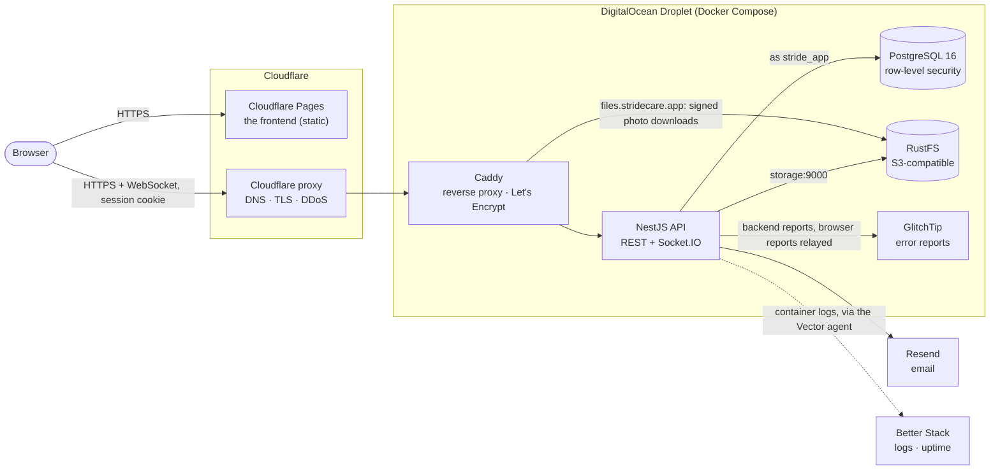
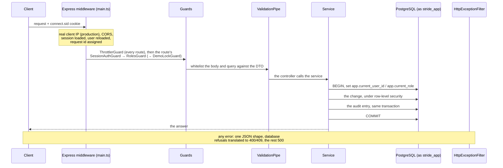

# Stride backend: architecture

This document describes the backend **as it stands**: what the parts are, how
they fit together, and what each one guarantees. It's a living document,
edited in place whenever the system changes. It keeps no history: the
history is in the [journal](journal/README.md), which is a frozen record of
each phase as it happened.

| For | Read |
|---|---|
| Building a client: routes, sign-in, errors, who may call what | [The API reference](api/README.md) |
| Why a decision was made, what was tried first | [The journal](journal/README.md) and [`PROJECT.md`](PROJECT.md) |
| Running it on a server | [`DEPLOYMENT.md`](DEPLOYMENT.md) |
| The seeded accounts | [`dev-test-accounts.md`](dev-test-accounts.md) |

Where this document and the code disagree, the code is right and this
document has a bug. Each section names its source files so it can be
checked.

---

## 1. What Stride is, and its parts

Stride runs a physiotherapy practice. **Admins** run its clinics and
accounts. **Practitioners** keep an exercise library, build program templates,
assign programs to their patients, write the medical file and measure range
of motion. **Patients** follow their programs session by session, report
pain and difficulty, and message their practitioners. One account can hold
several roles; a session acts in one of them at a time.

The backend is one NestJS process (REST plus a Socket.IO gateway) in front of
PostgreSQL and an S3-compatible object store. The frontend is a separate
single-page app in its own repository, served as static files.

The addresses chosen for the deployment are `https://stridecare.app` (the
frontend, on Cloudflare Pages) and `https://api.stridecare.app` (the API,
proxied by Cloudflare to the Droplet). Being one site lets the session cookie
be `SameSite=Lax`; see [§12](#12-open-items-before-the-deployment).

| Layer | Choice |
|---|---|
| Language, framework | TypeScript, NestJS 11 on Express |
| Database | PostgreSQL 16, Drizzle ORM and drizzle-kit migrations (80 so far) |
| Sign-in | `express-session` + Passport, sessions stored in Postgres (`connect-pg-simple`); TOTP two-factor with `otplib` |
| Real time | Socket.IO, authenticated by the same session cookie |
| Files | RustFS through `@aws-sdk/client-s3`; PDFs drawn with `pdfkit` |
| Email | Resend in production, SMTP to Mailpit locally (`nodemailer`) |
| Observability | `nestjs-pino` (JSON logs) shipped to Better Stack; `@sentry/nestjs` reporting to a self-hosted GlitchTip |
| Hosting | Docker Compose on one Droplet; Caddy; Cloudflare in front |

---

## 2. Inside the API process

### Modules

[`src/app.module.ts`](../src/app.module.ts) imports one module per area. Each
owns its controller(s), its service and its DTOs. 31 controllers serve 149
HTTP routes, listed in the generated [endpoint index](api/06-endpoints.md);
one gateway handles the socket's events.

| Area | Modules (`src/…`) |
|---|---|
| Accounts and sign-in | `auth`, `mfa`, `invitations`, `password-change`, `email-change`, `users`, `clinics`, `care-team`, `patient-merges` |
| Exercise programs | `exercises` (the library), `programs` (templates), `assigned-programs` (a patient's programs and their schedules), `sessions` |
| Clinical record | `medical-files`, `range-of-motion`, `alerts` (the practitioner's to-do and notices) |
| Messaging | `messaging` (REST controller, gateway, events, the new-message emails) |
| Record access and compliance | `records-export`, `complaint-reviews`, `legal-disclosures`, `audit`, `admin-metrics` |
| Platform | `database`, `storage`, `email`, `observability`, `health`, `demo`, `config`, `common` |

Services hold the rules; controllers translate HTTP into service calls and
back. Rules that are pure (no database, no clock) live in their own files
beside the service, so they are unit-tested with plain values: the schedule
module (`assigned-programs/schedule/`), the alert thresholds
(`alerts/alert-rules.ts`), the message rules (`messaging/message-rules.ts`),
the records export's content (`records-export/record-content.ts`).

### One request, start to finish

- **Middleware** ([`src/main.ts`](../src/main.ts)): in production, the
  visitor's IP from `CF-Connecting-IP` is copied into `X-Forwarded-For` before
  anything reads `req.ip`, and `trust proxy` is set to `TRUST_PROXY_HOPS` (2
  there: Cloudflare, then Caddy). Then CORS (an explicit list of origins,
  credentials allowed), the session, and Passport. Passport's
  `deserializeUser` reloads the account on **every** request, so a
  deactivation or a removed role takes effect on the next request.
- **Guards** run in a fixed order: the global `ThrottlerGuard`, then the
  route's `SessionAuthGuard` (`401`) and `RolesGuard` (`403`), plus, on a few
  routes, the demo deployment's `DemoLockGuard` (§10). A unit test reads every
  controller's metadata and fails if a route has `@Roles` without the guards
  that enforce it.
- **Validation**: one global `ValidationPipe` with `whitelist`,
  `forbidNonWhitelisted` and `transform`. An unknown field is a `400`, never
  silently dropped.
- **The service** does its work in a transaction that carries the caller's
  identity (§4). Every write writes its audit entry in that same transaction
  (§5).
- **Errors** go through [`HttpExceptionFilter`](../src/common/filters/http-exception.filter.ts):
  one body shape (`message` always an array of sentences, plus the request
  id), described in [the conventions](api/03-conventions.md#error-responses).
  A database refusal that the services' own checks would have given (a closed
  program, a race with a Finish, a blank title) is translated to the same
  `400` or `409`, in the same words. Any other error is a `500` with no
  internal detail; the full error goes to the log and to GlitchTip.

### Work outside requests

There is one timer in the process: the **new-message emails**
([`message-notices.service.ts`](../src/messaging/message-notices.service.ts)).
Every minute it claims the conversations with a message unread for 15
minutes and emails each recipient once, without the message's text. `main.ts`
starts it after `listen()`, so the e2e suites, the seed and the scripts,
which build the same modules, never send email on a timer. The claim is a
database function using `SKIP LOCKED`, so two instances would never send the
same notice.

Everything else that runs on a schedule runs **outside** the process, on the
Droplet: the nightly backup (cron) and the demo deployment's nightly reset (a
systemd timer). See §11.

---

## 3. The data model

42 tables, defined in Drizzle under
[`src/database/schema/`](../src/database/schema/) and re-exported from its
`index.ts`. Migrations are in
[`src/database/migrations/`](../src/database/migrations/): generated by
drizzle-kit for schema changes, written by hand (`--custom`) for row-level
security, triggers and functions. A 43rd table, `session`, is created by
`connect-pg-simple` itself, outside the schema, and is only reached through
the session store's own connection pool.

| Area | Tables |
|---|---|
| Identity and clinics (7) | `users`, `user_roles`, `user_clinics`, `clinics`, `admin_profiles`, `practitioner_profiles`, `patient_profiles` |
| Care team (1) | `care_team_members` |
| Account security (3) | `invitations`, `email_change_requests`, `mfa_recovery_codes` |
| Library and templates (4) | `exercises`, `program_templates`, `template_workouts`, `template_exercises` |
| Assigned programs (6) | `assigned_programs`, `program_workouts`, `assigned_program_exercises`, `program_schedules`, `program_schedule_days`, `program_schedule_rotation` |
| Sessions (2) | `sessions`, `session_exercises` |
| Clinical record (3) | `medical_files`, `rom_assessments`, `rom_measurements` |
| Practitioner reviews (3) | `session_reviews`, `program_alert_reviews`, `care_team_join_reviews` |
| Messaging (2) | `conversations`, `messages` |
| Record access (8) | `records_export_links`, `complaint_reviews`, `complaint_review_reasons`, `complaint_review_notice_reviews`, `legal_disclosures`, `legal_disclosure_details`, `legal_disclosure_orders`, `legal_disclosure_notice_reviews` |
| Patient merges (2) | `patient_merges`, `patient_merge_notice_reviews` |
| Audit (1) | `audit_logs` |

### Patterns that hold across the schema

- **One identity, profiles per role.** `users` holds what every account has
  (email, password hash, encrypted two-factor secret, names); each role's own
  data is a 1:1 profile table keyed by `user_id`. `user_roles` lists the roles
  an account holds.
- **Two relationships, two meanings.** `user_clinics` says where someone
  works or is treated. It grants directory access only. `care_team_members`
  is the clinical relationship: a link with a start, an optional end, who
  made it and why. An `EXCLUDE` constraint forbids two overlapping periods
  for the same patient and practitioner, so two simultaneous "join" clicks
  can't both succeed.
- **Copy, not reference, for what a patient was told.** Assigning a template
  copies its workouts and exercises into the patient's program; editing the
  template later changes nobody's program. A session copies its checklist's
  prescription and description when it starts, so editing a program later
  doesn't rewrite last month's sessions.
- **History is corrected, not edited.** Medical file entries and
  range-of-motion assessments are append-only: a mistake is fixed by an
  **amendment**, a new complete row pointing at the one it replaces, with a
  reason. Schedules are **versions** with an "applies from" date; a change is
  a new version, and versions that have started can't be removed. Care-team
  links can only be **ended**, never deleted or reopened.
- **Retire, archive or deactivate rather than delete.** A program exercise a
  session used is retired (`retired_at`), not deleted. Templates, library
  exercises and assigned programs are archived (`is_archived`). Accounts and
  clinics are deactivated (`is_active`); `users` has no delete policy at all.
  A message's delete is a soft delete (`deleted_at`) that empties its text.
- **`ON DELETE` is chosen per relationship.** 45 foreign keys are `RESTRICT`:
  anything with evidentiary value. 16 are `CASCADE`, for pure composition
  (a template's exercises, a schedule's days, an account's recovery codes).
  2 are `SET NULL`, where only provenance is optional (who created a library
  exercise).
- **Typed columns, with JSONB in one place.** Everything a query filters or a
  constraint checks is a typed column, with CHECKs for lengths, ranges and
  "not blank" (`~ '\S'`, the same test as the DTOs). The one JSONB column is
  `audit_logs.details`, whose shape differs by action.
- **The database's clock decides time-based rules.** Expiries, "reviewed at"
  and "ended at" are `now()` in SQL (often forced by a trigger), and lifetimes
  are counted in hours (`interval '72 hours'`), never in days, so daylight
  saving can't stretch them.

---

## 4. Who may do what, and how it's enforced

The rules themselves (the roles, the care team, why many refusals are `404`,
what an admin may and may not see) are in
[Roles & Authorization](api/04-authorization.md), resource by resource. This
section is about the machinery.

### Three layers

1. **Guards** check the session and its active role
   ([`src/common/guards/`](../src/common/guards/)).
2. **Services** check the relationship to the record: is this patient on my
   care team (`CareTeamService.isOnCareTeam`, used through
   `UsersService.isPatientManagedBy`), did I write this template, is this my
   session, and is the record in a state that allows the change.
3. **Row-level security** applies the same relationships again, in
   PostgreSQL, on every query the API makes.

The third layer is independent of the other two. A query the code got wrong
still can't read or write outside the policies.

### How row-level security is wired

- **The restricted role.** The API's queries connect as `stride_app`
  ([`drizzle.provider.ts`](../src/database/drizzle.provider.ts)), created by
  [`scripts/create-app-role.ts`](../scripts/create-app-role.ts). It's not a
  superuser and owns no table: either would bypass every policy. It has
  `SELECT`/`INSERT`/`UPDATE`/`DELETE` on the tables, `EXECUTE` on the two
  definer functions below, and nothing else (no DDL).
  Migrations, the session store, the seed and the maintenance scripts use the
  owner's connection.
- **All 42 tables** have row-level security enabled **and forced**.
- **The caller's identity reaches the policies** through two
  transaction-local settings, `app.current_user_id` and `app.current_role`,
  set by `withRlsContext(db, currentUser, fn)`
  ([`rls-context.ts`](../src/database/rls-context.ts)). They are set with
  `set_config(…, true)`, so they disappear at the transaction's end and can't
  leak to the next request on the same pooled connection.
- **Visitors without a session** (accepting an invitation, confirming an
  email change, downloading a records export from an emailed link) act
  through the **hash of the token** they hold: a transaction-local setting
  that lets the transaction see exactly one row of that table, and nothing
  else. Once the row says whose it is, the transaction may switch to acting
  as that account (`applyUserContext`).
- **One definition of the care team.** The SQL function
  `rls_care_team_member()` (a current link and a shared clinic) is used by
  every clinical policy, through `rls_practitioner_manages_patient()`. Its
  TypeScript twin is `CareTeamService.isOnCareTeam()`, and
  [`care-team.e2e-spec.ts`](../test/care-team.e2e-spec.ts) runs the same
  scenarios through both and requires the same answers.
- **Covered is not the same as restrictive.** Some tables have a
  `SELECT USING (true)` policy on purpose: `users`, `user_roles`,
  `user_clinics`, `clinics` and the three profile tables are read by sign-in
  before anyone is known, and the library (`exercises`, `program_templates`,
  `template_workouts`, `template_exercises`) is shared by design. The
  services decide what a caller is shown from those tables. Every **write**
  policy is restrictive, and so is every read policy on clinical data,
  messages, record access and the audit log (admins only).
- **Two `SECURITY DEFINER` functions**, each one narrow door for work no
  signed-in user's policies allow:
  - `merge_patients()` moves an account's rows into its duplicate, including
    clinical rows the admin who merges may not read;
  - `claim_message_notices()` finds the unread messages to email about, with
    no user signed in. It returns only names and addresses, never a message's
    text, and refuses to run inside a request's context.

  Both have a pinned `search_path`, run with `row_security = off` (so a
  misconfigured owner fails loudly instead of silently seeing nothing), and
  are executable by `stride_app` only.

### The database's half of the rules

Many rules are enforced twice: by the service, with a clear message, and by
the database, so a direct query or a race can't break them. Besides CHECK,
UNIQUE and EXCLUDE constraints, **29 triggers** guard what policies can't
express (which columns may change, and how). For example:

- a closed program (completed, cancelled or archived) refuses changes to its
  exercises, workouts and schedule, and new sessions;
- a session can be finished only on its own day, and only one completed
  session per program per day;
- a message's text never changes, and it can be deleted only while unread and
  within 15 minutes;
- a care-team link may only be ended, now;
- a review's "reviewed at" is always the database's `now()`.

Most triggers let the tables' owner through, so the seed, the test set-up and
the merge function can still write; the ones that only stamp the database's
clock, or check that an assessment has measurements, apply to everyone. When a
trigger refuses, it raises a named
constraint, and `HttpExceptionFilter` turns that into the service's own `409`
or `400` ([`pg-errors.ts`](../src/database/pg-errors.ts) lists them).

---

## 5. The audit trail

Every change to data writes **one complete audit entry, in the change's own
transaction**: who acted, the specific action (`ASSIGNED_PROGRAM_SCHEDULE_SET`,
not `POST /…`), the patient it concerns (`target_user_id`), the entity, and
`details` holding what changed (before and after for an edit, the whole record
for a creation, the removed rows for a removal). The change and its entry
commit or roll back together. A failed audit insert fails the request, which
for clinical data is the point: better refused than unrecorded.

- **Every mutating route is tagged.** `@AuditedByService()` says its service
  writes the entry; `@NotAudited(reason)` marks a POST that changes nothing
  (checking a reset link, relaying an error report). A unit test,
  [`audit-tags.spec.ts`](../src/audit/audit-tags.spec.ts), fails for a route
  with neither. There is no global interceptor any more.
- **Others' reads of clinical data are recorded** (programs, sessions,
  alerts, messages, the medical file, range of motion): one entry per patient
  shown, written before the answer is sent. A patient reading their own data
  is not recorded, except in the medical file, where every read is, the
  patient's included.
- **Sign-in events** (`LOGIN_SUCCESS`, `LOGIN_FAILURE`, `STEP_UP_FAILED`…) are
  written on their own connection, awaited before the answer.
- **The vocabulary is closed.** Every action and entity type is listed in
  [`audit-vocabulary.ts`](../src/audit/audit-vocabulary.ts); an unlisted
  action doesn't compile.
- **Append-only for the app.** `audit_logs` has an insert policy and an
  admin-only select policy, and no update or delete policy.
- **Admins see that clinical data was read or changed**, by whom and when,
  but not the details, which hold clinical content (they stay stored).
- **Retention** is decided (6 years) but no purge job exists yet, since
  nothing is that old.

---

## 6. Accounts, sign-in and sessions

The client-facing behaviour is in
[Authentication & Sessions](api/01-authentication.md). The design in brief:

- **A server-side session, not a token.** The cookie `connect.sid` is
  `httpOnly`, lasts 7 days from sign-in, and is not extended by activity. The
  session row stores `{ id, activeRole }` only. Ending a session server-side
  (sign-out, a password reset, deactivation) is immediate, and the same
  cookie authenticates the WebSocket.
- **Accounts are invited.** There is no sign-up: an admin or practitioner
  creates the account, and an emailed link (7 days) lets the person set a
  password. The very first admin is created once, by
  `POST /auth/register-clinic`, which closes for good once an admin exists.
- **Secrets at rest.** Passwords are hashed with bcrypt (cost 10, one
  constant in [`password-hashing.ts`](../src/common/password-hashing.ts)). An
  unknown email is still compared against a dummy hash, so sign-in takes the
  same time either way. Reset, invitation, email-change and export tokens are
  256 random bits, stored as SHA-256 hashes. TOTP secrets are encrypted with
  AES-256-GCM (`MFA_ENCRYPTION_KEY`). Recovery codes are stored as a keyed
  HMAC-SHA256 under a key derived from that same key, so a copy of the
  database alone can't test a guess.
- **Two-factor sign-in** is optional per account. A code can't be used twice
  (the last accepted time step is stored). Ten single-use recovery codes are
  shown once.
- **Step-up.** Changing a password, an email address or two-factor settings
  asks for the current password, plus a code when two-factor is on. Five
  failed step-ups in a row sign that session out.
- **Rate limits.** 60 requests a minute per route and IP for everything, and
  tighter limits on the password, code and token routes (5 a minute for
  sign-in), in [`rate-limits.ts`](../src/config/rate-limits.ts). A `429`
  says how long to wait, in words and in `Retry-After`. The counters are in
  memory, which is correct for one instance.

---

## 7. Real-time messaging

The client-facing protocol is in [the WebSocket API](api/02-websocket-api.md).

- **Same cookie, same session.** `SessionIoAdapter` runs the Express session
  middleware on every Socket.IO handshake, and the gateway's connection
  middleware (`server.use()`) authenticates the socket before any event can
  reach a handler. Admins are refused at the handshake: they read no messages.
- **Rooms per person and role, and per session.** Each socket joins
  `user:<id>:<role>`, so every tab and device of that person in that role hears
  about all their conversations without joining anything, and
  `session:<sessionId>`, so signing out or switching role closes exactly that
  session's sockets.
- **One way to write.** Sending and deleting go through `MessagingService`,
  whichever door is used (REST or socket). The service then emits through
  `MessagingEvents`, a small provider the gateway hands its server to, so a
  message sent over REST reaches open browsers too, and no module depends on
  the gateway.
- **Same errors.** `WsHttpExceptionFilter` translates the same exceptions,
  and the same database refusals, into the socket's acknowledgement.
- **Email instead of presence.** Someone who doesn't read a message within
  15 minutes gets one email per conversation (§2).

---

## 8. Files: uploads, photos and generated PDFs

### Object storage

RustFS, self-hosted and S3-compatible, reached only through
[`StorageService`](../src/storage/storage.service.ts) with the standard AWS
SDK (`forcePathStyle: true`, which any self-hosted S3 needs). One private
bucket, `stride`. The database stores object keys, never file contents, and
the API never hands out a key: every image URL it returns is **presigned**,
so the browser downloads the file from storage directly, for a limited time.

- **Two addresses for one storage server**
  ([`storage-urls.ts`](../src/config/storage-urls.ts)). The backend's own calls
  (upload, copy, delete, list) go to the internal address, `storage:9000` in
  production. Presigned URLs are signed for the **public** address browsers
  use, `STORAGE_PUBLIC_URL` (`https://files.stridecare.app`, a Caddy site
  forwarding to `storage:9000`). A signature covers the URL's method, path and
  host, so a URL can't be pointed at another host after signing; that's why
  `StorageService` has a second S3 client used only to sign (signing is
  computed locally; that client never connects). Locally the setting is left
  unset and both addresses are `http://localhost:9000`. In production it's
  required, and must be `https://`.
- **Lifetimes.** 15 minutes by default; 24 hours for avatars and clinic logos
  (an open tab keeps its own user for a day). The library list's cover photos
  are signed with the time rounded down to the hour and asked to be cached
  for an hour (`private`), so the same photo has the same URL all hour and
  the browser downloads it once ([`cacheable-url.ts`](../src/storage/cacheable-url.ts)).
- **Keys are built from server values only** (`avatars/<id>/<timestamp>.<ext>`,
  `patients/<id>/exercise-photos/…`), never the uploaded file's name, and
  nothing ever overwrites a key, so a URL's content never changes.
- **Limits.** One Multer configuration for the image routes: memory storage,
  5 MB a file, JPEG, PNG or WebP. `StorageService.upload()` has its own 10 MB
  ceiling, whoever calls it. Every storage call has a timeout.
- **Storage isn't in the transaction.** An upload that's followed by a failed
  database write deletes what it stored (a compensating action,
  [`compensation.ts`](../src/storage/compensation.ts)). A file is deleted only
  after the row stops pointing at it, so a failure leaves an orphan, never a
  broken image. `npm run storage:sweep` lists the orphans (and deletes them
  with `--delete`), ignoring anything younger than 24 hours.
- **Program photos are copies.** A program exercise can have its own photos,
  copied inside storage (S3 `CopyObject`) from the library or from an earlier
  program, so no file is shared between rows.

### The records export

A patient's whole record (medical file, range of motion, programs, sessions)
as one PDF ([`src/records-export/`](../src/records-export/)), for the
patient's right of access. It's built on request and **never stored**:

- The record is read in one `REPEATABLE READ` transaction **acting as the
  patient**, so the patient's own policies decide what goes in, and every
  query sees the same moment.
- What the document says is decided by pure functions (`record-content.ts`,
  and `record-scope.ts` for a legal disclosure's narrower scope); how it looks
  by `record-pdf.ts` (pdfkit, US Letter, bundled Noto Sans with a Noto Emoji
  fallback).
- The same pipeline makes the patient's copy, the copy behind an emailed link
  (72 hours, opened with the date of birth, a limited number of tries), an
  admin's review copy under a complaint review, and a legal disclosure's
  copy. Each copy is audited with the ids of what went into it.

---

## 9. Email

[`EmailService`](../src/email/email.service.ts) decides what each email says;
a **transport** sends it. `EMAIL_TRANSPORT` picks one, and is required:
`resend` (production), `smtp` (Mailpit locally, or any SMTP server) or `log`
(prints to the console, refused in production). The e2e tests swap in an
in-memory outbox through Nest's provider override, so no setting can ever
route real mail into an array.

- **Branded, and safe.** One layout ([`email-layout.ts`](../src/email/email-layout.ts))
  with an HTML and a plain-text body. Every value a person typed is escaped by
  the `markup` tagged template ([`safe-html.ts`](../src/email/safe-html.ts)).
- **No clinical content.** A new-message email names who wrote, never what.
  Address changes are announced to the old address with the new one masked.
- **Failures reject, and the caller decides.** A failed send no longer
  disappears inside the service. Where the email is part of a flow (an
  invitation, an export link), the request still succeeds, and the record
  says whether its email went out so the screen can offer to send again.
  Where answering differently would reveal whether an account exists (forgot
  password), the failure is logged and the answer is the same `204`.
- Addresses on reserved domains (`.test`, `example.com`, …) are never handed
  to the provider, so the seeded accounts can't bounce real mail.

---

## 10. Configuration, logging and demo mode

### Settings, checked at start-up

`validateEnv()` ([`validate-env.ts`](../src/config/validate-env.ts)) runs
before Nest builds a single module. A missing or placeholder secret, or a
malformed switch, stops the app with a message naming the setting. The rules
for each switch live in one function, called both there and by the module
that uses it, because the e2e suites build the app without `main.ts`.

| Setting | Default | Notes |
|---|---|---|
| `SESSION_SECRET`, `MFA_ENCRYPTION_KEY`, `POSTGRES_APP_USER` / `_PASSWORD` | required | The secrets refuse `.env.example`'s placeholders; the MFA key must be 64 hex characters. |
| `EMAIL_TRANSPORT` | required | `resend` / `smtp` / `log`; `log` refused in production. |
| `RATE_LIMITS` | `on` | `off` exists for the e2e suites and is refused in production. |
| `DEMO_MODE` | `off` | `on` turns a production deployment into the reviewers' demo (below). |
| `SENTRY_DSN`, `SENTRY_BROWSER_DSN` | unset (off) | Error reporting, for the backend and for the browser reports it relays. |
| `FRONTEND_URLS` | — | The origins CORS and the socket accept. `FRONTEND_URL` builds the links in emails. |
| `STORAGE_PUBLIC_URL` | unset = the internal address | Where browsers reach storage; photo URLs are signed for it (§8). Required in production, `https://`, an origin only. |
| `TRUST_PROXY_HOPS` | `1` | `2` in production (Cloudflare, Caddy). |
| `DATABASE_POOL_MAX`, `SESSION_POOL_MAX`, `DATABASE_POOL_CONNECTION_TIMEOUT_MS` | 10, 5, 5 s | Two pools, sized apart; a waiting query fails after 5 s instead of hanging. |

Both pools survive Postgres closing an idle connection (a restart, say): the
error is logged, and the next query opens a new connection.

### Logs, request ids and error reports

The logs and the error reports leave the server (Better Stack, GlitchTip), so
one rule governs both: **nothing in them names or locates a patient**
([`src/observability/`](../src/observability/)).

- **Logs** are JSON in production. A request line holds its id, method and
  path only: no headers, no IP, no query string. Text is scrubbed of email
  addresses and of the values a failed query was given.
- **Every request gets a random id** (a UUID made by the server; a client's
  `X-Request-Id` is ignored), sent back in `X-Request-Id` and in every error
  body. Error screens show its first 8 characters as a "Reference", which
  finds the report in GlitchTip and every log line of that request.
- **Error reports** are rebuilt from an allow-list of fields, never "the SDK's
  event minus a few keys", so an SDK upgrade can't widen them. The browser's
  reports come through `POST /monitoring`, which accepts only the frontend's
  own project, re-applies the same rule, and adds the session's user id
  rather than one the page claims. GlitchTip itself is never on the internet.
- `GET /health` (Terminus, plus a `SELECT 1`) is public and not rate-limited;
  the Docker healthcheck and the uptime monitor call it.

### Demo mode

The reviewers' deployment is an ordinary production deployment with
`DEMO_MODE=on` ([`src/demo/`](../src/demo/)). The switch does three things:

- `GET /auth/setup-status` includes the four shared accounts, their password
  and the two-factor key, for the sign-in page's "For reviewers" card. With
  the switch off, it doesn't even say a demo mode exists.
- `@DemoLocked(…)` routes refuse to change what the others need to sign in
  (a shared account's password, email or two-factor; deactivating or merging
  one). This is checked before any step-up, so a refusal never counts as a
  failed attempt.
- A nightly reset recreates the seed's data (§11).

---

## 11. Deployment topology

The procedure is in [`DEPLOYMENT.md`](DEPLOYMENT.md). What runs where, from
[`docker-compose.prod.yml`](../docker-compose.prod.yml):

| Service | What it is | Reachable from |
|---|---|---|
| `caddy` | Reverse proxy ([`Caddyfile`](../Caddyfile)) for two sites: `api.stridecare.app` → `app:3000`, and `files.stridecare.app` → `storage:9000`, which passes only `GET`s inside the `stride` bucket (signed photo downloads) and marks answers without a cache rule `private` so Cloudflare doesn't keep them. Automatic Let's Encrypt certificates, HTTP→HTTPS, its own JSON access log | The internet: the only service with public ports (80, 443) |
| `app` | The API (`node:24-slim`, non-root, `HEALTHCHECK` on `/health`) | Caddy, at `app:3000` on the Compose network |
| `db` | PostgreSQL 16 | The Compose network only (no published port) |
| `storage` | RustFS | The app and Caddy on the Compose network; `127.0.0.1:9000` (API) and `:9001` (console) from the Droplet itself |
| `glitchtip`, `glitchtip-db` | Error tracking, its own Postgres 18 | `127.0.0.1:8000`, read over an SSH tunnel |
| `migrate`, `create-app-role`, `seed`, `demo-reset` | One-off jobs, built from the image's `builder` stage | Run by hand (`profiles: ["tools"]`), never by `up` |

- **The network boundary.** Cloudflare's proxy runs in Full (strict) TLS mode
  in front of Caddy's own certificate. The Droplet's DigitalOcean firewall
  admits only Cloudflare's published IP ranges on 80/443, so the origin can't
  be reached around Cloudflare.
- **Secrets are required twice.** Compose refuses to start `db`, `storage` or
  `glitchtip` without their passwords (`${VAR:?…}`), and the app refuses to
  start without its own (§10).
- **The image** is built in two stages: `npm ci` and `nest build` in
  `builder`, then a fresh `node:24-slim` with production dependencies and
  `dist/` only. The one-off jobs use `builder`, which has drizzle-kit and
  ts-node.
- **Logs.** Every long-running container writes `json-file` logs capped at
  3 × 10 MB. Better Stack's Vector agent, installed on the Droplet rather than
  in Compose, ships them, and Better Stack's uptime monitor watches
  `/health`. Caddy's own JSON log is the only record of a request that never
  reached the app (a `502` while it restarts).
- **Backups.** [`scripts/backup-database.sh`](../scripts/backup-database.sh),
  run by cron, dumps Postgres, compresses it and uploads it to RustFS. A
  restore into a scratch database was checked by row counts. Storage lives on
  the same Droplet, so this protects against mistakes, not against losing
  the Droplet.
- **The demo's nightly reset** is a systemd timer
  ([`scripts/ops/`](../scripts/ops/)) at 04:00 America/Toronto. A timer
  rather than cron, because it follows the zone's clock changes. It stops the
  app (closing every socket), reseeds, sweeps storage and starts the app
  again whatever happened.
- **CI** (GitHub Actions: lint, type-check, unit and e2e suites, and the
  frontend's browser suite against this backend) is written and rehearsed,
  and switched on once the repositories are public. Its shared scripts are in
  [`scripts/ci/`](../scripts/ci/).

---

## 12. Open items before the deployment

The deployment above hasn't been run end to end with the frontend yet. These
are known before it is:

- **The `files.stridecare.app` DNS record.** Storage's public address (§8)
  needs a Cloudflare record for the Droplet, proxied like the API's, before
  photos load in production.
- **The cookie's `SameSite`.** Production still sets `SameSite=None`
  ([`main.ts`](../src/main.ts)). With the frontend and the API on one site,
  it becomes `Lax`.
- **Image versions.** RustFS and Mailpit are pinned by tag and digest;
  `glitchtip/glitchtip:6`, `postgres:16`, `postgres:18` and `caddy:2` still
  float.

## 13. Deliberate limits

- **One practice per deployment.** Clinics are the practice's locations, not
  separate tenants: admins are practice-wide, and clinic membership shapes
  the directory and the care team rather than isolating data.
- **One API instance.** Rate-limit counters and Socket.IO rooms live in the
  process's memory. Several instances would need Redis for both, and sticky
  sessions for Socket.IO's fallback transport. (The new-message sweep is
  already safe with several.)
- **Keys in the environment.** `MFA_ENCRYPTION_KEY` and `SESSION_SECRET` sit
  in the server's `.env`, not a key management service. The encryption
  protects a copy of the database, not a compromised server.
- **Backups on the same machine** (§11).
- **No purge yet** for audit entries older than the retention period (§5).

---

## 14. Security, in one table

A summary of the engineering safeguards as they stand (framed by HIPAA's
technical safeguards, 45 CFR §164.312). It's not a compliance claim: there is
no signed business associate agreement, no formal risk assessment, and no
real patient data.

| Safeguard | Mechanism | Covers | Doesn't cover |
|---|---|---|---|
| Transport | Cloudflare Full (strict), Caddy's certificate | Encryption to the origin, with its certificate checked | — |
| Network | Firewall limited to Cloudflare's ranges; database unpublished; storage's S3 API on loopback, with only signed `GET`s in its bucket let through by Caddy | Reaching the origin directly; reaching the database, or any other storage operation, from outside | A compromised Droplet |
| Sign-in | bcrypt, constant-time unknown-email path, `httpOnly` cookie, optional TOTP, recovery codes, step-up, rate limits | Password guessing, session theft by script, a stolen password alone (with two-factor) | A compromised device |
| Authorization in the app | Guards, care-team checks in services, tested wiring | Every route | A bug in a check, which the next row is for |
| Authorization in the database | RLS forced on 42/42 tables for `stride_app`; 29 guard triggers; two narrow definer functions | A query the code got wrong; races between requests | The deliberately readable directory tables (§4) |
| Data at rest | AES-256-GCM (TOTP secrets), keyed HMAC (recovery codes), SHA-256 (tokens), bcrypt (passwords) | A copy of the database | A compromised app server, which holds the keys |
| Audit | One entry per change in its transaction; others' clinical reads; append-only | Who did or saw what, and when | Sign-in attempts naming no account (`performed_by` is required) |
| Data leaving the server | The "names or locates a patient" rule for logs and reports; emails without clinical text; exports never stored | Third parties holding patient data | — |
| Input | Global whitelisting `ValidationPipe`, length caps in DTOs and CHECKs | Malformed or oversized payloads | — |

---

## Where to go for "why"

The journal's entries 1–35 cover the backend up to the deployment and the
row-level security passes. Entries 36–42 cover the frontend era, one per
build phase, condensed to the decisions and bugs worth telling; the
[journal's README](journal/README.md) indexes them all.

| Section | Journal entries |
|---|---|
| Stack, overall shape | [01](journal/01-backend-architecture-decisions.md), [04](journal/04-exercise-seeding-and-storage-migration.md), [16](journal/16-docker-deployment-foundations.md) |
| Data model | [02](journal/02-database-schema-design.md), [08](journal/08-core-clinical-domain.md), [11](journal/11-medical-files-module.md), [36](journal/36-care-team-invitations-and-schedules-as-history.md), [37](journal/37-the-session-as-a-state-machine.md), [41](journal/41-observability-without-patient-data.md) |
| Authorization and RLS | [05](journal/05-multi-role-authorization-and-clinics.md), [20](journal/20-two-bug-hunts.md), [23](journal/23-row-level-security-step-zero.md), [24](journal/24-row-level-security-rollout.md), [29](journal/29-row-level-security-user-roles.md), [30](journal/30-write-only-profile-fields.md), [32](journal/32-row-level-security-profile-tables.md), [33](journal/33-row-level-security-user-clinics.md), [34](journal/34-row-level-security-clinics.md), [36](journal/36-care-team-invitations-and-schedules-as-history.md), [37](journal/37-the-session-as-a-state-machine.md), [39](journal/39-audit-review-account-security-and-record-access.md), [40](journal/40-defence-in-depth-leftovers-and-merges.md) |
| Audit trail | [10](journal/10-audit-logging-system.md) (the first design, since replaced), [39](journal/39-audit-review-account-security-and-record-access.md) |
| Sign-in and sessions | [03](journal/03-application-layer-and-authentication.md), [12](journal/12-password-reset-and-mfa.md), [17](journal/17-real-email-and-mfa-encryption.md), [28](journal/28-resend-flake-timing-side-channel-and-a-false-claim.md), [36](journal/36-care-team-invitations-and-schedules-as-history.md), [39](journal/39-audit-review-account-security-and-record-access.md), [42](journal/42-the-documentation-rewrite-finds-three-bugs.md) |
| Messaging | [09](journal/09-messaging-system.md), [27](journal/27-message-normalization-and-api-docs-rls-review.md), [38](journal/38-messaging-brought-up-to-standard.md) |
| Files | [07](journal/07-file-upload-system.md), [15](journal/15-closing-the-review-five-improvements.md), [40](journal/40-defence-in-depth-leftovers-and-merges.md), [42](journal/42-the-documentation-rewrite-finds-three-bugs.md) |
| Deployment | [18](journal/18-deployment-provisioning-through-backups.md), [19](journal/19-deployment-verification-and-observability.md), [25](journal/25-closing-the-log-rotation-gap.md), [26](journal/26-redeploying-for-real.md), [35](journal/35-backup-bucket-and-credential-parsing.md), [41](journal/41-observability-without-patient-data.md) |
| The frontend era, phase by phase | [36](journal/36-care-team-invitations-and-schedules-as-history.md) (care team, invitations, schedules), [37](journal/37-the-session-as-a-state-machine.md) (sessions), [38](journal/38-messaging-brought-up-to-standard.md) (messaging), [39](journal/39-audit-review-account-security-and-record-access.md) (audit, account security, record access), [40](journal/40-defence-in-depth-leftovers-and-merges.md) (merges, guards, jobs), [41](journal/41-observability-without-patient-data.md) (observability, demo mode), [42](journal/42-the-documentation-rewrite-finds-three-bugs.md) (this documentation) |
