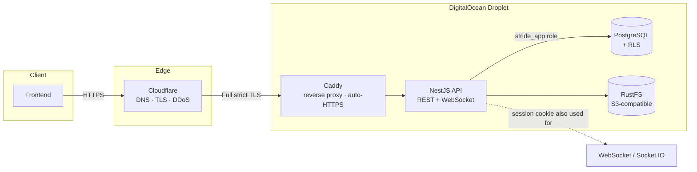
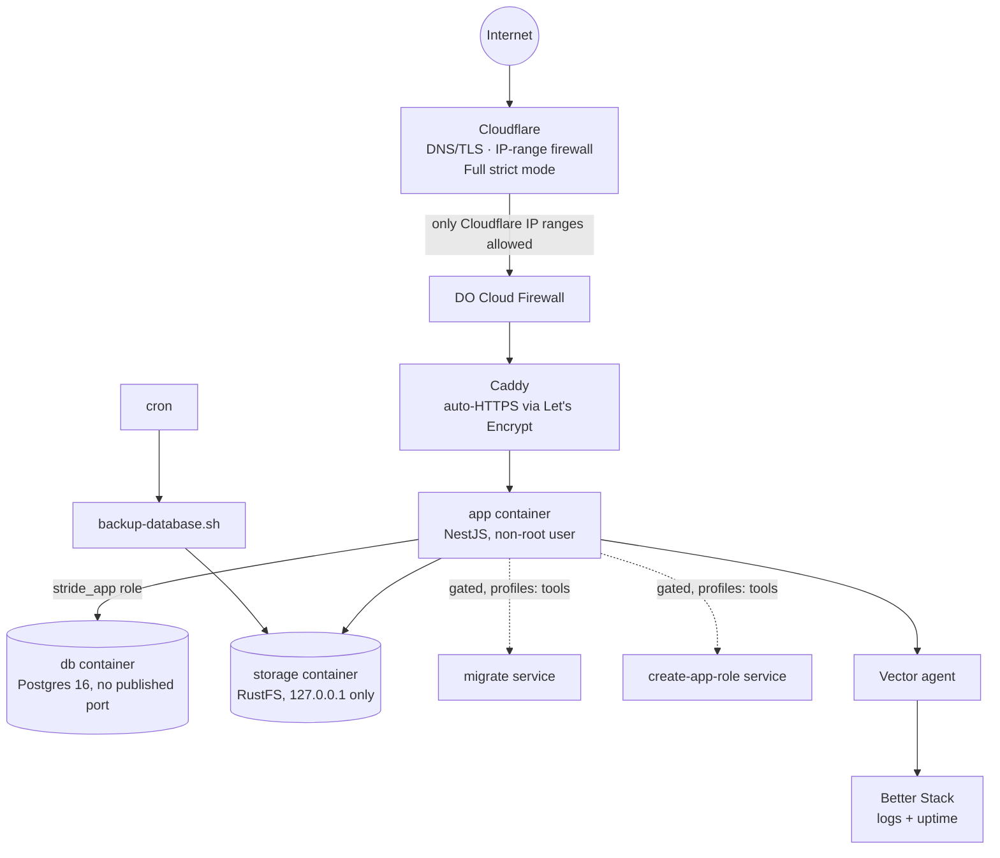

# Stride — Architecture Overview

This document describes the system **as it currently stands**: what exists,
how the pieces fit together, and what the current guarantees actually are.
It intentionally does not explain *why* each decision was made, or what was
tried and rejected along the way — that reasoning lives in the numbered
writeup series ([`README.md`](../docs/journal/README.md) is the index) and in [`PROJECT.md`](PROJECT.md)'s condensed
summary. Every major section below links back to the doc(s) where the
decision was actually made.

Unlike the writeup series, which is an immutable record of each phase as it
happened, **this document is living** — it should be edited in place every
time the system changes, with no obligation to preserve history.

---

## 1. System overview

Stride is a multi-role physiotherapy practice-management backend. Admins run
clinics, practitioners build exercise programs and assign them to patients,
and patients complete sessions and message their practitioner in real time.



**Stack**: NestJS (TypeScript) · PostgreSQL 16 + Drizzle ORM · Passport
(session-cookie auth) · Socket.IO · RustFS (S3-compatible object storage) ·
Resend (email) · Docker Compose · Caddy · Cloudflare.
*(rationale: doc 01, 04, 16)*

---

## 2. Domain & data model

18 tables across 8 schema files, all defined in Drizzle and re-exported from
`src/database/schema/index.ts`.

| Area | Tables |
|---|---|
| Identity & clinics | `users`, `user_roles`, `user_clinics`, `clinics`, `practitioner_profiles`, `patient_profiles`, `admin_profiles` |
| Exercise library & programs | `exercises`, `program_templates`, `template_exercises` |
| Patient care | `assigned_programs`, `assigned_program_exercises`, `sessions`, `session_exercises`, `medical_files` |
| Messaging | `conversations`, `messages` |
| Compliance | `audit_logs` |

**Patterns that hold across the schema** *(rationale: doc 02)*:
- **Identity is centralized, profiles are split.** `users` holds shared auth
  fields; role-specific data lives in a 1:1 profile table keyed by `user_id`.
  A single account can hold multiple roles via `user_roles` (doc 05).
- **Copy, not reference**, for anything a patient was actually told to do.
  `assigned_program_exercises` is an independent copy of the source
  `template_exercises` row at assignment time — editing or deleting the
  template afterward never touches an already-assigned patient's program.
- **Append-only where history matters.** `medical_files` has no update or
  delete route at all; `audit_logs` is insert-only at the application
  permission level; `assigned_programs`/`sessions` are soft-deleted only.
- **`ON DELETE` is chosen per relationship**, not defaulted: `RESTRICT` for
  anything with real evidentiary value (most references to `users`,
  clinical records), `CASCADE` for pure composition (`template_exercises` →
  `program_templates`), `SET NULL` where only provenance is optional
  (`exercises.created_by`).
- **JSONB is scoped to genuinely variable-shaped data** (`clinical_data`,
  `audit_logs.details`) — anything filterable or constrainable is a typed
  column instead.

---

## 3. Authentication

Session-cookie based (`httpOnly`, PostgreSQL-backed via `connect-pg-simple`),
not JWT — a single first-party client, so a server-revocable session is
simpler and more secure than a bearer token. *(rationale: doc 01, 03)*

**Current login flow:**
1. `POST /auth/login` validates credentials. If the account has more than
   one role, `role` must be supplied explicitly; a single-role account
   auto-selects.
2. If MFA is enabled, the response is `{ mfaRequired: true }` with a
   *pending* session (`req.session.mfaPending`, a separate key from
   `req.session.passport` — proves "password was correct" without Passport
   considering the session authenticated). `POST /auth/mfa/verify`
   completes it. *(doc 12)*
3. On success, the session stores only `{ id, activeRole }`.
   `SessionSerializer.deserializeUser` reloads the full user and
   re-validates `activeRole` is still held on **every request** — a role
   change or deactivation takes effect immediately, not at next login.
   *(doc 03, 05)*

**Other auth routes**: `POST /auth/register`, `POST /auth/register-clinic`
(one-time founding-admin bootstrap, permanently gated once any admin
exists), `POST /auth/switch-role` (rotates the session ID, Passport's
session-fixation protection), `POST /auth/logout` (destroys the session row
server-side, not just the request-local reference), `POST
/auth/forgot-password` / `POST /auth/reset-password`.

**Password reset**: a random 256-bit token, SHA-256 hashed at rest (not
bcrypt — a random token doesn't need deliberate slowness), single-use,
stored directly on `users`. The endpoint always returns `204` regardless of
whether the email matches an account — no user enumeration. Every existing
session is destroyed on a successful reset. *(doc 12)*

**MFA**: TOTP via `otplib`, QR provisioning via `qrcode`. `mfaSecret` is
encrypted at rest with AES-256-GCM (`MFA_ENCRYPTION_KEY`, 32 bytes) — a
stated, deliberate limitation: this protects against database-only
compromise, not full server compromise, since the key lives in the same
environment. *(doc 12, 17)*

**Email delivery**: Resend, behind a stable `EmailService` interface. Send
failures are logged but never thrown, so a failed send and a nonexistent
recipient remain indistinguishable to the caller — preserving the
no-enumeration guarantee. *(doc 17)*

---

## 4. Authorization

Two layers, checked in a fixed order, plus a database-level backstop for
part of the schema.

### Layer 1 — Guards (structural)

```typescript
@UseGuards(SessionAuthGuard, RolesGuard)
@Roles('practitioner')
```

`SessionAuthGuard` (*is anyone logged in?*) always runs before `RolesGuard`
(*is this role allowed here?*) — an anonymous request gets `401`, an
authenticated-but-wrong-role request gets `403`. *(doc 03)*

### Layer 2 — Service-level ownership checks (relational)

Guards can't know whether *this* practitioner may touch *this* specific
row — that depends on data only available once the row is fetched. Every
module implements the same shape of check, not three different ones:

- `UsersService.isPatientManagedBy` — the canonical clinic-membership check,
  reused everywhere a practitioner–patient relationship needs verifying
  (profiles, assigned programs, sessions, medical files, messaging).
- `assertCanModify` — exercise/template ownership (creator or admin).
- `assertParticipant` — messaging conversation membership.

Nested resources (`template_exercises`, `assigned_program_exercises`) are
checked twice: once on the parent, once confirming the child id in the URL
actually belongs to that parent. *(doc 05, 08, 09)*

### Layer 3 — Row-Level Security (database-enforced)

RLS is enabled and `FORCE`d on **6 of the schema's 18 tables (8 counting
child tables)**: `medical_files`, `audit_logs`,
`assigned_programs`+`assigned_program_exercises`,
`sessions`+`session_exercises`, `conversations`+`messages`,
`exercises`+`program_templates`+`template_exercises`, and `users`.

This is a genuine, database-enforced second boundary — not a restatement of
Layer 2. The app's own queries run as `stride_app`, a role created
specifically to have zero exemptions from RLS: not a superuser, and no
ownership of the tables it queries (both are separate, absolute Postgres
bypass conditions). Every RLS-scoped query runs inside
`withRlsContext(db, currentUser, fn)`, which sets
`app.current_user_id`/`app.current_role` as transaction-local Postgres
settings that each table's policies read. *(doc 23, 24)*

**Explicitly not RLS-covered**: `user_roles`, the three profile tables,
`clinics`, `user_clinics`. `user_clinics` in particular is a deliberate,
permanent exception — every other table's policies depend on it via `EXISTS`
subqueries, so restricting it directly would risk narrowing what those
policies can see through it. The rest are open questions for a future pass,
not oversights. *(doc 24)*

> **A note on doc 01**: the original architecture writeup describes RLS as
> already active. It wasn't, at the time — the app-layer checks above were
> the only enforcement until this rollout. Doc 01 is deliberately left as
> originally written (it was accurate to the plan at the time); doc 23 is
> where that gap is named and closed. This document reflects the current,
> actual state: partial, table-by-table RLS coverage layered on top of
> guards and service-level checks, not a replacement for either.

---

## 5. Real-time messaging

Socket.IO, authenticated with the **same session cookie** as REST — no
separate token scheme. `SessionIoAdapter` runs Express's session middleware
against every socket handshake (Socket.IO doesn't pass through Express
middleware on its own). *(doc 09)*

Connection auth is genuine Socket.IO **middleware** (`server.use()`), not
the `handleConnection` lifecycle hook — middleware must fully resolve before
any event can reach any handler, closing a real race condition where an
event emitted immediately after connecting could reach its handler before
`socket.data.user` was populated. *(doc 20)*

- `joinConversation` — checks `assertUserCanJoinConversation` (the same rule
  REST uses) before joining the Socket.IO room `conversation:{id}`.
- `sendMessage` / `deleteMessage` — call the identical `MessagingService`
  methods the REST routes use; there is exactly one place a message is ever
  created or deleted. Only the gateway path broadcasts live.
- `WsHttpExceptionFilter` converts the same `HttpException` subclasses REST
  controllers throw into their WebSocket equivalent, so a client gets a real
  error message over sockets too, not a generic failure.

Conversation archiving is per-participant (`practitionerArchivedAt` /
`patientArchivedAt`, two nullable timestamps — not a shared boolean, since
one person archiving shouldn't hide it from the other). Message deletion
requires **both** unread and within 15 minutes of sending; a soft delete
(`deletedAt`) replaces the body with a tombstone rather than removing the
row. Admins get full read access for oversight but are explicitly barred
from archiving, sending, or marking-as-read on conversations they aren't a
participant in. *(doc 09, 22)*

---

## 6. File storage

RustFS — self-hosted, S3-API-compatible — accessed exclusively through
`StorageService` via `@aws-sdk/client-s3` (vendor-neutral, not a
RustFS-branded client). The database stores only object keys, never binary
data. `forcePathStyle: true` is required for any self-hosted S3-compatible
backend (no wildcard DNS for bucket subdomains); this stays unchanged across
local/dev/prod since all three currently point at self-hosted RustFS.
*(doc 01, 04)*

One shared Multer config (`common/config/image-upload.config.ts`) backs all
three upload routes (avatar, clinic logo, exercise images): memory storage,
5MB limit, JPEG/PNG/WebP only. `StorageService.upload()` also enforces its
own independent 10MB ceiling — a generic "is this absurd" guard that travels
with the service regardless of which route (or future caller) invokes it.
*(doc 07, 15)*

Exercise images (`mediaUrls`) stay a plain ordered array rather than a rigid
schema — the "cover image" is simply `mediaUrls[0]`, so reordering and
setting a cover are the same operation with nothing to keep in sync.
*(doc 07)*

---

## 7. Cross-cutting concerns

| Concern | Mechanism |
|---|---|
| Input validation | One global `ValidationPipe` (`whitelist`, `forbidNonWhitelisted`, `transform`); every list route uses a single combined query DTO extending `PaginationQueryDto` (splitting query params across multiple `@Query()` decorators breaks whitelisting). |
| Error handling | Global `HttpExceptionFilter` (`APP_FILTER`) ensures no internal detail (stack traces, raw Postgres errors) reaches a client; `WsHttpExceptionFilter` mirrors it for WebSocket. |
| Audit logging | Hybrid: `AuditLogInterceptor` (`APP_INTERCEPTOR`) auto-logs every mutating REST request by deriving `entityType`/`entityId` from the URL and response body; `/auth/*` and `/medical-files` are excluded and call `AuditService.log()` explicitly instead, since those need context (why a login failed, that a read itself is the sensitive event) the generic interceptor can't infer. Writes are fire-and-forget — never awaited as part of the request/response cycle. |
| Rate limiting | `@nestjs/throttler`, global default (60 req/min/IP via `APP_GUARD`), tighter override on `/auth/login` and MFA enable/disable. In-memory counters — correct specifically because exactly one API instance runs today; would need Redis-backed storage if horizontally scaled. |
| Logging | `nestjs-pino`, structured JSON in production. Redaction is explicit: session cookies, `Authorization` headers, and plaintext passwords are stripped from every logged line. |
| Pagination | Consistent `{ data, meta }` envelope, with `COUNT` run in parallel via `Promise.all` alongside the page query. |
| API docs | Auto-generated OpenAPI/Swagger at `/api-docs` via the `@nestjs/swagger` CLI plugin (build-time static analysis of DTOs — only works through `nest build`/`nest start`, not plain `ts-node`). |
| Health check | `GET /health` via `@nestjs/terminus` + a small custom `DrizzleHealthIndicator` (`SELECT 1`). Public, no auth guard, exempt from rate limiting. |

*(rationale: doc 03, 10, 11, 14, 15, 20, 22)*

---

## 8. Deployment topology



**Host**: DigitalOcean Droplet, Ubuntu 24.04 LTS, single vCPU — chosen
deliberately over a PaaS to own the deployment problem directly (TLS,
firewalling, process management), not abstract it away. *(doc 18)*

**Network boundary**: Cloudflare Full (strict) TLS in front of Caddy's own
Let's Encrypt certificate; the Droplet's firewall is restricted to
Cloudflare's published IP ranges only, verified via `tcpdump` (Cloud
Firewalls filter at the hypervisor level — blocked traffic never reaches a
capture taken on the box, so a capture showing only Cloudflare-range traffic
is direct proof, not an inference). Inside the compose network: `db` has
**no published port at all** (not even loopback), reachable only via
Docker's internal DNS from `app`; `storage` is bound to `127.0.0.1:9000`
(API) and `127.0.0.1:9001` (console) — reachable from the Droplet itself
(SSH tunnel, the backup script) but categorically absent from the public
network interface; `app` itself has no published port either — only Caddy
reaches it, over the internal network, at `app:3000`. `caddy` is the only
service exposing ports to the world (`80`/`443`). *(doc 18, 19)*

**Required secrets are enforced at two layers.** Compose itself refuses to
start `db`/`storage` at all if `POSTGRES_PASSWORD`, `RUSTFS_ACCESS_KEY`, or
`RUSTFS_SECRET_KEY` are unset (`${VAR:?must be set in .env}` syntax) —
failing before a container even starts, one layer earlier than the app's own
`validateEnv()` (§3) catches its own required secrets at boot.

**Client IP correctness**: `CF-Connecting-IP` is copied onto
`X-Forwarded-For` before anything downstream reads `req.ip` — this project's
own production logs showed Cloudflare's `X-Forwarded-For` carrying only its
own edge IP in this specific chain, contradicting generic documentation.
`trust proxy` is set to the real hop count via `TRUST_PROXY_HOPS` (2 in
production: Cloudflare, then Caddy). *(doc 16, 19)*

**Container image**: multi-stage `Dockerfile` (`node:24-slim`, not alpine —
`bcrypt` is a native addon). Builder stage: `npm ci` (full deps, cached as
its own layer, invalidated only by `package*.json` changes), then `npm run
build` (`nest build`, not a plain `tsc` — required for the `@nestjs/swagger`
CLI plugin to take effect). Runtime stage: fresh `node:24-slim`, `npm ci
--omit=dev`, only `dist/` copied in from the builder — the TypeScript
compiler and every dev-only tool never exist in this image at all. Non-root
`USER node`. `HEALTHCHECK` polls the real `/health` endpoint via a plain
inline Node script (`http.get` + `process.exit`), avoiding installing `curl`
into the image for one purpose.

**Caddy**: a single-block `Caddyfile` — `reverse_proxy app:3000` is the
entire routing config; a real domain name is what makes Caddy request and
auto-renew a Let's Encrypt certificate and redirect HTTP→HTTPS with no
further configuration. WebSocket upgrade requests are proxied automatically
(`reverse_proxy` detects the `Connection: Upgrade` header). Caddy logs to
stdout as JSON, deliberately separate from the app's own pino output — this
is the only record of a request that never reached the app at all (e.g. a
`502` while the app container is down). `caddy_data`/`caddy_config` are
named volumes specifically so certificates persist across restarts — without
that, every container restart would request a fresh certificate and risk
Let's Encrypt's real rate limits.

**One-off operations, gated, not automatic**: `migrate` and
`create-app-role` are separate Compose services, both built from the
Dockerfile's `builder` stage (not the lean runtime image — the runtime image
deliberately lacks `drizzle-kit` and `ts-node`, both dev-only), both behind
`profiles: ["tools"]` so neither ever starts with a plain `docker compose
up`. Invoked explicitly: `docker compose -f docker-compose.prod.yml run --rm
migrate` / `... run --rm create-app-role`.

**Log rotation**: a shared `x-logging: &default-logging` anchor
(`json-file`, `max-size: "10m"`, `max-file: "3"`) applied to `db`,
`storage`, `app`, and `caddy` — deliberately not `migrate`/`create-app-role`,
which are short-lived and never accumulate logs the way a permanently-
running container does. Caps each container at 30MB of retained log
history rather than Docker's default unbounded growth. Requires a container
recreation to take effect (config applies at creation, not on restart) —
confirm this has actually reached the deployed Droplet, not just the repo,
before treating it as live. *(doc 25)*

**Backups**: `pg_dump`, compressed, cron-uploaded to RustFS. Verified by an
actual restore into a throwaway database with row counts checked (not just
"the script exited cleanly"). Documented limitation: this protects against
application-level mistakes, not a whole-Droplet failure, since RustFS lives
on the same machine as Postgres. *(doc 18)*

**Observability**: Better Stack (uptime + log management in one account) +
a standalone Vector agent for Docker log shipping — chosen over the bundled
eBPF collector, which failed outright on the Droplet's single vCPU.
Graceful shutdown (`app.enableShutdownHooks()`) is verified directly via
timed `docker stop`, sequenced after log shipping so the same test confirms
both. *(doc 19)*

---


## 9. Security posture summary

| Safeguard | Mechanism | Covers | Does not cover |
|---|---|---|---|
| Transport | Cloudflare Full (strict) + Caddy/Let's Encrypt | Encryption + origin cert validation in transit | — |
| Network | IP-range firewall, DB/storage bound to loopback | Direct-IP bypass, public DB/storage access | Compromise of the Droplet itself |
| Authentication | bcrypt password hashing, `httpOnly` session cookies, optional TOTP MFA | Credential theft via DB leak (bcrypt), session theft via XSS (httpOnly) | Full server compromise |
| Authorization (app layer) | Guards + `isPatientManagedBy`/`assertCanModify`/`assertParticipant` | Every route in the API | Bugs in the checks themselves (see doc 20/22 for real examples found and fixed) |
| Authorization (DB layer) | RLS on 6/8 of 18 tables, via non-superuser `stride_app` | A second, independent boundary on the highest-stakes clinical tables | The 4 tables explicitly out of scope (§4) |
| Data at rest | AES-256-GCM for `mfaSecret`; bcrypt (one-way) for passwords | DB-read-only compromise of MFA secrets | Compromise of the app server (holds the decryption key) |
| Audit trail | Insert-only `audit_logs`, interceptor + explicit calls, includes clinical-record *reads* | Who did/viewed what, when | Failed logins against nonexistent accounts (schema's `performedBy NOT NULL` constraint) |
| Input handling | Global `ValidationPipe`, DTO length caps, `@MaxJsonSize` | Overlong/malformed payloads | — |

This is the technical-safeguards framing from doc 01 (45 CFR §164.312) as it
actually stands today, not a compliance claim — there is no signed BAA, no
formal risk assessment, and no real patient data.

---

## 10. Known scope boundaries (not gaps — deliberate stops)

- **Single-tenant.** `clinics` is branding/display, not an isolation
  boundary; true multi-tenancy would need every query filtered by
  `clinic_id` forever. *(doc 05)*
- **In-memory rate-limit storage** — correct for exactly one running API
  instance; would need Redis if horizontally scaled. *(doc 03)*
- **RLS coverage is partial by design** — see §4.
- **MFA/backup encryption keys live in app-server environment variables**,
  not a KMS — acceptable given no real patient data exists. *(doc 12, 17)*
- **Log persistence, not full aggregation** — log rotation prevents disk
  exhaustion; there's no external long-term log archive beyond Better Stack.
  *(doc 19)*

---

## Where to go for "why"

| This doc's section | Read next for the reasoning |
|---|---|
| Stack choices | 01, 04, 16 |
| Schema patterns | 02, 23, 24 |
| Auth flow | 03, 05, 06, 12, 17 |
| Authorization layers | 03, 05, 08, 20, 22 |
| RLS | 23, 24 |
| Messaging | 09, 20, 22 |
| Storage | 04, 07, 15 |
| Deployment | 16, 18, 19, 25 |
| Security posture | 14, 15, 20, 21, 22 |
